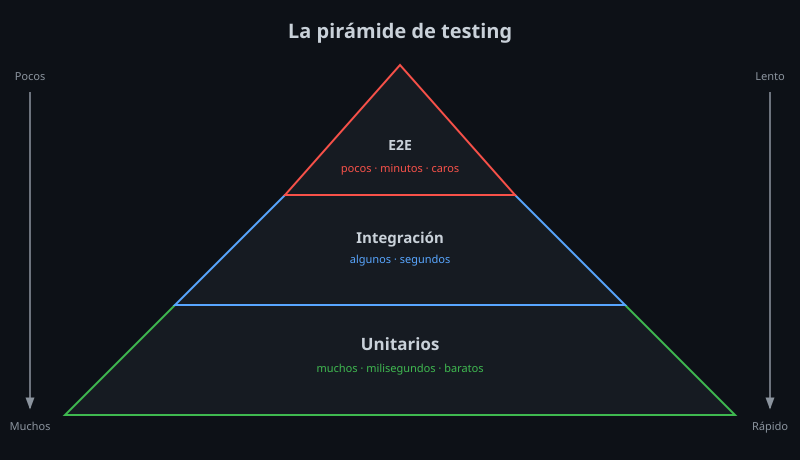

# 02 - La pirámide de testing y los niveles de prueba

> Transversal: sin código.

Un sistema se prueba a varias alturas: una función sola, varias piezas juntas, la aplicación entera como la usa una persona. Cada altura es un **nivel de prueba**, y la pirámide dice cuántos tests conviene tener de cada uno.

---

## 🎯 Objetivos

- Describir los cuatro niveles de prueba: unitario, integración, sistema (E2E) y aceptación.
- Explicar la forma de la pirámide de testing y el antipatrón del cono de helado.
- Decidir a qué nivel pertenece un test a partir de lo que usa.

---

## 1. Los cuatro niveles

### Unitario

Prueba la unidad más pequeña de código, una función o una clase, **aislada**: sin base de datos, sin red, sin archivos.

- Determinista: con las mismas entradas, siempre el mismo resultado.
- Rápido: milisegundos por test.
- Lo escribe quien escribe el código.

> `calculateDiscount(100, 20)` debe devolver `80`. El test comprueba ese contrato y nada más.

### Integración

Prueba **dos o más piezas juntas**: el código con una base de datos real, un cliente HTTP con un servidor, dos módulos que se pasan datos.

- Más lento: arranca o usa recursos reales.
- Encuentra los fallos en los bordes: una consulta SQL mal escrita, un JSON con un campo que el otro lado no espera.

> Guardar un usuario en PostgreSQL y leerlo de vuelta con los mismos datos.

En el bootcamp verás varios tipos: tests de repositorio (la capa de datos), tests de API (la respuesta HTTP) y tests contra servicios externos simulados.

### Sistema o E2E (*end to end*)

Prueba un **flujo completo** como lo hace el usuario: abre la aplicación, hace clic, rellena formularios.

- Usa todas las piezas: interfaz, servidor, base de datos.
- Lento y frágil: depende del navegador, de los tiempos de red y de cómo está hecha la página.
- Herramientas: Playwright ([semana 42](../../week-42-testing_end_to_end_con_playwright/README.md)), Cypress, Selenium.

> Abrir el navegador, iniciar sesión y comprobar que aparece el nombre del usuario en la barra superior.

### Aceptación

Comprueba que el sistema cumple los **criterios del negocio**, escritos en lenguaje natural para que los lea alguien que no programa. El formato más común es Gherkin (*Given / When / Then*), que verás con Behave y Cucumber en las semanas de BDD.

```gherkin
Dado que soy un usuario registrado
Cuando inicio sesión con credenciales válidas
Entonces veo mi panel de control
```

La diferencia con E2E no es la herramienta sino quién define el criterio: en aceptación, el negocio.

### Comparación

| | Unitario | Integración | E2E | Aceptación |
|---|---|---|---|---|
| Qué prueba | Una función o clase | Varias piezas juntas | Un flujo completo | Una regla del negocio |
| Velocidad | Milisegundos | Segundos | Segundos a minutos | Depende de cómo se implemente |
| Aislamiento | Total | Parcial | Ninguno | Ninguno |
| Quién lo escribe | Desarrollador | Desarrollador o QA | QA o SDET | QA con el negocio |
| Si falla, el problema está en | La lógica | La conexión entre piezas | El flujo | El requisito |

---

## 2. La pirámide



La pirámide reparte los tests en tres capas. De la base a la punta:

| Capa | Cuántos | Velocidad | Coste de mantenerlos |
|---|---|---|---|
| Unitarios | Muchos | Milisegundos | Bajo |
| Integración | Algunos | Segundos | Medio |
| E2E | Pocos | Minutos | Alto |

La forma sale de las tres columnas: lo barato y rápido se puede tener por cientos y ejecutar en cada cambio; lo caro y lento, solo para los flujos que más importan. No hay un porcentaje correcto: una librería de cálculo casi no tendrá E2E, y una tienda online necesitará más que una API interna.

La pirámide no tiene una capa de aceptación: un test de aceptación puede estar implementado como E2E, como test de API o como unitario, según lo que compruebe.

### El antipatrón: el cono de helado

Cuando un proyecto tiene más E2E que unitarios, la pirámide se invierte: es el **cono de helado**. Se reconoce por los síntomas:

- La suite tarda media hora o más en la CI.
- Un cambio pequeño rompe decenas de tests E2E, y nadie sabe cuál de ellos señala el problema real.
- El equipo deja de ejecutar los tests en su equipo y espera a la CI.

Suele pasar cuando las pruebas se automatizan al final, desde la interfaz, porque es lo único que el equipo de QA puede tocar. La salida es bajar cada comprobación al nivel más bajo que pueda detectarla.

---

## 3. Cómo decidir el nivel de un test

Pregunta qué usa el test, no cómo se llama:

1. ¿Abre un navegador o recorre la aplicación entera? **E2E.**
2. ¿Usa una base de datos, la red o el sistema de archivos reales, o junta varios módulos? **Integración.**
3. ¿Solo llama a una función con datos y mira lo que devuelve? **Unitario.**
4. ¿Su criterio lo escribió el negocio en lenguaje natural? Además, es de **aceptación**.

---

## ✅ Resumen

- Cuatro niveles: unitario, integración, sistema (E2E) y aceptación. Cada uno responde a una pregunta distinta.
- La pirámide pide muchos unitarios, algunos de integración y pocos E2E, porque así se reparten la velocidad y el coste.
- El cono de helado (más E2E que unitarios) hace la suite lenta y frágil.
- El nivel de un test lo decide lo que usa: navegador, recursos reales o solo una función.

<!-- nav -->
---

## 🔗 Navegación

| Anterior | Siguiente |
|---|---|
| ← [Teoría — 01 - Calidad de software y tipos de testing](01-calidad-y-tipos-de-testing.md) | [Teoría — 03 - El ciclo de vida del bug](03-ciclo-de-vida-del-bug.md) → |

[↑ Semana 01](../README.md)
