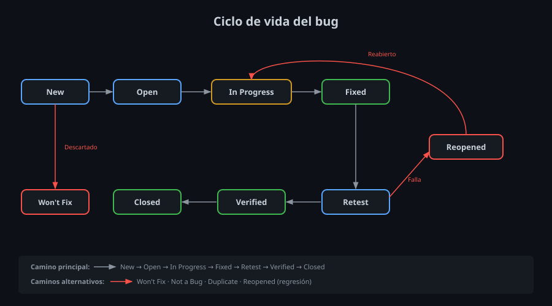

# 03 - El ciclo de vida del bug

> Transversal: sin código.

Encontrar un bug es la mitad del trabajo. La otra mitad es contarlo de forma que otra persona lo reproduzca sin preguntarte nada, y seguirlo hasta que la corrección esté comprobada.

---

## 🎯 Objetivos

- Distinguir error, defecto y fallo.
- Escribir un reporte de bug con todos sus campos.
- Distinguir severidad de prioridad y asignar las dos con una justificación.
- Seguir un bug por los estados de su ciclo de vida, incluidos los caminos alternativos.

---

## 1. Error, defecto y fallo

Tres palabras que se usan como sinónimos y no lo son:

| Término | Qué es | Ejemplo |
|---|---|---|
| **Error** | La equivocación de una persona | Para aplicar un 10 % de descuento, alguien escribe `price * 1.1` en lugar de `price * 0.9` |
| **Defecto** (*bug*) | Lo que esa equivocación deja en el código: la causa | La línea con `1.1` en `PriceCalculator.java` |
| **Fallo** (*failure*) | Lo que se ve cuando se ejecuta ese código: el efecto | El cliente paga un 10 % más en lugar de un 10 % menos |

Un error introduce un defecto, y el defecto produce un fallo cuando se ejecuta. Quien prueba ve fallos; quien corrige busca el defecto.

---

## 2. El reporte de bug

Un reporte de bug describe un fallo con la información suficiente para que otra persona pueda **reproducirlo**, **entender** qué debería pasar y **priorizarlo**.

| Campo | Qué lleva | Ejemplo |
|---|---|---|
| Título | `[Componente] Qué está mal` | `[Checkout] El cupón SAVE10 sube el total en lugar de bajarlo` |
| Pasos para reproducir | Numerados, concretos, desde un punto de partida conocido | 1. Inicia sesión. 2. Añade un producto de 50 €. 3. Aplica el cupón `SAVE10`. |
| Resultado obtenido | Lo que pasa, tal cual | El total pasa de 50,00 € a 55,00 € |
| Resultado esperado | Lo que debería pasar, concreto | El total pasa a 45,00 € |
| Severidad | Impacto en el sistema | High |
| Prioridad | Urgencia para el negocio | P1 |
| Entorno | Sistema operativo, navegador o app y su versión, dispositivo | Windows 11, Chrome 131, app v2.3.1 |
| Evidencia | Captura, vídeo, mensaje de error exacto, log | `checkout-cupon.png` |

Dos reglas que separan un reporte útil de uno que vuelve con preguntas:

- **El resultado obtenido describe, no diagnostica.** «El total pasa a 55,00 €» se puede comprobar; «el descuento está mal programado» es una hipótesis.
- **El resultado esperado es concreto.** «Que funcione» no dice qué es funcionar.

### El título

Es lo primero que se lee, y muchas veces lo único. Debe decir qué está mal y dónde:

| ❌ Título vago | ✅ Título útil |
|---|---|
| `Bug en login` | `[Login] El botón «Iniciar sesión» no responde en Safari 17` |
| `Error al guardar` | `[Perfil] Guardar cambios sin foto borra la foto que ya había` |
| `No funciona el pago` | `[Checkout] El pago con tarjetas Visa terminadas en 4242 devuelve «Error 500»` |
| `Problema con el texto` | `[Registro] El error de email inválido aparece en inglés con el idioma en español` |

---

## 3. Severidad y prioridad

- **Severidad:** cuánto daño hace el fallo al sistema. La evalúa quien prueba.
- **Prioridad:** cuándo hay que corregirlo. La decide el equipo, con el negocio.

| Severidad | Cuándo |
|---|---|
| Critical | El sistema no arranca, se pierden datos o se cobra mal |
| High | Una función principal no funciona y no hay forma de evitarlo |
| Medium | Falla una función secundaria, o la principal tiene un camino alternativo |
| Low | Cosmético: una errata, un desalineado |

| Prioridad | Cuándo |
|---|---|
| P1 | Hoy: bloquea a usuarios o al negocio |
| P2 | En este sprint |
| P3 | En los próximos sprints |
| P4 | Sin fecha: queda en el *backlog* |

Normalmente van juntas, pero no siempre:

- **Severidad alta, prioridad baja:** la exportación a un formato antiguo se cierra con un error, y la usan tres clientes que tienen otra forma de exportar.
- **Severidad baja, prioridad alta:** el logo sale deformado en la portada el día del lanzamiento.

Por eso cada una lleva su justificación.

---

## 4. El ciclo de vida

Un bug pasa por varios estados desde que se reporta hasta que se cierra. Cada cambio de estado tiene un responsable, y el historial queda registrado.



| Estado | Qué significa | Quién lo mueve ahí |
|---|---|---|
| New | Reportado, sin revisar | Quien lo encuentra |
| Open | Revisado y confirmado: está en la cola | QA lead o responsable de producto |
| In Progress | Alguien lo está corrigiendo | Desarrollador |
| Fixed | La corrección está hecha | Desarrollador |
| Retest | Quien probó comprueba la corrección | Tester |
| Verified | La corrección funciona | Tester |
| Closed | Cerrado | QA lead |
| Reopened | La corrección no funcionó, o el fallo volvió | Tester |

Camino principal:

```text
New → Open → In Progress → Fixed → Retest → Verified → Closed
                  ↑                    │
                  └──── Reopened ←─────┘  (la corrección no funciona)
```

Caminos alternativos desde **New**, al revisar el reporte:

| Estado | Cuándo |
|---|---|
| Duplicate | Ya hay un reporte del mismo fallo. Se cierra enlazando el original |
| Not a Bug | El sistema hace lo que debe: quien reportó esperaba otra cosa. Se cierra citando el requisito o la documentación |
| Won't Fix | Es un fallo real, pero no se va a corregir: poco impacto, coste alto o funcionalidad que se retira |
| Cannot Reproduce | Con los datos del reporte nadie consigue verlo. Vuelve a quien reportó para que añada información |

Los nombres cambian de una herramienta a otra, pero las preguntas son las mismas.

### Las herramientas

| Herramienta | Dónde se usa |
|---|---|
| Jira | Empresas con proyectos ágiles grandes |
| GitHub Issues | Junto al código; casi todos los proyectos de código abierto |
| Azure DevOps | Equipos que trabajan con Microsoft |
| Linear | Equipos pequeños de producto |

GitHub Issues solo tiene dos estados, abierto y cerrado. El resto del ciclo se representa con etiquetas (`severity: high`, `duplicate`) y con el motivo del cierre. Cuando abras un *issue* en un proyecto real, busca primero su plantilla de reporte: muchos la tienen en `.github/ISSUE_TEMPLATE/`.

---

## ✅ Resumen

- Error (la persona), defecto (el código) y fallo (lo que se ve) forman una cadena.
- Un reporte útil tiene título, pasos, obtenido, esperado, severidad, prioridad, entorno y evidencia, y describe sin diagnosticar.
- Severidad es el daño; prioridad, la urgencia. Pueden no coincidir, y cada una se justifica.
- Ciclo principal: New, Open, In Progress, Fixed, Retest, Verified, Closed; Reopened si la corrección falla.
- Desde New, un reporte puede acabar como Duplicate, Not a Bug, Won't Fix o Cannot Reproduce.

<!-- nav -->
---

## 🔗 Navegación

| Anterior | Siguiente |
|---|---|
| ← [Teoría — 02 - La pirámide de testing y los niveles de prueba](02-piramide-y-niveles.md) | [Índice de labs](../2-practicas/README.md) → |

[↑ Semana 01](../README.md)
