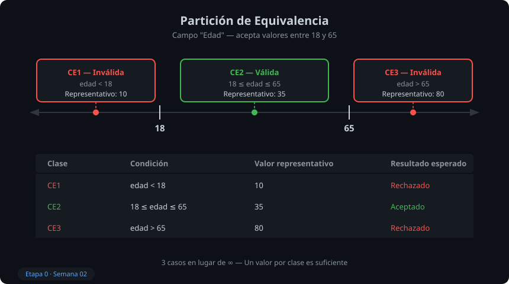
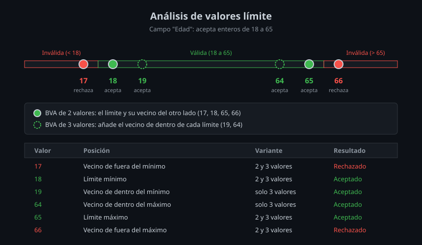

# 02 - Técnicas de diseño: partición, valores límite y tablas de decisión

> Transversal: sin código.

Un campo «edad» que acepta enteros de 18 a 65 admite miles de millones de entradas distintas si cuentas negativos, decimales y texto. No puedes probarlas todas. Las **técnicas de diseño** eligen pocas entradas que, si el sistema tiene un error, tienen muchas probabilidades de mostrarlo.

---

## 🎯 Objetivos

- Dividir las entradas de un campo en clases de equivalencia válidas e inválidas.
- Elegir los valores límite de un rango, con la variante de 2 y de 3 valores.
- Construir una tabla de decisión para reglas con varias condiciones y simplificarla.
- Combinar las tres técnicas en una suite sin casos repetidos.

---

## 1. Partición de equivalencia

### La idea

Una **clase de equivalencia** es un grupo de entradas que el sistema debería tratar igual. Si `35` se acepta, `36` también debería aceptarse: los dos pasan por la misma rama del código. Basta probar **un valor por clase**.

Las clases son **válidas** (el sistema debe aceptarlas) o **inválidas** (debe rechazarlas).



| Clase | Condición | Valor | Tipo |
|---|---|---|---|
| CE1 | edad < 18 | 10 | Inválida |
| CE2 | 18 ≤ edad ≤ 65 | 35 | Válida |
| CE3 | edad > 65 | 80 | Inválida |

### No solo rangos

Las clases salen de **cada regla** del campo, no solo del rango. Una contraseña «de 8 a 50 caracteres, solo letras y números» tiene más clases que las tres de longitud:

| Clase | Condición | Valor | Tipo |
|---|---|---|---|
| CE1 | 8 a 50 caracteres, letras y números | `Pass1234` | Válida |
| CE2 | menos de 8 caracteres | `abc12` | Inválida |
| CE3 | más de 50 caracteres | 60 veces `a` | Inválida |
| CE4 | contiene un símbolo | `Pass@123` | Inválida |
| CE5 | vacía | `""` | Inválida |

La vacía parece un caso de «menos de 8», pero muchos sistemas la tratan aparte (campo obligatorio) y con otro mensaje. Cuando el sistema puede tratar una entrada de otra forma, es otra clase.

### Una clase inválida por caso

Si un caso mete a la vez una edad inválida y un nombre inválido y el sistema rechaza el formulario, no sabes cuál de las dos reglas funcionó. Puede que la del nombre esté rota y la otra la tape.

- **Clases válidas:** se pueden combinar varias en un mismo caso.
- **Clases inválidas:** una por caso, con el resto de campos válidos.

---

## 2. Análisis de valores límite

### Por qué los límites

Los errores se concentran en los bordes. Quien programa «edad de 18 a 65» puede escribir `edad > 18` en lugar de `edad >= 18`, y el 18 queda rechazado. El 35 de la partición no detecta ese error; el 18 sí. Es el error **off-by-one** (por uno).

El **análisis de valores límite** (BVA, *Boundary Value Analysis*) prueba los valores en el borde de cada clase. Solo se aplica a datos **ordenados**: números, longitudes, fechas.

### Dos variantes

El temario ISTQB (CTFL 4.0) describe dos:

- **BVA de 2 valores:** el límite y su vecino del otro lado. Para el 18: el 17 y el 18.
- **BVA de 3 valores:** el límite y sus dos vecinos. Para el 18: el 17, el 18 y el 19.



| Valor | Posición | Esperado | Variante |
|---|---|---|---|
| 17 | vecino de fuera del mínimo | Rechazado | 2 y 3 valores |
| 18 | límite mínimo | Aceptado | 2 y 3 valores |
| 19 | vecino de dentro del mínimo | Aceptado | solo 3 valores |
| 64 | vecino de dentro del máximo | Aceptado | solo 3 valores |
| 65 | límite máximo | Aceptado | 2 y 3 valores |
| 66 | vecino de fuera del máximo | Rechazado | 2 y 3 valores |

La de 3 valores detecta más errores. Si el código dice `edad == 18 || (edad > 19 && edad <= 65)` por una errata, el 17 y el 18 se comportan bien y solo el 19 lo muestra. En este bootcamp se usa la de **3 valores** salvo que se diga otra cosa.

### Límites de longitud

En un texto, el valor ordenado es la longitud. Para la contraseña de 8 a 50 caracteres:

```text
7 caracteres   Rechazado
8 caracteres   Aceptado
9 caracteres   Aceptado
49 caracteres  Aceptado
50 caracteres  Aceptado
51 caracteres  Rechazado
```

Escribe el dato concreto en el caso, no solo la longitud: `Abcd123` (7) o `Abcd1234` (8). Para longitudes grandes, di cómo se construye: «`a` repetida 51 veces».

---

## 3. Partición y límites juntos

Las dos técnicas se aplican en este orden:

1. **Partición:** las clases de cada campo, un valor del interior de cada una.
2. **Límites:** en cada clase ordenada, los valores del borde.
3. **Quitar repetidos:** si un valor límite ya cubre una clase, no hace falta otro valor de esa clase.

Con la edad de 18 a 65:

| Técnica | Valores |
|---|---|
| Partición | 10, 35, 80 |
| Límites (3 valores) | 17, 18, 19, 64, 65, 66 |

El 17 está en la clase CE1 igual que el 10, y el 66 en CE3 igual que el 80. Si el tiempo aprieta, el 17 y el 66 cubren esas clases y el 10 y el 80 sobran. El 35 se queda: es el único valor del interior de la clase válida, lejos de los bordes.

Resultado: **7 casos** (17, 18, 19, 35, 64, 65, 66) para un campo que admite miles de millones de entradas.

---

## 4. Tablas de decisión

### Cuándo

La partición y los límites miran un campo cada vez. Cuando el resultado depende de **varias condiciones combinadas** (descuentos, tarifas, permisos), lo fácil es olvidar alguna combinación. La **tabla de decisión** las escribe todas.

### Ejemplo: descuento de una librería online

Las reglas, tal como llegan del negocio:

- Los clientes premium con compras de más de 50 € tienen un 30 %. El cupón no se suma.
- Los clientes premium con compras de 50 € o menos tienen un 20 % con cupón y un 10 % sin él.
- Los demás clientes tienen un 10 % con cupón y nada sin él, sea cual sea el importe.

Tres condiciones de sí o no dan 2 × 2 × 2 = **8 reglas**. Cada columna es una regla y un caso de prueba:

| Condición | R1 | R2 | R3 | R4 | R5 | R6 | R7 | R8 |
|---|---|---|---|---|---|---|---|---|
| Premium | S | S | S | S | N | N | N | N |
| Compra > 50 € | S | S | N | N | S | S | N | N |
| Cupón activo | S | N | S | N | S | N | S | N |
| **Descuento** | **30 %** | **30 %** | **20 %** | **10 %** | **10 %** | **0 %** | **10 %** | **0 %** |

Para rellenarla, empieza por la fila de premium (cuatro S y cuatro N), sigue con la de compra (dos S, dos N, repetido) y termina con el cupón (alternando). Así no repites ni te dejas ninguna combinación.

### Simplificar

Cuando dos reglas dan el mismo resultado y solo difieren en una condición, esa condición no importa para ellas. Se juntan en una y la condición se marca con `-`:

- R1 y R2: premium y más de 50 €, 30 % con cupón o sin él.
- R5 y R7: no premium con cupón, 10 % con cualquier importe.
- R6 y R8: no premium sin cupón, 0 % con cualquier importe.

| Condición | R1+R2 | R3 | R4 | R5+R7 | R6+R8 |
|---|---|---|---|---|---|
| Premium | S | S | S | N | N |
| Compra > 50 € | S | N | N | - | - |
| Cupón activo | - | S | N | S | N |
| **Descuento** | **30 %** | **20 %** | **10 %** | **10 %** | **0 %** |

De 8 casos a 5, sin dejar ninguna regla del negocio sin probar.

### Lo que la tabla encuentra

Al escribir la tabla, a veces una columna no tiene respuesta en el texto del negocio: «¿y un premium con cupón y más de 50 €, suma los dos descuentos?». Esa pregunta, hecha antes de programar, es un bug que no llega a existir. En el ejemplo la respuesta ya estaba («el cupón no se suma»); en el [lab 03](../2-practicas/lab-03-tabla-de-decision/README.md) no.

La «compra > 50 €» también es un rango: el 50,00 € y el 50,01 € son valores límite. Las técnicas se combinan.

---

## 5. Cuál usar

| Técnica | Cuándo | Qué encuentra | Qué no |
|---|---|---|---|
| Partición | Siempre, como base | Reglas que no se aplican a una clase entera | Errores en el borde |
| Valores límite | Campos ordenados: números, longitudes, fechas | Comparaciones mal escritas (`>` por `>=`) | Nada en campos sin orden, como un color |
| Tabla de decisión | Resultado que depende de varias condiciones | Combinaciones olvidadas y reglas que faltan | Crece al doble con cada condición: con 6 son 64 reglas |

---

## ✅ Resumen

- Partición: las entradas que el sistema trata igual forman una clase; se prueba un valor de cada una. Una clase inválida por caso.
- Valores límite: en los datos ordenados, se prueba el borde. La variante de 3 valores prueba el límite y sus dos vecinos.
- Tabla de decisión: cada combinación de condiciones es una regla y un caso; las reglas con el mismo resultado se juntan.
- Juntas, dan una suite pequeña que encuentra los errores más comunes.

<!-- nav -->
---

## 🔗 Navegación

| Anterior | Siguiente |
|---|---|
| ← [Teoría — 01 - El caso de prueba](01-casos-de-prueba.md) | [Teoría — 03 - Cobertura, suites y testing exploratorio](03-cobertura-y-tipos.md) → |

[↑ Semana 02](../README.md)
