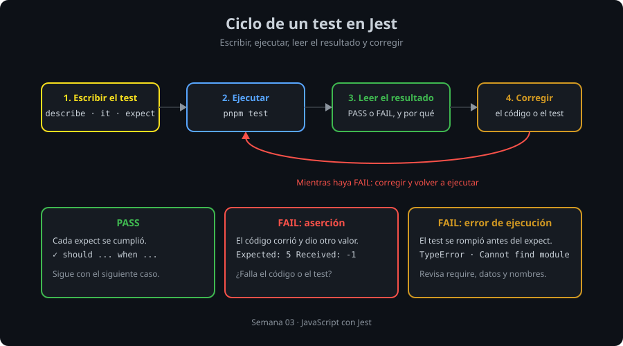

# 01 - Node.js, pnpm y Jest

> Lenguaje: JavaScript.

En la semana 2 escribiste casos que una persona ejecuta a mano. Un **test automatizado** es ese mismo caso escrito como código: lo ejecuta el ordenador, en milisegundos, tantas veces como quieras. Para escribirlos en JavaScript necesitas tres piezas: **Node.js** ejecuta el código, **pnpm** instala las librerías y **Jest** ejecuta los tests y te dice cuáles fallan.

---

## 🎯 Objetivos

- Instalar Node.js 22 y activar pnpm con corepack.
- Crear un proyecto con `package.json`, instalar Jest y entender por qué pnpm pide `pnpm-workspace.yaml`.
- Escribir un módulo, su primer test y ejecutarlo con `pnpm test`.
- Saber dónde busca Jest los tests y qué hace cuando no encuentra ninguno.

---

## 1. Node.js y pnpm

### Node.js

Node.js ejecuta JavaScript fuera del navegador. El curso usa la versión **22**, la LTS (soporte largo) activa. Instálala desde [nodejs.org/en/download](https://nodejs.org/en/download): elige la versión 22 y tu sistema, y la página te da los comandos. En Windows, trabaja dentro de WSL.

```bash
node -v
# v22.23.3
```

Cualquier `v22.algo` vale.

### pnpm con corepack

**pnpm** descarga las librerías (las **dependencias**) de tu proyecto. Es el único gestor de paquetes del curso: no uses npm ni yarn.

Node 22 trae **corepack**, una herramienta que instala el pnpm exacto que pide cada proyecto. Se activa una vez por equipo:

```bash
corepack enable pnpm
```

No muestra nada si todo va bien. A partir de aquí, cuando ejecutes `pnpm` dentro de un proyecto, corepack lee qué versión pide su `package.json` y la descarga la primera vez:

```text
! Corepack is about to download https://registry.npmjs.org/pnpm/-/pnpm-12.6.0.tgz
```

Te pregunta si quieres continuar: responde `Y`.

---

## 2. El proyecto

### Estructura

```text
mi-proyecto/
|-- package.json          # nombre, versión de pnpm, scripts y dependencias
|-- pnpm-workspace.yaml   # qué scripts de instalación se permiten
|-- pnpm-lock.yaml        # versiones exactas instaladas (lo crea pnpm)
|-- node_modules/         # las dependencias (lo crea pnpm; no se sube a git)
|-- src/
|   `-- calculator.js     # el código que pruebas
`-- tests/
    `-- calculator.test.js
```

### `package.json`

Crea la carpeta y, dentro, un `package.json` con este contenido:

```json
{
  "name": "mi-proyecto",
  "private": true,
  "packageManager": "pnpm@12.6.0",
  "scripts": {
    "test": "jest"
  }
}
```

| Campo | Qué | Para qué | Impacto |
|---|---|---|---|
| `private` | El proyecto no se publica | Evita subirlo por error al registro de paquetes | Ninguno en los tests |
| `packageManager` | Versión exacta de pnpm | Corepack la usa para que todo el equipo instale igual | Con otra versión, el lockfile puede cambiar |
| `scripts.test` | Comando que ejecuta `pnpm test` | Que todos lancen los tests igual | `pnpm test` llama a `jest` |

> `pnpm init` también crea un `package.json`, pero con campos que el curso no usa y una versión de pnpm distinta de la fijada. Por eso esta semana lo escribes a mano.

### Instalar Jest

```bash
pnpm add -D jest@30.5.2
```

- `add` instala una dependencia y la anota en `package.json`.
- `-D` la marca como **dependencia de desarrollo** (`devDependencies`): hace falta para probar, no para que el programa funcione.
- `@30.5.2` fija la versión. Las versiones del curso están en [stack-versions](../../../docs/stack-versions.md).

La primera vez termina con un error:

```text
devDependencies:
+ jest 30.5.2

Error: ERR_PNPM_IGNORED_BUILDS

  × adding a new package
  ╰─▶ Ignored build scripts: @parcel/watcher@2.6.0
  help: Run "pnpm approve-builds" to pick which dependencies should be allowed
        to run scripts.
```

Jest se ha instalado, pero una de sus dependencias, `@parcel/watcher`, trae un **script de compilación** (código que se ejecuta al instalar). pnpm 12 no ejecuta esos scripts sin tu permiso, y tampoco termina bien hasta que decides. pnpm ha creado un `pnpm-workspace.yaml` con la pregunta:

```yaml
allowBuilds:
  '@parcel/watcher': set this to true or false
```

Jest no necesita compilar ese paquete. Cambia el texto por `false`:

```yaml
allowBuilds:
  '@parcel/watcher': false
```

| Qué | Para qué | Impacto |
|---|---|---|
| Lista de dependencias que pueden ejecutar código al instalarse | Que ninguna librería ejecute nada en tu equipo sin que lo decidas | Con `false`, la instalación termina sin errores y Jest funciona igual |

Y vuelve a instalar:

```bash
pnpm install
# Lockfile is up to date, resolution step is skipped
# Already up to date
# Done in 58ms using pnpm v12.6.0
```

`package.json` tiene ahora una sección nueva:

```json
"devDependencies": {
  "jest": "30.5.2"
}
```

---

## 3. El primer test

### El módulo

`src/calculator.js`:

```javascript
function add(a, b) {
  return a + b;
}

function divide(a, b) {
  if (b === 0) {
    throw new Error("Division by zero");
  }
  return a / b;
}

module.exports = { add, divide };
```

`module.exports` dice qué funciones del archivo pueden usar otros archivos. Es el sistema de módulos **CommonJS**, el que Jest entiende sin configurar nada.

### El test

`tests/calculator.test.js`:

```javascript
const { add, divide } = require("../src/calculator");

describe("calculator", () => {
  it("should return 5 when adding 2 and 3", () => {
    // Arrange
    const a = 2;
    const b = 3;

    // Act
    const result = add(a, b);

    // Assert
    expect(result).toBe(5);
  });

  it("should throw an error when dividing by zero", () => {
    expect(() => divide(10, 0)).toThrow("Division by zero");
  });
});
```

- `require("../src/calculator")` carga lo que exporta el módulo. La ruta es relativa al archivo del test, sin `.js`.
- `describe`, `it` y `expect` no se importan: Jest los pone a disposición de cada archivo de test. La [teoría 02](02-estructura-test-jest.md) explica cada uno, y la [03](03-matchers-y-ejecucion.md), `toBe` y `toThrow`.

### Ejecutar



```bash
pnpm test
```

```text
$ jest
PASS tests/calculator.test.js
  calculator
    ✓ should return 5 when adding 2 and 3 (2 ms)
    ✓ should throw an error when dividing by zero (8 ms)

Test Suites: 1 passed, 1 total
Tests:       2 passed, 2 total
Snapshots:   0 total
Time:        0.211 s, estimated 1 s
Ran all test suites.
```

- `PASS` y el archivo: todos los tests de ese archivo pasaron.
- Una línea por test con `✓` y su nombre, agrupados por `describe`.
- **Test Suites** cuenta archivos de test; **Tests**, tests sueltos.

Si alguno falla, la línea dice `FAIL` y el test lleva `✕`. La [teoría 02](02-estructura-test-jest.md) explica cómo leer ese informe.

---

## 4. Dónde busca Jest

Jest busca en todo el proyecto (salvo `node_modules`) los archivos que terminan en `.test.js` o `.spec.js`, o que están en una carpeta `__tests__`. No hace falta configurarlo. En el curso, los tests van en `tests/` y terminan en `.test.js`.

Si no encuentra ninguno, termina con error:

```text
$ jest
No tests found, exiting with code 1
Run with `--passWithNoTests` to exit with code 0
  1 file checked.
  testMatch: **/__tests__/**/*.?([mc])[jt]s?(x), **/?(*.)+(spec|test).?([mc])[jt]s?(x) - 0 matches
  testPathIgnorePatterns: /node_modules/ - 1 match
  testRegex:  - 0 matches
Pattern:  - 0 matches
[ELIFECYCLE] Test failed. See above for more details.
```

`testMatch` son los patrones de nombre que acaba de probar: ningún archivo coincide.

---

## 5. Errores frecuentes

| Mensaje | Causa | Arreglo |
|---|---|---|
| `ERR_PNPM_IGNORED_BUILDS` | Falta decidir en `pnpm-workspace.yaml` si una dependencia ejecuta su script | Pon `false` en el paquete que nombra y ejecuta `pnpm install` |
| `No tests found, exiting with code 1` | Ningún archivo termina en `.test.js` | Revisa el nombre del archivo |
| `Your test suite must contain at least one test.` | El archivo existe pero no tiene ningún `it` | Escribe un test o descomenta el que hay |
| `Cannot find module '../src/maths' from 'tests/math.test.js'` | La ruta del `require` no existe | Corrige la ruta, relativa al archivo del test |

---

## ✅ Resumen

- Node.js 22 ejecuta el código; corepack instala el pnpm que pide `packageManager`; Jest ejecuta los tests.
- `pnpm add -D jest@30.5.2` instala Jest como dependencia de desarrollo con versión fija.
- `pnpm-workspace.yaml` dice qué dependencias pueden ejecutar scripts al instalarse; para Jest basta con `'@parcel/watcher': false`.
- `pnpm test` ejecuta el script `test` de `package.json`, y Jest busca los archivos `.test.js`.

<!-- nav -->
---

## 🔗 Navegación

| Anterior | Siguiente |
|---|---|
| ← [Semana 03 - Primeros Tests Automatizados con JavaScript](../README.md) | [Teoría — 02 - Estructura de un test: describe, it, expect y AAA](02-estructura-test-jest.md) → |

[↑ Semana 03](../README.md)
