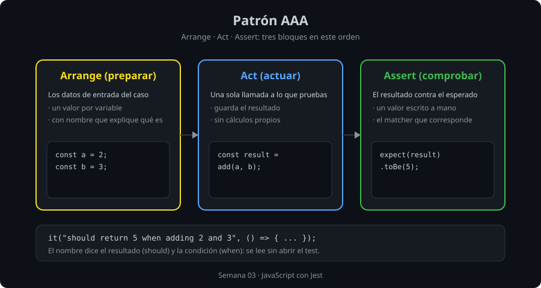

# 02 - Estructura de un test: describe, it, expect y AAA

> Lenguaje: JavaScript.

Un test es un caso de prueba de la semana 2 escrito en código. Tiene las mismas partes: unos datos, una acción y un resultado esperado. Jest les da forma con tres funciones, y el patrón AAA las ordena para que cualquiera lea el test sin preguntarte.

---

## 🎯 Objetivos

- Usar `describe`, `it` y `expect` y saber qué hace cada uno.
- Ordenar cada test en Arrange, Act y Assert.
- Poner nombres con el formato `should ... when ...`.
- Leer el informe de un test que falla.

---

## 1. Las tres piezas

```javascript
describe("calculator", () => {
  it("should return 5 when adding 2 and 3", () => {
    expect(add(2, 3)).toBe(5);
  });
});
```

| Función | Qué hace | Equivale en un caso manual a |
|---|---|---|
| `describe(nombre, fn)` | Agrupa tests. Su nombre aparece en el informe | El módulo o la funcionalidad |
| `it(nombre, fn)` | Define un test. La función contiene el caso | Un caso con su ID y título |
| `expect(valor).matcher(esperado)` | Comprueba el valor. Si no se cumple, el test falla | El resultado esperado |

`() => { ... }` es una **función flecha**: un bloque de código que Jest guarda y ejecuta cuando le toca. Por eso cada test va dentro de una.

`test` es otro nombre de `it`: hacen lo mismo. El curso usa `it`, porque se lee como una frase en inglés: *it should return 5 when adding 2 and 3*.

Los `describe` se pueden anidar, por ejemplo uno por función dentro del del módulo. La [semana 7](../../week-07-jest_avanzado_y_organizacion_de_suites/README.md) organiza suites grandes con ellos y con los *hooks* (`beforeEach` y compañía); esta semana basta con un nivel o dos.

---

## 2. Patrón AAA



| Bloque | Qué va | Del caso manual |
|---|---|---|
| **Arrange** (preparar) | Los datos de entrada, cada uno en una variable con nombre | Precondiciones y datos de prueba |
| **Act** (actuar) | Una sola llamada a lo que pruebas; el resultado se guarda | Los pasos |
| **Assert** (comprobar) | El `expect` con el valor esperado escrito a mano | Resultado esperado |

```javascript
it("should return 80 when price is 100 and percent is 20", () => {
  // Arrange
  const price = 100;
  const percent = 20;

  // Act
  const result = calculateDiscount(price, percent);

  // Assert
  expect(result).toBe(80);
});
```

Tres reglas:

- **Un Act por test.** Si llamas a dos funciones y el test falla, no sabes cuál. Es la misma idea que «una clase inválida por caso» de la [semana 2](../../week-02-casos_de_prueba_y_tecnicas_de_diseno/1-teoria/02-tecnicas-de-diseno.md).
- **El esperado se escribe a mano.** `expect(result).toBe(price - price * percent / 100)` repite la fórmula del código: si la fórmula está mal, el test también, y pasa.
- **Los comentarios son opcionales.** Cuando el test es de una línea (`expect(() => divide(10, 0)).toThrow(...)`), Act y Assert van juntos y los comentarios sobran. Lo que no cambia es el orden.

---

## 3. Nombres

El curso usa este formato:

```text
should <resultado esperado> when <condición>
```

| Mal | Bien |
|---|---|
| `test1` | `should return 5 when adding 2 and 3` |
| `works` | `should return false when email has no at sign` |
| `divide` | `should throw an error when dividing by zero` |
| `should validate age` | `should reject the visitor when age is 100` |

El nombre es lo único que ves en el informe cuando un test falla. Con un buen nombre sabes qué se ha roto sin abrir el archivo. Los nombres van en inglés, como el resto del código; los mensajes que muestra el sistema van en el idioma del usuario.

Un nombre con «and» (`should create the user and send an email`) suele ser dos tests.

---

## 4. Leer un test que falla

Con un bug en `add` (resta en lugar de sumar), `pnpm test` da:

```text
$ jest
FAIL tests/calculator.test.js
  calculator
    ✕ should return 5 when adding 2 and 3 (2 ms)
    ✓ should throw an error when dividing by zero (2 ms)

  ● calculator › should return 5 when adding 2 and 3

    expect(received).toBe(expected) // Object.is equality

    Expected: 5
    Received: -1

      11 |
      12 |     // Assert
    > 13 |     expect(result).toBe(5);
         |                    ^
      14 |   });
      15 |
      16 |   it("should throw an error when dividing by zero", () => {

      at Object.toBe (tests/calculator.test.js:13:20)

Test Suites: 1 failed, 1 total
Tests:       1 failed, 1 passed, 2 total
Snapshots:   0 total
Time:        0.281 s, estimated 1 s
Ran all test suites.
[ELIFECYCLE] Test failed. See above for more details.
```

Léelo de arriba abajo:

1. `FAIL` y `✕`: qué test falla. El otro sigue en verde: un fallo no para los demás.
2. `●` y la ruta `calculator › should return 5 ...`: los `describe` y el `it` del test.
3. `Expected` y `Received`: lo que pedía el test y lo que devolvió el código.
4. El trozo de código con `>`: la línea del `expect` que no se cumplió (`tests/calculator.test.js:13:20` es archivo, línea y columna).

Ahora decides: **¿está mal el código o el test?** Aquí el test pide lo que dice el requisito (2 + 3 es 5) y el código devuelve -1: es un bug del código. Si el esperado del test estuviera mal escrito, se corrige el test. Nunca cambies el esperado solo para que pase.

---

## 5. Rojo y verde

El primer test de una función conviene verlo fallar. Si escribes el test, lo ejecutas y pasa a la primera, no sabes si pasa porque el código está bien o porque el test no comprueba nada.

1. **Rojo:** el test falla por el motivo esperado (`Received: -1`).
2. **Verde:** corriges el código y el test pasa.

En el [lab 01](../2-practicas/lab-01-primer-proyecto-jest/README.md) lo haces con un bug real, y en el [lab 04](../2-practicas/lab-04-tests-que-mienten/README.md) rompes el código a propósito para ver qué tests lo notan. La [semana 11](../../week-11-tdd_con_jest/README.md) convierte este ciclo en método de trabajo (TDD).

---

## ✅ Resumen

- `describe` agrupa, `it` define un test y `expect` comprueba un valor.
- Arrange, Act, Assert: datos, una llamada, comprobación con el valor escrito a mano.
- `should <resultado> when <condición>`: el nombre explica el test en el informe.
- En un fallo, mira qué test, `Expected` frente a `Received` y la línea; después decide si el error está en el código o en el test.

<!-- nav -->
---

## 🔗 Navegación

| Anterior | Siguiente |
|---|---|
| ← [Teoría — 01 - Node.js, pnpm y Jest](01-setup-jest.md) | [Teoría — 03 - Matchers, errores y ejecución](03-matchers-y-ejecucion.md) → |

[↑ Semana 03](../README.md)
