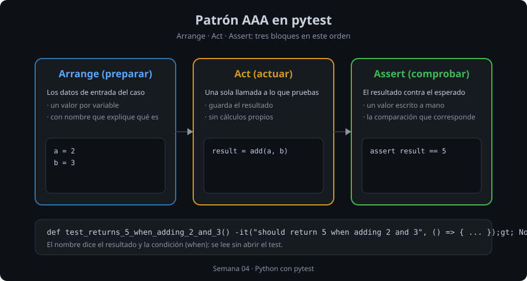

# 02 - Estructura de un test en pytest

> Lenguaje: Python.

El patrón AAA, los nombres que dicen resultado y condición, y el ciclo rojo-verde son los de la [semana 3](../../week-03-primeros_tests_automatizados_con_javascript/1-teoria/02-estructura-test-jest.md). Este documento muestra solo lo que cambia en pytest: cómo se escribe cada pieza y cómo se lee un fallo.

---

## 🎯 Objetivos

- Escribir un test de pytest como función `test_*` con `assert`.
- Agrupar tests en una clase `Test*`, el equivalente de `describe`.
- Nombrar los tests con `test_<resultado>_when_<condición>`.
- Leer un informe `FAILED` de pytest.

---

## 1. Las piezas

| Jest | pytest | Qué cambia |
|---|---|---|
| `it("...", () => { ... })` | `def test_...() -> None:` | El test es una función; su nombre es la descripción |
| `expect(result).toBe(5)` | `assert result == 5` | La comprobación es la palabra `assert` de Python |
| `describe("math", () => { ... })` | `class TestMath:` | Una clase agrupa tests; no hace falta para uno suelto |
| `require("../src/math")` | `from src.math_utils import add` | Se importa por nombre de módulo, sin ruta ni extensión |

`-> None` es la anotación de tipo que dice que la función no devuelve nada. pytest no la necesita, pero el curso la escribe en todos los tests.

### `assert`

`assert condición` no hace nada si la condición es verdadera y lanza `AssertionError` si es falsa. pytest captura ese error y marca el test como fallido. Es Python normal, no una función de pytest: por eso pytest no necesita matchers. La [teoría 03](./03-assertions-y-ejecucion.md) muestra qué condición escribir para cada tipo de valor.

### Clases para agrupar

```python
class TestIsEven:
    def test_returns_true_when_number_is_even(self) -> None:
        assert is_even(10) is True

    def test_returns_false_when_number_is_odd(self) -> None:
        assert is_even(7) is False
```

- La clase empieza por `Test` y no lleva `__init__`; si no, pytest la ignora.
- Cada método recibe `self`, el primer parámetro de todo método en Python. En estos tests no se usa.
- En el informe, la clase aparece en la ruta del test: `tests/test_math_utils.py::TestIsEven::test_returns_true_when_number_is_even`.

### `unittest`

Python trae su propio framework, [`unittest`](https://docs.python.org/3/library/unittest.html), al estilo de JUnit: una clase que hereda de `unittest.TestCase` y métodos `self.assertEqual(a, b)`. Lo verás en proyectos antiguos. pytest ejecuta esos tests sin cambios, así que no tienes que migrarlos para empezar a usar pytest. En el curso los tests nuevos se escriben con `assert`.

---

## 2. Patrón AAA



Igual que en la [semana 3](../../week-03-primeros_tests_automatizados_con_javascript/1-teoria/02-estructura-test-jest.md#2-patrón-aaa): preparar, actuar y comprobar, con un comentario en cada bloque y el esperado escrito a mano.

```python
def test_returns_80_when_price_is_100_and_percent_is_20() -> None:
    # Arrange
    price = 100
    percent = 20

    # Act
    result = calculate_discount(price, percent)

    # Assert
    assert result == 80
```

Cuando el resultado es un error, Act y Assert van juntos dentro de `with pytest.raises(...)`, como `expect(() => ...).toThrow()` en Jest:

```python
def test_raises_value_error_when_percent_is_greater_than_100() -> None:
    # Arrange
    price = 100
    percent = 120

    # Act + Assert
    with pytest.raises(ValueError, match="Invalid percent"):
        calculate_discount(price, percent)
```

---

## 3. Nombres

Python escribe los nombres de funciones en `snake_case`: minúsculas y guiones bajos. El nombre `should ... when ...` de Jest se convierte en:

```text
test_<resultado>_when_<condición>
```

| Jest | pytest |
|---|---|
| `should return 5 when adding 2 and 3` | `test_returns_5_when_adding_2_and_3` |
| `should throw an error when percent is greater than 100` | `test_raises_value_error_when_percent_is_greater_than_100` |
| `should return null when email is not in the list` | `test_returns_none_when_email_is_not_in_the_list` |

El nombre sale en el informe de cada fallo, así que tiene que bastar para entender qué se rompió sin abrir el archivo. Nombres como `test_1`, `test_add` o `test_ok` no lo consiguen.

---

## 4. Leer un test que falla

Con un `add` que resta en lugar de sumar, `uv run pytest` muestra:

```text
tests/test_math_utils.py F                                               [100%]

=================================== FAILURES ===================================
______________________ test_returns_5_when_adding_2_and_3 ______________________

    def test_returns_5_when_adding_2_and_3() -> None:
        # Arrange
        a = 2
        b = 3
    
        # Act
        result = add(a, b)
    
        # Assert
>       assert result == 5
E       assert -1 == 5

tests/test_math_utils.py:15: AssertionError
=========================== short test summary info ============================
FAILED tests/test_math_utils.py::test_returns_5_when_adding_2_and_3 - assert ...
============================== 1 failed in 0.06s ===============================
```

Léelo de arriba abajo:

1. **`F`**: una letra por test del archivo. `.` es un test que pasa y `F` uno que falla.
2. **El título** entre guiones bajos es el nombre del test.
3. **El código** del test, con `>` en la línea que falló.
4. **`E   assert -1 == 5`**: pytest vuelve a escribir el `assert` con los valores reales. A la izquierda lo que dio el código (`-1`), a la derecha lo que esperabas (`5`). Es el `Received` y el `Expected` de Jest, en el orden en que escribiste la comparación.
5. **`tests/test_math_utils.py:15`**: archivo y línea del `assert`.
6. **`short test summary info`**: una línea por test fallido, con su ruta completa (*node id*). Esa ruta sirve para ejecutar solo ese test ([teoría 03](./03-assertions-y-ejecucion.md#4-ejecutar-parte-de-la-suite)).

Para que el `-1` y el `5` salgan en su sitio, escribe siempre el resultado a la izquierda y el esperado a la derecha: `assert result == 5`.

¿Falla el código o el test? Igual que en la semana 3: si el esperado del test sale de la regla y está bien, el error está en el código.

---

## ✅ Resumen

- Un test es una función `test_*` con `assert`; una clase `Test*` agrupa tests como `describe`.
- AAA con comentarios; con errores, Act y Assert van dentro de `with pytest.raises(...)`.
- Nombres `test_<resultado>_when_<condición>` en `snake_case`.
- El informe reescribe el `assert` con los valores reales: resultado a la izquierda, esperado a la derecha.

<!-- nav -->
---

## 🔗 Navegación

| Anterior | Siguiente |
|---|---|
| ← [Teoría — 01 - Python, uv y pytest](01-setup-pytest.md) | [Teoría — 03 - Assertions, fallos y ejecución](03-assertions-y-ejecucion.md) → |

[↑ Semana 04](../README.md)
