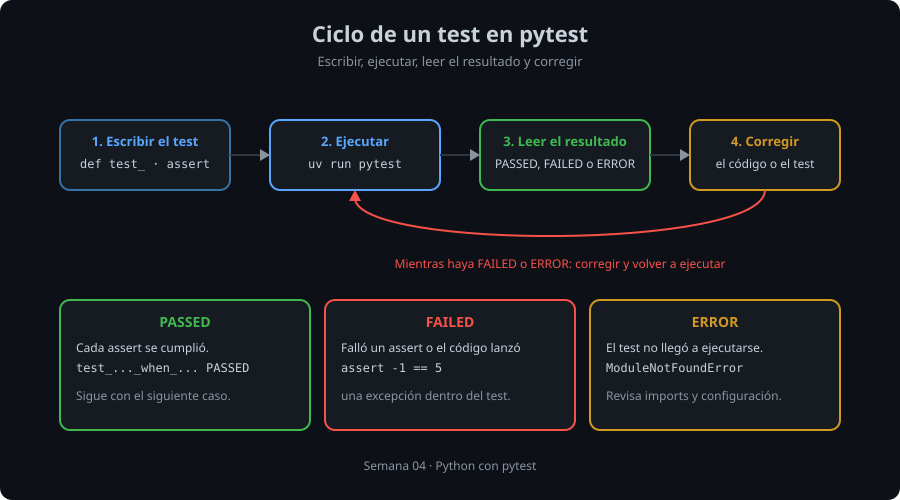

# 03 - Assertions, fallos y ejecución

> Lenguaje: Python.

En Jest elegías un matcher para cada tipo de valor. En pytest escribes una condición de Python después de `assert`. Este documento dice qué condición corresponde a cada matcher de la [semana 3](../../week-03-primeros_tests_automatizados_con_javascript/1-teoria/03-matchers-y-ejecucion.md), qué trampas son propias de Python y cómo ejecutar solo una parte de la suite.

---

## 🎯 Objetivos

- Escribir la comparación adecuada para textos, números, decimales, diccionarios, `None` y booleanos.
- Comprobar errores con `pytest.raises` y saber por qué `match` es una expresión regular.
- Distinguir `FAILED` de `ERROR` en un informe.
- Ejecutar un archivo, un test, los que contienen una palabra o los que fallaron la última vez.

---

## 1. Sin `assert` no hay comprobación

Igual que un test de Jest sin `expect`, un test sin `assert` pasa siempre:

```python
def test_no_assert() -> None:
    1 + 1 == 3
```

```text
tests/test_demo.py .                                                     [100%]
```

`1 + 1 == 3` calcula `False` y lo tira. Solo `assert` convierte un `False` en un fallo.

Python añade una trampa propia: el paréntesis.

```python
def test_tuple() -> None:
    assert (1 + 1 == 3, "la suma está mal")
```

Los paréntesis con una coma crean una **tupla** (una lista fija de valores) con dos elementos, y una tupla no vacía es siempre verdadera. El test pasa. pytest avisa al final del informe:

```text
PytestAssertRewriteWarning: assertion is always true, perhaps remove parentheses?
    assert (1 + 1 == 3, "la suma está mal")
```

El aviso solo sale la primera vez que pytest lee el archivo; en las ejecuciones siguientes usa una copia guardada en `__pycache__/` y no lo repite. Si quieres un mensaje propio, va sin paréntesis: `assert 1 + 1 == 3, "la suma está mal"`.

---

## 2. Qué escribir después de `assert`

### `==`: el mismo valor

`==` compara valores. Con textos y números funciona como `toBe`, y no convierte tipos:

```text
>       assert "5" == 5
E       AssertionError: assert '5' == 5
```

Con listas y diccionarios compara el contenido, como `toEqual`. En Python no hay que elegir entre `toBe` y `toEqual`: `==` hace las dos cosas. Si dos diccionarios no coinciden, pytest dice qué clave cambia:

```text
E       AssertionError: assert {'name': 'Ana...active': True} == {'name': 'Ana...ctive': False}
E         
E         Omitting 2 identical items, use -vv to show
E         Differing items:
E         {'active': True} != {'active': False}
E         Use -v to get more diff
```

### `pytest.approx`: decimales

El mismo problema de los decimales en binario que en JavaScript:

```text
>       assert 0.1 + 0.2 == 0.3
E       assert (0.1 + 0.2) == 0.3
```

`pytest.approx` acepta una diferencia pequeña:

```python
assert 0.1 + 0.2 == pytest.approx(0.3)  # pasa
```

La diferencia que acepta **no es la de `toBeCloseTo`**. Jest acepta, por defecto, cualquier valor que coincida en dos decimales. `pytest.approx` acepta una millonésima del esperado. Con un precio de 19,99 € y un 15 % de descuento el resultado es 16,9915:

```text
>       assert result == pytest.approx(16.99)
E       assert 16.9915 == 16.99 ± 1.7e-05
```

`toBeCloseTo(16.99)` habría pasado. `approx` absorbe el error de la representación binaria, no un redondeo que el código no hace. Escribe el esperado exacto que pide la regla:

```text
>       assert result == 26.91
E       assert 26.909999999999997 == 26.91
```

Con 29,90 € y un 10 %, el resultado exacto es 26,91, pero Python calcula `26.909999999999997`. `assert result == pytest.approx(26.91)` pasa. Usa `approx` siempre que el resultado venga de operar con decimales.

### `is None`, `is True`, `is False`

`None` es el «no hay valor» de Python, el `null` de JavaScript (Python no tiene `undefined`).

```python
assert result is None     # como toBeNull()
assert result is True     # como toBe(true)
assert result is False    # como toBe(false)
```

`is` comprueba que es exactamente ese objeto. Úsalo solo con `None`, `True` y `False`; para todo lo demás, `==`.

### `assert valor` a secas

`assert total` pasa con cualquier valor «verdadero»: cualquier número distinto de 0, cualquier texto no vacío. Es el `toBeTruthy` de Jest y tiene el mismo problema: con un número casi nunca comprueba nada. Escribe el valor esperado.

### `in` y `not`

```python
assert "@" in email                # contiene
assert "debug" not in message      # no contiene
assert result != 0                 # distinto
```

`not` es el `.not` de Jest.

### `pytest.raises`: errores

```python
with pytest.raises(ValueError, match="Division by zero"):
    divide(10, 0)
```

`with` abre un bloque: pytest comprueba que el código de dentro lanza un `ValueError`. Como en Jest con la función envoltorio, la llamada va **dentro** del bloque; si va fuera, el error se lanza antes de que `pytest.raises` pueda capturarlo.

Si no se lanza nada:

```text
>       with pytest.raises(ValueError):
             ^^^^^^^^^^^^^^^^^^^^^^^^^
E       Failed: DID NOT RAISE ValueError
```

Si se lanza un error de otro tipo, `pytest.raises` no lo captura y el test falla con ese error.

`match` no es un texto literal: es una **expresión regular**, un patrón en el que algunos caracteres tienen significado especial (`(`, `)`, `.`, `+`, `?`, `[`). pytest busca el patrón dentro del mensaje. Con paréntesis en el mensaje:

```python
with pytest.raises(ValueError, match="Invalid percent (0-100)"):
    check_percent(120)
```

```text
E       AssertionError: Regex pattern did not match.
E         Expected regex: 'Invalid percent (0-100)'
E         Actual message: 'Invalid percent (0-100)'
E        Did you mean to `re.escape()` the regex?
```

El texto es idéntico y aun así falla: `(0-100)` es un grupo del patrón, no los paréntesis del mensaje. Pon una `\` delante de cada carácter especial y escribe la cadena con `r` delante, para que Python no interprete la `\`:

```python
with pytest.raises(ValueError, match=r"Invalid percent \(0-100\)"):
    check_percent(120)
```

Con mensajes que solo tienen letras, espacios y tildes, como los del curso, no hace falta nada.

### Resumen de comparaciones

| Valor | Jest | pytest |
|---|---|---|
| Texto, entero | `toBe(5)` | `assert result == 5` |
| Lista, diccionario | `toEqual({...})` | `assert result == {...}` |
| Decimal calculado | `toBeCloseTo(26.91)` | `assert result == pytest.approx(26.91)` |
| Sin valor | `toBeNull()` | `assert result is None` |
| Booleano | `toBe(true)` | `assert result is True` |
| Contiene | `toContain("@")` | `assert "@" in result` |
| Error | `expect(() => f()).toThrow("msg")` | `with pytest.raises(ValueError, match="msg"): f()` |
| Negación | `.not.toBe(0)` | `assert result != 0` |

---

## 3. Dos tipos de fallo



pytest separa los fallos en dos palabras:

| Estado | Cuándo | Equivale en Jest a |
|---|---|---|
| `FAILED` | Algo falla **dentro** del test: un `assert` falso o una excepción del código | Fallo de aserción o error dentro de `it` |
| `ERROR` | El test **no llega a ejecutarse**: un import roto o un error de sintaxis en el archivo | `Test suite failed to run` |

Un `FAILED` que no viene de un `assert`:

```python
def test_type_error_in_test() -> None:
    price = "100"
    assert price * 20 / 100 == 20
```

```text
>       assert price * 20 / 100 == 20
               ^^^^^^^^^^^^^^^^
E       TypeError: unsupported operand type(s) for /: 'str' and 'int'

tests/test_demo.py:55: TypeError
FAILED tests/test_demo.py::test_type_error_in_test - TypeError: unsupported o...
```

La última palabra de la línea de archivo dice el tipo: `AssertionError` si el `assert` no se cumplió, cualquier otra (`TypeError`, `KeyError`) si el código se rompió antes de comparar.

Un `ERROR`, con un import que no existe:

```text
collected 0 items / 1 error

==================================== ERRORS ====================================
__________________ ERROR collecting tests/test_math_utils.py ___________________
...
E   ModuleNotFoundError: No module named 'src.math_util'
=========================== short test summary info ============================
ERROR tests/test_math_utils.py
!!!!!!!!!!!!!!!!!!!! Interrupted: 1 error during collection !!!!!!!!!!!!!!!!!!!!
=============================== 1 error in 0.13s ===============================
```

`collected 0 items / 1 error` e `Interrupted`: con un error de recolección pytest no ejecuta **ningún** test, tampoco los de otros archivos. Arregla los `ERROR` antes de mirar los `FAILED`.

---

## 4. Ejecutar parte de la suite

| Comando | Qué ejecuta |
|---|---|
| `uv run pytest tests/test_cart.py` | Un archivo |
| `uv run pytest tests/test_calculator.py::test_returns_5_when_adding_2_and_3` | Un test, por su ruta (*node id*) |
| `uv run pytest tests/test_visitor.py::TestAge` | Los tests de una clase |
| `uv run pytest -k email` | Los tests cuyo nombre contiene `email` (como `-t` en Jest) |
| `uv run pytest -x` | Toda la suite, pero se para en el primer fallo |
| `uv run pytest --lf` | Solo los que fallaron la última vez (*last failed*) |
| `uv run pytest -q` | Toda la suite, con el informe resumido |

Los argumentos van directos después de `pytest`: no hay `--` como en pnpm.

`-x` es útil cuando muchos tests fallan por la misma causa:

```text
FAILED tests/test_demo.py::test_text_vs_number - AssertionError: assert '5' == 5
!!!!!!!!!!!!!!!!!!!!!!!!!! stopping after 1 failures !!!!!!!!!!!!!!!!!!!!!!!!!!!
============================== 1 failed in 0.02s ===============================
```

`--lf` lee `.pytest_cache/`, donde pytest anota los fallos de cada ejecución:

```text
run-last-failure: rerun previous 7 failures (skipped 1 file)
```

pytest no trae modo watch. Con `--lf` y la flecha arriba de la terminal el ciclo es casi igual de corto.

---

## ✅ Resumen

- Sin `assert` no hay comprobación; `assert (condición, "mensaje")` siempre pasa.
- `==` sirve para valores y contenidos; `pytest.approx` para decimales; `is` solo con `None`, `True` y `False`.
- `pytest.approx` es mucho más estricto que `toBeCloseTo`: no tapa redondeos.
- `pytest.raises` envuelve la llamada; `match` es una expresión regular.
- `FAILED` es un fallo dentro del test; `ERROR`, un test que no llegó a ejecutarse.
- Ruta con `::`, `-k`, `-x` y `--lf` acotan qué se ejecuta.

<!-- nav -->
---

## 🔗 Navegación

| Anterior | Siguiente |
|---|---|
| ← [Teoría — 02 - Estructura de un test en pytest](02-estructura-test-pytest.md) | [Índice de labs](../2-practicas/README.md) → |

[↑ Semana 04](../README.md)
