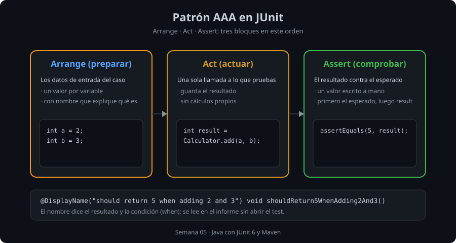

# 02 - Estructura de un test en JUnit 6

> Lenguaje: Java.

El patrón AAA, los nombres que dicen resultado y condición, y el ciclo rojo-verde son los de la [semana 3](../../week-03-primeros_tests_automatizados_con_javascript/1-teoria/02-estructura-test-jest.md) y la [semana 4](../../week-04-primeros_tests_automatizados_con_python/1-teoria/02-estructura-test-pytest.md). Este documento muestra solo lo que cambia en JUnit: cómo se escribe cada pieza y cómo se lee un fallo.

---

## 🎯 Objetivos

- Escribir un test de JUnit como método con `@Test` y `@DisplayName`.
- Agrupar tests con clases `@Nested`, el equivalente de `describe`.
- Nombrar los tests con `should<Resultado>When<Condición>`.
- Leer un fallo de Surefire sabiendo en qué orden van esperado y obtenido.

---

## 1. Las piezas

| Jest | pytest | JUnit 6 | Qué cambia |
|---|---|---|---|
| `it("...", () => { ... })` | `def test_...() -> None:` | `@Test void should...() { ... }` | El test es un método marcado con `@Test` |
| El texto de `it` | El nombre de la función | `@DisplayName("...")` | Texto libre aparte del nombre del método |
| `expect(result).toBe(5)` | `assert result == 5` | `assertEquals(5, result)` | Un método que recibe **primero el esperado** |
| `describe("math", ...)` | `class TestMath:` | `class CalculatorTest` y clases `@Nested` | Una clase de test por clase probada |
| `require("../src/math")` | `from src.math_utils import add` | Nada, mismo paquete | El test vive en el mismo paquete que el código |

### El método de test

```java
@Test
@DisplayName("should return 5 when adding 2 and 3")
void shouldReturn5WhenAdding2And3() {
    // ...
}
```

- `@Test` es una **anotación**: una etiqueta con `@` que JUnit busca para saber qué métodos son tests. Sin ella, el método no se ejecuta y nadie avisa.
- `void` dice que el método no devuelve nada. Un test nunca devuelve: comprueba.
- Ni la clase ni el método llevan `public`; JUnit no lo necesita. `private` sí rompe: JUnit no ejecuta el método y solo deja un aviso en mitad del informe:

```text
WARNING: TestEngine with ID 'junit-jupiter' encountered a non-critical issue during test discovery:

(1) [WARNING] @Test method 'private void com.bootcamp.CalculatorTest.shouldThrowAnErrorWhenDivisorIsZero()' must not be private. It will not be executed.
```

`Tests run: 1` en lugar de 2, y `BUILD SUCCESS`.

### `@DisplayName`

El nombre de un método no admite espacios, así que JUnit deja escribir aparte la frase de Jest. Los IDE, como IntelliJ o VS Code, muestran ese texto en su lista de tests. La consola de Surefire muestra el nombre del método, por eso los dos tienen que decir lo mismo.

### Las comprobaciones: `import static`

```java
import static org.junit.jupiter.api.Assertions.assertEquals;
```

`assertEquals` es un método `static` de la clase `Assertions` de JUnit. El `import static` deja llamarlo sin escribir la clase delante: `assertEquals(5, result)` en lugar de `Assertions.assertEquals(5, result)`. Cada comprobación que uses necesita su línea de `import static`.

### Agrupar con `@Nested`

Una clase de test por clase de código: `CalculatorTest` prueba `Calculator`. Dentro, cada grupo es una clase interna marcada con `@Nested`, como un `describe` dentro de otro:

```java
class CalculatorTest {

    @Nested
    @DisplayName("isEven")
    class IsEven {

        @Test
        @DisplayName("should return true when number is even")
        void shouldReturnTrueWhenNumberIsEven() {
            assertTrue(Calculator.isEven(10));
        }
    }
}
```

Surefire anuncia cada grupo con su `@DisplayName`: `Running isEven`. La [semana 25](../../week-25-junit_6_avanzado_y_assertj/1-teoria/02-nested-y-tags.md) saca más partido a `@Nested`; esta semana solo agrupa.

### JUnit 4 y JUnit Jupiter

JUnit 5 cambió todos los nombres de paquete y JUnit 6 los mantuvo: la parte con la que escribes tests se llama **JUnit Jupiter** en las dos versiones. En proyectos antiguos verás JUnit 4:

| JUnit 4 | JUnit 5 y 6 (Jupiter) |
|---|---|
| `import org.junit.Test;` | `import org.junit.jupiter.api.Test;` |
| `import static org.junit.Assert.assertEquals;` | `import static org.junit.jupiter.api.Assertions.assertEquals;` |
| `assertEquals("mensaje", 5, result)` | `assertEquals(5, result, "mensaje")` |
| `@Test(expected = X.class)` | `assertThrows(X.class, () -> ...)` |
| Clase y métodos `public` | Sin `public` |

Con solo `junit-jupiter` en el `pom.xml`, un `import org.junit.Test;` no compila (`cannot find symbol`). Si copias un ejemplo de internet, mira el `import` antes que nada.

---

## 2. Patrón AAA



Igual que en la [semana 3](../../week-03-primeros_tests_automatizados_con_javascript/1-teoria/02-estructura-test-jest.md#2-patrón-aaa): preparar, actuar y comprobar, con un comentario en cada bloque y el esperado escrito a mano.

```java
@Test
@DisplayName("should return 80 when price is 100 and percent is 20")
void shouldReturn80WhenPriceIs100AndPercentIs20() {
    // Arrange
    double price = 100;
    int percent = 20;

    // Act
    double result = UserUtils.calculateDiscount(price, percent);

    // Assert
    assertEquals(80, result);
}
```

Cada variable lleva su tipo delante (`double price`). Cuando el resultado es un error, Act y Assert van juntos: la llamada va dentro de `() -> ...`, como la función envoltorio de Jest:

```java
// Act + Assert
IllegalArgumentException error = assertThrows(
        IllegalArgumentException.class,
        () -> UserUtils.calculateDiscount(price, percent));
assertEquals("Invalid percent", error.getMessage());
```

La [teoría 03](./03-assertions-y-ejecucion.md#assertthrows-errores) explica `assertThrows` y la flecha `->`.

---

## 3. Nombres

Java escribe los métodos en `camelCase`: sin espacios, cada palabra empieza en mayúscula salvo la primera. El nombre de Jest se convierte en:

```text
should<Resultado>When<Condición>
```

| Jest | pytest | JUnit (método) |
|---|---|---|
| `should return 5 when adding 2 and 3` | `test_returns_5_when_adding_2_and_3` | `shouldReturn5WhenAdding2And3` |
| `should throw an error when percent is greater than 100` | `test_raises_value_error_when_percent_is_greater_than_100` | `shouldThrowAnErrorWhenPercentIsGreaterThan100` |
| `should return null when email is not in the list` | `test_returns_none_when_email_is_not_in_the_list` | `shouldReturnNullWhenEmailIsNotInTheList` |

El `@DisplayName` lleva la frase de Jest tal cual. Un número decimal no cabe en un nombre de método (`10.5` tiene un punto): escríbelo como `10Point5`.

---

## 4. Leer un test que falla

Con un `add` que resta en lugar de sumar, `mvn test` muestra:

```text
[INFO] Running com.bootcamp.CalculatorTest
[ERROR] Tests run: 1, Failures: 1, Errors: 0, Skipped: 0, Time elapsed: 0.040 s <<< FAILURE! -- in com.bootcamp.CalculatorTest
[ERROR] com.bootcamp.CalculatorTest.shouldReturn5WhenAdding2And3 -- Time elapsed: 0.025 s <<< FAILURE!
org.opentest4j.AssertionFailedError: expected: <5> but was: <-1>
	at org.junit.jupiter.api.AssertionFailureBuilder.build(AssertionFailureBuilder.java:158)
	...
	at com.bootcamp.CalculatorTest.shouldReturn5WhenAdding2And3(CalculatorTest.java:25)

[INFO] 
[INFO] Results:
[INFO] 
[ERROR] Failures: 
[ERROR]   CalculatorTest.shouldReturn5WhenAdding2And3:25 expected: <5> but was: <-1>
[INFO] 
[ERROR] Tests run: 1, Failures: 1, Errors: 0, Skipped: 0
[INFO] 
[INFO] ------------------------------------------------------------------------
[INFO] BUILD FAILURE
```

Léelo de arriba abajo:

1. **`Running`** y la línea `Tests run` de la clase: cuántos tests tiene y cuántos fallaron.
2. **`<<< FAILURE!`** con la ruta completa del método: qué test falló.
3. **`expected: <5> but was: <-1>`**: `expected` es lo que esperabas (`5`) y `but was`, lo que dio el código (`-1`).
4. **Las líneas `at`**: el camino que siguió el programa, de dentro afuera. Las primeras son de JUnit; busca la primera con `com.bootcamp`, tu archivo y línea: `CalculatorTest.java:25`.
5. **`Results`**: el resumen, una línea por fallo con `Clase.método:línea` y el mensaje. Si la suite es larga, empieza a leer por aquí.

### El esperado va primero

`assertEquals(esperado, obtenido)`: el orden es el contrario que en pytest (`assert result == 5`). JUnit no sabe cuál es cuál; se fía del orden. Si los cambias:

```java
int result = 2 - 3;
assertEquals(result, 5);
```

```text
DemoTest.reversedOrder:34 expected: <-1> but was: <5>
```

El informe dice que esperabas `-1` y el código dio `5`: justo al revés. Con el orden mal, el informe te manda a buscar el error donde no está. Escribe siempre `assertEquals(esperado, result)`.

Un tercer argumento opcional añade un mensaje propio, delante del fallo:

```text
DemoTest.messageArg:157 add should sum ==> expected: <5> but was: <-1>
```

¿Falla el código o el test? Igual que en la semana 3: si el esperado del test sale de la regla y está bien, el error está en el código.

---

## ✅ Resumen

- Un test es un método `void` con `@Test` y `@DisplayName`, sin `public` y nunca `private`.
- Las comprobaciones llegan con `import static org.junit.jupiter.api.Assertions.*`; los grupos, con clases `@Nested`.
- JUnit 5 y 6 comparten la API Jupiter; `org.junit.Test` es JUnit 4.
- AAA con comentarios; con errores, la llamada va dentro de `() -> ...`.
- Nombres `should...When...` en `camelCase`, y la frase completa en `@DisplayName`.
- `assertEquals(esperado, obtenido)`: el orden decide qué dice el informe.

<!-- nav -->
---

## 🔗 Navegación

| Anterior | Siguiente |
|---|---|
| ← [Teoría — 01 - JDK, Maven y JUnit 6](01-setup-junit.md) | [Teoría — 03 - Assertions, fallos y ejecución](03-assertions-y-ejecucion.md) → |

[↑ Semana 05](../README.md)
