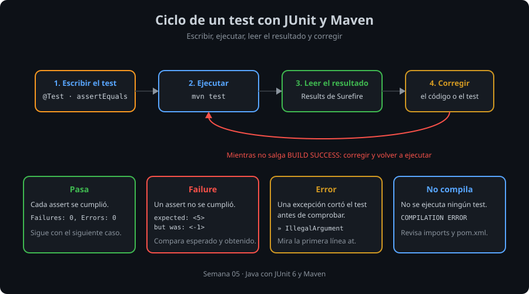

# 03 - Assertions, fallos y ejecución

> Lenguaje: Java.

En Jest elegías un matcher y en pytest una condición después de `assert`. En JUnit eliges un método de `Assertions`. Este documento dice cuál corresponde a cada matcher de la [semana 3](../../week-03-primeros_tests_automatizados_con_javascript/1-teoria/03-matchers-y-ejecucion.md) y a cada `assert` de la [semana 4](../../week-04-primeros_tests_automatizados_con_python/1-teoria/03-assertions-y-ejecucion.md), qué trampas para el compilador y cuáles no, y cómo ejecutar solo una parte de la suite.

---

## 🎯 Objetivos

- Elegir la comprobación adecuada para textos, números, decimales, objetos, `null` y booleanos.
- Comprobar errores con `assertThrows` y su mensaje.
- Distinguir `Failure`, `Error` y un error de compilación.
- Ejecutar una clase, un test o los que contienen una palabra.
- Escribir las primeras comprobaciones con AssertJ.

---

## 1. Lo que el compilador frena y lo que no

El tipado de Java detiene tres trampas de las semanas 3 y 4 antes de ejecutar nada:

| Trampa | En JavaScript o Python | En Java |
|---|---|---|
| Comparación suelta, sin comprobar | `total == 25` pasa sin hacer nada | `sum == 3;` no compila: `not a statement` |
| Comprobar un número como verdadero | `toBeTruthy()` o `assert total` pasan con 27 | `assertTrue(total)` no compila: `no suitable method found for assertTrue(double)` |
| Llamar fuera del envoltorio | El error salta antes de que nadie lo espere | `assertThrows(X.class, divide(10, 0))` no compila: pide `() -> ...` |

Lo que sí pasa en verde, como en los otros lenguajes:

```java
@Test
void noAssert() {
    int sum = 1 + 1;
    System.out.println(sum == 3);
}
```

```text
[INFO] Running com.bootcamp.DemoTest
false
```

El test imprime `false` en mitad del informe y pasa: imprimir no es comprobar. Y `assertTrue(total > 0)` compila y pasa con cualquier total positivo, como `toBeTruthy`.

---

## 2. Qué comprobación usar

### `assertEquals`: el mismo valor

Con enteros, textos, listas y mapas compara el contenido, como `toEqual` en Jest o `==` en Python:

```text
DemoTest.listEquals:97 expected: <[1, 2, 3]> but was: <[1, 2, 4]>
DemoTest.mapEquals:92 expected: <{active=false, name=Ana}> but was: <{active=true, name=Ana}>
```

Un texto y un número compilan juntos, pero nunca son iguales; el informe enseña el tipo de cada uno:

```text
DemoTest.textVsNumber:28 expected: java.lang.String@7203c7ff<5> but was: java.lang.Integer@49c66ade<5>
```

### Textos: nunca `==`

En Java, `==` entre textos pregunta si son **el mismo objeto**, no si tienen las mismas letras:

```java
String result = "  Ana ".strip();
assertTrue(result == "Ana");
```

```text
org.opentest4j.AssertionFailedError: expected: <true> but was: <false>
```

`strip()` crea un texto nuevo; tiene las letras de `"Ana"`, pero es otro objeto. Con `assertEquals("Ana", result)` pasa. Fíjate también en el mensaje: `assertTrue` solo sabe decir `true` o `false`, sin el valor que salió. Escribe siempre la comparación con `assertEquals`.

### Objetos: `record` sí, clase normal no

`assertEquals` llama al método `equals` del objeto. Un **`record`** (una clase que solo guarda datos, como un diccionario con campos fijos) trae un `equals` que compara campo a campo:

```java
public record User(String name, String email, boolean active) {}
```

```text
DemoTest.recordEquals:74 expected: <User[name=Ana, email=ana@example.com, active=false]> but was: <User[name=Ana, email=ana@example.com, active=true]>
```

Una clase normal sin `equals` propio solo es igual a sí misma. Dos objetos con el mismo contenido:

```text
DemoTest.plainClassEquals:86 expected: <com.bootcamp.DemoTest$PlainUser@cd1d761> but was: <com.bootcamp.DemoTest$PlainUser@68be8808>
```

Falla, y el informe ni siquiera enseña el contenido: `@cd1d761` es la dirección del objeto. En el curso, los datos van en `record`.

`assertSame` pregunta si son el mismo objeto, como `toBe` con objetos o `is` en Python:

```text
DemoTest.recordSame:80 expected: com.bootcamp.DemoTest$User@3d2ee678<User[name=Ana, email=ana@example.com, active=true]> but was: com.bootcamp.DemoTest$User@6179e425<User[name=Ana, email=ana@example.com, active=true]>
```

Mismo contenido, distinto objeto. No lo necesitarás esta semana.

### Decimales: `assertEquals` con delta

El mismo problema de los decimales en binario que en JavaScript y Python:

```text
DemoTest.doubleExact:39 expected: <0.3> but was: <0.30000000000000004>
```

Con `double`, `assertEquals` acepta un tercer número, el **delta**: la diferencia máxima que das por buena.

```java
assertEquals(0.3, 0.1 + 0.2, 0.0001);  // pasa
```

La diferencia con Jest y pytest es que **el delta lo eliges tú**. `toBeCloseTo` acepta dos decimales; `pytest.approx`, una millonésima. Con un precio de 19,99 € y un 15 % el resultado es 16,9915:

| Comprobación | Resultado |
|---|---|
| `assertEquals(16.99, result, 0.01)` | Pasa, como `toBeCloseTo(16.99)` |
| `assertEquals(16.99, result, 0.0001)` | `expected: <16.99> but was: <16.9915>`, como `pytest.approx` |

Un delta de `0.01` da por bueno un redondeo que el código no hace. Usa un delta muy por debajo del céntimo, `0.0001`, para absorber solo el error del binario:

```text
DemoTest.price2990Exact:62 expected: <26.91> but was: <26.909999999999997>
```

Con 29,90 € y un 10 % el resultado exacto es 26,91. Sin delta falla; con `assertEquals(26.91, result, 0.0001)` pasa.

### `assertNull`, `assertTrue`, `assertFalse`

```java
assertNull(result);    // como toBeNull() o is None
assertTrue(result);    // solo con un boolean
assertFalse(result);
```

```text
DemoTest.nullCheck:103 expected: <null> but was: <ana@example.com>
```

`null` es el «no hay valor» de Java, el `null` de JavaScript y el `None` de Python. `assertTrue` solo acepta un `boolean`, así que no hay *truthy* en Java: un `boolean` es `true` o `false`.

### Contiene y distinto

```java
assertTrue(email.contains("@"));   // contiene
assertNotEquals(0, result);        // distinto
```

### `assertThrows`: errores

```java
IllegalArgumentException error = assertThrows(
        IllegalArgumentException.class,
        () -> Calculator.divide(10, 0));
assertEquals("Division by zero", error.getMessage());
```

- `IllegalArgumentException.class` es el tipo de error esperado. `IllegalArgumentException` es el error de Java para «el argumento recibido no vale», el `ValueError` de Python.
- `() -> Calculator.divide(10, 0)` es una **lambda**, una función sin nombre: el `() => ...` de JavaScript con una flecha más corta. `assertThrows` la ejecuta dentro y captura lo que lance.
- `assertThrows` devuelve el error capturado. `getMessage()` lee su mensaje, que se comprueba con `assertEquals` aparte: `assertThrows` solo mira el tipo.

Si no se lanza nada:

```text
DemoTest.throwsNothing:113 Expected java.lang.IllegalArgumentException to be thrown, but nothing was thrown.
```

Si se lanza otro tipo de error:

```text
DemoTest.throwsOtherType:118 Unexpected exception type thrown, expected: <java.lang.IllegalStateException> but was: <java.lang.NumberFormatException>
```

Si el mensaje es otro:

```text
DemoTest.throwsWrongMessage:126 expected: <Invalid coupon> but was: <Invalid percent>
```

El mensaje se compara como texto exacto, sin expresiones regulares: los paréntesis no dan problemas, al revés que `match` en pytest.

### Resumen de comparaciones

| Valor | Jest | pytest | JUnit 6 |
|---|---|---|---|
| Texto, entero | `toBe(5)` | `assert result == 5` | `assertEquals(5, result)` |
| Lista, mapa, `record` | `toEqual({...})` | `assert result == {...}` | `assertEquals(esperado, result)` |
| Decimal calculado | `toBeCloseTo(26.91)` | `pytest.approx(26.91)` | `assertEquals(26.91, result, 0.0001)` |
| Sin valor | `toBeNull()` | `assert result is None` | `assertNull(result)` |
| Booleano | `toBe(true)` | `assert result is True` | `assertTrue(result)` |
| Contiene | `toContain("@")` | `assert "@" in result` | `assertTrue(result.contains("@"))` |
| Error | `expect(() => f()).toThrow("msg")` | `pytest.raises(ValueError, match="msg")` | `assertThrows(X.class, () -> f())` y `getMessage()` |
| Negación | `.not.toBe(0)` | `assert result != 0` | `assertNotEquals(0, result)` |

---

## 3. Tres formas de fallar



| Resultado | Cuándo | Equivale en pytest a |
|---|---|---|
| `Failure` | Una comprobación no se cumplió | `FAILED` con `AssertionError` |
| `Error` | El test lanzó una excepción antes de terminar | `FAILED` con otro error (`TypeError`) |
| `COMPILATION ERROR` | El código o los tests no compilan: no se ejecuta ninguno | `ERROR` de recolección |

Un `Error`:

```java
String price = "100";
int value = Integer.parseInt(price + "x");
```

```text
[ERROR] com.bootcamp.DemoTest.typeError -- Time elapsed: 0.001 s <<< ERROR!
java.lang.NumberFormatException: For input string: "100x"
...
[ERROR] Errors: 
[ERROR]   DemoTest.typeError:132 » NumberFormat For input string: "100x"
```

`<<< ERROR!` en lugar de `<<< FAILURE!`, y en `Results` va en su propio bloque `Errors`, con `»` y el tipo de excepción abreviado. Surefire cuenta los dos por separado: `Tests run: 26, Failures: 19, Errors: 1`.

Un error de compilación, con un `pom.xml` sin la dependencia de JUnit:

```text
[ERROR] COMPILATION ERROR : 
[INFO] -------------------------------------------------------------
[ERROR] /root/p/src/test/java/com/bootcamp/CalculatorTest.java:[3,36] package org.junit.jupiter.api does not exist
...
[INFO] 13 errors 
[INFO] -------------------------------------------------------------
[INFO] BUILD FAILURE
```

`[3,36]` es línea 3, columna 36. Arregla el **primer** error: los siguientes suelen ser consecuencia suya. Aquí, 13 errores con una sola causa.

---

## 4. Ejecutar parte de la suite

| Comando | Qué ejecuta |
|---|---|
| `mvn test -Dtest=CartTest` | Una clase |
| `mvn test -Dtest='CalculatorTest#shouldReturn5WhenAdding2And3'` | Un test, `Clase#método` |
| `mvn test -Dtest='UserUtilsTest#*Email*'` | Los tests de la clase cuyo nombre contiene `Email` (como `-t` en Jest o `-k` en pytest) |
| `mvn test -Dtest='*Visitor*'` | Las clases cuyo nombre contiene `Visitor` |
| `mvn -q test` | Toda la suite, escribiendo solo si algo falla |

- `-D` pasa una opción a Maven; `test` es el nombre de la opción de Surefire.
- Las comillas simples impiden que la terminal interprete `#` y `*`.
- `*` vale cualquier texto, y el filtro distingue mayúsculas: `UserUtilsTest#*email*` no encuentra `shouldReturnNullWhenEmailIsNotInTheList`.
- Si ninguna **clase** coincide, Maven termina en `BUILD FAILURE`: `No tests matching pattern "..." were executed!`. Si la clase coincide y ningún método, termina con `Tests run: 0` y `BUILD SUCCESS`. Mira siempre cuántos tests se ejecutaron.

Maven no trae modo watch ni un equivalente de `--lf`. Para repetir un test en rojo, copia su `Clase#método` de `Results` en `-Dtest`.

---

## 5. AssertJ: la comprobación como una frase

AssertJ es una librería aparte (ya está en el `pom.xml` del curso) que escribe la comprobación empezando por el valor obtenido:

```java
import static org.assertj.core.api.Assertions.assertThat;
import static org.assertj.core.api.Assertions.assertThatThrownBy;
```

| JUnit | AssertJ |
|---|---|
| `assertEquals(5, result)` | `assertThat(result).isEqualTo(5)` |
| `assertNull(result)` | `assertThat(result).isNull()` |
| `assertTrue(result)` | `assertThat(result).isTrue()` |
| `assertTrue(email.contains("@"))` | `assertThat(email).contains("@")` |
| `assertThrows` y `getMessage()` | `assertThatThrownBy(() -> ...).isInstanceOf(X.class).hasMessage("...")` |

Dos ventajas. El orden no se puede invertir: `assertThat` recibe el obtenido y `isEqualTo`, el esperado. Y los mensajes dicen más:

```text
DemoTest.assertjEquals:139 
expected: 5
 but was: -1
```

```text
Expecting message to be:
  "Invalid coupon"
but was:
  "Invalid percent"
```

Ojo con los dos `import static`: JUnit y AssertJ tienen una clase `Assertions`, y el `assertThat` que quieres es el de `org.assertj`. La [semana 25](../../week-25-junit_6_avanzado_y_assertj/1-teoria/04-assertj-y-soft-assertions.md) la usa a fondo; esta semana basta con `isEqualTo` y `assertThatThrownBy`.

---

## ✅ Resumen

- El compilador frena la comparación suelta, `assertTrue` con un número y la llamada fuera de la lambda; imprimir en lugar de comprobar sigue pasando en verde.
- `assertEquals(esperado, obtenido)` compara contenido en textos, listas, mapas y `record`; nunca `==` con textos.
- Con decimales, `assertEquals` con un delta que eliges tú: `0.0001`, no `0.01`.
- `assertThrows` con lambda comprueba el tipo; el mensaje, con `getMessage()`.
- `Failure` es una comprobación que no se cumplió; `Error`, una excepción; `COMPILATION ERROR`, ningún test ejecutado.
- `-Dtest=Clase#método` y comodines `*` acotan qué se ejecuta.
- AssertJ: `assertThat(obtenido).isEqualTo(esperado)` y `assertThatThrownBy`.

<!-- nav -->
---

## 🔗 Navegación

| Anterior | Siguiente |
|---|---|
| ← [Teoría — 02 - Estructura de un test en JUnit 6](02-estructura-test-junit.md) | [Índice de labs](../2-practicas/README.md) → |

[↑ Semana 05](../README.md)
