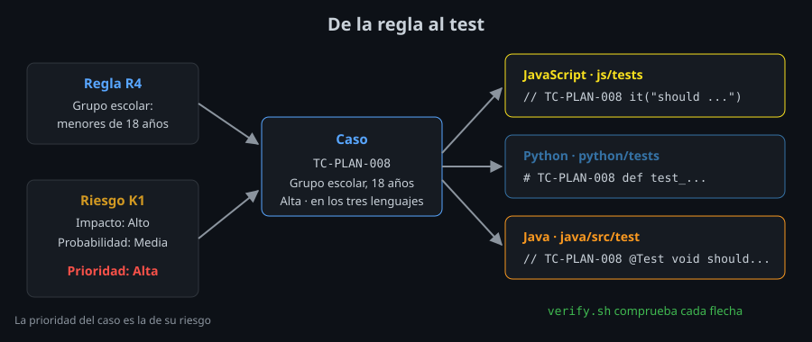

# 01 - Plan de pruebas y trazabilidad en tres lenguajes

> Repaso de la Etapa 0: lo que ya sabes de las semanas 1 a 5, puesto en un solo plan.

---

## 🎯 Objetivos

- Escribir un plan de pruebas con las secciones que vas a usar en el proyecto.
- Priorizar los casos por riesgo, con impacto y probabilidad.
- Seguir cada regla hasta su test en JavaScript, Python y Java, y comprobarlo con un script.
- Registrar lo que cambia entre los tres lenguajes cuando la regla es la misma.

---

## De tres proyectos a uno

En las semanas 3, 4 y 5 escribiste las mismas funciones y los mismos tests tres veces, cada vez en una carpeta propia. Esta semana los juntas en un solo proyecto:

```text
proyecto-semana-06/
|-- plan-de-pruebas.md   # qué se prueba, por qué y dónde está cada test
|-- verify.sh            # ejecuta las tres suites y compara la matriz con los tests
|-- js/                  # tu proyecto de la semana 3
|-- python/              # tu proyecto de la semana 4
`-- java/                # tu proyecto de la semana 5
```

Es la primera forma del repositorio que crece durante todo el curso ([proyecto hilo conductor](../../../docs/proyecto-hilo-conductor.md)): en la Etapa 1 crece `js/`, en la 2 `python/`, y así hasta el final.

Tener tres suites en verde no dice que prueben lo mismo. El plan es el documento que lo dice, y `verify.sh` el script que lo comprueba.

---

## El plan de pruebas

En la [semana 2](../../week-02-casos_de_prueba_y_tecnicas_de_diseno/1-teoria/03-cobertura-y-tipos.md#5-el-plan-de-pruebas) viste qué es un plan: qué se prueba, qué no, cómo y cuándo se da por terminado. El del curso tiene nueve secciones:

| Sección | Responde a | Ejemplo del planetario |
|---|---|---|
| 1. Alcance | Qué entra y qué queda **fuera**, con el motivo | Fuera: el formulario web, que se prueba en la etapa de E2E |
| 2. Reglas | Qué tiene que cumplir el sistema, con un ID por regla | R3: la edad es un entero de 5 a 99 |
| 3. Riesgos | Qué puede salir mal y cuánto importa | K1: un adulto entra con un grupo escolar |
| 4. Estrategia | En qué nivel y con qué herramientas se prueba | Tests unitarios en Jest, pytest y JUnit 6 |
| 5. Criterios de entrada y salida | Cuándo se puede empezar y cuándo se ha terminado | `./verify.sh` termina con código 0 |
| 6. Matriz de trazabilidad | Qué caso cubre cada regla y en qué lenguaje está automatizado | TC-PLAN-008, R4, Alta, ✅ ✅ ✅ |
| 7. Diferencias entre lenguajes | Qué casos no se pueden automatizar igual en los tres, y por qué | 12.5 no compila en Java |
| 8. Huecos encontrados | Qué faltaba al comparar el plan con los tests | Python no tenía el test de la edad 99 |
| 9. Evidencia de ejecución | La salida real que demuestra los criterios de salida | El final de `./verify.sh` |

**Declarar lo que queda fuera** evita que alguien dé por probado lo que nadie probó. Si una regla no tiene función todavía, no la inventes ni la dejes sin decir: va a «Fuera», con el motivo.

---

## Prioridad por riesgo

En la semana 2 cada caso llevaba una prioridad. Ahora sale de un **riesgo**: algo que puede fallar, con dos medidas.

- **Impacto**: cuánto daño hace si falla. Alto si afecta a la seguridad, al dinero o a la ley; Bajo si es una molestia.
- **Probabilidad**: cuánto se espera que falle. Alta en límites (`<` en lugar de `<=`), fechas y reglas que combinan campos; Baja en código que no cambia y ya tiene tests.

La prioridad sale de cruzar las dos:

| Impacto \ Probabilidad | Baja | Media | Alta |
|---|---|---|---|
| **Alto** | Media | Alta | Alta |
| **Medio** | Baja | Media | Alta |
| **Bajo** | Baja | Baja | Media |



Si todos los casos salen con prioridad Alta, la tabla no prioriza nada: revisa el impacto de cada uno. La prioridad de un caso es la del riesgo que cubre, y decide qué no puede faltar en ningún lenguaje.

---

## Trazabilidad hasta el test

En la semana 2 la matriz unía cada regla con sus casos. Esta semana llega un paso más lejos, hasta el test de cada lenguaje:

```text
R4  ->  TC-PLAN-008  ->  js/tests/visitor.test.js           // TC-PLAN-008
                     ->  python/tests/test_visitor.py        # TC-PLAN-008
                     ->  java/src/test/.../VisitorValidatorTest.java   // TC-PLAN-008
```

El enlace es el comentario con el ID encima de cada test, el mismo que pusiste en las semanas 3 a 5. La matriz tiene una columna por lenguaje:

```markdown
| Caso | Regla | Descripción | Prioridad | JS | Python | Java |
|---|---|---|---|---|---|---|
| TC-PLAN-008 | R4 | Grupo escolar con 18 años | Alta | ✅ | ✅ | ✅ |
| TC-PLAN-010 | R3 | Edad 12.5 | Media | ✅ | ✅ | — |
```

- **✅** significa «este caso tiene que estar automatizado en este lenguaje». La matriz dice lo que el plan exige, no lo que existe hoy.
- **—** significa «no se automatiza aquí», y el motivo va en la sección 7.

Con la matriz delante salen tres tipos de hueco:

| Hueco | Qué es | Cómo se arregla |
|---|---|---|
| Caso sin test | La matriz tiene ✅ pero el lenguaje no tiene ese ID | Escribir el test |
| Test sin caso | Un test sin ID, o con un ID que no está en la matriz (por ejemplo, `TC-PLAN-07`) | Poner el ID correcto o crear el caso en la matriz |
| Regla sin caso | Una regla de la sección 2 que ninguna fila cubre | Diseñar el caso con las técnicas de la semana 2 |

---

## Un comando para las tres suites

Leer tres carpetas a ojo para buscar huecos no escala. `verify.sh` es un script de bash que hace las dos cosas, en este orden:

1. Ejecuta `pnpm test`, `uv run pytest` y `mvn test`, cada uno en su carpeta.
2. Por cada lenguaje, compara los ID marcados con ✅ en la matriz con los ID que hay encima de los tests.

La primera línea útil del script es esta:

```bash
set -euo pipefail
```

| Opción | Qué hace | Sin ella |
|---|---|---|
| `-e` | El script se detiene en el primer comando que termina con un código distinto de 0 | Si Jest falla, el script sigue y termina con el código del último comando, que puede ser 0 |
| `-u` | Usar una variable que no existe es un error | Una variable mal escrita vale texto vacío sin avisar |
| `-o pipefail` | En `a \| b`, el código es el del primer comando que falla | `mvn test \| grep ...` termina con el código de `grep`, y un `BUILD FAILURE` pasaría |

Los códigos de salida son los de la [semana 3](../../week-03-primeros_tests_automatizados_con_javascript/1-teoria/03-matchers-y-ejecucion.md) y la [semana 4](../../week-04-primeros_tests_automatizados_con_python/1-teoria/03-assertions-y-ejecucion.md): 0 si todo pasa, otro número si algo falla. El lab 02 construye el script paso a paso. Cuando la matriz y los tests no coinciden, el final de su salida es así:

```text
== Trazabilidad
JavaScript: 8 tests, 8 con ID
  faltan en los tests: TC-PLAN-009 TC-PLAN-010
Python: 7 tests, 7 con ID
  faltan en los tests: TC-PLAN-006 TC-PLAN-007 TC-PLAN-009 TC-PLAN-010
  no están en la matriz: TC-PLAN-07
Java: 8 tests, 7 con ID
  faltan en los tests: TC-PLAN-008 TC-PLAN-009
  hay tests sin ID
FALLO: la matriz y los tests no coinciden
```

Las tres suites de ese ejemplo estaban en verde.

Un criterio de salida tiene que poder comprobarse así, con un comando o un número. «Cuando esté listo» o «los tests principales pasan» no se pueden comprobar; «`./verify.sh` termina con código 0» y «todos los casos de prioridad Alta tienen ✅ en los tres lenguajes» sí.

---

## Lo que cambia entre lenguajes

La regla es la misma, pero vive en tres implementaciones. Una mutación en `js/src/visitor.js` pone en rojo Jest, mientras pytest y JUnit siguen en verde porque prueban su propio código. Por eso cada caso necesita su test en los tres.

Y a veces la misma regla da veredictos distintos. Esto es lo que devuelve la validación del planetario de los labs con una edad de `5.0`:

```bash
node -e 'const { validateVisitor } = require("./src/visitor"); console.log(validateVisitor({ name: "Ana Ruiz", age: 5.0, schoolGroup: false }))'
# Visitante registrado

uv run python -c 'from src.visitor import validate_visitor; print(validate_visitor("Ana Ruiz", 5.0, False))'
# La edad debe ser un número entero de 5 a 99
```

En JavaScript `5.0` y `5` son el mismo número y `Number.isInteger(5.0)` es `true`; en Python `5.0` es un `float` y `isinstance(5.0, int)` es `False`. En Java la pregunta ni existe: `age` es un `int`.

Las diferencias que ya viste en las semanas 3 a 5, y que el plan registra en la sección 7 cuando afectan a un caso:

| Diferencia | JavaScript | Python | Java |
|---|---|---|---|
| Entero que llega con decimales (`5.0`) | Lo acepta: es `5` | Lo rechaza con `isinstance` | No compila con `int` |
| Booleano como número | `Number.isInteger(true)` es `false` | `isinstance(True, int)` es `True`: `bool` es una subclase de `int` | No compila con `int` |
| Decimales ([semana 4](../../week-04-primeros_tests_automatizados_con_python/1-teoria/03-assertions-y-ejecucion.md)) | `toBeCloseTo` con 2 dígitos acepta 16,9915 por 16,99 | `pytest.approx` lo rechaza | Depende del delta que elijas |
| Comparar textos ([semana 5](../../week-05-primeros_tests_automatizados_con_java/1-teoria/03-assertions-y-ejecucion.md#textos-nunca-)) | `toBe` | `==` | `assertEquals`, nunca `==` |
| Test pendiente | `it.todo` | `pytest.skip` | `@Disabled` |

Un caso que un lenguaje no puede expresar no es un hueco: es un — en la matriz con su motivo. Un caso que da otro veredicto en un lenguaje sí lo es: o es un bug, o la regla no estaba clara.

---

## ✅ Resumen

- El plan tiene nueve secciones; «Fuera» del alcance se declara con su motivo.
- La prioridad sale de cruzar impacto y probabilidad, no de la intuición.
- La matriz llega hasta el test de cada lenguaje: ✅ es lo que el plan exige, — lo que no se automatiza, con el motivo en la sección 7.
- `verify.sh` ejecuta las tres suites con `set -euo pipefail` y compara la matriz con los ID de los tests.
- Tres suites en verde pueden probar cosas distintas; la misma regla puede dar veredictos distintos.

<!-- nav -->
---

## 🔗 Navegación

| Anterior | Siguiente |
|---|---|
| ← [Semana 06 - Proyecto Integrador: Etapa 0](../README.md) | [Índice de labs](../2-practicas/README.md) → |

[↑ Semana 06](../README.md)
