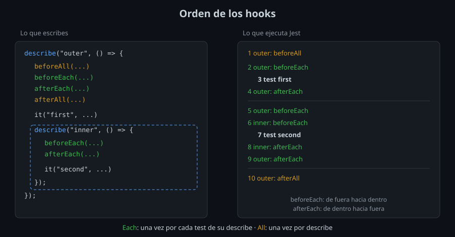

# 02 - Hooks y aislamiento entre tests

> `beforeEach` y compañía quitan la preparación repetida. Mal usados, hacen que un test dependa de otro.

---

## 🎯 Objetivos

- Usar `beforeEach`, `afterEach`, `beforeAll` y `afterAll`, y saber a qué tests afecta cada uno.
- Predecir el orden en que Jest ejecuta los hooks de varios `describe` anidados.
- Reconocer un test que depende del orden («pasa solo, falla en grupo») y detectarlo con `--randomize`.

---

## 1. La preparación repetida

Los diez tests del servicio de reservas empiezan igual:

```javascript
it("should take the seats from that session", () => {
  const service = createBookingService({ capacity: 10, clock: systemClock, notifier: silentNotifier });
  // ...
});
```

Diez copias de la misma línea. Si el servicio pide otro parámetro, hay que cambiar diez tests.

### El primer intento: subirla al `describe`

Lo primero que se le ocurre a casi todo el mundo es crear el servicio una vez, en el cuerpo del `describe`, y quitarlo de los tests:

```javascript
describe("createBookingService", () => {
  const service = createBookingService({ capacity: 10, clock: systemClock, notifier: silentNotifier });

  describe("book", () => {
    // los mismos tests, sin su primera línea
  });
});
```

```bash
pnpm test
# ✕ should take the seats from that session (3 ms)
# ✕ should throw when the seats do not fit
# ✕ should free its seats
# ✕ should return the capacity when there are no bookings (1 ms)
# ...
# Tests:       4 failed, 6 passed, 10 total
```

```text
● createBookingService › book › when the booking is valid › should take the seats from that session

  expect(received).toBe(expected) // Object.is equality

  Expected: 8
  Received: 6
```

Ahora los diez tests usan **el mismo** servicio. El primer test reservó 2 butacas, así que cuando el segundo reserva otras 2 quedan 6, no 8. Y si ejecutas ese test solo, pasa:

```bash
pnpm test -t "should take the seats"
# Tests:       9 skipped, 1 passed, 10 total
```

«Pasa solo y falla en grupo» es la señal de que los tests comparten estado. Cada test tiene que poder ejecutarse solo, en cualquier orden, y dar el mismo resultado: es lo que se llama **aislamiento**.

---

## 2. Los cuatro hooks

Un **hook** es una función que Jest ejecuta en un momento fijo, antes o después de los tests:

| Hook | Cuándo se ejecuta | Para qué |
|---|---|---|
| `beforeEach(fn)` | Antes de **cada** test de su `describe` | Preparar un estado nuevo para cada test |
| `afterEach(fn)` | Después de **cada** test de su `describe` | Deshacer lo que el test cambió fuera de él (los spies de la [teoría 03](03-dobles-de-prueba-basicos.md)) |
| `beforeAll(fn)` | Una vez, antes del primer test de su `describe` | Preparar algo caro que los tests solo leen |
| `afterAll(fn)` | Una vez, después del último test de su `describe` | Cerrar lo que abrió `beforeAll` |

La solución a la preparación repetida es `beforeEach`. La variable se declara con `let` en el `describe`, para que los tests la vean, y se asigna en el hook:

```javascript
describe("createBookingService", () => {
  let service;

  beforeEach(() => {
    service = createBookingService({ capacity: 10, clock: systemClock, notifier: silentNotifier });
  });

  describe("book", () => {
    // los mismos tests, sin su primera línea
  });
});
```

```bash
pnpm test
# Tests:       10 passed, 10 total
```

Cada test recibe un servicio recién creado, vacío. La preparación está escrita una vez y se ejecuta diez.

Si cambias `beforeEach` por `beforeAll`, vuelves al primer intento: un solo servicio para todos. Por eso `beforeAll` es solo para lo que los tests **no modifican**.

---

## 3. Orden y ámbito

Un hook afecta a los tests de su `describe` y de todos los `describe` que tiene dentro. Con dos niveles, el orden es este:



Es la salida real de un archivo de prueba que escribe una línea en cada hook (lo harás en el lab 02):

```text
outer: cuerpo del describe
inner: cuerpo del describe
outer: beforeAll
outer: beforeEach
    test first
outer: afterEach
outer: beforeEach
inner: beforeEach
    test second
inner: afterEach
outer: afterEach
outer: afterAll
```

Fíjate en las dos primeras líneas. Jest lee todo el archivo **antes** de ejecutar nada: recorre los `describe` para apuntar qué tests y qué hooks hay, y en ese recorrido ejecuta el cuerpo de cada `describe`. Por eso el servicio del primer intento se creaba una sola vez, antes de cualquier test. En el cuerpo de un `describe` solo van declaraciones (`let service;`), hooks, otros `describe` e `it`; la preparación va en un hook.

---

## 4. Desordenar para encontrar dependencias

Jest ejecuta los tests de un archivo en el orden en que están escritos. Un test que solo pasa porque otro se ejecutó antes puede estar años en verde. `--randomize` los desordena (y también los `describe`), y `--seed` fija la semilla del desorden para repetirlo:

```bash
pnpm test --randomize --seed=1
# ✓ should throw when the date is today (12 ms)
# ✓ should throw when the seats do not fit (1 ms)
# ✕ should return the booking with id 1 when it is the first one (2 ms)
# ...
# Seed:        1
# Tests:       5 failed, 5 passed, 10 total
```

Es la suite del primer intento. En el orden escrito, el test del id 1 pasaba porque era el primero; desordenado, falla, y cada semilla deja en rojo un grupo distinto:

| Semilla | Resultado |
|---|---|
| 1 | 5 failed, 5 passed |
| 4 | 4 failed, 6 passed |

Sin `--seed`, Jest elige una semilla al azar y la escribe en la línea `Seed:`. Si un desorden falla, esa semilla te deja repetirlo hasta arreglarlo. Con `beforeEach`, la suite pasa con cualquier semilla.

---

## ✅ Resumen

- Un test aislado da el mismo resultado solo, en grupo y en cualquier orden.
- `beforeEach` prepara un estado nuevo para cada test; `beforeAll` solo vale para lo que los tests no modifican.
- `afterEach` y `afterAll` deshacen lo que el test o el `beforeAll` dejaron cambiado fuera.
- Jest ejecuta el cuerpo de los `describe` antes que cualquier hook: la preparación nunca va ahí.
- `--randomize` desordena la suite; `--seed` repite un desorden concreto.

<!-- nav -->
---

## 🔗 Navegación

| Anterior | Siguiente |
|---|---|
| ← [Teoría — 01 - Organizar una suite por comportamiento](01-organizar-suites-por-comportamiento.md) | [Teoría — 03 - Dobles de prueba: stub, mock y spy](03-dobles-de-prueba-basicos.md) → |

[↑ Semana 07](../README.md)
