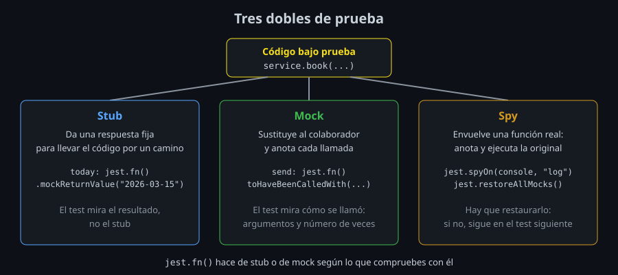

# 03 - Dobles de prueba: stub, mock y spy

> Cuando el código depende de algo que el test no controla (el reloj, el correo), se sustituye por un doble.

---

## 🎯 Objetivos

- Explicar por qué un servicio recibe sus colaboradores como parámetros.
- Sustituir el reloj por un **stub** para que un test no dependa del día en que se ejecuta.
- Comprobar con un **mock** que el servicio avisa a quien debe, y que no avisa cuando no debe.
- Observar una función real con un **spy** y restaurarla después.

---

## 1. Colaboradores

El servicio de reservas de los labs no hace todo solo. Pregunta la fecha a un reloj y avisa al visitante con un notificador:

```javascript
function createBookingService({ capacity, clock, notifier }) {
  // ...
  if (date <= clock.today()) {
    throw new Error("La sesión tiene que ser a partir de mañana");
  }
  // ...
  notifier.send(email, `Reserva ${booking.id} confirmada: ${seats} butacas el ${date}`);
}
```

`clock` y `notifier` son sus **colaboradores**. El servicio no los importa: los recibe como parámetros, y eso se llama **inyección de dependencias**. En la aplicación se le pasan los reales (`systemClock`, que lee la fecha del sistema, y `emailNotifier`, que envía el correo); en un test, lo que el test necesite.

Un **doble de prueba** es un objeto que ocupa el lugar de un colaborador durante el test, como el doble de un actor en una escena peligrosa. Hay varios tipos; esta semana usas tres.



---

## 2. Stub: una respuesta fija

Este test se escribió el 15 de marzo de 2026, con el reloj real:

```javascript
// Escrito el 15 de marzo de 2026, con todos los tests en verde.
const service = createBookingService({ capacity: 10, clock: systemClock, notifier: silentNotifier });

const booking = service.book({ name: "Ana Ruiz", email: "ana@example.com", seats: 2, date: "2026-03-16" });

expect(booking.date).toBe("2026-03-16");
```

Aquel día, el 16 de marzo era mañana y el test pasaba. Hoy:

```bash
pnpm test tests/booking-dates.test.js
# ✕ should accept the booking (2 ms)
# ✓ should throw (2 ms)
#
# ● createBookingService dates › when the session is tomorrow › should accept the booking
#
#   La sesión tiene que ser a partir de mañana
```

Nadie ha tocado el código. El test depende del día en que se ejecuta. Y el otro, `should throw` para una sesión de hoy, sigue en verde por otro motivo: el 15 de marzo ya no es hoy, es pasado.

Un **stub** es un doble que devuelve una respuesta fija, para llevar el código por el camino que quieres probar. El más sencillo es un objeto escrito a mano:

```javascript
const marchClock = { today: () => "2026-03-15" };
const service = createBookingService({ capacity: 10, clock: marchClock, notifier: silentNotifier });
```

Para este servicio, hoy es siempre el 15 de marzo de 2026, y el test da el mismo resultado cualquier día. El `silentNotifier` (`{ send() {} }`) que usan los tests de los labs también es un stub: no hace nada, y solo está para que el servicio tenga a quién llamar.

Jest tiene su propia forma de crear stubs, con `jest.fn()`, una función falsa:

```javascript
const clock = { today: jest.fn().mockReturnValue("2026-03-15") };
```

| Método | Qué devuelve la función falsa |
|---|---|
| `jest.fn()` | `undefined` |
| `.mockReturnValue(valor)` | `valor`, en cada llamada |
| `.mockReturnValueOnce(valor)` | `valor` en la siguiente llamada; después, lo anterior |
| `.mockImplementation(fn)` | Lo que devuelva `fn` con los mismos argumentos |

Con un stub, el test comprueba el **resultado** del código (la reserva, el error), no el stub.

---

## 3. Mock: comprobar las llamadas

Los tests de reservas usan `silentNotifier`, así que ninguno sabe si el visitante recibe su aviso. Un **mock** sustituye al colaborador y anota cada llamada, para que el test compruebe **cómo** se le llamó. `jest.fn()` lo hace siempre, aunque no lo mires:

```javascript
describe("createBookingService notifications", () => {
  let notifier;
  let service;

  beforeEach(() => {
    notifier = { send: jest.fn() };
    service = createBookingService({ capacity: 10, clock: { today: () => "2026-03-15" }, notifier });
  });

  describe("when the booking is valid", () => {
    it("should send one confirmation to the visitor", () => {
      service.book({ name: "Ana Ruiz", email: "ana@example.com", seats: 2, date: "2026-03-20" });

      expect(notifier.send).toHaveBeenCalledTimes(1);
      expect(notifier.send).toHaveBeenCalledWith("ana@example.com", "Reserva 1 confirmada: 2 butacas el 2026-03-20");
    });
  });
});
```

| Matcher | Pasa si la función falsa... |
|---|---|
| `toHaveBeenCalled()` | Se llamó al menos una vez |
| `toHaveBeenCalledTimes(n)` | Se llamó exactamente `n` veces |
| `toHaveBeenCalledWith(a, b)` | Se llamó **alguna vez** con esos argumentos, comparados como `toEqual` |
| `toHaveBeenLastCalledWith(a, b)` | La última llamada fue con esos argumentos |
| `.not.toHaveBeenCalled()` | No se llamó nunca |

Lo que **no** debe pasar se comprueba igual. Cuando la sesión está llena, el visitante rechazado no puede recibir una confirmación:

```javascript
describe("when the session is full", () => {
  it("should not send anything to the rejected visitor", () => {
    service.book({ name: "Ana Ruiz", email: "ana@example.com", seats: 6, date: "2026-03-20" });

    expect(() => service.book({ name: "Luis Gil", email: "luis@example.com", seats: 5, date: "2026-03-20" })).toThrow("No quedan butacas suficientes");

    // Solo el aviso de Ana: el de Luis no tiene que salir.
    expect(notifier.send).toHaveBeenCalledTimes(1);
  });
});
```

```text
● createBookingService notifications › when the session is full › should not send anything to the rejected visitor

  expect(jest.fn()).toHaveBeenCalledTimes(expected)

  Expected number of calls: 1
  Received number of calls: 2
```

Es un bug real del servicio de los labs, y los diez tests de reservas estaban en verde. Para ver las llamadas, `notifier.send.mock.calls` es la lista de los argumentos de cada una:

```javascript
console.log(notifier.send.mock.calls);
```

```text
console.log
  [
    [
      'ana@example.com',
      'Reserva 1 confirmada: 6 butacas el 2026-03-20'
    ],
    [
      'luis@example.com',
      'Reserva 2 confirmada: 5 butacas el 2026-03-20'
    ]
  ]
```

El servicio enviaba el aviso antes de comprobar si quedaban butacas. Luis recibe una confirmación de una reserva que no existe.

`notifier` se crea en el `beforeEach`. Una función falsa creada una vez en el `describe` acumularía las llamadas de todos los tests, y `toHaveBeenCalledTimes(1)` fallaría en el segundo: es el estado compartido de la [teoría 02](02-hooks-y-aislamiento.md).

---

## 4. Spy: observar la función real

A veces no quieres sustituir una función, solo saber si se llamó. `emailNotifier`, el notificador real, escribe el aviso en la consola:

```javascript
const emailNotifier = {
  send(to, message) {
    console.log(`Correo a ${to}: ${message}`);
  },
};
```

Para probarlo, el test necesita saber qué recibió `console.log`. `jest.spyOn(objeto, "método")` crea un **spy**: cambia el método del objeto por una función falsa que anota las llamadas y, además, ejecuta la original:

```javascript
it("should write the address and the message", () => {
  const log = jest.spyOn(console, "log");

  emailNotifier.send("ana@example.com", "Reserva 1 cancelada");

  expect(log).toHaveBeenCalledWith("Correo a ana@example.com: Reserva 1 cancelada");
});
```

El test pasa y el mensaje sale en el informe, porque la función original se ejecutó:

```text
console.log
  Correo a ana@example.com: Reserva 1 cancelada
```

Para que no se ejecute, encadena `.mockImplementation(() => {})`: el spy deja de llamar a la original y no escribe nada.

### Restaurar

El spy cambia `console.log` para todo el archivo, no solo para ese test. Si el test siguiente crea otro spy sobre `console.log`, Jest reutiliza el primero, con sus llamadas:

```text
● emailNotifier › send › should write one line per message

  expect(jest.fn()).toHaveBeenCalledTimes(expected)

  Expected number of calls: 1
  Received number of calls: 2
```

Por eso cada spy se restaura después de su test:

```javascript
afterEach(() => {
  // Devuelve a console.log su función original y borra las llamadas anotadas.
  jest.restoreAllMocks();
});
```

La otra opción es la configuración `"restoreMocks": true` en la sección `jest` de `package.json`, que hace lo mismo después de cada test de todos los archivos.

---

## 5. Cuándo no hace falta un doble

| Situación | ¿Doble? |
|---|---|
| Funciones puras como las de la semana 3 (`validateVisitor`, `cartTotal`) | No: reciben datos y devuelven un resultado |
| El código lee el reloj, el azar o algo que cambia entre ejecuciones | Stub |
| El código avisa, guarda o envía algo que el test tiene que comprobar | Mock |
| Quieres comprobar una llamada sin cambiar lo que hace la función real | Spy |
| El propio código que pruebas | Nunca: el test acabaría probando el doble |

Un doble es una suposición sobre cómo se comporta el colaborador real. Si te equivocas (el reloj real devuelve otra cosa, el correo pide otros argumentos), los tests pasan y la aplicación falla. La [semana 10](../../week-10-mocks_avanzados_en_jest/README.md) trata `jest.mock()`, que sustituye módulos enteros, y los tests frágiles por exceso de mocks.

---

## ✅ Resumen

- Un servicio que recibe sus colaboradores como parámetros se puede probar con dobles.
- Stub: respuesta fija (`mockReturnValue` o un objeto a mano); el test mira el resultado.
- Mock: anota las llamadas; el test comprueba argumentos y número de veces, también que no se llamó.
- Spy: `jest.spyOn` envuelve la función real; se restaura con `jest.restoreAllMocks()` en `afterEach`.
- Las funciones falsas se crean en `beforeEach`, como cualquier otro estado.

<!-- nav -->
---

## 🔗 Navegación

| Anterior | Siguiente |
|---|---|
| ← [Teoría — 02 - Hooks y aislamiento entre tests](02-hooks-y-aislamiento.md) | [Índice de labs](../2-practicas/README.md) → |

[↑ Semana 07](../README.md)
