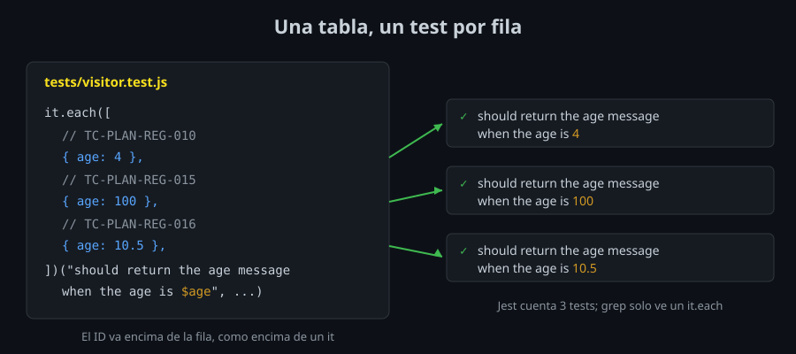

# 01 - Tablas de casos con `it.each`

> Cómo convertir varios tests que solo cambian de datos en una tabla, con un nombre que dice qué fila falla.

---

## 🎯 Objetivos

- Reconocer cuándo varios tests son el mismo test con otros datos.
- Escribir una tabla con `it.each`: de arrays, de objetos y de plantilla.
- Poner los datos de cada fila en el nombre del test y el ID del caso encima de la fila.
- Saber cuándo un test no va en una tabla.

---

## 1. Diecinueve tests casi iguales

En el [lab 03 de la semana 3](../../week-03-primeros_tests_automatizados_con_javascript/2-practicas/lab-03-de-casos-a-tests/README.md) escribiste un test por caso del formulario del planetario. Estos son dos de los ocho de `age`:

```javascript
// TC-PLAN-REG-010
it("should reject the visitor when age is 4", () => {
  const visitor = { ...validVisitor, age: 4 };

  const result = validateVisitor(visitor);

  expect(result).toBe(AGE);
});

// TC-PLAN-REG-015
it("should reject the visitor when age is 100", () => {
  const visitor = { ...validVisitor, age: 100 };

  const result = validateVisitor(visitor);

  expect(result).toBe(AGE);
});
```

Solo cambian tres cosas: el ID, el nombre y el número. Con 19 casos, el archivo tiene 189 líneas, y casi todas se repiten. Si mañana cambia el mensaje de la edad, hay que tocarlo en ocho sitios.

Lo que cambia son **datos**; lo que se repite es el **test**. Jest permite escribir el test una vez y darle una tabla con los datos.

---

## 2. `it.each` con arrays

`it.each(tabla)` devuelve una función que se llama como `it`, con el nombre y el cuerpo. Jest ejecuta el cuerpo una vez por fila y le pasa los valores de la fila como argumentos:

```javascript
it.each([
  ["A", NAME_LENGTH],
  ["a".repeat(49), REGISTERED],
])("should return the message when name is %s", (name, expected) => {
  expect(validateVisitor({ ...validVisitor, name })).toBe(expected);
});
```

| Parte | Qué es |
|---|---|
| `[["A", NAME_LENGTH], ...]` | La tabla: un array por fila. Cada fila es un test |
| `"... %s"` | El nombre. `%s` se sustituye por el primer valor de la fila, el siguiente `%s` por el segundo, y así |
| `(name, expected) => {...}` | El cuerpo. Recibe los valores de la fila en el mismo orden |

`it.each` y `test.each` son lo mismo, como `it` y `test`. Jest genera un test por fila:

```bash
pnpm test --verbose
#   arrays
#     ✓ should return the message when name is A (2 ms)
#     ✓ should return the message when name is aaaaaaaaaaaaaaaaaaaaaaaaaaaaaaaaaaaaaaaaaaaaaaaaa
```

Funciona, pero tiene dos problemas. El nombre de la segunda fila son 49 letras `a`, que nadie cuenta. Y en el cuerpo, el orden importa: si escribes `(expected, name)`, cada valor llega a la variable equivocada.

---

## 3. `it.each` con objetos

Si cada fila es un objeto, el cuerpo recibe el objeto y tomas sus campos por nombre. En el nombre del test, `$campo` se sustituye por el valor de ese campo:

```javascript
it.each([
  // TC-PLAN-REG-001
  { what: "1 character", name: "A", expected: NAME_LENGTH },
  // TC-PLAN-REG-006
  { what: "51 characters", name: "a".repeat(51), expected: NAME_LENGTH },
  // TC-PLAN-REG-007
  { what: "a digit", name: "Ana3", expected: NAME_LETTERS },
])("should return '$expected' when the name has $what", ({ name, expected }) => {
  const visitor = { ...validVisitor, name };

  const result = validateVisitor(visitor);

  expect(result).toBe(expected);
});
```

```bash
pnpm test --verbose
#       when the name is invalid
#         ✓ should return 'El nombre debe tener de 2 a 50 caracteres' when the name has 1 character
#         ✓ should return 'El nombre debe tener de 2 a 50 caracteres' when the name has 51 characters
#         ✓ should return 'El nombre solo admite letras y espacios' when the name has a digit
```

Tres cosas que ver:

- **Una columna para el nombre.** `what` no la usa el cuerpo: está para que el informe diga «51 characters» en lugar de 51 letras.
- **El orden no importa.** `({ name, expected })` toma los campos por nombre (es la *desestructuración* de objetos de JavaScript).
- **El ID va encima de la fila**, en una línea sola, igual que encima de un `it`. El `grep` de `verify.sh` de la [semana 6](../../week-06-plan_de_pruebas_y_suite_base_multilenguaje/README.md) lo encuentra igual.

Este es el formato que usa el curso: objetos, con el ID encima de cada fila.



---

## 4. Tabla de plantilla

Jest tiene una tercera forma, con una plantilla de texto (las comillas invertidas `` ` ``). La primera línea son los nombres de las columnas, separados por `|`, y cada fila lleva sus valores dentro de `${}`:

```javascript
it.each`
  age    | expected
  ${4}   | ${AGE}
  ${5}   | ${REGISTERED}
  ${99}  | ${REGISTERED}
  ${100} | ${AGE}
`("should return '$expected' when the age is $age", ({ age, expected }) => {
  expect(validateVisitor({ ...validVisitor, age })).toBe(expected);
});
```

```bash
pnpm test --verbose
#     age
#       ✓ should return 'La edad debe ser un número entero de 5 a 99' when the age is 4 (1 ms)
#       ✓ should return 'Visitante registrado' when the age is 5
#       ✓ should return 'Visitante registrado' when the age is 99
#       ✓ should return 'La edad debe ser un número entero de 5 a 99' when the age is 100
```

Se lee como una tabla, y el cuerpo recibe un objeto, como en la sección 3. El curso no la usa por una razón: todo lo que hay entre las comillas invertidas es texto para Jest, no código. Un comentario con el ID dentro de la plantilla no es un comentario de JavaScript, y depender de cómo trata Jest ese texto es frágil. Con objetos, el ID es un comentario normal.

---

## 5. Cuándo no hacer una tabla

Una tabla es para tests que comparten **la función, el contexto y el `expect`**. Antes de convertir, revisa:

| Situación | Qué hacer |
|---|---|
| Varios tests con el mismo `expect` y otros datos | Una tabla |
| Los mismos datos, pero cada test comprueba algo distinto (lo guardado, el aviso) | Tests separados |
| Una sola fila | Un `it`: una tabla de una fila solo añade líneas |
| Filas que necesitan un `if` en el cuerpo para decidir qué comprobar | Dos tablas, una por cada `expect` |

La última es la más común. Si el cuerpo empieza a tener `if (expected === REGISTERED)`, la tabla mezcla dos comportamientos: «se registra» y «se rechaza con este mensaje». Son dos contextos de la [semana 7](../../week-07-jest_avanzado_y_organizacion_de_suites/1-teoria/01-organizar-suites-por-comportamiento.md), cada uno con su tabla.

Con `describe.each` repites un grupo entero de tests para cada fila. Su nombre también admite `$campo`:

```javascript
describe.each([
  { schoolGroup: false },
  { schoolGroup: true },
])("when schoolGroup is $schoolGroup", ({ schoolGroup }) => {
  it.each([{ age: 5 }, { age: 17 }])("should register a visitor aged $age", ({ age }) => {
    expect(validateVisitor({ ...validVisitor, age, schoolGroup })).toBe(REGISTERED);
  });
});
```

```bash
#     when schoolGroup is false
#       ✓ should register a visitor aged 5
#       ✓ should register a visitor aged 17 (1 ms)
#     when schoolGroup is true
#       ✓ should register a visitor aged 5
#       ✓ should register a visitor aged 17
```

Dos filas por dos filas son cuatro tests. Úsalo con cuidado: las combinaciones crecen rápido, y muchas no son casos de tu plan.

---

## 6. Dos trampas del nombre

Si un campo del nombre no existe en la fila, Jest no da ningún error: deja el texto tal cual. Con un objeto `{ age: 5, expected: REGISTERED }` y este nombre, escrito con una errata:

```javascript
"should return $expectd when age is $age (%#)"
```

```bash
#     ✓ should return $expectd when age is $age (0) (1 ms)
```

Salen dos cosas a la vez:

- `$expectd` queda escrito tal cual: el campo no existe.
- `$age` tampoco se sustituye, aunque está bien escrito. `%#` es el número de la fila (empieza en 0), y al mezclar un `%` con `$campo`, Jest solo sustituye los `%`.

Usa una sola forma por nombre. Con objetos, `$campo`. Y si en el informe ves un `$` sin sustituir, el nombre tiene una errata.

---

## ✅ Resumen

- Los tests que solo cambian de datos son un test con una tabla: `it.each(tabla)(nombre, cuerpo)`.
- El curso usa filas de objetos: el cuerpo toma los campos por nombre y el ID va encima de cada fila.
- El nombre lleva los datos con `$campo`, y una columna solo para el nombre si el dato no se lee bien.
- Una tabla agrupa tests con el mismo `expect`. Un `if` en el cuerpo significa dos tablas.
- Un `$campo` que no existe aparece tal cual en el informe, y mezclar `%` con `$` desactiva los `$`.

<!-- nav -->
---

## 🔗 Navegación

| Anterior | Siguiente |
|---|---|
| ← [Semana 08 - Jest: Matchers Avanzados y Parametrización](../README.md) | [Teoría — 02 - Matchers de objetos y arrays](02-matchers-de-objetos-y-arrays.md) → |

[↑ Semana 08](../README.md)
