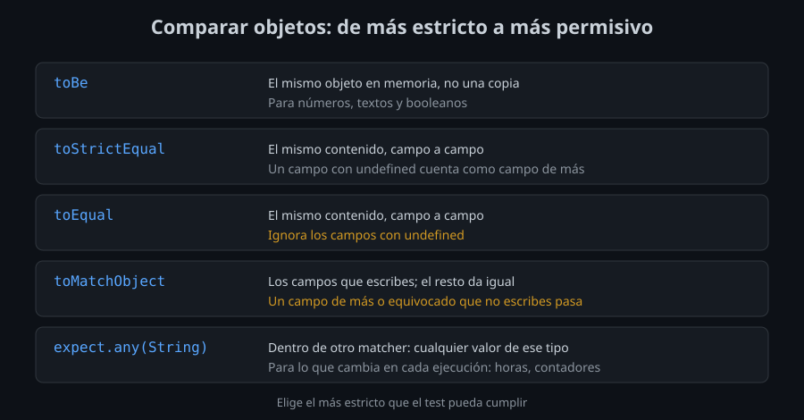

# 02 - Matchers de objetos y arrays

> Qué compara cada matcher cuando el resultado es un objeto o una lista, y cómo comprobar un campo que cambia en cada ejecución.

---

## 🎯 Objetivos

- Elegir entre `toEqual`, `toStrictEqual` y `toMatchObject` según lo que el test tiene que garantizar.
- Usar matchers asimétricos (`expect.any`, `expect.stringMatching`, `expect.objectContaining`) para los valores que no se pueden fijar.
- Comprobar arrays con `toHaveLength`, `toContain` y `toContainEqual`.

---

## 1. El objeto de esta teoría

Los ejemplos usan `createTicket` del [lab 02](../2-practicas/lab-02-matchers-de-objetos-y-arrays/README.md), que crea la entrada de un visitante del planetario para una sesión:

```javascript
createTicket({ name: "Ana Ruiz", age: 30, schoolGroup: false }, { date: "2026-12-05", room: "Cúpula" });
// {
//   code: 'PLAN-20261205-0001',
//   visitor: { name: 'Ana Ruiz', age: 30 },
//   session: { date: '2026-12-05', room: 'Cúpula' },
//   price: 9,
//   discount: undefined,
//   issuedAt: '2026-11-20T03:52:56.939Z'
// }
```

Tiene dos campos que no puedes escribir en el test: `code` lleva un contador que sube con cada entrada, e `issuedAt` es la hora en que se creó.

---

## 2. `toEqual` y `toStrictEqual`

En la [semana 3](../../week-03-primeros_tests_automatizados_con_javascript/1-teoria/03-matchers-y-ejecucion.md#toequal-el-mismo-contenido) viste que `toEqual` compara el contenido campo a campo, y que Jest sugería `toStrictEqual`. La diferencia está en los campos con `undefined`:

| Matcher | `{ price: 9, discount: undefined }` frente a `{ price: 9 }` |
|---|---|
| `toEqual` | Pasa: ignora los campos con `undefined` |
| `toStrictEqual` | Falla: `discount` es un campo de más |

¿Importa un campo con `undefined`? Depende de quién use el objeto. El recibo del planetario recorre todos los campos de la entrada con `Object.entries` y escribe una línea por campo:

```text
code: PLAN-20261205-0003
visitor: {"name":"Ana Ruiz","age":30}
session: {"date":"2026-12-05","room":"Cúpula"}
price: 9
discount: undefined
issuedAt: 2026-11-20T03:53:30.767Z
```

Para `toEqual`, la entrada es correcta. Para el visitante, el recibo tiene una línea `discount: undefined`. `toStrictEqual` lo encuentra:

```text
    expect(received).toStrictEqual(expected) // deep equality

    - Expected  - 0
    + Received  + 1

    @@ -1,7 +1,8 @@
      Object {
        "code": StringMatching /^PLAN-20261205-\d{4}$/,
    +   "discount": undefined,
        "issuedAt": Any<String>,
        "price": 9,
```

`- Expected` son las líneas que esperabas y no llegaron; `+ Received`, las que llegaron y no esperabas. Aquí hay una línea de más: el campo `discount`.

`toStrictEqual` también distingue un objeto creado con una clase de un objeto literal con los mismos campos. Para comparar un objeto entero, empieza por `toStrictEqual`: si pasa, el objeto no tiene nada de más.

---

## 3. Campos que cambian: matchers asimétricos

Si escribes la hora en el test, falla en cada ejecución:

```text
    -   "issuedAt": "2026-11-19T10:00:00.000Z",
    +   "issuedAt": "2026-11-20T03:53:14.298Z",
```

En la [semana 7](../../week-07-jest_avanzado_y_organizacion_de_suites/1-teoria/03-dobles-de-prueba-basicos.md) resolviste algo parecido con un stub del reloj. Aquí la función no recibe el reloj, y la hora exacta no es lo que quieres probar: solo que hay una hora. Para eso están los **matchers asimétricos**, que se ponen en el lugar de un valor dentro de otro matcher:

| Matcher | Acepta |
|---|---|
| `expect.any(String)` | Cualquier texto. También `Number`, `Array` o una clase tuya |
| `expect.anything()` | Cualquier valor salvo `null` y `undefined` |
| `expect.stringMatching(/^PLAN-\d{8}-\d{4}$/)` | Un texto que cumple la expresión regular |
| `expect.stringContaining("Cúpula")` | Un texto que contiene ese trozo |
| `expect.objectContaining({ price: 5 })` | Un objeto con esos campos, tenga los que tenga además |
| `expect.arrayContaining([5, 6, 9])` | Un array con esos elementos, en cualquier orden y con otros además |

Se llaman asimétricos porque solo funcionan en un lado: van en lo esperado, nunca en lo recibido.

```javascript
expect(ticket).toStrictEqual({
  code: expect.stringMatching(/^PLAN-20261205-\d{4}$/),
  visitor: { name: "Ana Ruiz", age: 30 },
  session: { date: "2026-12-05", room: "Cúpula" },
  price: 9,
  issuedAt: expect.any(String),
});
```

El resto del objeto se compara exacto. En la expresión regular, `^` y `$` son el principio y el final del texto, y `\d{4}` son cuatro dígitos.

¿Por qué no `"PLAN-20261205-0001"`? Porque el contador es del módulo y sigue subiendo entre tests. Un test que espera `0001` pasa solo y falla con otros delante, el mismo problema de estado compartido de la [semana 7](../../week-07-jest_avanzado_y_organizacion_de_suites/1-teoria/02-hooks-y-aislamiento.md):

```bash
pnpm test tests/ticket.test.js
#     Expected: "PLAN-20261205-0001"
#     Received: "PLAN-20261205-0002"
pnpm test tests/ticket.test.js -t "second"
# Tests:       1 skipped, 1 passed, 2 total
```

---

## 4. Comprobar solo una parte

A veces el test trata de un campo, y el resto ya lo prueba otro test:

```javascript
expect(ticket).toMatchObject({ price: 6.75, discount: { code: "COMETA", percent: 25 } });
expect(ticket).toHaveProperty("session.room", "Cúpula");
```

| Matcher | Qué comprueba |
|---|---|
| `toMatchObject(parcial)` | Que el objeto tiene esos campos con esos valores. Los demás dan igual |
| `toHaveProperty("a.b", valor)` | Que existe el campo de esa ruta y, si lo pasas, que tiene ese valor |

Son cómodos y también permisivos. El test del precio sin descuento con `toMatchObject({ price: 9 })` pasa con el `discount: undefined` de la sección 2: no lo mira. Usa `toMatchObject` cuando el test trata de esos campos, y deja que otro test compruebe el objeto entero con `toStrictEqual`.



---

## 5. Arrays

| Matcher | Qué comprueba |
|---|---|
| `toHaveLength(3)` | El número de elementos |
| `toContain(5)` | Que hay un elemento igual con `===`: números, textos |
| `toContainEqual(objeto)` | Que hay un elemento igual campo a campo: objetos |
| `toEqual([...])` | El array entero, en orden |

`toContain` con un objeto no sirve: compara con `===`, y un objeto escrito en el test nunca es el mismo que el del array. Para objetos, `toContainEqual`, que además admite asimétricos:

```javascript
expect(tickets).toContainEqual(
  expect.objectContaining({ visitor: { name: "Luis Gil", age: 8 }, price: 5 }),
);
```

«Hay una entrada de Luis Gil, de 8 años, a 5 €, tenga el código que tenga.» Y si el orden no importa, `expect.arrayContaining`:

```javascript
expect(prices).toEqual(expect.arrayContaining([5, 6, 9]));
```

---

## ✅ Resumen

- `toStrictEqual` para el objeto entero: no deja pasar campos con `undefined` ni de más. `toEqual` sí.
- Los valores que cambian en cada ejecución (horas, contadores) se comprueban con un asimétrico: `expect.any`, `expect.stringMatching`.
- `toMatchObject` y `toHaveProperty` miran solo lo que escribes; úsalos cuando el test trata de esos campos.
- En arrays: `toHaveLength`, `toContain` para valores simples y `toContainEqual` para objetos.

<!-- nav -->
---

## 🔗 Navegación

| Anterior | Siguiente |
|---|---|
| ← [Teoría — 01 - Tablas de casos con `it.each`](01-tablas-de-casos-con-each.md) | [Teoría — 03 - Errores y fallos que se leen](03-errores-y-fallos-legibles.md) → |

[↑ Semana 08](../README.md)
