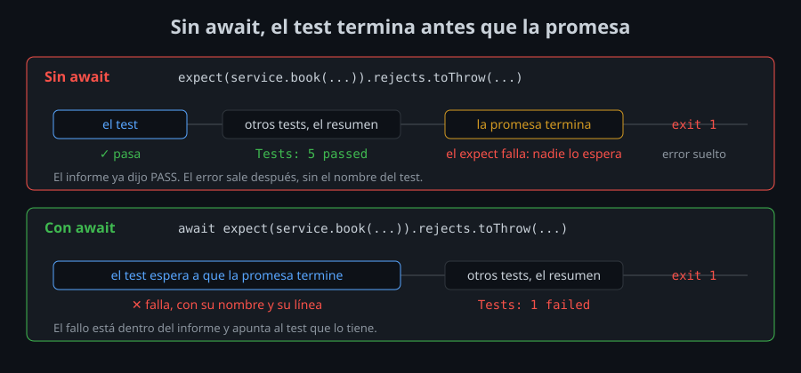

# 01 - Esperar a las promesas

> Por qué un test de una función asíncrona tiene que esperar su resultado, qué hace Jest cuando no espera y las formas correctas de escribirlo.

---

## 🎯 Objetivos

- Explicar qué es una promesa y qué hacen `async` y `await`.
- Reconocer un test que termina antes que la promesa que comprueba, y lo que Jest 30 muestra entonces.
- Escribir un test asíncrono con `async`/`await`, con `return` y con `.resolves`.
- Encontrar un `await` olvidado en el código que se prueba.

---

## 1. Una función que tarda

Hasta la semana 8, cada función del planetario devolvía su resultado al momento. En esta semana, las butacas ocupadas las lleva la **taquilla**, un servicio aparte. Preguntarle cuántas butacas quedan tarda: la respuesta llega por la red.

En JavaScript, una función que tarda no espera bloqueada: devuelve al momento una **promesa**, un objeto que representa un valor que llegará más tarde. La promesa está *pendiente* hasta que llega el valor (se *resuelve*) o llega un error (se *rechaza*).

```javascript
async function book({ name, seats, date }) {
  if (seats < 1 || seats > 6) {
    throw new Error("Entre 1 y 6 butacas por reserva");
  }
  const taken = await boxOffice.seatsTaken(date);
  if (taken + seats > capacity) {
    throw new Error("No quedan butacas suficientes");
  }
  return boxOffice.reserve({ name, seats, date });
}
```

| Palabra | Qué hace |
|---|---|
| `async` | La función devuelve siempre una promesa. Su `return valor` resuelve la promesa con `valor`, y su `throw` la rechaza con el error |
| `await promesa` | Espera a que la promesa termine. Si se resuelve, da su valor; si se rechaza, lanza su error en esa línea. Solo se puede usar dentro de una función `async` |

`book(...)` no devuelve la reserva: devuelve una promesa de la reserva. Para tener la reserva hay que esperarla con `await`.

---

## 2. El test no espera solo

Jest da un test por terminado cuando su función termina. Si la función devuelve una promesa, Jest espera a esa promesa; si no devuelve nada, el test ha terminado, quede lo que quede pendiente.

Este test del [lab 01](../2-practicas/lab-01-tests-que-esperan/README.md) encadena la reserva y la consulta con `.then`, que registra qué hacer cuando la promesa se resuelva:

```javascript
it("should take the seats from the session", () => {
  service
    .book(ANA)
    .then(() => service.availableSeats(DATE))
    .then((available) => expect(available).toBe(8));
});
```

La función no tiene `return`: termina en cuanto registra los `.then`, antes de que la taquilla responda. Jest marca el test como superado. El `expect` se ejecuta después, cuando el test ya terminó:

```bash
pnpm test
# PASS tests/booking.test.js
#   createBookingService
#     book
#       when there are seats left
#         ✓ should return the booking with its id (16 ms)
#         ✓ should take the seats from the session (1 ms)
#   ...
# Tests:       5 passed, 5 total
# ...
# Ran all test suites.
# /home/tu-usuario/labs-semana-09/tests/booking.test.js:31
#         service.book(ANA).then(() => service.availableSeats(DATE)).then(available => expect(available).toBe(8));
#                                                                                                        ^
#
# JestAssertionError: expect(received).toBe(expected) // Object.is equality
#
# Expected: 8
# Received: 4
# ...
# [ELIFECYCLE] Test failed. See above for more details.
echo $?
# 1
```

Tres cosas que mirar:

- **El resumen dice `5 passed`**, y el error llega después de `Ran all test suites.`. Nadie esperaba ese `expect`: su error es un *rechazo sin manejar*, y Node termina el proceso con código 1.
- **El error no dice qué test lo tiene.** Solo trae una línea de código, y su número no coincide con el de tu archivo: es la del código que Jest ejecuta después de transformarlo.
- **El 4 no es de este test.** Cuando la taquilla respondió, el `beforeEach` del test siguiente ya había creado otro `service`, con 6 butacas reservadas. El `.then` leyó la variable `service` y encontró el nuevo.

Si el `expect` suelto falla mientras otro test del mismo archivo sigue en marcha, Jest 30 sí lo pone en el informe, en el test que lo dejó suelto. Si termina cuando ya no queda nada en marcha, sale como arriba. Y si la promesa tarda más de un segundo en terminar, Jest avisa antes de que llegue el error:

```text
Jest did not exit one second after the test run has completed.
```

En los tres casos el código de salida es 1. Por eso el `verify.sh` de la [semana 6](../../week-06-plan_de_pruebas_y_suite_base_multilenguaje/README.md) mira el código de salida de `pnpm test` y no solo la línea `Tests:`.



---

## 3. Tres formas de esperar

| Forma | Ejemplo | Cuándo |
|---|---|---|
| `async` y `await` | `it("...", async () => { const n = await service.availableSeats(DATE); expect(n).toBe(8); })` | La forma del curso: se lee de arriba abajo, como un test síncrono |
| `return` de la promesa | `it("...", () => { return service.availableSeats(DATE).then((n) => expect(n).toBe(8)); })` | Código antiguo con `.then`. Si falta el `return`, vuelves a la sección 2 |
| `.resolves` | `await expect(service.availableSeats(DATE)).resolves.toBe(8);` | Una sola comprobación sobre el valor de la promesa |

El test de la sección 2, con `async` y `await`:

```javascript
it("should take the seats from the session", async () => {
  await service.book(ANA);

  const available = await service.availableSeats(DATE);

  expect(available).toBe(8);
});
```

`.resolves` espera la promesa y aplica el matcher a su valor. Pero `expect(...).resolves.toBe(8)` también es una promesa: sin `await` (o sin `return`) delante, es otro `expect` suelto. Lo mismo vale para `.rejects`, que verás en la [teoría 02](02-errores-asincronos.md).

Con `return` y un valor equivocado, el fallo sale dentro del informe, igual que con `await`:

```bash
pnpm test
#   ✕ should return the promise (13 ms)
#   ✕ should return the expect (10 ms)
# ...
#     Expected: 8
#     Received: 4
# ...
# Tests:       2 failed, 2 total
```

---

## 4. El `await` olvidado en el código

Un `await` puede faltar también en el código que pruebas. En el lab 01, la comprobación de las butacas libres es así:

```javascript
const taken = boxOffice.seatsTaken(date);
if (taken + seats > capacity) {
```

Sin `await`, `taken` no es un número: es la promesa. Con un `console.log(taken, taken + seats)` se ve:

```text
  console.log
    Promise { <pending> } [object Promise]6
```

`Promise { <pending> }` es una promesa que aún no ha terminado. Al sumarle un número, JavaScript convierte la promesa en el texto `"[object Promise]"` y lo pega delante del 6. Ese texto comparado con `capacity` da siempre `false`: la sesión nunca está llena. Ningún error avisa; solo lo encuentra un test que reserve más butacas de las que hay y **espere** el rechazo.

---

## ✅ Resumen

- Una función `async` devuelve una promesa; `await` espera su valor o lanza su error.
- Jest solo espera la promesa que devuelve la función del test. Un `.then` o un `expect(...).resolves` sin `await` ni `return` se ejecuta cuando el test ya terminó.
- En Jest 30, ese `expect` suelto que falla sale después del resumen (o en otro test), con código de salida 1. Mira siempre el código de salida, no solo la línea `Tests:`.
- El curso escribe los tests asíncronos con `async` y `await`, y pone `await` delante de cada `expect(...).resolves` y `.rejects`.
- Un `await` olvidado en el código convierte un número en una promesa: `Promise { <pending> }`.

<!-- nav -->
---

## 🔗 Navegación

| Anterior | Siguiente |
|---|---|
| ← [Semana 09 - Jest: Testing Asíncrono](../README.md) | [Teoría — 02 - Errores asíncronos](02-errores-asincronos.md) → |

[↑ Semana 09](../README.md)
