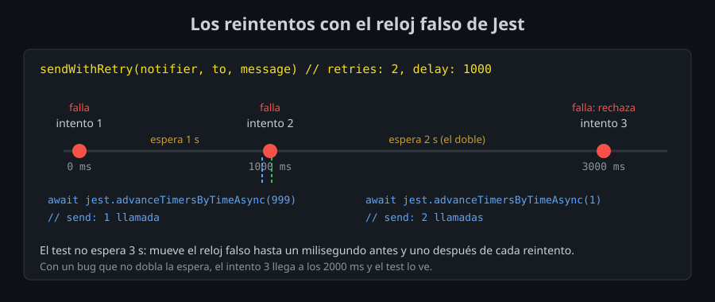

# 03 - Fake timers: controlar el tiempo

> Cómo probar código que espera (reintentos, debounce) sin esperar de verdad, con el reloj falso de Jest.

---

## 🎯 Objetivos

- Explicar por qué un test que espera tiempo real es lento y frágil.
- Activar y desactivar el reloj falso con `jest.useFakeTimers` y `jest.useRealTimers`.
- Avanzar el reloj con `advanceTimersByTimeAsync` y `runAllTimersAsync`, y explicar por qué la versión síncrona no basta con promesas.
- Comprobar un rechazo que llega mientras avanza el reloj.

---

## 1. Un aviso con reintentos

Un servidor de correo a veces no responde. `sendWithRetry`, del [lab 03](../2-practicas/lab-03-reintentos-con-fake-timers/README.md), vuelve a intentarlo: espera 1 s antes del primer reintento y el doble antes del siguiente.

```javascript
function wait(ms) {
  return new Promise((resolve) => setTimeout(resolve, ms));
}

async function sendWithRetry(notifier, to, message, { retries = 2, delay = 1000 } = {}) {
  for (let attempt = 0; ; attempt += 1) {
    try {
      return await notifier.send(to, message);
    } catch (error) {
      if (attempt === retries) {
        throw error;
      }
      await wait(delay * 2 ** attempt);
    }
  }
}
```

`setTimeout(función, ms)` ejecuta la función al cabo de `ms` milisegundos; `wait` lo envuelve en una promesa para poder esperarlo con `await`. `2 ** attempt` es 2 elevado a `attempt`: 1, 2, 4... Con un notificador que falla siempre, los tres intentos llegan a los 0, 1000 y 3000 ms.

Un test con el reloj real espera esos 3 s:

```bash
pnpm test tests/retry.test.js --verbose
#       ✓ should try three times and reject with the last error (3006 ms)
```

Con un reintento más (`retries: 3`) espera 1 + 2 + 4 = 7 s, y Jest corta cualquier test a los 5 s:

```text
    thrown: "Exceeded timeout of 5000 ms for a test.
    Add a timeout value to this test to increase the timeout, if this is a long-running test. See https://jestjs.io/docs/api#testname-fn-timeout."
```

Subir el límite no lo arregla: una suite con diez tests así tarda un minuto, y nadie la ejecuta antes de cada commit.

---

## 2. El reloj falso

`jest.useFakeTimers()` cambia `setTimeout`, `setInterval`, `Date` y sus parientes por versiones falsas. Un `setTimeout` falso no se ejecuta solo: espera a que el test mueva el reloj.

```javascript
beforeEach(() => {
  jest.useFakeTimers();
});

afterEach(() => {
  jest.useRealTimers();
});
```

`useRealTimers` en `afterEach` devuelve el reloj de verdad, para que el siguiente test no herede el falso (es el estado compartido de la [semana 7](../../week-07-jest_avanzado_y_organizacion_de_suites/1-teoria/02-hooks-y-aislamiento.md)).

Con el reloj falso y sin moverlo, el test del reintento espera para siempre: el `setTimeout` de 1 s no llega nunca, y a los 5 s (de reloj real) Jest lo corta con el mismo `Exceeded timeout of 5000 ms`.

| Función | Qué hace |
|---|---|
| `jest.advanceTimersByTimeAsync(ms)` | Mueve el reloj `ms` milisegundos y ejecuta los timers que vencen por el camino |
| `jest.runAllTimersAsync()` | Ejecuta todos los timers pendientes, también los que se crean mientras tanto, hasta que no queda ninguno |

---

## 3. Por qué la versión `Async`

Cada función tiene una versión sin `Async`: `jest.advanceTimersByTime(ms)`. Con promesas no basta:

```javascript
sendWithRetry(notifier, TO, MESSAGE);
jest.advanceTimersByTime(1000);

expect(notifier.send).toHaveBeenCalledTimes(2);
```

```text
    Expected number of calls: 2
    Received number of calls: 1
```

Cuando el test mueve el reloj, el `setTimeout` del primer reintento aún no existe. El primer `send` ha rechazado, pero el código que hay detrás del `await` (el `catch` y el `wait`) se ejecuta *después*, cuando el test deje de ejecutar código. La versión síncrona mueve el reloj sin dar ese hueco.

La versión `Async` devuelve una promesa: con `await`, deja que se ejecute ese código pendiente antes de mover el reloj y después de cada timer. Con ella, el test puede mirar justo antes y justo después del reintento:

```javascript
sendWithRetry(notifier, TO, MESSAGE);
await jest.advanceTimersByTimeAsync(999);
expect(notifier.send).toHaveBeenCalledTimes(1);

await jest.advanceTimersByTimeAsync(1);
expect(notifier.send).toHaveBeenCalledTimes(2);
```

999 ms no bastan, 1000 sí: el test comprueba el valor exacto de la espera, como un caso límite de la [semana 2](../../week-02-casos_de_prueba_y_tecnicas_de_diseno/README.md). Con un bug que no dobla la espera, el tercer intento llega a los 2000 ms, y el test que mira a los 2999 lo encuentra.



El curso usa siempre la versión `Async`. Funciona también con código sin promesas, como el debounce de la sección 5.

---

## 4. Un rechazo mientras avanza el reloj

Con un notificador que falla siempre, el tercer intento rechaza la promesa de `sendWithRetry`. Si lo compruebas así:

```javascript
const sending = sendWithRetry(notifier, TO, MESSAGE);
await jest.runAllTimersAsync();

await expect(sending).rejects.toThrow("SMTP no responde");
```

```text
  ● sendWithRetry › when every attempt fails › should try three times and reject with the last error

    SMTP no responde
```

La promesa se rechaza **durante** `runAllTimersAsync`, cuando aún no tiene ningún `.rejects` esperándola. Jest ve un rechazo sin manejar y hace fallar el test, aunque la línea siguiente lo iba a comprobar.

La solución es preparar la comprobación antes de mover el reloj, y esperarla después:

```javascript
const rejection = expect(sendWithRetry(notifier, TO, MESSAGE)).rejects.toThrow("SMTP no responde");
await jest.runAllTimersAsync();

await rejection;
expect(notifier.send).toHaveBeenCalledTimes(3);
```

`expect(...).rejects.toThrow(...)` sin `await` devuelve una promesa que ya está esperando el rechazo. Se guarda en `rejection` y se espera al final: no es un `expect` suelto, porque el test lo espera antes de terminar.

Si la promesa se resuelve (un reintento funcionó), no hay rechazo que manejar, y el orden de la primera versión vale:

```javascript
const sending = sendWithRetry(notifier, TO, MESSAGE);
await jest.runAllTimersAsync();

await expect(sending).resolves.toBe("250 OK");
```

---

## 5. Debounce

El buscador de sesiones del planetario no busca con cada letra: espera a que el visitante deje de escribir 300 ms. Es un **debounce**: cada llamada cancela la espera anterior y empieza otra.

```javascript
function debounce(fn, ms) {
  let timer;
  return (...args) => {
    clearTimeout(timer);
    timer = setTimeout(() => fn(...args), ms);
  };
}

it("should search once with the last text", async () => {
  const search = jest.fn();
  const onType = debounce(search, 300);

  onType("C");
  await jest.advanceTimersByTimeAsync(100);
  onType("Cú");
  await jest.advanceTimersByTimeAsync(100);
  onType("Cúpula");
  await jest.advanceTimersByTimeAsync(299);
  expect(search).not.toHaveBeenCalled();

  await jest.advanceTimersByTimeAsync(1);
  expect(search).toHaveBeenCalledTimes(1);
  expect(search).toHaveBeenCalledWith("Cúpula");
});
```

```bash
pnpm test --verbose
#     ✓ should search once with the last text (12 ms)
```

Tres pulsaciones en 200 ms y una sola búsqueda, 300 ms después de la última, con el último texto. El test tarda 12 ms.

---

## ✅ Resumen

- Un test que espera tiempo real tarda lo que la espera, y a los 5 s Jest lo corta.
- `jest.useFakeTimers()` en `beforeEach` y `jest.useRealTimers()` en `afterEach`.
- Mueve el reloj con `await jest.advanceTimersByTimeAsync(ms)` o `await jest.runAllTimersAsync()`. La versión síncrona no ejecuta el código que hay detrás de un `await`.
- Comprueba los límites del tiempo: un milisegundo antes y en el momento exacto.
- Si la promesa se rechaza mientras avanza el reloj, prepara el `expect(...).rejects` antes de moverlo y espéralo después.

<!-- nav -->
---

## 🔗 Navegación

| Anterior | Siguiente |
|---|---|
| ← [Teoría — 02 - Errores asíncronos](02-errores-asincronos.md) | [Índice de labs](../2-practicas/README.md) → |

[↑ Semana 09](../README.md)
