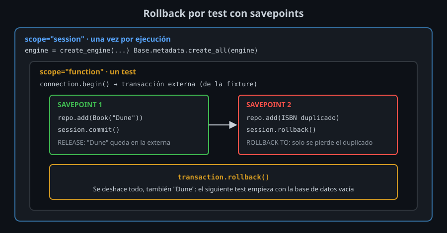

# 02 - Fixtures de base de datos y rollback por test

> Lenguaje: **Python**



---

## 🎯 Objetivos

- Repartir el trabajo de la base de datos entre fixtures de scope `session` y `function`.
- Aislar cada test con una transacción externa que siempre termina en rollback.
- Entender por qué hace falta `join_transaction_mode="create_savepoint"` cuando el código bajo prueba hace `commit()` o `rollback()`.
- Configurar `sqlite3` para que los `SAVEPOINT` funcionen.

---

## Qué cuesta y qué se comparte

Las fixtures y sus *scopes* son los de la [semana 16](../../week-16-fundamentos_con_pytest/README.md). Con una base de datos, cada paso tiene un coste distinto:

| Paso | Coste | Scope | Por qué |
|---|---|---|---|
| Arrancar PostgreSQL y crear el `engine` | Segundos | `session` | Se hace una vez para toda la ejecución de pytest |
| `create_all` (crear tablas) | Decenas de ms por tabla | `session` | El esquema no cambia entre tests |
| Abrir conexión + `BEGIN` | Microsegundos | `function` | Cada test necesita su propia transacción |
| `ROLLBACK` al terminar | Microsegundos | `function` | Borra todo lo que el test escribió |

El rollback deshace los cambios del test sin tener que borrar ni recrear tablas.

---

## Paso 1: una fixture sin aislamiento (el error)

```python
@pytest.fixture(scope="session")
def engine():
    engine = create_engine("sqlite+pysqlite:///:memory:")
    Base.metadata.create_all(engine)
    yield engine
    engine.dispose()


@pytest.fixture
def session(engine):
    with Session(engine) as session:
        yield session
```

El esquema se crea una vez, pero los datos también se comparten. Lo que un test confirma con `commit()` lo ve el siguiente:

```bash
uv run pytest -q
# FAILED tests/test_isolation.py::test_next_test_starts_with_an_empty_database
# FAILED tests/test_isolation.py::test_rollback_inside_the_code_keeps_previous_commits
# 2 failed, 1 passed in 0.39s
```

El segundo test espera una base de datos vacía y encuentra el libro del primero. El tercero falla al insertar, por `UNIQUE constraint failed: books.isbn`, con un ISBN que ya insertó el primero.

Si cambias el orden de ejecución, fallan otros tests. Este es el síntoma clásico de los tests acoplados por datos.

## Paso 2: transacción externa + savepoint

```python
@pytest.fixture
def session(engine):
    with engine.connect() as connection:
        transaction = connection.begin()
        session = Session(bind=connection, join_transaction_mode="create_savepoint")
        yield session
        session.close()
        transaction.rollback()
```

Qué hace cada línea:

1. **`engine.connect()`:** reserva una conexión para este test.
2. **`connection.begin()`:** abre la *transacción externa*. Es de la fixture, no del código bajo prueba.
3. **`Session(bind=connection, ...)`:** la sesión trabaja dentro de esa transacción.
4. **`join_transaction_mode="create_savepoint"`:** cada `commit()` y cada `rollback()` del código bajo prueba actúa sobre un `SAVEPOINT`, una transacción anidada. La transacción externa nunca se toca.
5. **`transaction.rollback()`:** al terminar el test se deshace todo, también lo que el código "confirmó".

**Qué:** cada test ve una base de datos vacía y deja la base de datos vacía.
**Para qué:** los tests se pueden ejecutar en cualquier orden, de uno en uno o todos a la vez.
**Impacto:** el código bajo prueba no cambia. Puede seguir llamando a `commit()` y a `rollback()` como en producción.

### ¿Por qué `create_savepoint`?

El repositorio del lab hace `rollback()` cuando detecta un ISBN duplicado:

```python
def add(self, book: Book) -> Book:
    self.session.add(book)
    try:
        self.session.commit()
    except IntegrityError as error:
        self.session.rollback()
        raise DuplicateIsbnError(book.isbn) from error
    return book
```

Sin `join_transaction_mode`, SQLAlchemy usa el modo `"conservative_savepoint"`. En ese modo, el `rollback()` del repositorio deshace **la transacción externa entera**, incluido el primer libro del test:

```bash
uv run pytest -q
# E       AttributeError: 'NoneType' object has no attribute 'title'
# FAILED tests/test_isolation.py::test_rollback_inside_the_code_keeps_previous_commits
# 1 failed, 2 passed, 1 warning in 0.04s
```

El aviso confirma que la fixture perdió su transacción: `SAWarning: transaction already deassociated from connection`. Con `"create_savepoint"`, el `rollback()` solo vuelve al último savepoint y el primer libro sigue ahí.

## Paso 3: `sqlite3` y los savepoints

Con el Paso 2 aplicado y SQLite, los tests **siguen fallando igual que en el Paso 1**. El motivo es que el módulo `sqlite3` de Python, en su modo por defecto, gestiona las transacciones por su cuenta y no respeta el `BEGIN` ni los `SAVEPOINT` de SQLAlchemy. Desde Python 3.12 se corrige con un argumento de conexión:

```python
engine = create_engine(
    "sqlite+pysqlite:///:memory:", connect_args={"autocommit": False}
)
```

```bash
uv run pytest -q
# ...                                                                      [100%]
# 3 passed in 0.03s
```

**Qué:** `autocommit=False` hace que `sqlite3` siga las transacciones tal como las pide SQLAlchemy.
**Para qué:** que el rollback por test funcione también en SQLite.
**Impacto:** solo afecta a SQLite. El driver de PostgreSQL (`psycopg`) ya funciona así.

---

## ✅ Resumen

- El engine y el esquema van en scope `session`; la transacción, en scope `function`.
- Transacción externa, `join_transaction_mode="create_savepoint"` y `rollback()` al final: cada test empieza y termina con la base de datos vacía.
- Sin `create_savepoint`, el `rollback()` del código bajo prueba destruye los datos del test.
- En SQLite, añade `connect_args={"autocommit": False}`; si no, los savepoints no funcionan.

<!-- nav -->
---

## 🔗 Navegación

| Anterior | Siguiente |
|---|---|
| ← [Teoría — 01 - Estrategias para testear la capa de datos](01-estrategias-y-sqlalchemy.md) | [Teoría — 03 - Datos de prueba con Faker y Factory Boy](03-datos-con-faker-y-factory-boy.md) → |

[↑ Semana 23](../README.md)
