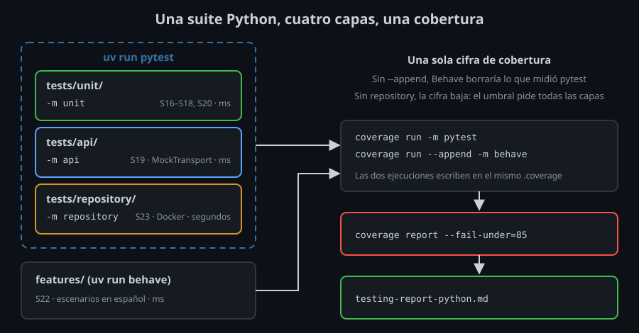

# 01 - La suite Python completa

> Lenguaje: **Python**

Esta semana no hay conceptos nuevos. Juntas en una sola suite lo que construiste entre las semanas 16 y 23, y la mides como un todo.

---

## 🎯 Objetivos

- Ordenar los tests por capas y ejecutar cada capa con una marca de pytest.
- Medir con una sola cifra la cobertura de pytest y de Behave.
- Escribir un reporte de testing con datos reales de la suite.

---

## De ocho semanas a una suite

Cada semana de la etapa añadió una pieza. Esta tabla dice en qué carpeta queda cada una:

| Semana | Pieza | Carpeta |
|---|---|---|
| [16](../../week-16-fundamentos_con_pytest/README.md) | Fixtures y `yield` | `tests/conftest.py` y los `conftest.py` de cada capa |
| [17](../../week-17-parametrizacion_y_marks_con_pytest/README.md) | `parametrize` y marcas | En todas las capas |
| [18](../../week-18-mocking_con_unittest_mock_y_pytest_mock/README.md) | Mocks de dependencias | `tests/unit/` |
| [19](../../week-19-testing_de_apis_con_python/README.md) | Cliente `httpx2` con `MockTransport` y tests async | `tests/api/` |
| [20](../../week-20-tdd_con_python/README.md) | TDD y Hypothesis | `tests/unit/` |
| [21](../../week-21-coverage_y_calidad_en_python/README.md) | Coverage y umbral | `pyproject.toml` |
| [22](../../week-22-bdd_con_python_behave/README.md) | Behave en español | `features/` |
| [23](../../week-23-testing_de_bases_de_datos_en_python/README.md) | PostgreSQL con Testcontainers y Alembic | `tests/repository/` |

La estructura de `python/` queda así:

```text
python/
├── pyproject.toml           # dependencias, marcas y configuración de coverage
├── testing-report-python.md # el reporte de esta semana
├── domain/ catalog/ data/   # código del dominio (los nombres dependen de tu dominio)
├── migrations/              # Alembic (S23)
├── features/                # Behave (S22)
│   └── steps/
└── tests/
    ├── conftest.py          # marca cada test según su carpeta
    ├── unit/
    ├── api/
    └── repository/
```



---

## Una marca por capa

En la [semana 17](../../week-17-parametrizacion_y_marks_con_pytest/README.md) pusiste marcas a mano con `@pytest.mark.smoke` y las registraste con `--strict-markers`. Con capas por carpeta no hace falta escribirlas en cada test: un *hook* de `conftest.py` las pone al recoger los tests.

```python
# tests/conftest.py
LAYERS = ("unit", "api", "repository")


def pytest_collection_modifyitems(items):
    for item in items:
        layer = item.path.parent.name
        if layer in LAYERS:
            item.add_marker(layer)
```

**Qué:** `pytest_collection_modifyitems` es un *hook*: pytest lo llama una vez, después de recoger todos los tests y antes de ejecutarlos. `item.path.parent.name` es el nombre de la carpeta del archivo de test.
**Para qué:** un test nuevo en `tests/api/` queda marcado como `api` sin que nadie lo recuerde.
**Impacto:** `uv run pytest -m "not repository"` ejecuta la suite sin Docker en menos de un segundo, y `-m repository` solo la capa lenta.

Las marcas se registran en `pyproject.toml`, igual que en la semana 17:

```toml
[tool.pytest.ini_options]
addopts = "--strict-markers"
markers = [
    "unit: lógica pura, sin red ni base de datos",
    "api: cliente HTTP con transporte simulado",
    "repository: repositorio contra PostgreSQL (necesita Docker)",
]
```

Recuerda que `--strict-markers` revisa las marcas de los tests, no la expresión de `-m`: `-m unti` no da error, deselecciona todos los tests.

---

## Una sola cifra de cobertura

pytest y Behave son dos programas distintos. Con `pytest --cov` solo se mide lo que ejecuta pytest; el código que solo prueba un escenario de Behave aparece como no cubierto.

`coverage run` mide cualquier programa de Python. `--append` suma la medición a la anterior en lugar de borrarla:

```bash
uv run coverage run -m pytest -q
uv run coverage run --append -m behave
uv run coverage report
```

| Opción | Qué hace |
|---|---|
| `coverage run -m pytest` | Ejecuta pytest midiendo y escribe `.coverage` desde cero |
| `--append` | Añade la medición de Behave al mismo `.coverage` |
| `coverage report` | Lee `.coverage` e imprime la tabla. Con `fail_under`, sale con código 2 si no llega |

La configuración va en `pyproject.toml`, como en la [semana 21](../../week-21-coverage_y_calidad_en_python/README.md):

```toml
[tool.coverage.run]
source = ["domain", "catalog", "data"]   # solo tu código, no los tests
branch = true

[tool.coverage.report]
show_missing = true
fail_under = 85
```

Sin `source`, coverage mide también los archivos de test, que siempre están al 100 %, y la cifra total sube sin que la suite pruebe más.

---

## El reporte de testing

`testing-report-python.md` resume el estado de la suite con datos de una ejecución real. Tiene cinco secciones:

| Sección | De dónde salen los datos |
|---|---|
| Suite por capas | `uv run pytest -q -m <capa>` y `uv run behave` |
| Cobertura | `uv run coverage report --format=markdown` |
| Tests más lentos | `uv run pytest -q --durations=3` |
| Riesgos y huecos | Tu análisis: qué no prueba la suite |
| Próximos pasos | Los tests que añadirías primero |

`--format=markdown` imprime la tabla de cobertura en Markdown, lista para pegar. `--durations=3` lista los tres pasos más lentos, separando *setup*, *call* y *teardown*.

---

## ✅ Resumen

- Una carpeta por capa y un *hook* que marca cada test según su carpeta.
- `--strict-markers` detecta marcas mal escritas en los tests.
- `coverage run` + `coverage run --append` dan una sola cifra para pytest y Behave.
- El reporte se escribe con salidas reales, no con estimaciones.

<!-- nav -->
---

## 🔗 Navegación

| Anterior | Siguiente |
|---|---|
| ← [Semana 24 - Proyecto Integrador: Etapa 2 (Python)](../README.md) | [Índice de labs](../2-practicas/README.md) → |

[↑ Semana 24](../README.md)
