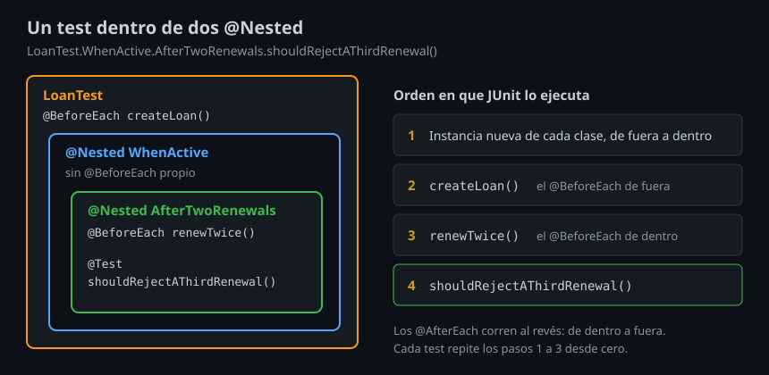

# 02 - Organizar la suite con @Nested y @Tag

> Lenguaje: **Java**



---

## 🎯 Objetivos

- Agrupar los tests por contexto con clases `@Nested`, cada una con su propia preparación.
- Saber en qué orden se ejecutan los `@BeforeEach` de las clases anidadas.
- Etiquetar tests con `@Tag` y ejecutar solo una parte de la suite con Maven.

---

## @Nested: un contexto por clase

En Jest agrupabas con `describe` dentro de `describe` ([semana 7](../../week-07-jest_avanzado_y_organizacion_de_suites/1-teoria/01-organizar-suites-por-comportamiento.md)). En JUnit, el equivalente es una **clase interna** marcada con `@Nested`.

Sin `@Nested`, el contexto acaba en el nombre de cada test y el *Arrange* se repite:

```java
@Test
@DisplayName("returned: should reject a second return")
void returnedShouldRejectASecondReturn() {
    loan.returnOn(DUE.plusDays(3));
    // ...
}

@Test
@DisplayName("returned: should reject a renewal")
void returnedShouldRejectARenewal() {
    loan.returnOn(DUE.plusDays(3));
    // ...
}
```

Con `@Nested`, el contexto es la clase y el *Arrange* compartido va en su `@BeforeEach`:

```java
@DisplayName("Loan")
class LoanTest {

    private static final LocalDate DUE = LocalDate.of(2026, 3, 16);

    private Loan loan;

    @BeforeEach
    void createLoan() {
        loan = new Loan(DUE);
    }

    @Nested
    @DisplayName("when returned three days late")
    class WhenReturnedThreeDaysLate {

        @BeforeEach
        void returnLate() {
            loan.returnOn(DUE.plusDays(3));
        }

        @Test
        @DisplayName("should reject a second return")
        void shouldRejectASecondReturn() {
            assertThatThrownBy(() -> loan.returnOn(DUE.plusDays(4)))
                .isInstanceOf(IllegalStateException.class)
                .hasMessage("loan already returned");
        }
    }
}
```

Reglas:

1. La clase anidada **no es `static`**. Así puede usar los campos de la clase de fuera, como `loan`.
2. Cada test crea instancias nuevas de todas las clases, de fuera a dentro. Ningún test ve el estado de otro.
3. Los `@BeforeEach` se ejecutan de fuera a dentro y los `@AfterEach`, de dentro a fuera (diagrama de arriba).
4. Puedes anidar varios niveles. Con dos o tres basta; más niveles cuestan de leer.

### Lo que muestra Maven

Surefire usa el `@DisplayName` de cada clase:

```bash
mvn test
# [INFO] Tests run: 4, Failures: 0, Errors: 0, Skipped: 0, Time elapsed: 0.006 s -- in after two renewals
# [INFO] Tests run: 0, Failures: 0, Errors: 0, Skipped: 0, Time elapsed: 0.089 s -- in when active
# [INFO] Tests run: 4, Failures: 0, Errors: 0, Skipped: 0, Time elapsed: 0.009 s -- in when returned three days late
# [INFO] Tests run: 0, Failures: 0, Errors: 0, Skipped: 0, Time elapsed: 0.112 s -- in Loan
# [INFO] Tests run: 8, Failures: 0, Errors: 0, Skipped: 0
```

Los recuentos por clase no cuadran con el código: Surefire suma los tests de `when active` a la última clase anidada que encuentra dentro (`after two renewals`). El total de la última línea sí es correcto.

### Si olvidas @Nested

Una clase interna sin `@Nested` no se ejecuta. JUnit solo avisa durante el descubrimiento:

```text
WARNING: TestEngine with ID 'junit-jupiter' encountered a non-critical issue during test discovery:
(1) [WARNING] Inner class 'com.bootcamp.LoanTest$WhenReturnedThreeDaysLate' looks like it was intended to be a test class but will not be executed. It must be static or annotated with @Nested.
[INFO] Tests run: 4, Failures: 0, Errors: 0, Skipped: 0
```

La compilación pasa y Maven termina con `BUILD SUCCESS`, pero se perdieron cuatro tests. Compara siempre el total con el que esperabas.

---

## @Tag: etiquetas para ejecutar una parte de la suite

`@Tag` es el equivalente de los *marks* de pytest ([semana 17](../../week-17-parametrizacion_y_marks_con_pytest/1-teoria/02-marks-organizacion-priorizacion-suites.md)). Se pone en un método o en una clase. En una clase, la heredan todos sus tests, también los de sus clases `@Nested`.

```java
@Test
@Tag("smoke")
@DisplayName("should be overdue the day after the due date")
void shouldBeOverdueTheDayAfterTheDueDate() {
    assertThat(loan.isOverdue(DUE.plusDays(1))).isTrue();
}
```

Surefire filtra por etiquetas con dos propiedades:

| Comando | Qué ejecuta |
|---|---|
| `mvn test -Dgroups=smoke` | Solo los tests con la etiqueta `smoke` |
| `mvn test -DexcludedGroups=smoke` | Todos menos los `smoke` |
| `mvn test -Dgroups='slow & !smoke'` | Los `slow` que no son `smoke` |

```bash
mvn test -Dgroups=smoke
# [INFO] Tests run: 2, Failures: 0, Errors: 0, Skipped: 0
mvn test -DexcludedGroups=smoke
# [INFO] Tests run: 6, Failures: 0, Errors: 0, Skipped: 0
```

La tercera fila es una **expresión de etiquetas**: `&` (y), `|` (o) y `!` (no), con paréntesis si hace falta. Las comillas simples evitan que la shell interprete `&` y `!`.

Para ejecutar una sola clase o un solo método no necesitas etiquetas: usa `-Dtest`.

```bash
mvn test -Dtest=LoanTest
mvn test -Dtest='CatalogTest#shouldFindABookByIsbn'
```

### Qué etiquetas usar

Pocas y con un significado que todo el equipo entienda:

| Etiqueta | Significado |
|---|---|
| `smoke` | El mínimo que debe pasar antes de cualquier otra cosa |
| `slow` | Tarda más de un segundo; se puede dejar fuera en local |
| `integration` | Necesita algo externo: disco, red, Docker |

Un nombre mal escrito (`smok`) no da error: el filtro simplemente no encuentra tests. Si `-Dgroups` devuelve `Tests run: 0`, revisa la etiqueta.

---

## ✅ Resumen

- `@Nested` agrupa por contexto; la clase interna no es `static` y tiene su propio `@BeforeEach`.
- Los `@BeforeEach` van de fuera a dentro y cada test empieza con instancias nuevas.
- Sin `@Nested`, la clase interna no se ejecuta y solo queda un aviso.
- `@Tag` etiqueta tests y `-Dgroups` / `-DexcludedGroups` eligen cuáles ejecutar.

<!-- nav -->
---

## 🔗 Navegación

| Anterior | Siguiente |
|---|---|
| ← [Teoría — 01 - Tests parametrizados con JUnit 6](01-tests-parametrizados.md) | [Teoría — 03 - @TempDir y extensiones de JUnit](03-tempdir-y-extensiones.md) → |

[↑ Semana 25](../README.md)
