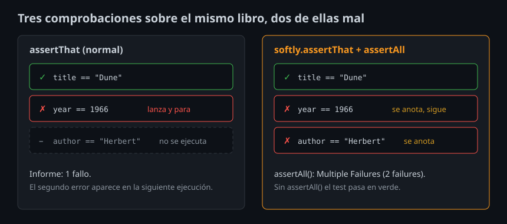

# 04 - AssertJ a fondo y soft assertions

> Lenguaje: **Java**



---

## 🎯 Objetivos

- Escribir aserciones sobre colecciones, `Optional` y objetos con AssertJ.
- Leer los mensajes de fallo de AssertJ y compararlos con los de JUnit.
- Comprobar varios campos de un resultado de una vez con soft assertions.

---

## De dónde partes

En la [semana 5](../../week-05-primeros_tests_automatizados_con_java/1-teoria/03-assertions-y-ejecucion.md) usaste `assertThat(...).isEqualTo(...)` y `assertThatThrownBy(...)`. AssertJ es una librería aparte de JUnit, con su propia dependencia:

```xml
<dependency>
  <groupId>org.assertj</groupId>
  <artifactId>assertj-core</artifactId>
  <version>3.27.7</version>
  <scope>test</scope>
</dependency>
```

Todo empieza con `assertThat(valorReal)`. Según el tipo del valor, AssertJ ofrece unos métodos u otros: si escribes `assertThat(lista).` en el IDE, el autocompletado solo muestra los de una lista. Por eso se llaman **aserciones fluentes**: se encadenan y se leen como una frase.

```java
import static org.assertj.core.api.Assertions.assertThat;
```

---

## Colecciones

| Método | Comprueba |
|---|---|
| `hasSize(3)` | El tamaño |
| `isEmpty()` / `isNotEmpty()` | Si hay elementos |
| `contains("a", "b")` | Que estén, en cualquier orden, aunque haya más |
| `containsExactly("a", "b")` | Esos y solo esos, **en ese orden** |
| `containsExactlyInAnyOrder("b", "a")` | Esos y solo esos, en cualquier orden |
| `extracting(Book::title)` | Cambia la lista de libros por la lista de sus títulos |
| `allSatisfy(b -> ...)` | Que todos los elementos cumplan las aserciones de la lambda |

`extracting` evita recorrer la lista a mano:

```java
assertThat(catalog.byAuthor("Frank Herbert"))
    .extracting(Book::title)
    .containsExactly("Dune", "Dune Messiah", "Children of Dune");
```

### El mensaje de fallo

Supón que `byAuthor` deja de ordenar por año. Con aserciones de JUnit, índice por índice:

```java
assertEquals(3, books.size());
assertEquals("Dune", books.get(0).title());
assertEquals("Dune Messiah", books.get(1).title());
assertEquals("Children of Dune", books.get(2).title());
```

el informe solo enseña el primer índice que no coincide:

```text
[ERROR]   CatalogTest.shouldListTheBooksOfAnAuthorFromOldestToNewestWithJUnit:52 expected: <Dune Messiah> but was: <Children of Dune>
```

Con AssertJ, el informe enseña las dos listas y cada diferencia:

```text
[ERROR]   CatalogTest.shouldListTheBooksOfAnAuthorFromOldestToNewest:36
Expecting actual:
  ["Dune", "Children of Dune", "Dune Messiah"]
to contain exactly (and in same order):
  ["Dune", "Dune Messiah", "Children of Dune"]
but there were differences at these indexes:
  - element at index 1: expected "Dune Messiah" but was "Children of Dune"
  - element at index 2: expected "Children of Dune" but was "Dune Messiah"
```

Con este mensaje ves que el problema es el orden, no los datos.

---

## Optional

```java
assertThat(catalog.findByIsbn("9780441172719"))
    .hasValueSatisfying(book -> assertThat(book.title()).isEqualTo("Dune"));

assertThat(catalog.findByIsbn("0000000000000")).isEmpty();
```

`hasValueSatisfying` comprueba que hay valor y, además, ejecuta las aserciones de la lambda sobre él. No hace falta llamar a `get()`.

---

## Objetos: satisfies y as

`satisfies` aplica una o varias lambdas al mismo objeto:

```java
assertThat(dune).satisfies(
    book -> assertThat(book.title()).isEqualTo("Dune"),
    book -> assertThat(book.year()).isLessThan(1970));
```

`as(...)` pone una descripción delante del mensaje de fallo. Va **antes** de la aserción:

```java
assertThat(dune.year()).as("year of %s", dune.title()).isEqualTo(1966);
```

```text
[year of Dune]
expected: 1966
 but was: 1965
```

---

## Soft assertions

Una aserción normal lanza una excepción al fallar y el test se detiene ahí. Si un resultado tiene cinco campos y tres están mal, ves el primero, lo arreglas, vuelves a ejecutar y ves el segundo.

Una **soft assertion** anota el fallo y sigue. Al final informa de todos a la vez (diagrama de arriba).

### Forma 1: assertSoftly

```java
import static org.assertj.core.api.SoftAssertions.assertSoftly;

assertSoftly(soft -> {
    soft.assertThat(book.title()).isEqualTo("The Dispossessed");
    soft.assertThat(book.author()).isEqualTo("Ursula K. Le Guin");
    soft.assertThat(book.year()).isEqualTo(1974);
});
```

Si el autor y el año están mal:

```text
[ERROR]   CatalogTest.shouldKeepEveryFieldOfTheBook:65
Multiple Failures (2 failures)
-- failure 1 --
expected: "Ursula Le Guin"
 but was: "Ursula K. Le Guin"
at CatalogTest.lambda$shouldKeepEveryFieldOfTheBook$2(CatalogTest.java:67)
-- failure 2 --
expected: 1975
 but was: 1974
at CatalogTest.lambda$shouldKeepEveryFieldOfTheBook$2(CatalogTest.java:68)
```

`assertSoftly` comprueba todo al cerrar la lambda.

### Forma 2: SoftAssertions y assertAll

```java
SoftAssertions softly = new SoftAssertions();
softly.assertThat(dune.title()).as("title").isEqualTo("Dune");
softly.assertThat(dune.year()).as("year").isEqualTo(1966);
softly.assertAll();
```

Si olvidas `softly.assertAll()`, los fallos se anotan pero nadie los lanza, y **el test pasa en verde**. Por eso es mejor `assertSoftly` o la forma 3.

### Forma 3: la extensión de AssertJ

AssertJ trae una extensión de JUnit (las extensiones se explican en la [teoría 03](03-tempdir-y-extensiones.md)) que crea el objeto, lo inyecta en un campo y llama a `assertAll()` al terminar cada test:

```java
@ExtendWith(SoftAssertionsExtension.class)
class CatalogTest {

    @InjectSoftAssertions
    private SoftAssertions softly;

    @Test
    @DisplayName("should keep every field of the book with the extension")
    void shouldKeepEveryFieldOfTheBookWithTheExtension() {
        Book book = catalog.findByIsbn("9780441478125").orElseThrow();

        softly.assertThat(book.title()).isEqualTo("The Left Hand of Darkness");
        softly.assertThat(book.author()).isEqualTo("Ursula K. Le Guin");
        softly.assertThat(book.year()).isEqualTo(1969);
    }
}
```

### Cuándo usarlas

| Usa soft assertions | Usa aserciones normales |
|---|---|
| Varios campos **independientes** del mismo resultado | Un paso depende del anterior |
| Un objeto devuelto por una API o un servicio | Comprobar que no es `null` antes de leer sus campos |
| Una fila leída de un archivo o de una tabla | Una sola comprobación |

Si la primera comprobación falla y las siguientes ya no tienen sentido (por ejemplo, la lista está vacía y luego lees su primer elemento), usa aserciones normales.

---

## ✅ Resumen

- `assertThat(valor)` ofrece métodos según el tipo: `containsExactly` y `extracting` para listas, `hasValueSatisfying` para `Optional` y `satisfies` para objetos.
- Los mensajes de AssertJ enseñan el valor completo y cada diferencia.
- Las soft assertions informan de todos los fallos a la vez; `assertSoftly` o la extensión evitan olvidar `assertAll()`.

<!-- nav -->
---

## 🔗 Navegación

| Anterior | Siguiente |
|---|---|
| ← [Teoría — 03 - @TempDir y extensiones de JUnit](03-tempdir-y-extensiones.md) | [Índice de labs](../2-practicas/README.md) → |

[↑ Semana 25](../README.md)
