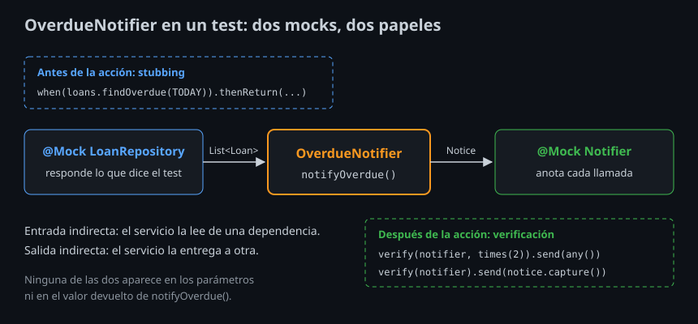

# 01 - Mocks y stubbing con Mockito

> Lenguaje: **Java**



---

## 🎯 Objetivos

- Configurar Mockito 5 en un proyecto Maven con JUnit 6.
- Crear mocks y programar sus respuestas con `when(...).thenReturn(...)` y `thenThrow(...)`.
- Saber qué devuelve un mock cuando nadie le dijo qué responder.
- Crear los mocks con `@Mock`, `@InjectMocks` y `MockitoExtension`.

---

## De dónde partes

Los dobles de prueba (dummy, stub, spy, mock, fake) ya los viste con Jest en la [semana 10](../../week-10-mocks_avanzados_en_jest/1-teoria/01-test-doubles-jest.md) y con `unittest.mock` en la [semana 18](../../week-18-mocking_con_unittest_mock_y_pytest_mock/1-teoria/01-fundamentos-mocking-python.md). La idea es la misma. Cambian dos cosas:

| | Jest / `unittest.mock` | Mockito |
|---|---|---|
| Qué se sustituye | Una función o un módulo importado | Un objeto que implementa una interfaz o extiende una clase |
| Cómo llega al código | `jest.mock(...)` o `patch(...)` reemplazan el import | Se pasa por el constructor del servicio |

En Java no se parchea un import: el servicio recibe sus dependencias por el constructor y el test le pasa mocks en lugar de las reales.

```java
public class HoldService {

    private final BookRepository books;     // interfaz: una base de datos en producción
    private final MemberDirectory members;  // interfaz: una API HTTP en producción

    public HoldService(BookRepository books, MemberDirectory members) {
        this.books = books;
        this.members = members;
    }
}
```

---

## Configurar Mockito en Maven

Tres piezas en el `pom.xml`. Están en todos los labs de la semana.

### 1. Las dependencias

```xml
<dependency>
  <groupId>org.mockito</groupId>
  <artifactId>mockito-core</artifactId>
  <version>5.23.0</version>
  <scope>test</scope>
</dependency>
<dependency>
  <groupId>org.mockito</groupId>
  <artifactId>mockito-junit-jupiter</artifactId>
  <version>5.23.0</version>
  <scope>test</scope>
</dependency>
```

- **Qué:** `mockito-core` crea los mocks; `mockito-junit-jupiter` trae `MockitoExtension`, la extensión de JUnit que lee `@Mock`.
- **Para qué:** `scope` `test` las deja fuera del código de producción.
- **Impacto:** sin la segunda, `@Mock` compila pero los campos quedan en `null`.

### 2. La ruta del jar de Mockito como propiedad

```xml
<plugin>
  <groupId>org.apache.maven.plugins</groupId>
  <artifactId>maven-dependency-plugin</artifactId>
  <version>3.11.0</version>
  <executions>
    <execution>
      <goals>
        <goal>properties</goal>
      </goals>
    </execution>
  </executions>
</plugin>
```

- **Qué:** el objetivo `properties` crea una propiedad de Maven por cada dependencia con la ruta de su jar en `~/.m2`. La de Mockito se llama `${org.mockito:mockito-core:jar}`.
- **Para qué:** el paso 3 necesita esa ruta y cambia en cada máquina.

### 3. Mockito como agente de Java

```xml
<plugin>
  <groupId>org.apache.maven.plugins</groupId>
  <artifactId>maven-surefire-plugin</artifactId>
  <version>3.5.6</version>
  <configuration>
    <argLine>-javaagent:${org.mockito:mockito-core:jar} -Xshare:off</argLine>
  </configuration>
</plugin>
```

- **Qué:** `argLine` son opciones para la JVM que ejecuta los tests. `-javaagent` carga Mockito antes que cualquier clase; `-Xshare:off` desactiva una caché de clases del JDK que no se lleva bien con el agente.
- **Para qué:** desde Mockito 5, el creador de mocks por defecto (el *inline mock maker*) modifica las clases ya cargadas en memoria. Así puede hacer mocks de clases `final` y de métodos estáticos. Para eso necesita ser un agente.
- **Impacto:** sin esta línea los tests pasan hoy, pero Mockito se carga a sí mismo durante la ejecución y avisa:

  ```text
  Mockito is currently self-attaching to enable the inline-mock-maker. This will no longer work in future releases of the JDK. Please add Mockito as an agent to your build as described in Mockito's documentation: https://javadoc.io/doc/org.mockito/mockito-core/latest/org.mockito/org/mockito/Mockito.html#0.3
  WARNING: A Java agent has been loaded dynamically (/home/<usuario>/.m2/repository/net/bytebuddy/byte-buddy-agent/1.17.7/byte-buddy-agent-1.17.7.jar)
  ```

  Sin `-Xshare:off`, cada ejecución imprime `OpenJDK 64-Bit Server VM warning: Sharing is only supported for boot loader classes because bootstrap classpath has been appended`.

---

## mock() y when

```java
import static org.mockito.Mockito.mock;
import static org.mockito.Mockito.when;

BookRepository books = mock(BookRepository.class);
MemberDirectory members = mock(MemberDirectory.class);
HoldService service = new HoldService(books, members);

when(members.isActive("M-001")).thenReturn(true);
when(books.findByIsbn(DUNE.isbn())).thenReturn(Optional.of(DUNE));
when(books.countHolds(DUNE.isbn())).thenReturn(2);

Hold hold = service.placeHold("M-001", DUNE.isbn());

assertThat(hold.position()).isEqualTo(3);
```

- `mock(BookRepository.class)` crea en tiempo de ejecución un objeto que implementa la interfaz. No hace falta escribir ninguna clase.
- `when(llamada).thenReturn(valor)` es un **stub**: cuando el servicio haga esa llamada **con esos argumentos**, recibe ese valor.
- Encadenar respuestas: `thenReturn(1, 2, 3)` devuelve 1 en la primera llamada, 2 en la segunda y 3 en las siguientes.

### Respuestas por defecto

Un método sin stub no lanza ninguna excepción: devuelve un valor vacío según su tipo.

| Tipo devuelto | Valor por defecto |
|---|---|
| `int`, `long`, `double`... | `0` |
| `boolean` | `false` |
| `Optional<T>` | `Optional.empty()` |
| `List`, `Set`, `Map` | colección vacía |
| `String` y otros objetos | `null` |
| `void` | no hace nada |

Si olvidas un stub, el servicio recibe uno de estos valores y sigue. En el lab 01, borrar el stub de `findByIsbn` no produce un error de Mockito sino uno del servicio:

```text
java.util.NoSuchElementException: unknown book: 9780441172719
```

Cuando un test falla con un "no encontrado" o un `0` que no esperas, revisa primero los stubs.

### thenThrow

```java
when(members.isActive(anyString()))
    .thenThrow(new DirectoryUnavailableException("member directory timed out"));
```

Simula que una dependencia falla, algo difícil de provocar con el servicio real. `anyString()` es un **matcher**: acepta cualquier `String` (la [teoría 02](02-verify-y-captores.md) explica los matchers).

---

## @Mock, @InjectMocks y MockitoExtension

```java
@ExtendWith(MockitoExtension.class)
class HoldServiceTest {

    @Mock
    private BookRepository books;

    @Mock
    private MemberDirectory members;

    @InjectMocks
    private HoldService service;
}
```

Antes de cada test, `MockitoExtension` (una extensión de JUnit, como las de la [semana 25](../../week-25-junit_6_avanzado_y_assertj/1-teoria/03-tempdir-y-extensiones.md)):

1. crea un mock **nuevo** para cada campo `@Mock`, así ningún stub pasa de un test a otro;
2. crea el objeto del campo `@InjectMocks` llamando a su constructor más grande con los mocks del tipo adecuado;
3. al terminar, revisa los stubs que no se usaron (strict stubbing, [teoría 03](03-strict-stubs-spies-y-static.md)).

Si un parámetro del constructor no es un mock (por ejemplo, un `Clock`), `@InjectMocks` le pasa `null`. En ese caso crea el servicio a mano en un `@BeforeEach`, como en el lab 02.

---

## ✅ Resumen

- Mockito necesita `mockito-core`, `mockito-junit-jupiter` y el agente configurado en Surefire.
- `when(...).thenReturn(...)` y `thenThrow(...)` controlan lo que una dependencia devuelve al servicio.
- Un método sin stub devuelve `0`, `false`, vacío o `null`, nunca un error.
- `@Mock` + `@InjectMocks` + `MockitoExtension` crean mocks nuevos y el servicio antes de cada test.

<!-- nav -->
---

## 🔗 Navegación

| Anterior | Siguiente |
|---|---|
| ← [Semana 26 - Java Testing II: Mockito — Mocking en Java](../README.md) | [Teoría — 02 - verify, matchers y ArgumentCaptor](02-verify-y-captores.md) → |

[↑ Semana 26](../README.md)
