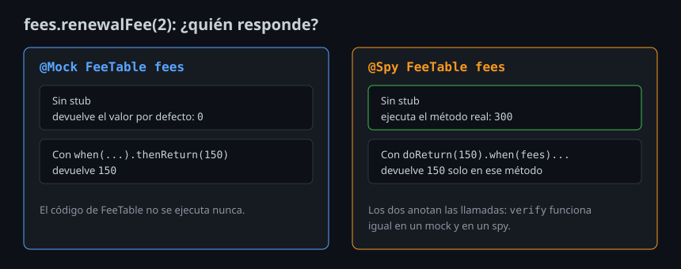

# 03 - Strict stubbing, spies y mockStatic

> Lenguaje: **Java**



---

## 🎯 Objetivos

- Reconocer los dos errores de strict stubbing y corregir el test que los provoca.
- Elegir entre `@Mock` y `@Spy`, y cambiar una respuesta de un spy con `doReturn`.
- Hacer un mock de un método estático con `mockStatic` y saber por qué suele indicar un problema de diseño.

---

## Strict stubbing

`MockitoExtension` trabaja en modo **strict stubs**: trata como error dos descuidos que, sin él, pasarían en silencio.

### Un stub que nadie usa

```java
when(loans.findById("L-3")).thenReturn(Optional.of(new Loan("L-3", "M-001", TODAY, 2)));
when(loans.findById("L-9")).thenReturn(Optional.empty());   // el servicio nunca pide L-9
```

```text
[ERROR]   RenewalServiceTest.shouldRejectAThirdRenewal » UnnecessaryStubbing
Unnecessary stubbings detected.
Clean & maintainable test code requires zero unnecessary code.
Following stubbings are unnecessary (click to navigate to relevant line of code):
  1. -> at com.bootcamp.RenewalServiceTest.shouldRejectAThirdRenewal(RenewalServiceTest.java:68)
Please remove unnecessary stubbings or use 'lenient' strictness. More info: javadoc for UnnecessaryStubbingException class.
```

Un stub que sobra hace creer a quien lee el test que esa llamada importa. Suele aparecer al copiar la preparación de otro test. La solución es borrarlo.

### Un stub con otros argumentos

```java
when(loans.findById("L-9")).thenReturn(Optional.empty());

service.renew("L-8");   // el servicio pide L-8
```

```text
org.mockito.exceptions.misusing.PotentialStubbingProblem:
Strict stubbing argument mismatch. Please check:
 - this invocation of 'findById' method:
    loans.findById("L-8");
    -> at com.bootcamp.RenewalService.renew(RenewalService.java:21)
 - has following stubbing(s) with different arguments:
    1. loans.findById("L-9"); stubbed with: [Returns: Optional.empty]
```

Sin strict stubs, `findById("L-8")` devolvería `Optional.empty()` por defecto y el test pasaría por casualidad.

### lenient

Si un stub compartido no lo usan todos los tests (por ejemplo, en un `@BeforeEach`), puedes marcarlo como permisivo:

```java
lenient().when(members.isActive("M-001")).thenReturn(true);
```

Antes de usarlo, piensa si ese stub debería estar solo en los tests que lo necesitan.

---

## Mock y spy

Un **mock** sustituye al objeto entero: ningún método ejecuta código real. Un **spy** envuelve un objeto real: cada método ejecuta su código de verdad, salvo los que cambies, y además registra las llamadas para `verify` (diagrama de arriba).

```java
@Mock
private FeeTable fees;   // renewalFee(2) devuelve 0

@Spy
private FeeTable fees;   // renewalFee(2) ejecuta FeeTable y devuelve 300
```

`@Spy` sin inicializar crea el objeto con su constructor sin argumentos. Si necesita argumentos: `@Spy private FeeTable fees = new FeeTable(...);`.

| Usa un mock | Usa un spy |
|---|---|
| La dependencia sale del proceso: base de datos, API, correo | La dependencia es una clase real, rápida y sin efectos externos |
| Quieres decidir cada respuesta | Quieres su comportamiento real y, además, verificar llamadas |

Si necesitas un spy para casi todo, a menudo es más simple usar el objeto real y verificar el resultado.

### doReturn en un spy

`when(spy.metodo())` **llama al método real** al preparar el stub. En una lista vacía, eso lanza una excepción antes de llegar a `thenReturn`:

```java
List<String> titles = spy(new ArrayList<>());
when(titles.get(0)).thenReturn("Dune");
```

```text
java.lang.IndexOutOfBoundsException: Index 0 out of bounds for length 0
```

`doReturn` prepara el stub sin llamar al método:

```java
doReturn("Dune").when(titles).get(0);

assertThat(titles.get(0)).isEqualTo("Dune");
assertThat(titles).isEmpty();   // el resto de la lista sigue siendo real
```

En un spy, usa siempre la familia `doReturn`, `doThrow` y `doNothing`. También sirve en un mock para métodos `void`: `doThrow(new IllegalStateException()).when(notifier).send(any());`.

---

## mockStatic

`RenewalService` del lab 03 pregunta la fecha a un método estático de código heredado:

```java
LocalDate today = LegacyCalendar.today();   // LocalDate.now() por dentro
```

Un test que no la controle depende del día en que se ejecute. Desde Mockito 5 (con el inline mock maker, el que carga el agente de la [teoría 01](01-mocks-y-stubbing.md)) se puede hacer un mock del método estático:

```java
try (MockedStatic<LegacyCalendar> calendar = mockStatic(LegacyCalendar.class)) {
    calendar.when(LegacyCalendar::today).thenReturn(TODAY);

    Renewal renewal = service.renew("L-1");

    assertThat(renewal.loan().dueDate()).isEqualTo(TODAY.plusDays(17));
}
```

- El mock solo vale dentro del `try` y en el hilo del test.
- `try` con recursos (*try-with-resources*) llama a `close()` al salir del bloque, aunque el test falle. Sin él, el mock sigue activo y el siguiente test que lo cree falla:

  ```text
  For com.bootcamp.LegacyCalendar, static mocking is already registered in the current thread

  To create a new mock, the existing static mock registration must be deregistered
  ```

### Por qué suele indicar un problema de diseño

Cada test que llega a la fecha necesita su bloque `try`. Es el síntoma de una dependencia escondida: el servicio no recibe el reloj, lo busca. La alternativa es la de la [semana 25](../../week-25-junit_6_avanzado_y_assertj/1-teoria/03-tempdir-y-extensiones.md): recibir un `Clock` por el constructor y llamar a `LocalDate.now(clock)`. El test pasa `Clock.fixed(...)` y no necesita ningún mock.

Reserva `mockStatic` para código que no puedes cambiar (una librería, código heredado sin tests) mientras escribes los tests que te permitan refactorizarlo.

---

## ✅ Resumen

- Strict stubs convierte en error un stub sin usar (`UnnecessaryStubbingException`) y uno con otros argumentos (`PotentialStubbingProblem`).
- Un mock nunca ejecuta código real; un spy sí, salvo en los métodos que cambies con `doReturn`.
- `mockStatic` va siempre en un `try` con recursos, y su presencia es una pista para inyectar la dependencia.

<!-- nav -->
---

## 🔗 Navegación

| Anterior | Siguiente |
|---|---|
| ← [Teoría — 02 - verify, matchers y ArgumentCaptor](02-verify-y-captores.md) | [Teoría — 04 - BDDMockito](04-bddmockito.md) → |

[↑ Semana 26](../README.md)
