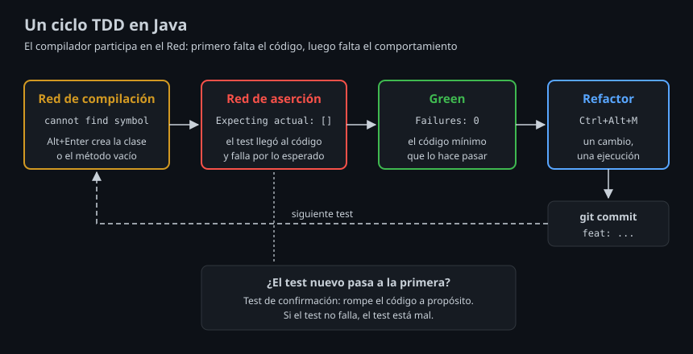

# 01 - El ciclo Red → Green → Refactor en Java

> Lenguaje: **Java**



---

## 🎯 Objetivos

- Recorrer el ciclo Red → Green → Refactor con JUnit 6, AssertJ y Maven.
- Distinguir un Red de compilación de un Red de aserción, y saber cuál de los dos te dice algo.
- Reconocer un test de confirmación: el que pasa en verde a la primera.
- Usar los atajos de IntelliJ IDEA que hacen rápido el ciclo.
- Hacer un commit por ciclo.

---

## De dónde partes

El ciclo ya lo hiciste con Jest en la [semana 11](../../week-11-tdd_con_jest/1-teoria/01-red-green-refactor-fundamentos.md) y con pytest en la [semana 20](../../week-20-tdd_con_python/1-teoria/01-tdd-en-python-ciclo-y-herramientas.md):

1. **Red**: escribe un test con el siguiente comportamiento y ejecútalo. Tiene que fallar.
2. **Green**: escribe el código mínimo que lo hace pasar, aunque sea ingenuo.
3. **Refactor**: mejora nombres y estructura con toda la suite en verde.

En Java cambian dos cosas: el compilador participa en el Red, y casi siempre la unidad mínima es una clase, no una función suelta.

---

## Dos clases de Red

Primer test del kata Prime Factors ([lab 01](../2-practicas/lab-01-prime-factors/README.md)), sin que exista todavía la clase `PrimeFactors`:

```java
@Test
void shouldReturnNoFactorsForOne() {
    assertThat(PrimeFactors.of(1)).isEmpty();
}
```

```bash
mvn test
# [ERROR] COMPILATION ERROR :
# [ERROR] .../PrimeFactorsTest.java:[NN,20] cannot find symbol
```

Es un **Red de compilación**: el test ni siquiera se ejecutó. Te dice qué clase o qué método falta, nada más. En Java es el primer paso de casi todos los ciclos que crean algo nuevo, y se resuelve en segundos con el IDE (`Alt+Enter`, más abajo).

Con la clase creada y un método que todavía no hace nada:

```java
public static List<Integer> of(int n) {
    throw new UnsupportedOperationException("TODO: PrimeFactors.of");
}
```

```bash
mvn test
# [ERROR]   PrimeFactorsTest.shouldReturnNoFactorsForOne:NN » UnsupportedOperation TODO: PrimeFactors.of
# [ERROR] Tests run: 1, Failures: 0, Errors: 1, Skipped: 0
```

Ahora el test sí se ejecutó y llamó al código. Del segundo test en adelante el Red es de **aserción**:

```text
Expecting actual:
  []
to contain exactly (and in same order):
  [2]
```

| Salida | Qué significa | Qué haces |
|---|---|---|
| `COMPILATION ERROR` / `cannot find symbol` | Falta una clase, un método o un import | Créalo vacío o con `UnsupportedOperationException` |
| `Errors: 1` con `UnsupportedOperation` | El test llegó al código, que aún no hace nada | Escribe el Green |
| `Failures: 1` con `Expecting actual` / `expected` | El código hace algo, pero no lo que pide el test | Escribe el Green |
| Pasa en verde | El test no pide nada nuevo | Mira la sección siguiente |

`Failures` cuenta las aserciones que fallaron; `Errors`, las excepciones que nadie esperaba.

---

## El test que pasa a la primera

En el lab 01, después de hacer pasar `of(4)` = `[2, 2]`, el siguiente test es `of(6)` = `[2, 3]`:

```bash
mvn test
# [INFO] Tests run: 5, Failures: 0, Errors: 0, Skipped: 0
```

Pasa sin tocar el código. No es un error del ciclo: es un **test de confirmación**. Pueden pasar dos cosas:

- El código ya era más general de lo que pensabas. Quédate con el test si documenta un caso que alguien querría leer; bórralo si repite otro.
- El test no comprueba lo que crees. Para saberlo, rompe el código a propósito (cambia un `2` por un `3`) y comprueba que el test falla. Si no falla, el test está mal.

En el TDD-LOG del [proyecto](../3-proyecto/README.md) estos ciclos se anotan igual que los demás, con "pasó en verde" en la columna Red.

---

## Ejecutar solo lo que estás tocando

| Comando | Qué ejecuta |
|---|---|
| `mvn test` | Toda la suite |
| `mvn test -Dtest=PrimeFactorsTest` | Una clase |
| `mvn test -Dtest='PrimeFactorsTest#shouldFactorNine'` | Un método |
| `mvn -q test` | Toda la suite, solo con los errores en pantalla |

- **Qué:** `-Dtest` es una opción de Surefire, el plugin que ejecuta los tests.
- **Para qué:** el ciclo es más corto si el Red y el Green tardan lo mínimo.
- **Impacto:** antes de cada commit, ejecuta la suite entera: un Green local puede haber roto otro test.

---

## Atajos de IntelliJ IDEA para TDD

IntelliJ IDEA Community es gratuito y es el IDE más usado en Java. Los atajos son del keymap por defecto de Windows y Linux; en macOS, `Ctrl` suele ser `⌘` y `Alt` es `⌥`.

| Atajo | Qué hace | Cuándo en el ciclo |
|---|---|---|
| `Alt+Enter` | Acciones sobre lo que está bajo el cursor: crear la clase, el método, el campo | Red de compilación |
| `Ctrl+Shift+T` | Salta del código a su test y vuelta; si el test no existe, ofrece crearlo | Siempre |
| `Ctrl+Shift+F10` | Ejecuta el test o la clase donde está el cursor | Red y Green |
| `Shift+F10` | Repite la última ejecución | Red y Green |
| `Ctrl+Alt+M` | Extrae un método | Refactor |
| `Ctrl+Alt+V` / `Ctrl+Alt+C` | Extrae una variable / una constante | Refactor |
| `Shift+F6` | Renombra en todo el proyecto | Refactor |

En la ventana Run, el botón **Rerun Failed Tests** repite solo los que fallaron, y **Toggle auto-test** vuelve a ejecutar la última configuración cada vez que guardas.

En VS Code, con el Extension Pack for Java, el equivalente de `Alt+Enter` es `Ctrl+.` y el de `Shift+F6` es `F2`. Los tests se ejecutan desde el icono que aparece junto a cada `@Test`.

---

## Un commit por ciclo

El proyecto de la semana pide un commit por ciclo, con el tipo de [Conventional Commits](https://www.conventionalcommits.org/es/v1.0.0/) que corresponde:

```bash
git add -A
git commit -m "feat: count late days"
git log --oneline -3
# <hash> feat: count late days
# <hash> test: late days on the due date
# <hash> chore: add ArchUnit
```

Cada `<hash>` es un identificador de siete caracteres distinto en cada repositorio.

| Tipo | Cuándo |
|---|---|
| `test:` | El ciclo solo añade un test (de confirmación, o uno que pasa con un Green trivial) |
| `feat:` | El ciclo añade comportamiento |
| `refactor:` | Un refactor que no cabía en el ciclo anterior |

- **Qué:** el historial cuenta en qué orden creció el código.
- **Para qué:** quien revisa el pull request puede seguir el razonamiento commit a commit, y tú puedes volver al último verde con `git switch --detach <hash>` si un refactor se complica.
- **Impacto:** ningún commit deja la suite en rojo. Si quieres guardar un Red a medias, usa `git stash`.

---

## ✅ Resumen

- En Java, el Red de compilación es el primer paso; el que cuenta es el Red de aserción.
- `Failures` son aserciones que fallaron; `Errors`, excepciones inesperadas.
- Un test que pasa a la primera es un test de confirmación: compruébalo rompiendo el código.
- `-Dtest` y `Shift+F10` hacen corto el ciclo; la suite completa se ejecuta antes de cada commit.

<!-- nav -->
---

## 🔗 Navegación

| Anterior | Siguiente |
|---|---|
| ← [Semana 27 - Java Testing III: TDD con Java](../README.md) | [Teoría — 02 - Diseño emergente y refactoring seguro](02-diseno-emergente-y-refactoring.md) → |

[↑ Semana 27](../README.md)
