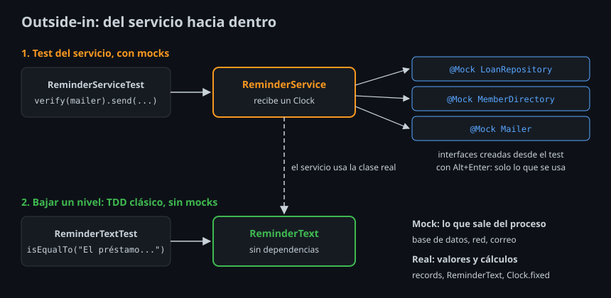

# 03 - Outside-in TDD con Mockito

> Lenguaje: **Java**



---

## 🎯 Objetivos

- Diferenciar TDD inside-out (de las piezas al servicio) de outside-in (del servicio a las piezas).
- Descubrir las interfaces de un servicio escribiendo su test con mocks.
- Programar contra abstracciones: el servicio depende de interfaces y recibe la fecha por un `Clock`.
- Saber qué no se sustituye con un mock.

---

## De dónde partes

En la [semana 26](../../week-26-mockito_mocking_en_java/1-teoria/01-mocks-y-stubbing.md) usaste Mockito para probar un servicio que **ya existía**, con sus interfaces escritas. Esta semana el test se escribe primero, y las interfaces todavía no existen: el test las inventa.

---

## Dos direcciones

| | Inside-out (escuela clásica o de Chicago) | Outside-in (escuela de Londres) |
|---|---|---|
| Por dónde empiezas | Por las piezas sin dependencias: una regla, un cálculo | Por el servicio que usa el cliente |
| Qué dobles usas | Casi ninguno: las piezas se prueban con objetos reales | Mocks para las dependencias que aún no existen |
| Qué verificas | El resultado (estado) | El resultado y las llamadas a las dependencias |
| Riesgo | Construir piezas que el servicio luego no necesita | Tests acoplados a cómo el servicio llama a sus dependencias |

Los labs 01 y 02 son inside-out. El [lab 03](../2-practicas/lab-03-outside-in-con-mockito/README.md) es outside-in. En el [proyecto](../3-proyecto/README.md) se combinan: las reglas de cobro se hacen inside-out y el servicio outside-in.

---

## El test inventa las interfaces

El lab 03 pide un servicio que envíe un correo a cada socio que tiene que devolver un libro mañana. Lo primero que se escribe es el test del servicio, con las dependencias que **debería** tener:

```java
@Mock
private LoanRepository loans;      // ¿qué préstamos vencen mañana?

@Mock
private MemberDirectory members;   // ¿cuál es el correo de este socio?

@Mock
private Mailer mailer;             // envía el correo

@Test
void shouldEmailTheMemberOfEachLoanDueTomorrow() {
    when(loans.findDueOn(MARCH_17)).thenReturn(List.of(ANA_LOAN));
    when(members.emailOf("M-7")).thenReturn(Optional.of("ana@example.com"));

    service.remindLoansDueTomorrow();

    verify(mailer).send(email.capture());
    assertThat(email.getValue().to()).isEqualTo("ana@example.com");
}
```

Nada de eso compila. Cada `cannot find symbol` es una decisión de diseño que el test ya tomó:

| Lo que escribió el test | Lo que creas con `Alt+Enter` |
|---|---|
| `loans.findDueOn(MARCH_17)` devuelve `List.of(...)` | `interface LoanRepository { List<Loan> findDueOn(LocalDate date); }` |
| `members.emailOf("M-7")` devuelve `Optional.of(...)` | `interface MemberDirectory { Optional<String> emailOf(String memberId); }` |
| `mailer.send(email.capture())` con un `Email` que tiene `to()` | `interface Mailer { void send(Email email); }` y `record Email(String to, ...)` |

Las interfaces tienen **solo** los métodos que el servicio usa, con los nombres del problema ("préstamos que vencen el día X"), no los de la tecnología ("ejecutar una consulta SQL"). Las implementaciones reales (la base de datos, el servidor de correo) se escriben más tarde, contra esas interfaces.

---

## Bajar un nivel

Cuando el servicio está en verde con mocks, lo que queda son las piezas que el servicio usa y que no hablan con nadie. En el lab 03, el texto del correo:

```java
@Test
void shouldGiveTheLoanAndItsDueDateInTheBody() {
    assertThat(ReminderText.bodyFor(LOAN)).isEqualTo("El préstamo L-1 vence el 17/03/2026.");
}
```

`ReminderText` no tiene dependencias: se prueba con TDD clásico, sin mocks. Después, un último test del servicio comprueba que el correo usa esos textos.

La regla para decidir: **se sustituye con un mock lo que sale del proceso** (base de datos, red, correo) o lo que todavía no existe. Lo demás se usa de verdad.

---

## Qué no se sustituye con un mock

| No hagas un mock de | Por qué | Usa |
|---|---|---|
| Un `record` o un valor (`Loan`, `Email`) | Crearlo de verdad cuesta una línea y no tiene efectos | `new Loan(...)` |
| Una clase sin dependencias (`ReminderText`) | El mock oculta si el cálculo es correcto | La clase real |
| Clases de la librería estándar (`List`, `LocalDate`) | No son tuyas: si su comportamiento cambia, el mock no se entera | Los objetos reales |
| La fecha de hoy | Ver la sección siguiente | Un `Clock` fijo |

---

## La fecha llega por un Clock

En el lab 03 de la semana 26, el servicio llamaba a un método estático para saber la fecha y el test necesitaba `mockStatic`. Con TDD la pregunta "¿qué día es hoy?" aparece en el test antes de que exista el código, y la respuesta natural es pasarla por el constructor, como cualquier otra dependencia.

`java.time.Clock` es la abstracción de la librería estándar para eso:

```java
// En el test: un reloj parado en el 16 de marzo de 2026
private static final Clock MARCH_16 = Clock.fixed(
    LocalDate.of(2026, 3, 16).atStartOfDay().toInstant(ZoneOffset.UTC), ZoneOffset.UTC);

// En el servicio
LocalDate tomorrow = LocalDate.now(clock).plusDays(1);
```

En producción se pasa `Clock.systemDefaultZone()`. No es un mock: `Clock.fixed` es un reloj de verdad que siempre da la misma hora, un fake que ya trae Java.

Si el servicio se equivoca de día, el strict stubbing de Mockito lo detecta. En el lab 03, con `LocalDate.now(clock)` sin `.plusDays(1)`:

```text
Strict stubbing argument mismatch. Please check:
 - this invocation of 'findDueOn' method:
    loans.findDueOn(2026-03-16);
 - has following stubbing(s) with different arguments:
    1. loans.findDueOn(2026-03-17); ...
```

La [teoría 04](04-archunit-fitness-functions.md) convierte "nadie llama a `LocalDate.now()`" en una regla que se comprueba en cada `mvn test`.

---

## ✅ Resumen

- Outside-in empieza por el test del servicio; sus mocks deciden qué interfaces hacen falta.
- Una interfaz tiene solo los métodos que su cliente usa, con nombres del problema.
- Se hace mock de lo que sale del proceso; los valores y las clases sin dependencias se usan de verdad.
- La fecha llega por un `Clock`; en los tests, `Clock.fixed`.

<!-- nav -->
---

## 🔗 Navegación

| Anterior | Siguiente |
|---|---|
| ← [Teoría — 02 - Diseño emergente y refactoring seguro](02-diseno-emergente-y-refactoring.md) | [Teoría — 04 - Fitness functions de arquitectura con ArchUnit](04-archunit-fitness-functions.md) → |

[↑ Semana 27](../README.md)
