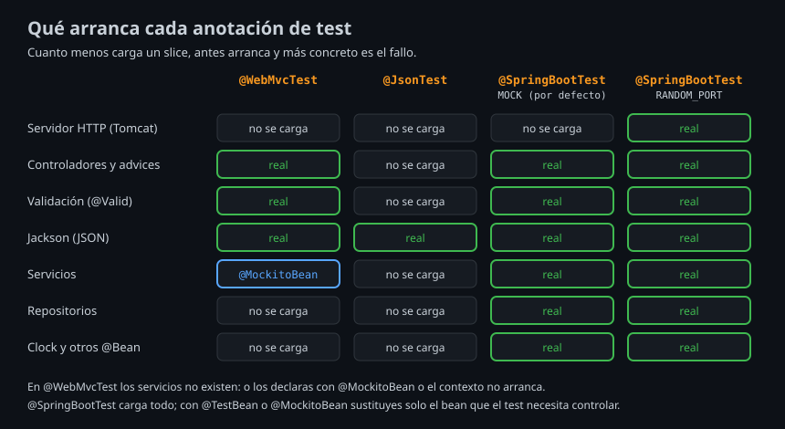

# 01 - El contexto de Spring en los tests y los slices

> Lenguaje: **Java**



---

## 🎯 Objetivos

- Explicar qué es el contexto de Spring y por qué un test que lo arranca es distinto de un test unitario.
- Elegir entre `@WebMvcTest`, `@JsonTest` y `@SpringBootTest` según lo que quieres probar.
- Sustituir un bean del contexto con `@MockitoBean` o `@TestBean`.
- Saber cuándo Spring reutiliza un contexto entre clases de test y cuándo crea otro.

---

## De dónde partes

Hasta la [semana 27](../../week-27-tdd_con_java/README.md) el código del dominio era Java plano: los tests creaban los objetos con `new` y les pasaban mocks de Mockito por el constructor. Esta semana el mismo dominio se expone como una API REST con Spring Boot, y aparece una pregunta nueva: ¿cuánta aplicación hay que arrancar para probar cada cosa?

Los tests de las semanas 26 y 27 **no cambian**. Siguen sin Spring, y siguen siendo la mayoría: en el proyecto del ejemplo son 57 de 75. Spring solo aparece en los tests de lo que Spring hace: recibir HTTP, convertir JSON, validar y conectar los beans entre sí.

---

## Qué es el contexto

Una aplicación Spring Boot arranca un **contexto** (`ApplicationContext`): un contenedor que crea los objetos de la aplicación, llamados **beans**, y le pasa a cada uno sus dependencias por el constructor.

```java
@RestController                       // bean: Spring lo crea
public class PieceController {

    private final PieceService pieces;

    public PieceController(PieceService pieces) {   // Spring busca un bean PieceService y lo pasa aquí
        this.pieces = pieces;
    }
}
```

Es lo mismo que hacías a mano en los tests (`new PieceService(repo, registry, notifier)`), pero lo hace Spring al arrancar. Si falta un bean que alguien necesita, el contexto no arranca y **todos** los tests de esa clase fallan con el mismo error. Lo verás en el [lab 01](../2-practicas/lab-01-webmvctest-y-mockmvc/README.md#paso-5-qué-pasa-sin-el-mockitobean).

---

## El pom.xml de un proyecto Spring Boot

```xml
<parent>
  <groupId>org.springframework.boot</groupId>
  <artifactId>spring-boot-starter-parent</artifactId>
  <version>4.1.1</version>
  <relativePath/>
</parent>
```

- **Qué:** el `pom.xml` hereda de `spring-boot-starter-parent`.
- **Para qué:** el parent fija la versión de cada librería que Spring Boot conoce. Por eso las dependencias de Spring, JUnit, AssertJ y Mockito van **sin** `<version>`: Spring Boot 4.1.1 trae JUnit 6.0.3, AssertJ 3.27.7 y Mockito 5.23.0, las mismas de las semanas 25 a 27.
- **Impacto:** si escribes una versión a mano, sustituyes la del parent y puedes mezclar librerías que no se han probado juntas. Solo llevan versión las que Spring Boot no gestiona, como ArchUnit.

Las dependencias se piden por **starters**: paquetes que agrupan lo necesario para una tarea.

| Starter | Scope | Qué trae |
|---|---|---|
| `spring-boot-starter-webmvc` | compile | Spring MVC, Jackson 3 y Tomcat embebido |
| `spring-boot-starter-validation` | compile | Bean Validation: `@Valid`, `@NotBlank`, `@Positive` |
| `spring-boot-starter-webmvc-test` | test | `@WebMvcTest`, `MockMvc`, `@JsonTest`, `@SpringBootTest`, `RestTestClient` ([teoría 04](04-springboottest-de-extremo-a-extremo.md)), JUnit 6, AssertJ y Mockito |

Desde Spring Boot 4 cada tecnología tiene su propio starter de test. Los tutoriales anteriores usan un único `spring-boot-starter-test`, que sigue existiendo pero ya no trae `@WebMvcTest`.

---

## Slices: arrancar solo una parte

Un **slice** (rebanada) es un test que arranca solo los beans de una capa. El diagrama de arriba resume los tres de esta semana:

| Anotación | Qué carga | Qué pruebas con ella | Teoría |
|---|---|---|---|
| `@WebMvcTest(PieceController.class)` | El controlador, sus `@RestControllerAdvice`, Jackson y la validación. Ni servicios ni repositorios | Rutas, códigos HTTP, JSON de entrada y salida, errores | [02](02-webmvctest-y-mockmvc.md) |
| `@JsonTest` | Solo Jackson, con la configuración `spring.jackson.*` de la aplicación | Los nombres y formatos de los campos del JSON | [03](03-contrato-json-con-jsontest.md) |
| `@SpringBootTest` | Toda la aplicación | Que las piezas encajan: beans, configuración y flujo completo | [04](04-springboottest-de-extremo-a-extremo.md) |

Hay más slices (`@DataJpaTest` para JPA, `@RestClientTest` para clientes HTTP). `@DataJpaTest` necesita una base de datos y en este curso esa base es siempre PostgreSQL: llega en la [semana 29](../../../docs/plan-estudios.md) con Testcontainers. Muchos tutoriales usan H2, una base en memoria, para que `@DataJpaTest` arranque sin Docker; aquí no se usa porque su SQL no es el de PostgreSQL y un test verde con H2 no garantiza nada en producción.

### Por qué no siempre @SpringBootTest

`@SpringBootTest` lo prueba todo a la vez, y por eso cuando falla no dice dónde. Si un test de `@WebMvcTest` falla, el problema está en el controlador o en su JSON; si falla uno de `@SpringBootTest`, puede estar en cualquier bean. La regla de la pirámide de la [semana 1](../../week-01-que_es_testing_calidad_de_software/README.md) sigue valiendo: muchos tests unitarios, bastantes de slice y pocos de la aplicación entera.

---

## Sustituir un bean: @MockitoBean y @TestBean

En un slice, los beans que el controlador necesita y que el slice no carga se declaran en el test:

```java
@WebMvcTest(PieceController.class)
class PieceControllerTest {

    @MockitoBean
    private PieceService pieces;   // un mock de Mockito, registrado como bean del contexto
}
```

| Anotación | Qué pone en el contexto | Cuándo |
|---|---|---|
| `@MockitoBean` | Un mock de Mockito. Lo programas con `when(...)` y lo compruebas con `verify(...)`, igual que en la [semana 26](../../week-26-mockito_mocking_en_java/README.md) | En `@WebMvcTest`, para los servicios |
| `@TestBean` | El objeto que devuelve un método `static` del test con el mismo nombre que el campo | En `@SpringBootTest`, para un bean concreto, como el `Clock` |

Las dos son de Spring Framework (`org.springframework.test.context.bean.override`). `@MockBean`, la anotación que aparece en tutoriales antiguos, se marcó como obsoleta en Spring Boot 3.4 y ya no existe en Spring Boot 4.

---

## El contexto se reutiliza

Arrancar un contexto cuesta tiempo. Spring guarda cada contexto que arranca en una caché y lo reutiliza en cualquier otra clase de test con **la misma configuración**: las mismas anotaciones, los mismos `@MockitoBean` y `@TestBean`, y las mismas propiedades.

El [lab 04](../2-practicas/lab-04-springboottest-y-resttestclient/README.md) tiene dos clases de `@SpringBootTest` con configuraciones distintas. Spring escribe una línea `Started` por cada contexto que arranca:

```bash
mvn test | grep 'Started Loan'
# ... Started LoanApiTest in 1.222 seconds (process running for 2.118)
# ... Started LoanMockMvcTest in 0.185 seconds (process running for 2.936)
```

Dos líneas: dos contextos. Ojo con lo que cuenta como "misma configuración": un `@TestBean` o un `@MockitoBean` pertenece a la clase donde se declara, así que una copia exacta de `LoanApiTest` con otro nombre arranca un tercer contexto. Para compartirlo, la configuración va en una clase base abstracta de la que heredan las clases de test; el lab 04 lo comprueba.

La caché tiene una consecuencia: los beans **se comparten** entre todos los tests que usan el mismo contexto. Un repositorio en memoria conserva lo que guardó el test anterior, y un reloj que un test adelanta sigue adelantado en el siguiente. El lab 04 lo provoca a propósito y lo arregla con un `@BeforeEach`.

`@DirtiesContext` descarta el contexto y obliga a arrancar otro. Funciona, pero cada uso cuesta un arranque; antes de usarlo, prueba a que cada test use sus propios datos (otro código de pieza, otro ISBN) o a devolver el estado al inicial en un `@BeforeEach`.

---

## ✅ Resumen

- El contexto crea los beans y les pasa sus dependencias. Si falta uno, no arranca y fallan todos los tests de la clase.
- El parent de Spring Boot fija las versiones; las dependencias que gestiona van sin `<version>`.
- `@WebMvcTest` carga la capa web, `@JsonTest` solo Jackson y `@SpringBootTest` todo.
- `@MockitoBean` pone un mock en el contexto; `@TestBean` pone el objeto que tú construyes.
- Spring reutiliza un contexto entre clases con la misma configuración, y sus beans se comparten entre tests.

<!-- nav -->
---

## 🔗 Navegación

| Anterior | Siguiente |
|---|---|
| ← [Semana 28 - Java Testing IV: Testing de Spring Boot](../README.md) | [Teoría — 02 - @WebMvcTest, MockMvc y MockMvcTester](02-webmvctest-y-mockmvc.md) → |

[↑ Semana 28](../README.md)
