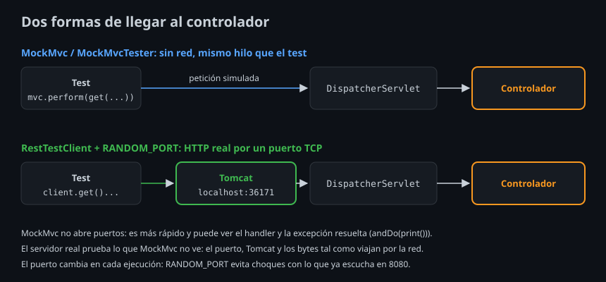

# 04 - @SpringBootTest de extremo a extremo

> Lenguaje: **Java**



---

## 🎯 Objetivos

- Arrancar la aplicación entera en un test con `@SpringBootTest`.
- Diferenciar `WebEnvironment.MOCK` (con `MockMvc`) de `WebEnvironment.RANDOM_PORT` (con `RestTestClient`).
- Sustituir el `Clock` de la aplicación con `@TestBean` para controlar la fecha.
- Escribir tests que no dependen del orden aunque compartan el contexto.

---

## De dónde partes

En la [semana 27](../../week-27-tdd_con_java/1-teoria/03-outside-in-con-mockito.md) la fecha llegaba al servicio por un `Clock`, y los tests pasaban `Clock.fixed(...)` por el constructor. Con Spring, el `Clock` es un bean y el constructor lo llama Spring, no el test. Esta teoría explica cómo cambiar ese bean desde el test.

---

## Dos entornos web

```java
@SpringBootTest                                                     // MOCK, el valor por defecto
@AutoConfigureMockMvc
class LoanMockMvcTest { ... }

@SpringBootTest(webEnvironment = SpringBootTest.WebEnvironment.RANDOM_PORT)
@AutoConfigureRestTestClient
class LoanApiTest { ... }
```

| | `MOCK` | `RANDOM_PORT` |
|---|---|---|
| Servidor | Ninguno | Tomcat, en un puerto libre que elige el sistema |
| Cliente | `MockMvc` o `MockMvcTester` (`@AutoConfigureMockMvc`) | `RestTestClient` (`@AutoConfigureRestTestClient`) |
| Hilo | El del test | Otro: el de Tomcat |
| Qué prueba además | Lo mismo que `@WebMvcTest`, pero con los beans reales | Tomcat y los bytes que viajan por la red |

`RANDOM_PORT` usa un puerto libre distinto en cada ejecución. Spring lo escribe al arrancar:

```text
Tomcat started on port 36171 (http) with context path '/'
```

Con un puerto fijo (`DEFINED_PORT`, el 8080 por defecto), el test falla si otro programa ya usa ese puerto, y dos ejecuciones a la vez chocan entre sí.

---

## RestTestClient

`RestTestClient` es el cliente de test de Spring Framework 7. Ya está configurado con la dirección y el puerto del servidor del test:

```java
@Autowired
private RestTestClient client;

Loan loan = client.post().uri("/api/loans")
    .body(new LoanRequest("978-0307474728", "M-7"))   // el objeto se envía como JSON
    .exchange()                                       // envía la petición
    .expectStatus().isCreated()                       // comprueba el código
    .expectBody(Loan.class)                           // convierte el cuerpo en un Loan
    .returnResult().getResponseBody();                // y lo devuelve
```

Para leer una lista hace falta decir el tipo de sus elementos, porque Java borra los genéricos al compilar:

```java
List<Loan> overdue = client.get().uri("/api/loans/overdue")
    .exchange()
    .expectStatus().isOk()
    .expectBody(new ParameterizedTypeReference<List<Loan>>() { })
    .returnResult().getResponseBody();
```

Los tutoriales anteriores a Spring Boot 4 usan `TestRestTemplate`, que sigue existiendo. `RestTestClient` tiene la misma forma que `WebTestClient` y que `MockMvcTester`: lo que aprendes con uno sirve para los otros.

---

## Cambiar la fecha con @TestBean

La aplicación declara el reloj como un bean:

```java
@Bean
Clock clock() {
    return Clock.systemDefaultZone();
}
```

El test lo sustituye:

```java
@TestBean
private Clock clock;                 // el nombre del campo...

static Clock clock() {               // ...es el nombre del método que crea el sustituto
    return Clock.fixed(Instant.parse("2026-03-20T10:00:00Z"), ZoneOffset.UTC);
}
```

- **Qué:** `@TestBean` sustituye el bean de tipo `Clock` por lo que devuelve el método `static` del mismo nombre que el campo.
- **Para qué:** el servicio, el controlador y todo lo demás son reales; solo la fecha la controla el test.
- **Impacto:** el campo y el método deben coincidir en nombre y el método debe ser `static`. Si no, no se ejecuta ningún test de la clase:

  ```text
  IllegalState No static method found named clock() in com.bootcamp.LoanApiTest with return type java.time.Clock
  ```

`Clock.fixed` no avanza. Para probar lo que pasa "dentro de 15 días", el lab 04 usa un `MutableClock`: un `Clock` de test con un método `advance(Duration)`. Es un fake, como el repositorio en memoria del [proyecto de la semana 26](../../week-26-mockito_mocking_en_java/3-proyecto/README.md).

---

## Tests que comparten el contexto

El contexto se reutiliza entre tests ([teoría 01](01-contexto-de-spring-y-slices.md#el-contexto-se-reutiliza)), y con él sus beans. En un `@SpringBootTest`:

- **El repositorio en memoria conserva lo que guardaron los tests anteriores.** Cada test usa sus propios datos (otro código, otro ISBN) y comprueba con `contains`, no con `containsExactly` ni con un número total de elementos.
- **El reloj que un test adelanta sigue adelantado en el siguiente.** Un `@BeforeEach` lo devuelve a la fecha inicial.
- **El orden de los tests no está garantizado.** Un test que solo pasa si otro se ejecutó antes está roto, aunque hoy pase.

En el lab 04, sin el `@BeforeEach`, el test del vencimiento falla porque el de los préstamos vencidos se ejecutó antes y dejó el reloj 15 días adelante:

```text
[ERROR]   LoanApiTest.shouldSetTheDueDateTwoWeeksFromToday:55
expected: 2026-04-03 (java.time.LocalDate)
 but was: 2026-04-18 (java.time.LocalDate)
```

---

## Cuántos tests de este tipo

Un `@SpringBootTest` por flujo importante, no uno por caso. Los casos de error y los límites ya los cubren los tests unitarios y los de `@WebMvcTest`, que son más rápidos y señalan mejor el fallo. En el proyecto del ejemplo hay tres: registrar y listar, el flujo completo de préstamo y devolución con recargos, y el rechazo de una institución que no está en la configuración. Los tres prueban algo que ningún slice ve: que los beans reales encajan.

---

## ✅ Resumen

- `@SpringBootTest` arranca toda la aplicación; con `RANDOM_PORT` también Tomcat en un puerto libre.
- `RestTestClient` envía HTTP real al servidor del test y convierte las respuestas en objetos.
- `@TestBean` sustituye un bean, como el `Clock`, por el que devuelve un método `static` del test.
- Los beans se comparten entre tests: datos propios en cada test y estado reiniciado en `@BeforeEach`.

<!-- nav -->
---

## 🔗 Navegación

| Anterior | Siguiente |
|---|---|
| ← [Teoría — 03 - El contrato JSON con @JsonTest](03-contrato-json-con-jsontest.md) | [Índice de labs](../2-practicas/README.md) → |

[↑ Semana 28](../README.md)
