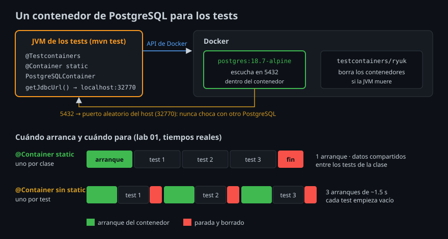

# 01 - Testcontainers y el ciclo de vida de un contenedor

> Lenguaje: **Java**



---

## 🎯 Objetivos

- Explicar qué hace Testcontainers y qué necesita para funcionar.
- Arrancar un PostgreSQL a mano con `GenericContainer`: imagen, variables de entorno, puerto y estrategia de espera.
- Usar `@Testcontainers` y `@Container` para que JUnit arranque y pare el contenedor.
- Elegir entre un contenedor por clase (`static`) y uno por test, sabiendo lo que cuesta cada uno.

---

## De dónde partes

En la [semana 23](../../week-23-testing_de_bases_de_datos_en_python/1-teoria/01-estrategias-y-sqlalchemy.md#postgresql-desechable-con-testcontainers) probaste los repositorios de Python contra un PostgreSQL desechable con Testcontainers para Python. Esta semana es la misma idea en Java; aquí solo se ve lo que cambia.

En la [semana 28](../../week-28-testing_de_spring_boot/README.md) tu API Spring Boot guardaba los datos en un `Map`: al parar la aplicación se perdían, y ningún test ejecutaba una sola línea de SQL. Esta semana los repositorios pasan a PostgreSQL y los tests se ejecutan contra un PostgreSQL de verdad, la misma imagen que usa la aplicación.

### ¿Y H2?

En Java, el equivalente de SQLite en memoria es H2: una base de datos escrita en Java que arranca dentro de la JVM de los tests. Aquí no se usa, por la misma razón que no se usó SQLite en la semana 23: un test verde en H2 no dice cómo se comportará PostgreSQL. H2 tiene un modo de compatibilidad con PostgreSQL, pero sigue siendo otro motor, con otros tipos, otras funciones y otros mensajes de error. El curso tiene una sola base de datos, PostgreSQL, y los tests la usan también.

---

## Qué es Testcontainers

Testcontainers es una librería que, desde el código de un test, le pide a Docker que arranque un contenedor, espera a que el servicio esté listo, te da su host y su puerto, y lo borra al terminar. Para el test, la base de datos es un objeto Java más.

### Requisito: Docker

Testcontainers no trae Docker: usa el que tengas instalado. Comprueba que responde:

```bash
docker version --format '{{.Server.Version}}'
# 29.9.3
```

Si este comando falla, ningún test de esta semana arranca.

### Las dependencias

Testcontainers 2.0.5 tiene un artefacto por pieza. Spring Boot 4.1.1 gestiona su versión, así que en el `pom.xml` van sin `<version>`:

| Artefacto | Qué trae |
|---|---|
| `org.testcontainers:testcontainers-junit-jupiter` | `@Testcontainers` y `@Container`, la extensión de JUnit. Incluye el núcleo, `GenericContainer` |
| `org.testcontainers:testcontainers-postgresql` | `PostgreSQLContainer` ([teoría 02](02-postgresql-esquema-y-migraciones.md)) |
| `org.testcontainers:testcontainers-kafka` | `KafkaContainer` ([teoría 04](04-contenedores-compartidos-y-kafka.md)) |

Si buscas ejemplos en internet, verás nombres más cortos: `junit-jupiter`, `postgresql`. Son los de Testcontainers 1.x. En la versión 2 los artefactos llevan el prefijo `testcontainers-` y las clases de cada módulo están en su propio paquete: `PostgreSQLContainer` se importa de `org.testcontainers.postgresql`.

---

## Un PostgreSQL a mano con GenericContainer

`GenericContainer` arranca cualquier imagen. Este es el contenedor del [lab 01](../2-practicas/lab-01-genericcontainer-y-postgresqlcontainer/README.md):

```java
@Testcontainers
class GenericPostgresTest {

    @Container
    static GenericContainer<?> postgres = new GenericContainer<>(DockerImageName.parse("postgres:18.7-alpine"))
        .withEnv("POSTGRES_USER", "lab")
        .withEnv("POSTGRES_PASSWORD", "lab")
        .withEnv("POSTGRES_DB", "lab")
        .withExposedPorts(5432)
        .waitingFor(Wait.forLogMessage(".*database system is ready to accept connections.*\\s", 2));
```

Línea a línea:

- **`DockerImageName.parse("postgres:18.7-alpine")`**: la imagen oficial, con la versión exacta de [stack-versions](../../../docs/stack-versions.md). Nunca `postgres:latest`: si la etiqueta cambia, tus tests prueban otra base de datos sin que nadie lo decida.
- **`withEnv(...)`**: las mismas variables que pondrías en un `compose.yaml`. La imagen de PostgreSQL crea el usuario y la base de datos al arrancar.
- **`withExposedPorts(5432)`**: el puerto **dentro** del contenedor. Testcontainers lo publica en un puerto libre y aleatorio del host. Así nunca choca con otro PostgreSQL que tengas arrancado.
- **`waitingFor(...)`**: cuándo está listo. Que el proceso del contenedor haya arrancado no basta: PostgreSQL tarda un poco en aceptar conexiones. La imagen escribe `database system is ready to accept connections` dos veces, la primera durante la inicialización con un servidor temporal, y solo la segunda vale.

Para conectarte, pides el host y el puerto publicado:

```java
"jdbc:postgresql://" + postgres.getHost() + ":" + postgres.getMappedPort(5432) + "/lab"
```

En el lab 01 se ve el puerto real:

```text
5432 en el contenedor -> localhost:32769
```

`GenericContainer` sirve para cualquier servicio que tenga imagen de Docker. Para los más comunes hay módulos que ya saben qué variables, puerto y espera necesitan. Con PostgreSQL, todo lo anterior se reduce a `new PostgreSQLContainer("postgres:18.7-alpine")` ([teoría 02](02-postgresql-esquema-y-migraciones.md)).

---

## @Testcontainers y @Container

- **`@Testcontainers`** en la clase registra la extensión de JUnit.
- **`@Container`** marca los campos que la extensión arranca antes de los tests y para después.

Sin `@Testcontainers`, nadie arranca el contenedor, y el primer método que pide su puerto falla:

```text
java.lang.IllegalStateException: Mapped port can only be obtained after the container is started
```

### static o no static

| Campo | Cuándo arranca | Cuándo para | Datos entre tests |
|---|---|---|---|
| `@Container static` | Antes del primer test de la clase | Después del último | Compartidos |
| `@Container` sin `static` | Antes de **cada** test | Después de cada test | Cada test empieza vacío |

Tiempos reales del lab 01, con la imagen ya descargada:

```text
Tests run: 1 ... Time elapsed: 1.918 s -- in com.bootcamp.ModulePostgresTest     # static: 1 arranque
Tests run: 3 ... Time elapsed: 5.912 s -- in com.bootcamp.ContainerPerTestTest   # sin static: 3 arranques
```

Cada arranque de PostgreSQL cuesta alrededor de 1.5 s. Con diez tests por clase, sin `static` pagarías quince segundos para lo que con `static` cuesta uno y medio. Por eso lo normal es `static`, y limpiar los datos entre tests de otra forma: un rollback ([teoría 03](03-serviceconnection-en-spring-boot.md)) o datos distintos en cada test.

El contenedor por test tiene sentido cuando el test cambia algo que no se puede deshacer: la configuración del servidor, un usuario, el propio esquema.

### Ryuk, el que limpia

La primera línea del log de cualquier suite con Testcontainers es esta:

```text
INFO  tc.testcontainers/ryuk:0.14.0 - Container testcontainers/ryuk:0.14.0 started in PT0.396995057S
```

Ryuk es un contenedor auxiliar que vigila la JVM de los tests. Si la JVM termina, incluso con un `kill -9` o si cierras el IDE a mitad de la suite, Ryuk borra todos los contenedores que creó. Gracias a él no se te acumulan PostgreSQL olvidados en Docker.

---

## Java frente a Python

| | Python ([semana 23](../../week-23-testing_de_bases_de_datos_en_python/1-teoria/01-estrategias-y-sqlalchemy.md#la-fixture-del-contenedor)) | Java |
|---|---|---|
| Arrancar y parar | `with PostgresContainer(...) as postgres:` en una fixture | `@Container` en un campo |
| Uno para todos los tests | `scope="session"` | Campo `static` (por clase) o singleton ([teoría 04](04-contenedores-compartidos-y-kafka.md)) |
| URL de conexión | `postgres.get_connection_url()` | `postgres.getJdbcUrl()` |
| Limpieza si el proceso muere | Ryuk | Ryuk |

---

## ✅ Resumen

- Testcontainers arranca contenedores de Docker desde los tests y los borra al terminar, también si la JVM muere (Ryuk).
- `GenericContainer` arranca cualquier imagen: tú le dices el puerto interno y cuándo está listo; él te da el puerto del host.
- `@Testcontainers` registra la extensión; `@Container` marca qué arrancar.
- Un campo `static` arranca un contenedor por clase; sin `static`, uno por test y bastante más lento.
- La imagen va con versión exacta, la misma que en producción.

<!-- nav -->
---

## 🔗 Navegación

| Anterior | Siguiente |
|---|---|
| ← [Semana 29 - Java Testing V: Testcontainers en Java](../README.md) | [Teoría — 02 - PostgreSQL, su esquema y las migraciones](02-postgresql-esquema-y-migraciones.md) → |

[↑ Semana 29](../README.md)
