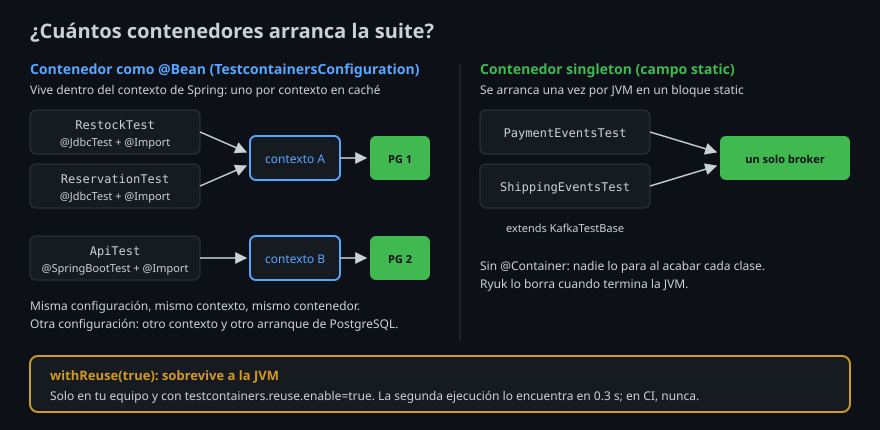

# 04 - Contenedores compartidos, reutilización y Kafka

> Lenguaje: **Java**



---

## 🎯 Objetivos

- Contar cuántos contenedores arranca una suite y reducirlos sin compartir datos por accidente.
- Escribir un contenedor singleton para varias clases de test.
- Usar `withReuse(true)` en tu equipo y explicar por qué nunca en CI.
- Probar un productor de Kafka contra un broker real con `KafkaContainer`.

---

## Cuántos contenedores arrancan

Cada arranque de PostgreSQL cuesta alrededor de 1.5 s, y uno de Kafka alrededor de 0.7 s. En una suite con veinte clases de test, la diferencia entre un contenedor y veinte se nota en cada `mvn test`. Depende de dónde declares el contenedor:

| Dónde está el contenedor | Cuántos arrancan | Lo viste en |
|---|---|---|
| `@Container` sin `static` | Uno por test | [Teoría 01](01-testcontainers-y-el-ciclo-de-vida.md#static-o-no-static) |
| `@Container static` | Uno por clase | Teoría 01 |
| `@Bean` en una `@TestConfiguration` | Uno por contexto de Spring en caché | [Teoría 03](03-serviceconnection-en-spring-boot.md#el-contenedor-como-bean) |
| Campo `static` arrancado en un bloque `static` | Uno por JVM, para todas las clases | Esta teoría |

Con el contenedor como bean, una clase con otra configuración crea otro contexto y otro contenedor. En el lab 03, cambiar `@JdbcTest` por `@SpringBootTest` en `RestockTest` añade un arranque más:

```text
INFO  tc.postgres:18.7-alpine - Container postgres:18.7-alpine started in PT1.782140089S
[INFO] Tests run: 1, Failures: 0, Errors: 0, Skipped: 0, Time elapsed: 2.285 s -- in com.bootcamp.RestockTest
```

Compartir contenedor no significa compartir datos sin control. Cada test sigue siendo responsable de no depender de lo que dejó otro: rollback, datos distintos por test o limpiar antes de empezar.

---

## El contenedor singleton

Para que todas las clases usen el mismo contenedor, sin Spring de por medio, se arranca a mano una sola vez:

```java
abstract class KafkaTestBase {

    static final KafkaContainer KAFKA = new KafkaContainer("apache/kafka-native:4.2.1");

    static {
        KAFKA.start();
    }
}
```

```java
class PaymentEventsTest extends KafkaTestBase { ... }
class ShippingEventsTest extends KafkaTestBase { ... }
```

- **El bloque `static`** se ejecuta la primera vez que la JVM carga `KafkaTestBase`, es decir, con la primera clase que hereda de ella. Las demás encuentran el contenedor ya arrancado.
- **Sin `@Testcontainers` ni `@Container`**: si los pusieras, JUnit pararía el contenedor al acabar la primera clase. Nadie lo para: cuando termina la JVM, Ryuk lo borra.

Si te olvidas del bloque `static`, el contenedor existe pero no arrancó:

```text
java.lang.IllegalStateException: Mapped port can only be obtained after the container is started
```

En el [lab 04](../2-practicas/lab-04-kafka-y-contenedor-compartido/README.md), las dos clases que heredan de `KafkaTestBase` arrancan un único broker.

---

## withReuse(true): entre ejecuciones

Un singleton dura lo que dura la JVM: cada `mvn test` arranca el contenedor otra vez. Testcontainers puede dejarlo vivo entre ejecuciones:

```java
static PostgreSQLContainer postgres = new PostgreSQLContainer("postgres:18.7-alpine").withReuse(true);

static {
    postgres.start();
}
```

Solo funciona si lo activas en tu equipo. Hay dos formas: la línea `testcontainers.reuse.enable=true` en el archivo `~/.testcontainers.properties`, o la variable de entorno `TESTCONTAINERS_REUSE_ENABLE=true`. Dos ejecuciones seguidas del lab 01 con la variable:

```text
# primera ejecución
INFO  tc.postgres:18.7-alpine - Container postgres:18.7-alpine started in PT5.280800797S

# segunda ejecución
INFO  tc.postgres:18.7-alpine - Reusing existing container (09c5da8ebc3c...) and not creating a new one
INFO  tc.postgres:18.7-alpine - Container postgres:18.7-alpine started in PT0.275191223S
```

De 5.3 s a 0.3 s. A cambio:

- **Los datos sobreviven**: la segunda ejecución encuentra las filas de la primera. Tus tests tienen que limpiar antes de empezar, no después.
- **Nadie lo borra**: Ryuk no toca los contenedores reutilizables. Lo borras tú con `docker rm -f <id>`; búscalo con `docker ps --filter label=org.testcontainers.hash`.
- **Con `@Container` no funciona**: la extensión de JUnit para el contenedor al terminar la clase. Hace falta el patrón singleton.
- **Nunca en CI**: allí cada ejecución tiene que empezar de cero, y en un CI no existe tu `~/.testcontainers.properties`. Sin esa configuración, `withReuse(true)` se ignora y el contenedor se comporta como uno normal. Por eso puedes dejarlo en el código.

---

## Kafka

Kafka es un sistema de mensajería: un **productor** escribe mensajes en un **topic** y uno o varios **consumidores** los leen. Un topic se divide en **particiones**, y Kafka solo garantiza el orden dentro de una partición. Los mensajes con la misma **clave** van siempre a la misma partición.

Un mock del productor solo comprueba que tu código llamó a `send`. No comprueba que el mensaje llegue, con qué clave, ni en qué orden lo leerá el consumidor. Para eso hace falta un broker de verdad.

### KafkaContainer

```java
@Container
static KafkaContainer kafka = new KafkaContainer("apache/kafka-native:4.2.1");
```

- **`apache/kafka-native`**: la imagen oficial de Apache Kafka compilada a código nativo. Arranca en menos de un segundo (`started in PT0.719824173S` en el lab 04). La imagen `apache/kafka` es la misma versión sobre la JVM, más lenta en arrancar. Para tests, la nativa.
- **`4.2.1`**: la versión del cliente `kafka-clients` que gestiona Spring Boot 4.1.1. Broker y cliente, de la misma versión.
- **`kafka.getBootstrapServers()`**: la dirección a la que se conectan el productor y el consumidor, con el puerto publicado.

### Probar el orden por clave

En el lab 04, un topic de tres particiones recibe cinco eventos de dos pedidos, intercalados. El consumidor los imprime así:

```text
partición 0 offset 0 ORD-A CREATED
partición 0 offset 1 ORD-A PAID
partición 0 offset 2 ORD-A SHIPPED
partición 2 offset 0 ORD-B CREATED
partición 2 offset 1 ORD-B CANCELLED
```

Cada pedido cayó entero en una partición, en orden. El test comprueba el orden **por pedido**, no el orden total, porque entre particiones Kafka no garantiza nada.

### Leer lo que es asíncrono

El consumidor no recibe los mensajes en cuanto los pides: `poll` devuelve lo que haya llegado en ese momento, que puede ser nada. El consumidor del lab repite `poll` hasta tener los mensajes esperados o agotar un plazo de 10 s:

```java
while (records.size() < expected && Instant.now().isBefore(deadline)) {
    consumer.poll(Duration.ofMillis(200)).forEach(records::add);
}
```

Ni un `Thread.sleep` fijo (lento si sobra, inestable si falta) ni un bucle sin plazo (cuelga la suite si el mensaje no llega). Si pides más mensajes de los que llegan, el test espera el plazo entero: la clase del lab pasa de 2.7 s a 18.7 s.

### La primera vez que se usa un topic

Al publicar en un topic que no existe, el log muestra un aviso:

```text
WARN  org.apache.kafka.clients.NetworkClient - [Producer clientId=producer-1] The metadata response from the cluster reported a recoverable issue with correlation id 1 : {shipments=UNKNOWN_TOPIC_OR_PARTITION}
```

El broker de la imagen crea los topics automáticamente al primer uso (con una partición). El productor reintenta y el mensaje llega: el aviso no es un fallo. Cuando el test necesita varias particiones, crea el topic antes con `Admin.createTopics`.

---

## ✅ Resumen

- Un contenedor por test, por clase, por contexto o por JVM: elige el más amplio que no comparta datos sin control.
- El singleton se arranca en un bloque `static` sin `@Container`; Ryuk lo borra al terminar.
- `withReuse(true)` deja el contenedor entre ejecuciones solo si lo activas en tu equipo; en CI se ignora.
- `KafkaContainer` con `apache/kafka-native` da un broker real en menos de un segundo.
- Kafka ordena por partición, y la clave decide la partición: los tests lo comprueban por clave.
- Lo asíncrono se lee con un bucle y un plazo, nunca con un `sleep` fijo.

<!-- nav -->
---

## 🔗 Navegación

| Anterior | Siguiente |
|---|---|
| ← [Teoría — 03 - @ServiceConnection en Spring Boot](03-serviceconnection-en-spring-boot.md) | [Índice de labs](../2-practicas/README.md) → |

[↑ Semana 29](../README.md)
