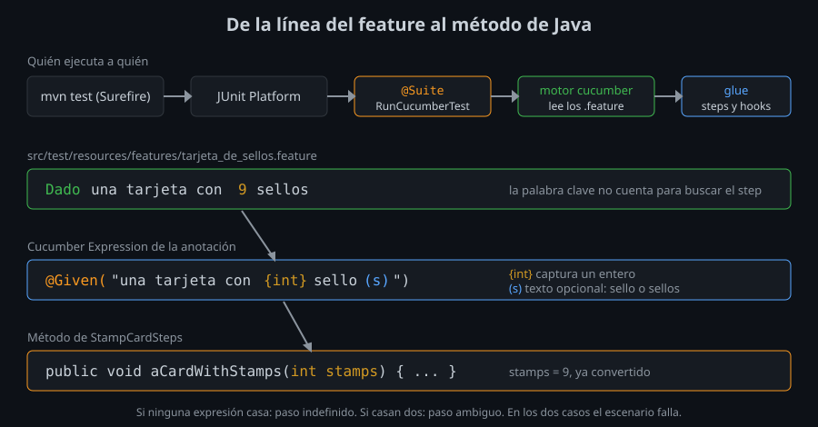

# 01 - Cucumber en Java

> Lenguaje: **Java**

---

## 🎯 Objetivos

- Montar Cucumber en un proyecto Maven con su BOM y ejecutarlo con JUnit Platform.
- Escribir step definitions con `@Given`, `@When` y `@Then` y Cucumber Expressions.
- Leer los mensajes de un paso indefinido y de un paso ambiguo.

---

## De dónde partes

En la [semana 22](../../week-22-bdd_con_python_behave/1-teoria/01-bdd-y-gherkin.md) viste qué es BDD, cómo se escribe Gherkin y por qué un escenario declarativo se lee mejor que uno imperativo. Todo eso vale igual aquí: los archivos `.feature` no cambian de un lenguaje a otro. Lo que cambia es quién los ejecuta.

| | behave (semana 22) | Cucumber para Java |
|---|---|---|
| Dónde van los features | `features/` en la raíz | `src/test/resources/features/` |
| Steps | funciones con `@given`, `@when`, `@then` | métodos con `@Given`, `@When`, `@Then` |
| Parámetros del step | `{cantidad:d}` (formato de `parse`) | `{int}` (Cucumber Expressions) |
| Estado del escenario | el objeto `context` | campos de la clase de steps o un bean compartido ([teoría 03](03-estado-y-cucumber-spring.md)) |
| Cómo se lanza | `uv run behave` | `mvn test`, como el resto de tests de Java |

---

## Las dependencias

Spring Boot no gestiona la versión de Cucumber. El `pom.xml` importa su BOM (*bill of materials*) en `dependencyManagement` y, a partir de ahí, las dependencias de Cucumber se escriben sin versión:

```xml
<dependencyManagement>
  <dependencies>
    <dependency>
      <groupId>io.cucumber</groupId>
      <artifactId>cucumber-bom</artifactId>
      <version>8.1.0</version>
      <type>pom</type>
      <scope>import</scope>
    </dependency>
  </dependencies>
</dependencyManagement>
```

- **Qué:** un `pom` que solo lista versiones, la misma para todos los módulos de Cucumber.
- **Para qué:** que `cucumber-java`, `cucumber-spring` y el motor nunca queden en versiones distintas.
- **Impacto:** al subir de versión, cambias un número en un sitio.

Las dependencias, todas con `<scope>test</scope>`:

| Artefacto | Qué aporta |
|---|---|
| `io.cucumber:cucumber-java` | Las anotaciones `@Given`, `@When`, `@Then`, los hooks y las Cucumber Expressions |
| `io.cucumber:cucumber-junit-platform-engine` | El motor de Cucumber para JUnit Platform. Surefire lo ejecuta igual que a JUnit Jupiter |
| `org.junit.platform:junit-platform-suite` | `@Suite`, la clase que Surefire encuentra y que apunta a los features. Su versión la fija Spring Boot |
| `io.cucumber:cucumber-spring` | Solo si los steps necesitan beans de Spring ([teoría 03](03-estado-y-cucumber-spring.md)) |

---

## Dónde va cada cosa

```text
src/test/
├── java/com/bootcamp/
│   ├── RunCucumberTest.java        # la suite: qué features y qué glue
│   └── StampCardSteps.java         # step definitions (el "glue")
└── resources/features/
    └── tarjeta_de_sellos.feature   # Gherkin
```

*Glue* es el nombre que Cucumber da al código que une el Gherkin con Java: las clases de steps, los hooks y los tipos de parámetro. Se le indica como un paquete.



---

## La suite

Surefire no sabe qué es un `.feature`: ejecuta clases. La clase de la suite es el puente:

```java
@Suite
@IncludeEngines("cucumber")
@SelectPackages("features")
@ConfigurationParameter(key = GLUE_PROPERTY_NAME, value = "com.bootcamp")
@ConfigurationParameter(key = PLUGIN_PROPERTY_NAME, value = "pretty")
class RunCucumberTest {
}
```

| Anotación | Qué hace |
|---|---|
| `@Suite` | La convierte en una suite de JUnit Platform. Surefire la encuentra porque su nombre termina en `Test` |
| `@IncludeEngines("cucumber")` | La suite solo usa el motor de Cucumber, no el de Jupiter |
| `@SelectPackages("features")` | Ejecuta los `.feature` del paquete `features` del classpath, es decir, de `src/test/resources/features/` |
| `GLUE_PROPERTY_NAME` | El paquete donde Cucumber busca steps y hooks (`cucumber.glue`) |
| `PLUGIN_PROPERTY_NAME` | Cómo informa de los resultados. `pretty` imprime cada escenario en la consola ([teoría 04](04-reportes-tags-y-documentacion-viva.md)) |

Los dos `GLUE_PROPERTY_NAME` y `PLUGIN_PROPERTY_NAME` son constantes de `io.cucumber.junit.platform.engine.Constants`, importadas con `import static`.

En muchos ejemplos de internet verás `@SelectClasspathResource("features")`. Con Cucumber 8 funciona, pero avisa:

```text
WARNING: TestEngine with ID 'cucumber' encountered a non-critical issue during test discovery:
(1) [WARNING] The classpath resource selector 'features' should not be used to select features in a package. Use the package selector with 'features' instead
```

`@SelectClasspathResource` es para un archivo concreto (`"features/tarjeta_de_sellos.feature"`); para una carpeta, `@SelectPackages`.

Cada escenario se cuenta como un test:

```bash
mvn test
# Escenario: Un café suma un sello      # classpath:features/tarjeta_de_sellos.feature:5
#   ✔ Dado una tarjeta nueva            # com.bootcamp.StampCardSteps.aNewCard()
#   ✔ Cuando compro 1 café              # com.bootcamp.StampCardSteps.iBuyCoffees(int)
#   ✔ Entonces la tarjeta tiene 1 sello # com.bootcamp.StampCardSteps.theCardHasStamps(int)
# [INFO] Tests run: 1, Failures: 0, Errors: 0, Skipped: 0, Time elapsed: 0.156 s -- in com.bootcamp.RunCucumberTest
```

---

## Step definitions

Un step es un método público con una anotación que lleva una expresión:

```java
public class StampCardSteps {

    private StampCard card;

    @Given("una tarjeta nueva")
    public void aNewCard() {
        card = new StampCard();
    }

    @When("compro {int} café(s)")
    public void iBuyCoffees(int coffees) {
        card.stamp(coffees);
    }

    @Then("la tarjeta tiene {int} sello(s)")
    public void theCardHasStamps(int expected) {
        assertThat(card.stamps()).isEqualTo(expected);
    }
}
```

La comprobación es una aserción de AssertJ, igual que en un test de JUnit ([semana 25](../../week-25-junit_6_avanzado_y_assertj/README.md)). Si falla, el escenario falla en ese paso.

### La palabra clave no cuenta

Cucumber busca el step solo por el texto que va después de la palabra clave. `@Given`, `@When` y `@Then` son intercambiables: `Y la tarjeta tiene 10 sellos` encuentra el método de `@Then` aunque empiece por `Y`. La anotación sirve para que quien lee el código sepa en qué parte del escenario se usa.

### Gherkin en español

Con `# language: es` en la primera línea, las palabras clave van en español, como en la [semana 22](../../week-22-bdd_con_python_behave/1-teoria/01-bdd-y-gherkin.md#gherkin):

| Español | Inglés |
|---|---|
| `Característica` | `Feature` |
| `Antecedentes` | `Background` |
| `Escenario` | `Scenario` |
| `Esquema del escenario` y `Ejemplos` | `Scenario Outline` y `Examples` |
| `Dado`, `Cuando`, `Entonces`, `Y`, `Pero` | `Given`, `When`, `Then`, `And`, `But` |

El código sigue en inglés: `cucumber-java` también trae `@Dado`, `@Cuando` y `@Entonces` (paquete `io.cucumber.java.es`), y son las que verás en los fragmentos que Cucumber sugiere, pero en el curso se usan `@Given`, `@When` y `@Then`, del paquete `io.cucumber.java.en`.

---

## Cucumber Expressions

La expresión de la anotación describe el texto del paso y qué partes son parámetros.

| En la expresión | Casa con | El método recibe |
|---|---|---|
| `{int}` | `9`, `-3` | `int` o `Integer` |
| `{long}`, `{double}`, `{float}` | números de ese tipo | el tipo correspondiente |
| `{word}` | una palabra sin espacios: `MUS-001` | `String` |
| `{string}` | texto entre comillas: `"not enough stamps: 9"` | `String`, sin las comillas |
| `{}` | cualquier cosa | `String` (o el tipo del parámetro, si Cucumber sabe convertirlo) |
| `sello(s)` | `sello` o `sellos` | nada: es texto opcional |
| `café/té` | `café` o `té` | nada: es texto alternativo, de una sola palabra a cada lado |

La alternativa `/` solo separa palabras sueltas. `tengo/no tengo un café gratis` se lee como `tengo` o `no`, seguido de ` tengo un café gratis`: casa con `no tengo un café gratis`, pero `tengo un café gratis` queda como paso indefinido. Para frases distintas, escribe dos steps.

Si la expresión necesita un tipo propio (un precio como `$12.500`, una fecha), se define con `@ParameterType` ([teoría 02](02-tablas-tipos-y-esquemas.md#tipos-de-parámetro-propios)).

---

## Un paso indefinido

Si ningún step casa con una línea, el escenario termina con error, sus pasos siguientes no se ejecutan y Cucumber sugiere el código:

```text
Escenario: Con 10 sellos hay café gratis # classpath:features/tarjeta_de_sellos.feature:11
  ■ Dado una tarjeta con 9 sellos
  ↷ Cuando compro 1 café                 # com.bootcamp.StampCardSteps.iBuyCoffees(int)
  ↷ Entonces la tarjeta tiene 10 sellos  # com.bootcamp.StampCardSteps.theCardHasStamps(int)
  ↷ Y tengo un café gratis
[ERROR] com.bootcamp.RunCucumberTest.Con 10 sellos hay café gratis -- Time elapsed: 0.030 s <<< ERROR!
io.cucumber.junit.platform.engine.UndefinedStepException:
The step 'una tarjeta con 9 sellos' and 1 other step(s) are undefined.
You can implement these steps using the snippet(s) below:

@Dado("una tarjeta con {int} sellos")
public void una_tarjeta_con_sellos(Integer int1) {
    // Write code here that turns the phrase above into concrete actions
    throw new io.cucumber.java.PendingException();
}
```

`■` es el paso indefinido y `↷` los que se saltaron. El fragmento es un punto de partida: cambia la anotación por `@Given`, pon un nombre de método en inglés y, si el paso tiene plural, `sello(s)`.

## Un paso ambiguo

Si dos expresiones casan con la misma línea, Cucumber no elige:

```text
io.cucumber.core.runner.AmbiguousStepDefinitionsException:
"una tarjeta con 9 sellos" matches more than one step definition:
  "una tarjeta con {int} sello(s)" in com.bootcamp.StampCardSteps.aCardWithStamps(int)
  "una tarjeta con {int} sellos" in com.bootcamp.StampCardSteps.duplicate(int)
```

Todos los steps del glue son globales: da igual en qué clase estén. Dos clases no pueden tener el mismo paso.

---

## ✅ Resumen

- El BOM de Cucumber fija una versión para todos sus módulos; Spring Boot no la gestiona.
- Una clase `@Suite` con `@IncludeEngines("cucumber")` y `@SelectPackages("features")` hace que `mvn test` ejecute los features.
- La palabra clave del paso no cuenta para encontrar el step; solo el texto.
- `{int}`, `{word}` y `{string}` capturan parámetros; `(s)` y `a/b` son texto opcional y alternativo.
- Un paso indefinido o ambiguo hace fallar el escenario.

<!-- nav -->
---

## 🔗 Navegación

| Anterior | Siguiente |
|---|---|
| ← [Semana 30 - Java Testing VI: BDD con Java (Cucumber)](../README.md) | [Teoría — 02 - Tablas, tipos de parámetro y esquemas](02-tablas-tipos-y-esquemas.md) → |

[↑ Semana 30](../README.md)
