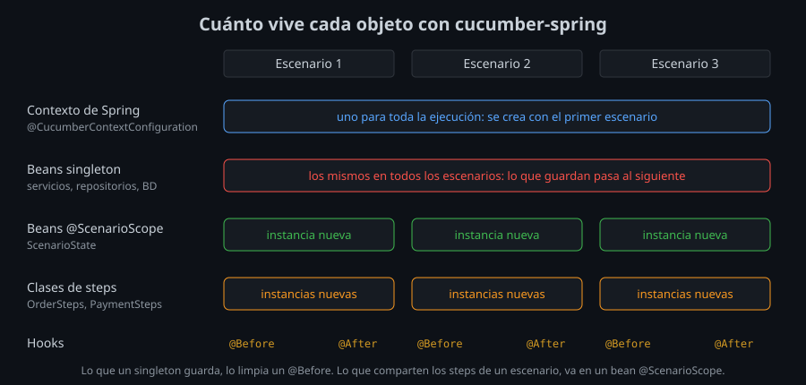

# 03 - Estado entre steps y cucumber-spring

> Lenguaje: **Java**

---

## 🎯 Objetivos

- Saber cuánto vive una clase de steps y por qué sus campos no pasan de un escenario a otro.
- Compartir estado entre clases de steps con un bean `@ScenarioScope`.
- Arrancar Spring Boot para los escenarios con `@CucumberContextConfiguration`.
- Limpiar con hooks lo que un singleton guarda entre escenarios.

---

## Una instancia por escenario

Cucumber crea una instancia nueva de cada clase de steps para cada escenario. El campo `card` de `StampCardSteps` empieza en `null` en todos: un escenario no ve lo que dejó el anterior, sin que tengas que limpiar nada.

En behave había un único `context` por escenario, compartido por todos los steps ([semana 22](../../week-22-bdd_con_python_behave/1-teoria/02-behave-steps-context-y-hooks.md#context-el-estado-del-escenario)). En Java, mientras haya una sola clase de steps, sus campos hacen ese papel.

## El problema: dos clases de steps

Cuando el feature crece, los steps se reparten por temas: `OrderSteps` crea pedidos y `PaymentSteps` los paga. Pero el pago necesita el pedido que creó la otra clase, y cada clase tiene sus propios campos. Hacen falta dos cosas:

1. Un objeto compartido por las dos clases durante el escenario.
2. Que alguien se lo pase a las dos.

Lo segundo es inyección de dependencias. Cucumber no la hace solo: la delega en un módulo. Con `cucumber-picocontainer`, cualquier clase que pidas en el constructor se crea una vez por escenario. Con `cucumber-spring`, los steps se crean como beans de Spring y reciben cualquier bean del contexto. Como en este curso la aplicación ya es Spring Boot, se usa `cucumber-spring`. Hay que elegir uno: con los dos en el classpath, Cucumber no arranca.

---

## @CucumberContextConfiguration

Con `cucumber-spring` en el `pom.xml`, una clase del glue (y solo una) dice cómo se crea el contexto de Spring:

```java
@CucumberContextConfiguration
@SpringBootTest
public class CucumberSpringConfiguration {
}
```

Lleva las mismas anotaciones que pondrías en una clase de test: `@SpringBootTest` busca la clase `@SpringBootApplication` y arranca la aplicación ([semana 28](../../week-28-testing_de_spring_boot/README.md)). Sin esa clase, el primer escenario falla:

```text
io.cucumber.core.backend.CucumberBackendException: Please annotate a glue class with some context configuration.
```

A partir de ahí, las clases de steps reciben beans por el constructor:

```java
public class OrderSteps {

    private final OrderService orders;
    private final ScenarioState state;

    public OrderSteps(OrderService orders, ScenarioState state) {
        this.orders = orders;
        this.state = state;
    }
}
```

Las clases de steps no llevan `@Component`: `cucumber-spring` las registra en el contexto por estar en el glue.

---

## Cuánto vive cada objeto



| Objeto | Vive | Consecuencia |
|---|---|---|
| El contexto de Spring | Toda la ejecución. Se crea con el primer escenario y lo reutilizan todos, gracias a la caché de contextos de la semana 28 | Arrancar Spring Boot (y su PostgreSQL) se paga una vez |
| Un bean singleton (`@Service`, `@Repository`) | Lo mismo que el contexto | **Lo que guarda pasa al siguiente escenario** |
| Un bean `@ScenarioScope` | Un escenario | Estado compartido entre clases de steps, nuevo en cada escenario |
| Una clase de steps | Un escenario | Sus campos empiezan vacíos en cada escenario |

### El estado compartido: @ScenarioScope

```java
@Component
@ScenarioScope
public class ScenarioState {

    private Order order;
    private Throwable error;

    public Order getOrder() {
        return order;
    }

    public void setOrder(Order order) {
        this.order = order;
    }
    // getError() y setError(...) igual
}
```

- **Qué:** un bean con el ámbito *cucumber-glue*: Spring crea una instancia la primera vez que un escenario la pide y la descarta al terminar el escenario.
- **Para qué:** que `OrderSteps` guarde el pedido y `PaymentSteps` lo lea, en el mismo escenario.
- **Impacto:** sin `@ScenarioScope`, el bean sería un singleton y el pedido del escenario anterior seguiría ahí. Necesita `@Component` (o un `@Bean`) porque, a diferencia de los steps, no lo registra Cucumber: lo encuentra el escaneo de componentes de la aplicación, que llega a las clases de test del mismo paquete o de uno por debajo.

#### La trampa: el proxy

Las clases de steps no reciben la instancia del escenario, sino un **proxy**: una subclase que genera Spring (`ScenarioState$$SpringCGLIB$$0`), creada una sola vez, que en cada llamada a un método busca la instancia del escenario actual y le pasa la llamada. Los campos del proxy no se redirigen: son los suyos, y el proxy vive toda la ejecución. Con un campo público, lo escrito en un escenario se lee en el siguiente:

```text
PROBE ScenarioState$$SpringCGLIB$$0 null                                      # state.getOrder() al empezar cada escenario
PROBE ScenarioState$$SpringCGLIB$$0 null
PROBE ScenarioState$$SpringCGLIB$$0 null
PROBE ScenarioState$$SpringCGLIB$$0 null
PROBE ScenarioState$$SpringCGLIB$$0 null                                      # state.last, un campo público
PROBE ScenarioState$$SpringCGLIB$$0 Order[id=1, amount=40000, status=PENDING] # el pedido del escenario anterior
PROBE ScenarioState$$SpringCGLIB$$0 Order[id=2, amount=40000, status=PENDING]
PROBE ScenarioState$$SpringCGLIB$$0 Order[id=3, amount=40000, status=PENDING]
```

Un bean `@ScenarioScope` se usa siempre con métodos y con campos `private` ([lab 03, experimento 3](../2-practicas/lab-03-estado-compartido-con-cucumber-spring/README.md#experimento-3-el-proxy-de-scenarioscope)).

### Lo que guarda un singleton

En el [lab 03](../2-practicas/lab-03-estado-compartido-con-cucumber-spring/README.md), `OrderService` guarda los pedidos en un `Map`. Es un singleton, así que los pedidos del primer escenario siguen ahí en el segundo:

```text
[ERROR] com.bootcamp.RunCucumberTest.Pagar el importe exacto -- Time elapsed: 0.031 s <<< FAILURE!
java.lang.AssertionError:

Expected size: 0 but was: 1 in:
[Order[id=1, amount=40000, status=PENDING]]
	at ✽.hay 0 pedidos pendientes(classpath:features/pago.feature:14)
```

`Order[id=1]` es el pedido del primer escenario. El escenario pasa solo, pero falla detrás de otro: el resultado depende del orden. Con una base de datos pasa lo mismo, porque `@SpringBootTest` no deshace nada al terminar ([semana 29](../../week-29-testcontainers_en_java/1-teoria/03-serviceconnection-en-spring-boot.md#el-rollback-de-jdbctest)). La solución es un hook que deja el estado como al principio.

---

## Hooks

Los hooks son métodos de una clase del glue que Cucumber ejecuta alrededor de cada escenario:

```java
@Before
public void clearOrders() {
    orders.clear();
}

@After
public void logPendingOrders(Scenario scenario) {
    if (scenario.isFailed()) {
        scenario.log("pending orders: " + orders.pending());
    }
}
```

| Hook | Cuándo | Para qué |
|---|---|---|
| `@Before` | Antes de cada escenario, también antes de los `Antecedentes` | Dejar limpio lo que vive más que un escenario: tablas, colas, relojes |
| `@After` | Después de cada escenario, aunque falle | Registrar información del fallo, liberar recursos |
| `@BeforeStep`, `@AfterStep` | Antes y después de cada paso | Rara vez hacen falta |
| `@BeforeAll`, `@AfterAll` | Una vez por ejecución; métodos `static` | Preparar algo caro que no sea un bean |

Detalles que conviene saber:

- Un hook puede recibir `Scenario`: su nombre, sus tags, si falló, y `log(...)`, que escribe texto en la salida y en el reporte del escenario.
- `@Before("@lento")` solo se ejecuta en escenarios con ese tag ([teoría 04](04-reportes-tags-y-documentacion-viva.md#tags)).
- Si hay varios `@Before`, `order = 10` los ordena: primero el número más bajo. En `@After`, primero el más alto.
- Los hooks son globales, como los steps: un `@Before` de `OrderSteps` se ejecuta también en escenarios que no usan ningún paso de esa clase.

El equivalente de behave es `environment.py` con `before_scenario` y `after_scenario` ([semana 22](../../week-22-bdd_con_python_behave/1-teoria/02-behave-steps-context-y-hooks.md#hooks-en-environmentpy)).

---

## Con la aplicación completa

En el proyecto, los escenarios hablan HTTP con la API, que guarda en PostgreSQL. La configuración junta lo de las semanas 28 y 29:

```java
@CucumberContextConfiguration
@SpringBootTest(webEnvironment = SpringBootTest.WebEnvironment.RANDOM_PORT)
@Import({TestcontainersConfiguration.class, CucumberSpringConfiguration.ClockConfiguration.class})
@AutoConfigureRestTestClient
public class CucumberSpringConfiguration { ... }
```

Tres cosas cambian respecto a un test de JUnit:

1. **La base de datos se limpia en un `@Before`**, con `TRUNCATE` de las tablas del dominio. No hay rollback, y el contenedor se comparte entre todos los escenarios.
2. **El reloj es un bean de test que los escenarios mueven.** Un `Clock.fixed` no sirve para "pasan 33 días". `TestClock` es un `Clock` con `setToday(...)` y `advanceDays(...)`, declarado como `@Bean @Primary`: los servicios lo reciben en lugar del `Clock` del sistema. No se usa `@TestBean` porque los steps necesitan el tipo `TestClock` para moverlo.
3. **La respuesta HTTP se guarda en el bean `@ScenarioScope`**, para que un paso haga la petición y otro compruebe el código y el cuerpo.

---

## ✅ Resumen

- Cada clase de steps se crea de nuevo en cada escenario; para compartir entre clases, un bean `@ScenarioScope`.
- `@CucumberContextConfiguration`, en una sola clase del glue, dice cómo arrancar Spring.
- El contexto de Spring y sus singletons duran toda la ejecución: lo que guardan, lo limpia un `@Before`.
- Los hooks son globales y pueden recibir `Scenario`.
- Con `@SpringBootTest` no hay rollback: limpia las tablas antes de cada escenario.

<!-- nav -->
---

## 🔗 Navegación

| Anterior | Siguiente |
|---|---|
| ← [Teoría — 02 - Tablas, tipos de parámetro y esquemas](02-tablas-tipos-y-esquemas.md) | [Teoría — 04 - Reportes, tags y documentación viva](04-reportes-tags-y-documentacion-viva.md) → |

[↑ Semana 30](../README.md)
