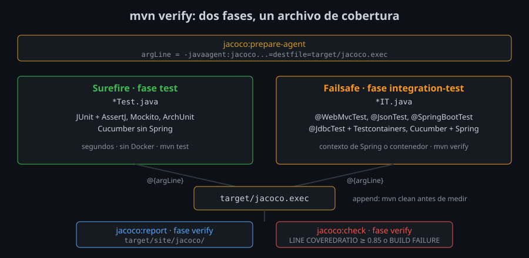

# 01 - La suite Java completa

> Lenguaje: **Java**

Esta semana no hay conceptos de testing nuevos. Juntas en una sola suite lo que construiste entre las semanas 25 y 30, la separas en tests rápidos y tests de integración, y la mides con JaCoCo.

---

## 🎯 Objetivos

- Separar los tests unitarios de los de integración con Surefire y Failsafe.
- Medir con JaCoCo la cobertura de las dos fases en una sola cifra y hacer fallar el build por debajo del 85 %.
- Escribir un reporte de testing con datos reales de la suite.

---

## De seis semanas a una suite

El proyecto Java de tu repositorio ya es una sola aplicación: cada semana añadió piezas sobre la anterior. Esta tabla dice qué tipo de test dejó cada semana y en qué fase va:

| Semana | Pieza | Tests | Fase |
|---|---|---|---|
| [25](../../week-25-junit_6_avanzado_y_assertj/README.md) | JUnit 6 y AssertJ: anidados, parametrizados | Reglas del dominio | Unitaria |
| [26](../../week-26-mockito_mocking_en_java/README.md) | Mockito | Servicios con dependencias simuladas | Unitaria |
| [27](../../week-27-tdd_con_java/README.md) | TDD y ArchUnit | Servicios y reglas de arquitectura | Unitaria |
| [28](../../week-28-testing_de_spring_boot/README.md) | `@WebMvcTest`, `@JsonTest`, `@SpringBootTest` | Controladores, JSON, API completa | Integración |
| [29](../../week-29-testcontainers_en_java/README.md) | `@JdbcTest` con Testcontainers | Repositorios contra PostgreSQL | Integración |
| [30](../../week-30-bdd_con_java_cucumber/README.md) | Cucumber con `cucumber-spring` | Features contra la API completa | Integración |

La estructura de `java/` queda así:

```text
java/
├── pom.xml                   # Surefire, Failsafe y JaCoCo
├── testing-report-java.md    # el reporte de esta semana
├── TDD-LOG.md                # semana 27
└── src/
    ├── main/java/...         # código del dominio, web e infraestructura
    └── test/
        ├── java/...
        │   ├── *Test.java    # unitarios: Surefire, en mvn test
        │   └── *IT.java      # integración: Failsafe, en mvn verify
        └── resources/features/
```



---

## Dos fases: Surefire y Failsafe

En la [semana 24](../../week-24-proyecto_integrador_python/1-teoria/01-la-suite-python-completa.md#una-marca-por-capa) separaste las capas con una marca de pytest por carpeta. En Maven la separación habitual está en el nombre de la clase, y la ejecutan dos plugins distintos:

| | Surefire | Failsafe |
|---|---|---|
| Qué clases ejecuta por defecto | `*Test`, `Test*`, `*Tests`, `*TestCase` | `*IT`, `IT*`, `*ITCase` |
| En qué fase | `test` | `integration-test`, y comprueba el resultado en `verify` |
| Comando | `mvn test` | `mvn verify` (ejecuta también Surefire antes) |
| Informes | `target/surefire-reports/` | `target/failsafe-reports/` |

El criterio para decidir el nombre es qué arranca el test, no qué herramienta usa:

| Si el test... | Nombre | Ejemplos |
|---|---|---|
| Solo crea objetos de Java, con o sin mocks | `*Test` | JUnit con AssertJ, Mockito, ArchUnit, un feature de Cucumber sin Spring |
| Arranca un contexto de Spring o un contenedor | `*IT` | `@WebMvcTest`, `@JsonTest`, `@JdbcTest`, `@SpringBootTest`, Cucumber con `cucumber-spring` |

Un feature de Cucumber que llama directamente a una clase del dominio es tan rápido como un test unitario. El mismo feature contra la API con PostgreSQL tarda segundos. Lo que cuenta es el coste, no la herramienta.

Failsafe no está activo por defecto. `spring-boot-starter-parent` ya fija su versión y sus dos *goals*, así que basta con declararlo:

```xml
<plugin>
  <groupId>org.apache.maven.plugins</groupId>
  <artifactId>maven-failsafe-plugin</artifactId>
</plugin>
```

**Qué:** Failsafe ejecuta los `*IT` en la fase `integration-test` y comprueba el resultado en `verify`.
**Para qué:** que `mvn test` ejecute en segundos solo lo que no necesita Spring ni Docker, y `mvn verify` la suite entera.
**Impacto:** sin el plugin, ni `mvn test` ni `mvn verify` ejecutan los `*IT`, y Maven no avisa ([lab 01](../2-practicas/lab-01-test-e-it-con-surefire-y-failsafe/README.md#paso-0-lo-que-no-se-ejecuta)).

Failsafe tiene dos *goals* por una razón: si un `*IT` falla en `integration-test`, Maven sigue hasta `post-integration-test` (donde se pararía un servidor arrancado antes) y el build falla después, en `verify`.

| Opción | Qué hace |
|---|---|
| `-DskipITs` | Salta Failsafe; Surefire sí se ejecuta |
| `-Dit.test=JdbcPieceRepositoryIT` | Failsafe ejecuta solo esa clase |
| `-Dtest=ReturnFeesTest` | Surefire ejecuta solo esa clase |
| `-DskipTests` | Salta los dos |

---

## Cobertura con JaCoCo

En la [semana 21](../../week-21-coverage_y_calidad_en_python/README.md) mediste Python con coverage.py. JaCoCo hace lo mismo en Java, con un mecanismo distinto: es un **agente de Java** que se carga al arrancar la JVM de los tests y anota qué instrucciones del *bytecode* se ejecutan.

```xml
<plugin>
  <groupId>org.jacoco</groupId>
  <artifactId>jacoco-maven-plugin</artifactId>
  <version>0.8.16</version>
  <executions>
    <execution>
      <id>agent</id>
      <goals>
        <goal>prepare-agent</goal>
      </goals>
    </execution>
    <execution>
      <id>report-and-check</id>
      <phase>verify</phase>
      <goals>
        <goal>report</goal>
        <goal>check</goal>
      </goals>
      <configuration>
        <rules>
          <rule>
            <element>BUNDLE</element>
            <limits>
              <limit>
                <counter>LINE</counter>
                <value>COVEREDRATIO</value>
                <minimum>0.85</minimum>
              </limit>
            </limits>
          </rule>
        </rules>
      </configuration>
    </execution>
  </executions>
</plugin>
```

| Goal | Cuándo | Qué hace |
|---|---|---|
| `prepare-agent` | Al principio del build | Guarda en la propiedad `argLine` la opción `-javaagent:...jacoco...=destfile=target/jacoco.exec` |
| `report` | En `verify`, después de Failsafe | Lee `target/jacoco.exec` y escribe `target/site/jacoco/` (HTML, `jacoco.xml` y `jacoco.csv`) |
| `check` | En `verify` | Compara la cobertura con las reglas y falla el build si no llega |

La regla dice: en todo el proyecto (`BUNDLE`), la proporción de líneas cubiertas (`LINE`, `COVEREDRATIO`) debe ser al menos 0.85. Es el `fail_under = 85` de coverage.py.

### Una sola cifra para las dos fases

Surefire y Failsafe arrancan cada uno su propia JVM, y los dos le pasan la propiedad `argLine` como opciones. Con `prepare-agent`, las dos JVM cargan el agente y escriben en el mismo `target/jacoco.exec`, que JaCoCo abre en modo *append*. Es el `coverage run --append` de la semana 24, sin escribirlo.

`report` analiza las clases de `target/classes`, no las de test: a diferencia de coverage.py sin `source`, los tests nunca entran en la cifra.

### Las dos trampas

**El `argLine` propio pisa el de JaCoCo.** En la [semana 26](../../week-26-mockito_mocking_en_java/README.md) le diste a Surefire un `<argLine>` para cargar Mockito como agente. Un `<argLine>` escrito en la configuración del plugin sustituye a la propiedad, y la JVM de los tests arranca sin JaCoCo. No hay error ni aviso: la clase sale al 0 % aunque sus tests pasen. La solución es incluir la propiedad con `@{argLine}`:

```xml
<argLine>@{argLine} -javaagent:${org.mockito:mockito-core:jar} -Xshare:off</argLine>
```

`@{...}` es una sustitución tardía: Surefire la resuelve justo antes de lanzar la JVM, cuando `prepare-agent` ya ha definido `argLine`. Con `${argLine}`, Maven la sustituiría al leer el `pom.xml`, antes de que exista.

**`jacoco.exec` sobrevive entre ejecuciones.** El modo *append* también suma la ejecución anterior. Si ejecutas `mvn verify` y luego `mvn verify -DskipITs`, la segunda cifra incluye lo que cubrieron los `*IT` de la primera. Para medir una ejecución, empieza con `clean`: `mvn clean verify`.

---

## El reporte de testing

`testing-report-java.md` tiene las mismas cinco secciones que el de Python. Cambia de dónde salen los datos:

| Sección | De dónde salen los datos |
|---|---|
| Suite por capas | Las líneas `Tests run:` de Surefire y Failsafe en `mvn clean verify`, y el tiempo de `mvn clean verify -DskipITs` |
| Cobertura | `target/site/jacoco/jacoco.csv`, convertido en tabla con `awk` ([lab 02](../2-practicas/lab-02-jacoco-umbral-y-reporte/README.md#paso-4-los-datos-del-reporte)) |
| Tests más lentos | `Time elapsed` de `target/*-reports/*.txt`, por clase |
| Riesgos y huecos | Tu análisis: qué no prueba la suite |
| Próximos pasos | Los tests que añadirías primero |

Surefire y Failsafe miden el tiempo por clase, no por método. En un `*IT`, ese tiempo incluye arrancar el contexto de Spring y el contenedor, como el *setup* de `--durations` en pytest.

---

## ✅ Resumen

- `*Test` va en Surefire (`mvn test`) y `*IT` en Failsafe (`mvn verify`). El nombre depende de lo que arranca el test.
- Failsafe hay que declararlo: sin él, los `*IT` no se ejecutan y nadie avisa.
- `prepare-agent` carga JaCoCo en las JVM de los dos plugins, que escriben en el mismo `jacoco.exec`.
- `check` hace fallar el build por debajo del umbral.
- Un `<argLine>` propio necesita `@{argLine}`, y cada medición empieza con `clean`.

<!-- nav -->
---

## 🔗 Navegación

| Anterior | Siguiente |
|---|---|
| ← [Semana 31 - Proyecto Integrador: Etapa 3 (Java)](../README.md) | [Índice de labs](../2-practicas/README.md) → |

[↑ Semana 31](../README.md)
