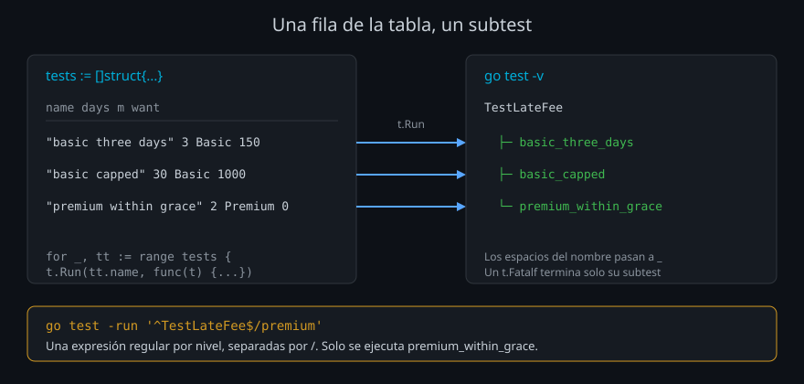

# 02 - Table-driven tests y subtests

> Lenguaje: **Go**

Go no tiene `test.each`, `@pytest.mark.parametrize` ni `@ParameterizedTest`. La parametrización es un patrón de código: una tabla de casos y un bucle que ejecuta cada uno como **subtest**. Es la forma por defecto de escribir tests en Go.

---

## 🎯 Objetivos

- Escribir un table-driven test con un subtest por fila.
- Ejecutar un subtest concreto con `-run 'TestX/caso'`.
- Ejecutar los subtests en paralelo con `t.Parallel()` y entender qué cambió en Go 1.22.
- Cambiar el orden de los tests con `-shuffle=on`.

---

## La tabla

```go
func TestLateFee(t *testing.T) {
	tests := []struct {
		name string
		days int
		m    Membership
		want int
	}{
		{name: "basic three days", days: 3, m: Basic, want: 150},
		{name: "basic capped", days: 30, m: Basic, want: 1000},
		{name: "premium within grace", days: 2, m: Premium, want: 0},
	}
	for _, tt := range tests {
		t.Run(tt.name, func(t *testing.T) {
			got, err := LateFee(tt.days, tt.m)
			if err != nil {
				t.Fatalf("LateFee(%d, %v) returned error: %v", tt.days, tt.m, err)
			}
			if got != tt.want {
				t.Errorf("LateFee(%d, %v) = %d, want %d", tt.days, tt.m, got, tt.want)
			}
		})
	}
}
```

| Parte | Qué es |
|---|---|
| `tests := []struct{...}{...}` | Un *slice* de un `struct` anónimo: cada campo es una entrada o la salida esperada, cada elemento es un caso |
| `name` | El nombre del caso. Va el primero por convención |
| `for _, tt := range tests` | Recorre la tabla. `tt` es la convención para "test table" |
| `t.Run(tt.name, func(t *testing.T) {...})` | Crea un subtest con su propio `t` |

Añadir un caso es añadir una línea a la tabla. Es lo mismo que en la [semana 8](../../week-08-matchers_avanzados_y_parametrizacion/README.md) con `test.each`, la [17](../../week-17-parametrizacion_y_marks_con_pytest/README.md) con `parametrize` y la [25](../../week-25-junit_6_avanzado_y_assertj/README.md) con `@CsvSource`. La diferencia: aquí la tabla es código normal de Go. Un campo puede ser una fecha, un `struct` o una función, sin convertidores.



### Por qué `t.Run` y no solo el bucle

Sin `t.Run`, el bucle funciona, pero los casos no tienen nombre: un `t.Fatalf` en la segunda fila para el test entero y las demás filas no se ejecutan. Con `t.Run`:

- cada fila es un test con nombre propio, `TestLateFee/basic_capped`, que aparece en `-v` y en el mensaje de fallo;
- un `t.Fatalf` termina solo ese subtest; las demás filas siguen;
- se puede ejecutar una sola fila con `-run`.

`go test` cambia los espacios del nombre por `_`. Si dos filas tienen el mismo nombre, la segunda pasa a llamarse `nombre#01`: los nombres repetidos no dan error, pero confunden.

---

## Filtrar con `-run`

`-run` recibe una expresión regular por cada nivel, separados por `/`:

| Comando | Qué ejecuta |
|---|---|
| `go test -run TestLateFee ./...` | `TestLateFee` y cualquier test cuyo nombre la contenga, como `TestLateFeeRejectsNegativeDays` |
| `go test -run '^TestLateFee$' ./...` | Solo `TestLateFee`, con todas sus filas |
| `go test -run '^TestLateFee$/premium' ./...` | Las filas de `TestLateFee` cuyo nombre contiene `premium` |
| `go test -run 'TestLateFee/^basic_capped$' ./...` | Una sola fila |

Las expresiones casan con cualquier parte del nombre, no con el nombre entero: `^` y `$` lo anclan. Un test sin subtests casa con `TestX/lo-que-sea` si casa el primer nivel ([lab 02](../2-practicas/lab-02-table-driven-y-subtests/README.md#paso-2-ejecutar-una-fila)).

---

## Tests en paralelo

`t.Parallel()` al principio de un subtest le dice a `go test` que puede ejecutarlo a la vez que los otros subtests paralelos del mismo test:

```go
for _, tt := range tests {
	t.Run(tt.name, func(t *testing.T) {
		t.Parallel()
		// ...
	})
}
```

Con `-v` se ve cómo funciona: cada subtest empieza (`=== RUN`), se pausa (`=== PAUSE`) y continúa (`=== CONT`) cuando el bucle termina, todos a la vez.

**Qué:** `t.Parallel()` pausa el subtest hasta que el test padre termina de crear subtests, y luego los ejecuta en paralelo.
**Para qué:** que una tabla de casos lentos (con archivos, red o una base de datos) tarde lo que el caso más lento, no la suma.
**Impacto:** los casos no pueden compartir estado que se modifique. Si uno escribe en una variable del paquete, el resultado depende del orden.

### La variable del bucle (Go 1.22)

Hasta Go 1.21, `tt` era **una sola variable** que el bucle reescribía en cada vuelta. Los subtests paralelos se ejecutan después del bucle, así que todos leían el último caso. El código antiguo lo arreglaba con una copia, `tt := tt`, dentro del bucle.

Desde Go 1.22, cada vuelta tiene su propia `tt`. La semántica la decide la directiva `go` del `go.mod`, no la versión instalada: un módulo con `go 1.21` sigue con el comportamiento antiguo aunque lo compiles con Go 1.26. En el [lab 02](../2-practicas/lab-02-table-driven-y-subtests/README.md#experimento-2-go-121-y-la-variable-del-bucle) ves una tabla con una fila mal que pasa en verde por eso, y cómo `go vet` lo detecta.

Si ves `tt := tt` en código nuevo con `go 1.22` o superior, sobra.

---

## Orden aleatorio con `-shuffle`

```bash
go test -shuffle=on -v ./...
# -test.shuffle 1794984235677549312
# --- PASS: TestLateFeeRejectsNegativeDays (0.00s)
# --- PASS: TestLateFee (0.00s)
```

**Qué:** `-shuffle=on` ejecuta los tests de cada paquete en un orden aleatorio e imprime la semilla.
**Para qué:** encontrar tests que solo pasan si otro se ejecutó antes, como `--randomize` o `pytest-randomly`.
**Impacto:** si falla, `-shuffle=1794984235677549312` repite el mismo orden. Solo cambia el orden de los tests de primer nivel, no el de los subtests de una tabla.

---

## ✅ Resumen

- La parametrización en Go es una tabla de `struct` y un bucle con `t.Run`.
- Cada fila es un subtest con nombre, que `-run 'TestX/fila'` ejecuta por separado. `^` y `$` anclan el nombre.
- `t.Parallel()` ejecuta las filas a la vez. Desde Go 1.22 (según el `go.mod`), cada vuelta del bucle tiene su variable.
- `-shuffle=on` cambia el orden de los tests e imprime la semilla para repetirlo.

<!-- nav -->
---

## 🔗 Navegación

| Anterior | Siguiente |
|---|---|
| ← [Teoría — 01 - `go test` y el paquete `testing`](01-go-test-y-el-paquete-testing.md) | [Teoría — 03 - Helpers, caja negra y examples](03-helpers-y-caja-negra.md) → |

[↑ Semana 32](../README.md)
