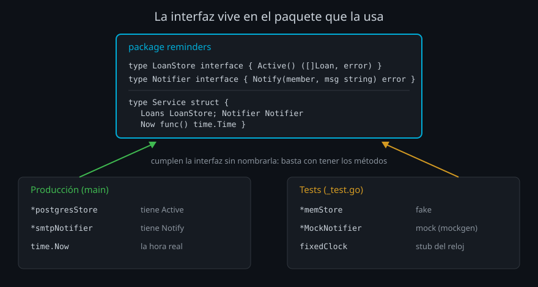

# 01 - Interfaces y dobles escritos a mano

> Lenguaje: **Go**

Los dobles de prueba (dummy, stub, spy, mock, fake) ya los viste con Jest en la [semana 10](../../week-10-mocks_avanzados_en_jest/1-teoria/01-test-doubles-jest.md), con `unittest.mock` en la [semana 18](../../week-18-mocking_con_unittest_mock_y_pytest_mock/1-teoria/01-fundamentos-mocking-python.md) y con Mockito en la [semana 26](../../week-26-mockito_mocking_en_java/1-teoria/01-mocks-y-stubbing.md). En Go la idea es la misma, pero cambia cómo llega el doble al código y quién lo escribe: casi siempre, tú, en unas pocas líneas.

---

## 🎯 Objetivos

- Declarar interfaces pequeñas en el paquete que las usa, no en el que las implementa.
- Escribir a mano un fake, un stub y un spy, y elegir entre ellos.
- Sustituir el reloj y la aleatoriedad para que el test dé siempre el mismo resultado.

---

## Las interfaces se cumplen sin declararlo

En Java, una clase dice `implements BookRepository`. En Go no hay `implements`: un tipo cumple una interfaz si tiene sus métodos, y el compilador lo comprueba donde se usa.

```go
// En el paquete reminders, que es quien la usa.
type LoanStore interface {
	Active() ([]Loan, error)
}

// En los tests: memStore nunca nombra LoanStore, pero tiene Active.
type memStore struct{ loans []Loan }

func (m *memStore) Active() ([]Loan, error) { return slices.Clone(m.loans), nil }
```

Esto cambia dónde se declara la interfaz:

| | Java | Go |
|---|---|---|
| Dónde vive la interfaz | Junto a la implementación (`BookRepository` en el paquete del repositorio) | En el paquete que la **consume** (`LoanStore` en `reminders`) |
| Cuántos métodos | Todos los que ofrece el repositorio | Solo los que usa el consumidor |
| Quién la nombra | La clase que la implementa | Nadie: basta con tener los métodos |



**Qué:** el servicio declara una interfaz con los métodos que usa, y recibe sus dependencias como campos de ese tipo.
**Para qué:** que el test pueda pasar cualquier tipo con esos métodos. Con un solo método, un doble escrito a mano ocupa tres líneas.
**Impacto:** cada método que añades a la interfaz lo tiene que implementar cada doble. Si `LoanStore` tuviera también `Add`, el stub que solo devuelve un error dejaría de compilar ([lab 01, experimento 2](../2-practicas/lab-01-interfaces-y-fakes-a-mano/README.md#experimento-2-una-interfaz-más-grande)).

El proverbio de Go lo resume: *"The bigger the interface, the weaker the abstraction"*. `io.Reader`, con un solo método, es la interfaz más usada de la librería estándar.

---

## Los dobles, escritos a mano

Como las interfaces son pequeñas, en Go es normal escribir los dobles sin librería, en el `_test.go`:

| Doble | Qué hace | En el lab 01 |
|---|---|---|
| **Stub** | Devuelve una respuesta fija | `errStore`: `Active` siempre devuelve un error |
| **Spy** | Guarda las llamadas para que el test las compruebe después | `recordingNotifier`: añade cada aviso a un slice |
| **Fake** | Funciona de verdad, pero con un atajo: memoria en lugar de base de datos | `memStore`: guarda los préstamos en un slice |
| **Mock** | Lleva las expectativas dentro y falla solo si no se cumplen | Lo genera mockgen ([teoría 02](02-mockgen-y-testify.md)) |

```go
// Spy: un campo para lo que recibe y otro para lo que debe responder.
type recordingNotifier struct {
	sent []string
	err  error
}

func (r *recordingNotifier) Notify(member, message string) error {
	r.sent = append(r.sent, member+" <- "+message)
	return r.err
}
```

Con el campo `err`, el mismo spy hace también de stub que falla. El test lee `notifier.sent` y lo compara con `slices.Equal`: no hace falta ningún `verify`.

¿Cuándo basta con escribirlo a mano? Cuando la interfaz tiene uno o dos métodos y el test comprueba el **estado** al final (qué se guardó, qué se envió). Cuando el test comprueba la **interacción** (que una llamada ocurra con estos argumentos, tantas veces, o que no ocurra), un mock generado ahorra el código de comprobar a mano.

---

## El reloj y la aleatoriedad también son dependencias

Un servicio que llama a `time.Now()` da un resultado distinto cada día, y un test que depende de él falla cuando cambia la fecha. La solución es la misma que con el almacén: recibir la hora desde fuera.

```go
type Service struct {
	Loans    LoanStore
	Notifier Notifier
	Now      func() time.Time // en producción: time.Now; en el test: un reloj fijo
}
```

```go
// Producción
s := &reminders.Service{Loans: db, Notifier: mailer, Now: time.Now}

// Test
var now = time.Date(2026, time.March, 10, 9, 0, 0, 0, time.UTC)
s := &Service{Loans: store, Notifier: notifier, Now: func() time.Time { return now }}
```

`time.Now` sin paréntesis es la función, no la hora: el servicio la llama cada vez que necesita la hora. Una función basta para el reloj. Una interfaz `Clock` con un método `Now()` hace lo mismo con más código.

Con la aleatoriedad pasa igual. `rand.IntN(4)` usa un generador global con semilla al azar. Si el código recibe un `*rand.Rand`, el test le pasa uno con semilla fija, que da siempre la misma secuencia:

```go
r := rand.New(rand.NewPCG(1, 2)) // math/rand/v2: misma semilla, mismos números
```

| Dependencia oculta | Se inyecta como | Equivalente que ya conoces |
|---|---|---|
| `time.Now()` | `Now func() time.Time` | `jest.useFakeTimers` ([semana 9](../../week-09-testing_asincrono_con_jest/1-teoria/03-fake-timers-jest.md)), `Clock` en Java |
| `rand.IntN` | `*rand.Rand` con semilla fija | `random.seed` en Python, `new Random(seed)` en Java |

---

## ✅ Resumen

- En Go la interfaz la declara quien la usa, con los métodos que usa. Un tipo la cumple sin nombrarla.
- Con interfaces pequeñas, los stubs, spies y fakes se escriben a mano en pocas líneas.
- Fake o spy para comprobar estado; mock para comprobar interacción.
- La hora y el azar se reciben desde fuera: `Now func() time.Time` y un `*rand.Rand` con semilla fija.

<!-- nav -->
---

## 🔗 Navegación

| Anterior | Siguiente |
|---|---|
| ← [Semana 33 - Interfaces y Dobles de Prueba en Go](../README.md) | [Teoría — 02 - Mocks con mockgen y aserciones con testify](02-mockgen-y-testify.md) → |

[↑ Semana 33](../README.md)
