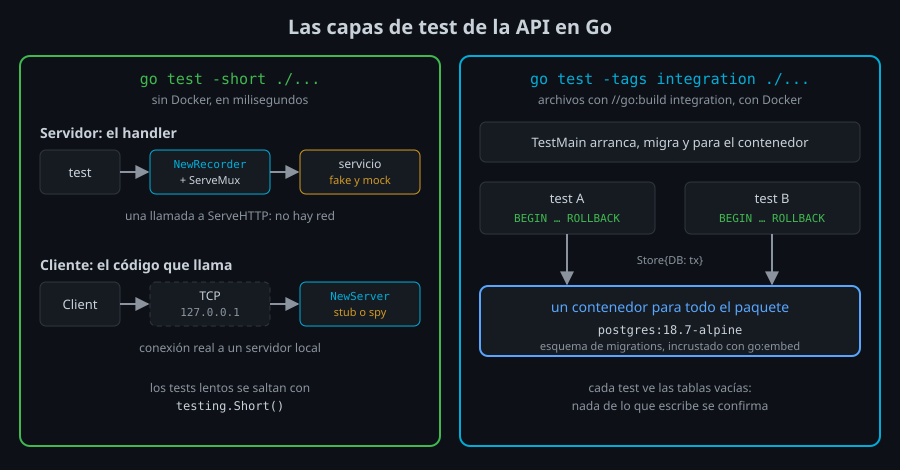

# 01 - httptest: handlers y clientes

> Lenguaje: **Go**

Ya probaste una API sin levantar un servidor con Supertest en la [semana 12](../../week-12-apis_rest_con_supertest/README.md), con los transportes de httpx en la [semana 19](../../week-19-testing_de_apis_con_python/README.md) y con `MockMvcTester` en la [semana 28](../../week-28-testing_de_spring_boot/1-teoria/02-webmvctest-y-mockmvc.md). En Go no hace falta ninguna librería: el paquete `net/http/httptest` de la librería estándar cubre los dos lados de una llamada HTTP.

---

## 🎯 Objetivos

- Probar un handler en memoria con `httptest.NewRequest` y `httptest.NewRecorder`.
- Probar un cliente HTTP contra un servidor local con `httptest.NewServer`.
- Usar las rutas con método del `http.ServeMux` y saber qué responde el router por su cuenta.
- Comparar una respuesta JSON campo por campo.

---

## Dos lados, dos herramientas

| Lo que pruebas | Herramienta | Qué hay en medio |
|---|---|---|
| Tu **servidor**: un `http.Handler` | `NewRequest` + `NewRecorder` | Nada: una llamada a una función |
| Tu **cliente**: código que hace peticiones | `NewServer` | Una conexión TCP real a `127.0.0.1` |

En el primer caso no hay red: el test llama a `ServeHTTP` como a cualquier función. En el segundo sí la hay, porque lo que se prueba es justamente cómo el cliente construye la petición y lee la respuesta.



---

## 1. Handlers con NewRecorder

Un handler en Go es cualquier valor con el método `ServeHTTP(w http.ResponseWriter, r *http.Request)`. Para probarlo hacen falta una petición y algo que haga de `ResponseWriter`:

```go
func TestGetBook(t *testing.T) {
	h := NewHandler(fakeStore{rayuela.ISBN: rayuela})
	req := httptest.NewRequest(http.MethodGet, "/books/"+rayuela.ISBN, nil)
	rec := httptest.NewRecorder()

	h.ServeHTTP(rec, req)

	res := rec.Result()
	if res.StatusCode != http.StatusOK {
		t.Fatalf("status = %d, want %d", res.StatusCode, http.StatusOK)
	}
	// ...el cuerpo con json.NewDecoder(res.Body)
}
```

| Pieza | Qué es | Para qué |
|---|---|---|
| `httptest.NewRequest(method, target, body)` | Un `*http.Request` como el que recibe un servidor | No devuelve error: si `target` es inválido hace `panic`, porque en un test eso es un error del propio test |
| `httptest.NewRecorder()` | Un `ResponseWriter` que guarda en memoria lo que se escribe | Después de la llamada, tiene el estado, las cabeceras y el cuerpo |
| `rec.Result()` | Un `*http.Response` con lo que se envió | Leer la respuesta igual que la leería el cliente |

**Comprueba siempre sobre `rec.Result()`, no sobre `rec.Header()`.** `rec.Header()` es el mapa que el handler sigue pudiendo modificar, incluso después de enviar el estado, cuando el cliente ya no ve los cambios. `rec.Result()` toma una foto de las cabeceras en el momento en que se escribió el estado. El [experimento 1 del lab 01](../2-practicas/lab-01-handlers-con-httptest/README.md#experimento-1-una-cabecera-después-de-writeheader) enseña un test que pasa con el error dentro por mirar el mapa equivocado.

Si vienes de Spring: `NewRecorder` cumple el papel de `MockMvcTester`, pero sin contexto que arrancar. El handler es un valor normal y sus dependencias son las que le pases, como los fakes de la [semana 33](../../week-33-interfaces_y_dobles_de_prueba_en_go/1-teoria/01-interfaces-y-dobles-a-mano.md).

---

## 2. Clientes con NewServer

Cuando el código bajo prueba es el que hace las peticiones, lo que necesita es un servidor al que llamar:

```go
srv := httptest.NewServer(http.HandlerFunc(func(w http.ResponseWriter, r *http.Request) {
	w.Header().Set("Content-Type", "application/json")
	w.Write([]byte(`{"isbn":"978-0","title":"Ficciones"}`))
}))
t.Cleanup(srv.Close)

c := &Client{BaseURL: srv.URL, HTTP: srv.Client()}
```

| Pieza | Qué es |
|---|---|
| `httptest.NewServer(h)` | Un servidor HTTP de verdad en `127.0.0.1`, en un puerto libre, que atiende con `h` |
| `srv.URL` | Su URL base, por ejemplo `http://127.0.0.1:46743` |
| `srv.Client()` | Un `*http.Client` preparado para ese servidor. Con `NewTLSServer`, es además el que confía en su certificado |
| `srv.Close()` | Cierra el servidor. **Espera a que terminen las peticiones en curso** |

Para que esto funcione, el cliente tiene que aceptar la URL base y el `*http.Client` desde fuera, no tenerlos escritos dentro. Es la misma inyección de dependencias de la semana 33, aplicada a la red.

El handler del servidor de pruebas puede hacer de **stub** (responde siempre lo mismo) o de **spy** (guarda el método, la ruta o las cabeceras que recibió para que el test las compruebe después). Ese handler corre en la goroutine del servidor, no en la del test. Desde ahí puedes llamar a `t.Errorf`, pero no a `t.Fatalf` ni a `t.FailNow`: la documentación de `testing` exige llamarlos desde la goroutine del test.

### Un servidor que tarda

Para probar un plazo, el handler no contesta y espera a que el cliente se rinda:

```go
srv := httptest.NewServer(http.HandlerFunc(func(w http.ResponseWriter, r *http.Request) {
	<-r.Context().Done()
}))
```

`r.Context()` se cancela cuando el cliente cierra la conexión. Si en lugar de esperar ahí el handler hace `time.Sleep(2 * time.Second)`, el test pasa igual, pero dura 2 segundos: `srv.Close` espera a que el handler termine ([experimento 3 del lab 02](../2-practicas/lab-02-clientes-con-httptest-newserver/README.md#experimento-3-un-servidor-que-duerme)).

---

## 3. El router estándar con métodos

Desde Go 1.22, los patrones del `http.ServeMux` admiten un método y comodines:

```go
mux := http.NewServeMux()
mux.HandleFunc("GET /books/{isbn}", getBook)   // r.PathValue("isbn")
mux.HandleFunc("POST /books", createBook)
```

El router responde por su cuenta algunos casos, y conviene que los tests los documenten:

| Petición | Respuesta | Quién la da |
|---|---|---|
| `GET /authors` (ninguna ruta coincide) | `404 Not Found` | El `ServeMux` |
| `DELETE /books/978-0` (la ruta existe con otro método) | `405 Method Not Allowed` con `Allow: GET, HEAD` | El `ServeMux` |
| `HEAD /books/978-0` | La de `GET`: el mismo handler | El `ServeMux`: un patrón `GET` también atiende `HEAD` |

**El comportamiento depende de la línea `go` del `go.mod`.** Con `go 1.21` o anterior, el `ServeMux` vuelve a las reglas antiguas y lee `"GET /books/{isbn}"` como una ruta literal: todas las peticiones dan `404`. El código compila igual, y `go test` no avisa:

```bash
go vet ./...
# catalog.go:36:21: http.PathValue requires go1.22 or later (module is go1.21)
```

Es el mismo tipo de trampa que la semántica de las variables de bucle de la [semana 32](../../week-32-fundamentos_de_testing_en_go/README.md): la versión del lenguaje la decide el `go.mod`, no el compilador instalado. Por eso los proyectos del curso ejecutan `go vet` además de `go test` ([experimento 2 del lab 01](../2-practicas/lab-01-handlers-con-httptest/README.md#experimento-2-los-patrones-con-método-necesitan-go-122)).

---

## 4. Comparar JSON

Hay dos formas de leer el cuerpo de una respuesta en un test:

| Decodificar en... | Compara | Detecta un campo renombrado |
|---|---|---|
| El mismo struct que produce la respuesta (`Book`) | Los valores | **No**: `encoding/json` no distingue mayúsculas al decodificar, así que `"Copies"` llena el campo de `json:"copies"` |
| Un `map[string]any` | Los nombres de los campos y sus valores, tal como salen por la red | Sí |

```go
var got map[string]any
json.NewDecoder(res.Body).Decode(&got)
want := map[string]any{"isbn": "978-0", "title": "Ficciones", "copies": 1.0}
if diff := cmp.Diff(want, got); diff != "" { ... }
```

En un `map[string]any`, los números JSON llegan como `float64`: por eso el valor esperado es `1.0`, no `1`. El struct sirve para comprobar el comportamiento, y el mapa para fijar el **contrato** con quien consume la API, como el `@JsonTest` de la [semana 28](../../week-28-testing_de_spring_boot/1-teoria/03-contrato-json-con-jsontest.md).

---

## Resumen

| Concepto | Para qué |
|---|---|
| `NewRequest` + `NewRecorder` | Probar un handler en memoria, sin puerto |
| `rec.Result()` | Leer la respuesta como el cliente, con las cabeceras del momento del envío |
| `NewServer` / `NewTLSServer` + `srv.Client()` | Probar un cliente contra un servidor local, con HTTP o HTTPS |
| `r.Context().Done()` en el handler de prueba | Simular un servidor lento sin alargar el test |
| `"GET /books/{isbn}"` + `r.PathValue` | Rutas con método; `404` y `405` los da el router |
| Decodificar en `map[string]any` | Fijar los nombres de los campos del contrato JSON |

<!-- nav -->
---

## 🔗 Navegación

| Anterior | Siguiente |
|---|---|
| ← [Semana 34 - HTTP, BD e Integración en Go](../README.md) | [Teoría — 02 - TestMain, build tags y -short](02-testmain-build-tags-y-short.md) → |

[↑ Semana 34](../README.md)
