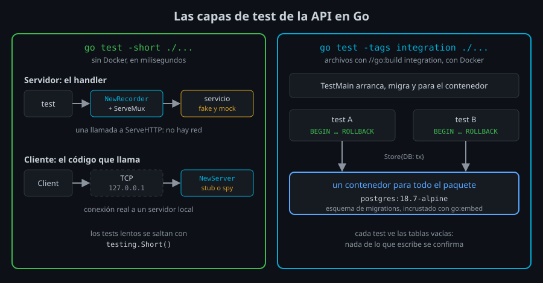

# 03 - testcontainers-go y PostgreSQL

> Lenguaje: **Go**

Testcontainers ya lo usaste con Java en la [semana 29](../../week-29-testcontainers_en_java/1-teoria/01-testcontainers-y-el-ciclo-de-vida.md), y el rollback por test con pytest en la [semana 23](../../week-23-testing_de_bases_de_datos_en_python/1-teoria/02-fixtures-y-rollback-por-test.md). La idea es la misma: un PostgreSQL de verdad, en Docker, que arranca el propio test y se borra al terminar. En Go cambian dos cosas: el ciclo de vida lo escribes tú (no hay `@Container` ni `@ServiceConnection`), y el aislamiento entre tests sale de una interfaz pequeña.

---

## 🎯 Objetivos

- Arrancar PostgreSQL con el módulo `postgres` de testcontainers-go y pararlo siempre.
- Aplicar las migraciones con `//go:embed`.
- Elegir entre un contenedor por test, uno por paquete con una transacción por test, y los snapshots.

---

## 1. El módulo postgres

```go
ctr, err := postgres.Run(ctx, "postgres:18.7-alpine",
	postgres.WithDatabase("library"),
	postgres.WithUsername("library"),
	postgres.WithPassword("library"),
	postgres.BasicWaitStrategies(),
)
testcontainers.CleanupContainer(t, ctr)
if err != nil {
	t.Fatal(err)
}
dsn := ctr.MustConnectionString(ctx, "sslmode=disable")
```

| Pieza | Qué hace | Equivalente en Java (semana 29) |
|---|---|---|
| `postgres.Run(ctx, imagen, opciones...)` | Crea y arranca el contenedor | `new PostgreSQLContainer(...)` + `start()` |
| `BasicWaitStrategies()` | Espera a que PostgreSQL escriba dos veces que acepta conexiones (arranca, se reinicia tras el script de inicio, vuelve a arrancar) y a que el puerto escuche | La espera por defecto del contenedor |
| `testcontainers.CleanupContainer(t, ctr)` | Registra en `t.Cleanup` la parada del contenedor | `@Container` con su ciclo de vida |
| `testcontainers.TerminateContainer(ctr)` | Lo para a mano, para `TestMain`, que no tiene `t` | `stop()` |
| `MustConnectionString(ctx, "sslmode=disable")` | La URL con el puerto que Docker asignó en el host | `getJdbcUrl()` |

`CleanupContainer` va **antes** de comprobar `err`. Si el contenedor llegó a crearse y la espera falló, `ctr` no es nulo y también hay que pararlo. Con un `ctr` nulo, la función no hace nada.

La imagen va con versión fija, la de [stack-versions](../../../docs/stack-versions.md). Con `postgres:latest`, un test que pasa hoy podría fallar el día que salga una versión nueva, sin que haya cambiado tu código.

### Ryuk

Junto al PostgreSQL arranca un segundo contenedor, `testcontainers/ryuk:0.14.0`. Vigila el proceso de test: si muere sin parar sus contenedores (un `log.Fatal`, un `Ctrl+C`), Ryuk los borra a los pocos segundos ([experimento 2 del lab 04](../2-practicas/lab-04-postgresql-con-testcontainers-go/README.md#experimento-2-una-migración-rota-y-el-contenedor-huérfano)). Sin él, cada ejecución fallida dejaría un contenedor encendido.

---

## 2. Migraciones con embed

El esquema vive en archivos `.sql`, los mismos que usa producción, y entra en el binario con `//go:embed`:

```go
//go:embed migrations/*.sql
var migrations embed.FS

func Migrate(ctx context.Context, db DBTX) error {
	files, err := fs.Glob(migrations, "migrations/*.sql") // en orden alfabético
	// ...db.Exec(ctx, contenido) por cada archivo
}
```

| Decisión | Por qué |
|---|---|
| Los `.sql` incrustados con `embed` | El test no depende del directorio desde el que se ejecute `go test`, y el binario de producción lleva su propio esquema |
| Numerados (`001_`, `002_`) | `fs.Glob` los devuelve en orden alfabético, que es el orden de aplicación |
| Sin librería de migraciones | Para un esquema que solo crece, unas líneas bastan. Si necesitas versiones aplicadas, bajar de versión o bloqueo entre réplicas, existen goose o golang-migrate, el equivalente a Flyway |

Con migraciones de verdad, el test prueba también el esquema: los `CHECK`, las claves foráneas, los `NOT NULL`. Ningún fake tiene esas reglas ([experimento 3 del lab 04](../2-practicas/lab-04-postgresql-con-testcontainers-go/README.md#experimento-3-la-regla-en-la-base-de-datos)).

---

## 3. Aislar cada test

Arrancar PostgreSQL cuesta unos 2 segundos. Hay tres formas de repartir ese coste:

| Estrategia | Arranques | Aislamiento | Cuándo |
|---|---|---|---|
| Un contenedor por test | Uno por test | Total | Pocos tests, o código que cambia la configuración del servidor |
| Uno por paquete (`TestMain`) + una **transacción por test** con `Rollback` | Uno | Cada test ve la base de datos vacía | El caso normal: el código recibe la conexión desde fuera |
| Uno por paquete + **snapshot y restore** | Uno, más una copia de la base de datos por test | Total | El código abre y confirma sus propias transacciones |



### Transacción por test

La pieza que lo hace posible es una interfaz del lado del consumidor ([semana 33](../../week-33-interfaces_y_dobles_de_prueba_en_go/1-teoria/01-interfaces-y-dobles-a-mano.md)):

```go
// DBTX la cumplen *pgxpool.Pool y pgx.Tx.
type DBTX interface {
	Exec(ctx context.Context, sql string, args ...any) (pgconn.CommandTag, error)
	QueryRow(ctx context.Context, sql string, args ...any) pgx.Row
}

type Store struct{ DB DBTX }
```

En producción, `Store{DB: pool}`. En el test:

```go
func newStore(t *testing.T) *Store {
	t.Helper()
	tx, err := pool.Begin(t.Context())
	if err != nil {
		t.Fatal(err)
	}
	t.Cleanup(func() { tx.Rollback(context.Background()) })
	return &Store{DB: tx}
}
```

Todo lo que el test escribe queda dentro de una transacción que nunca se confirma. El `Rollback` usa `context.Background()` porque, cuando se ejecutan las funciones de `t.Cleanup`, `t.Context()` ya está cancelado.

Tiene dos límites:

- **Un error aborta la transacción.** En PostgreSQL, después de una sentencia fallida, la transacción rechaza todo lo demás con `25P02 current transaction is aborted`. Un test que espera un error de la base de datos y quiere seguir necesita un savepoint: en pgx, `tx.Begin(ctx)` sobre una `pgx.Tx` crea un `SAVEPOINT`, y su `Rollback` vuelve a él ([experimento 1 del lab 04](../2-practicas/lab-04-postgresql-con-testcontainers-go/README.md#experimento-1-un-error-deja-la-transacción-inservible)).
- **El código que confirma sus transacciones** no cabe dentro de la del test. Para ese código está el snapshot.

### Snapshot y restore

El módulo `postgres` puede guardar una copia de la base de datos ya migrada y volver a ella:

```go
import _ "github.com/jackc/pgx/v5/stdlib" // registra el driver "pgx" de database/sql

ctr, err := postgres.Run(ctx, "postgres:18.7-alpine",
	postgres.WithDatabase("library"), // no puede ser "postgres"
	// ...usuario, contraseña y espera...
	postgres.WithSQLDriver("pgx"),
)
// migrar, cerrar las conexiones y entonces:
err = ctr.Snapshot(ctx)
// después de cada test, con las conexiones cerradas:
err = ctr.Restore(ctx)
```

`Snapshot` copia la base de datos como plantilla con `CREATE DATABASE ... WITH TEMPLATE`. `Restore` borra la base de datos con `DROP DATABASE ... WITH (FORCE)`, que corta las conexiones abiertas, y la vuelve a crear desde la plantilla. Por eso el pool del test se cierra antes del `Restore` y se abre de nuevo después. `WithSQLDriver("pgx")` le dice al módulo qué driver de `database/sql` usar para esas órdenes. Es más lento que un `Rollback`, pero no impone nada al código bajo prueba.

---

## 4. El contexto de la petición hasta la consulta

Todos los métodos de pgx reciben un `context.Context`. Si las interfaces del almacén también lo reciben, el contexto de la petición HTTP llega hasta la consulta:

```text
r.Context()  ->  servicio.Lend(ctx, ...)  ->  store.FindByCode(ctx, ...)  ->  pool.QueryRow(ctx, ...)
```

Si el cliente cierra la conexión, `r.Context()` se cancela y pgx abandona la consulta en curso. En los tests, `t.Context()` hace lo mismo al terminar el test. Por convención, `ctx` es siempre el primer parámetro.

---

## Resumen

| Concepto | Para qué |
|---|---|
| `postgres.Run` + `BasicWaitStrategies()` | Un PostgreSQL listo para conectar, con la imagen del curso |
| `CleanupContainer(t, ctr)` antes del `if err` | Parar el contenedor aunque la espera falle |
| `TerminateContainer` en `TestMain` | Parar el contenedor compartido después de `m.Run()` |
| Ryuk | Borrar los contenedores de un proceso de test que murió |
| `//go:embed migrations/*.sql` | El mismo esquema en el test y en producción |
| `DBTX` + transacción por test | Un contenedor para todo el paquete y cada test aislado |
| Savepoint (`tx.Begin` sobre una `pgx.Tx`) | Seguir después de un error esperado dentro de la transacción |
| `Snapshot` / `Restore` | Aislar código que confirma sus propias transacciones |

<!-- nav -->
---

## 🔗 Navegación

| Anterior | Siguiente |
|---|---|
| ← [Teoría — 02 - TestMain, build tags y -short](02-testmain-build-tags-y-short.md) | [Índice de labs](../2-practicas/README.md) → |

[↑ Semana 34](../README.md)
