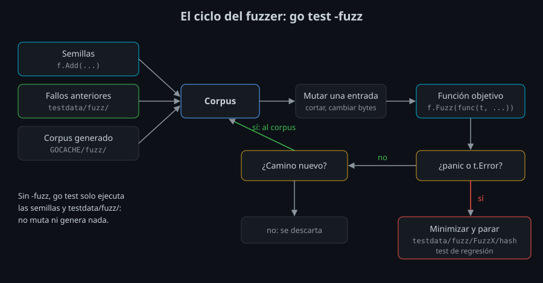

# 02 - Fuzzing nativo

> Lenguaje: **Go**

Un test de tabla prueba las entradas que se te ocurrieron. El **fuzzing** prueba las que no se te ocurrieron: genera millones de entradas a partir de unas pocas de ejemplo y se queda con las que recorren código nuevo. Se parece al property-based testing de fast-check ([semana 13](../../week-13-snapshot_y_property_based_testing/1-teoria/02-property-based-fundamentos.md)) y de hypothesis ([semana 20](../../week-20-tdd_con_python/1-teoria/03-property-based-testing-con-hypothesis.md)), con dos diferencias: viene en `go test`, sin librerías, y no genera las entradas al azar, sino guiado por la cobertura.

---

## 🎯 Objetivos

- Escribir un fuzz test con `func FuzzXxx(f *testing.F)`, su corpus semilla y su función objetivo.
- Ejecutar el fuzzer con `-fuzz` y `-fuzztime`, y leer lo que imprime.
- Convertir cada fallo encontrado en un test de regresión de `testdata/fuzz/`.
- Elegir qué comprobar dentro de la función objetivo: que no hay `panic`, una propiedad, o la comparación con otra implementación.

---

## 1. Anatomía de un fuzz test

```go
func FuzzParse(f *testing.F) {
	for _, tt := range parseTests { // corpus semilla: las entradas de la tabla
		f.Add(tt.in)
	}
	f.Fuzz(func(t *testing.T, s string) { // función objetivo
		id, err := Parse(s)
		if err != nil {
			return // rechazar la entrada es correcto; lo que no puede hacer es fallar mal
		}
		if len(id) != 13 {
			t.Errorf("Parse(%q) = %q: want 13 digits", s, id)
		}
	})
}
```

| Pieza | Qué es |
|---|---|
| `FuzzXxx(f *testing.F)` | El fuzz test. Vive en un `_test.go`, como los tests y los benchmarks |
| `f.Add(...)` | Una entrada del **corpus semilla**: los ejemplos de los que parte el fuzzer |
| `f.Fuzz(func(t *testing.T, ...))` | La **función objetivo**. Recibe un `*testing.T` y una entrada. Si hace `panic` o llama a `t.Error`/`t.Fatal`, la entrada es un fallo |

Los parámetros de la función objetivo solo pueden ser de estos tipos: `string`, `[]byte`, `bool`, `rune`, `byte`, los enteros (`int`, `int8`... `uint64`) y los decimales (`float32`, `float64`). Cada `f.Add` tiene que pasar los mismos tipos en el mismo orden. Si no coinciden, `go vet` (y por tanto `go test`) lo rechaza al compilar ([experimento 3 del lab 02](../2-practicas/lab-02-fuzzing-nativo/README.md#experimento-3-una-semilla-de-otro-tipo)).

Para un tipo propio, como un `Piece`, la función objetivo recibe sus campos sueltos y construye el valor dentro.

---

## 2. Dos formas de ejecutarlo



| Comando | Qué hace | Cuándo |
|---|---|---|
| `go test ./...` | Ejecuta la función objetivo con cada semilla y con cada archivo de `testdata/fuzz/FuzzXxx/`, como subtests. No genera nada | Siempre: es un test más de la suite |
| `go test -run=^$ -fuzz=FuzzParse -fuzztime=30s .` | Arranca el fuzzer: muta las entradas durante 30 s buscando un fallo | Cuando escribes o cambias el código que se prueba, y en CI en un trabajo aparte |

Con `-fuzz`, Go compila el paquete con instrumentación de cobertura y lanza un proceso por núcleo (`now fuzzing with 8 workers`). Cada proceso toma una entrada del corpus, la **muta** (cambia bytes, corta, duplica, inserta valores) y la ejecuta. Si la entrada mutada recorre un camino de código que ninguna otra había recorrido, es **interesante** y se añade al corpus. Por eso encuentra en milisegundos una cadena que empieza por `ISBN` y tiene exactamente cuatro letras: no la adivina al azar, la construye paso a paso desde las semillas.

```text
fuzz: elapsed: 0s, gathering baseline coverage: 6/6 completed, now fuzzing with 8 workers
fuzz: elapsed: 3s, execs: 1277518 (425778/sec), new interesting: 20 (total: 26)
```

| Dato | Qué significa |
|---|---|
| `gathering baseline coverage: 6/6` | Ejecuta primero las 6 semillas para saber qué cubren |
| `execs: 1277518 (425778/sec)` | Entradas probadas en total y por segundo |
| `new interesting: 20 (total: 26)` | Entradas que abrieron caminos nuevos en esta sesión, y tamaño del corpus |

Reglas de los flags:

| Regla | Por qué |
|---|---|
| `-run=^$` | Sin él, `go test` ejecuta también todos los tests del paquete antes de empezar |
| `-fuzz` admite un solo fuzz test | Es una expresión regular: `-fuzz=FuzzParse` también coincide con `FuzzParseDigits`, y Go se niega: `-fuzz matches more than one fuzz test`. Ánclala: `-fuzz='^FuzzParse$'` |
| `-fuzz` admite un solo paquete | Con `./...` y varios paquetes: `cannot use -fuzz flag with multiple packages` |
| `-fuzztime` | Sin él, el fuzzer no se para nunca. Acepta una duración (`30s`) o un número de ejecuciones (`10000x`) |

---

## 3. Cuando encuentra un fallo

El fuzzer **minimiza** la entrada (la recorta mientras siga fallando), la guarda y para:

```text
fuzz: minimizing 31-byte failing input file
--- FAIL: FuzzParse (6.80s)
    --- FAIL: FuzzParse (0.00s)
        testing.go:1927: panic: runtime error: slice bounds out of range [5:4]
    ...
    Failing input written to testdata/fuzz/FuzzParse/ea624b8b77c021c0
    To re-run:
    go test -run=FuzzParse/ea624b8b77c021c0
```

El archivo es texto, con una línea por parámetro:

```text
go test fuzz v1
string("ISBN")
```

Desde ese momento, `go test ./...` ejecuta esa entrada como un subtest más (`FuzzParse/ea624b8b77c021c0`) y falla hasta que arreglas el código. Por eso **`testdata/fuzz/` se sube al repositorio**: cada fallo que encontró el fuzzer se convierte en un test de regresión que se ejecuta en cada `go test`, sin fuzzing y en milisegundos.

| Dónde | Qué guarda | ¿Al repositorio? |
|---|---|---|
| `testdata/fuzz/FuzzXxx/` | Las entradas que hicieron fallar el test | Sí |
| `$(go env GOCACHE)/fuzz/` | El corpus generado: las entradas interesantes de cada sesión | No. Es una caché local; `go clean -fuzzcache` la borra |

La siguiente sesión de fuzzing parte de las semillas, de `testdata/` y de la caché, así que no empieza desde cero.

---

## 4. Qué comprobar en la función objetivo

La función objetivo no puede comparar con un valor esperado, porque no conoce la entrada de antemano. Comprueba **propiedades**: cosas que tienen que cumplirse para cualquier entrada.

| Tipo de comprobación | Ejemplo | Qué encuentra |
|---|---|---|
| Sin `panic` | Solo llamar a `Parse(s)` | Índices fuera de rango, `nil` sin comprobar, divisiones por cero |
| Una propiedad del resultado | Si `Parse` acepta, el resultado son 13 dígitos ASCII | Validaciones que faltan ([lab 02, paso 2](../2-practicas/lab-02-fuzzing-nativo/README.md#paso-2-una-propiedad-del-resultado-paso-2)) |
| Ida y vuelta | `Unmarshal(Marshal(p)) == p` | Datos que se pierden o cambian al serializar (proyecto) |
| Comparar dos implementaciones | La versión optimizada responde lo mismo que la original | Diferencias introducidas al optimizar (proyecto) |

Las entradas que no tienen sentido para la propiedad se descartan con `return` o con `t.Skip()`. Por ejemplo, el fuzz de ida y vuelta del proyecto solo comprueba piezas que `ValidatePiece` acepta.

La función objetivo tiene que ser **determinista** y rápida: sin red, sin reloj, sin estado compartido entre llamadas. Si la misma entrada a veces falla y a veces no, el fuzzer no puede minimizarla ni reproducirla.

---

## Resumen

| Comando o pieza | Para qué |
|---|---|
| `f.Add(...)` | Dar semillas al fuzzer; se ejecutan en cada `go test` |
| `f.Fuzz(func(t *testing.T, ...))` | La función que recibe las entradas |
| `go test -run=^$ -fuzz='^FuzzX$' -fuzztime=30s .` | Buscar fallos durante 30 s |
| `testdata/fuzz/FuzzX/<hash>` | El fallo encontrado, como test de regresión (al repositorio) |
| `go test -run=FuzzX/<hash>` | Reproducir un fallo concreto |
| `go clean -fuzzcache` | Borrar el corpus generado de la caché |

<!-- nav -->
---

## 🔗 Navegación

| Anterior | Siguiente |
|---|---|
| ← [Teoría — 01 - Race detector y testing/synctest](01-race-detector-y-synctest.md) | [Teoría — 03 - Benchmarks y benchstat](03-benchmarks-y-benchstat.md) → |

[↑ Semana 35](../README.md)
