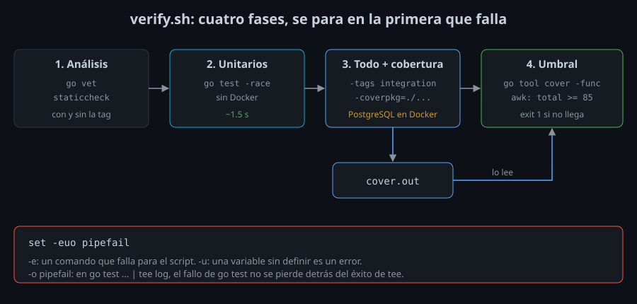

# 01 - La suite Go completa

> Lenguaje: **Go**

Esta semana no hay conceptos de testing nuevos. Juntas en una sola suite lo que construiste entre las semanas 32 y 35, la ejecutas con un solo comando, le pones un mínimo de cobertura y escribes el reporte con sus datos.

---

## 🎯 Objetivos

- Ordenar la suite Go en fases: análisis, unitarios e integración.
- Ejecutarla entera con un script, `verify.sh`, que se pare en el primer fallo.
- Hacer fallar ese script cuando la cobertura baja del 85 %.
- Sacar los datos del reporte de testing de las salidas de `go test`.

---

## De cuatro semanas a una suite

La carpeta `go/` de tu repositorio ya es un solo módulo: cada semana añadió piezas sobre la anterior.

| Semana | Pieza | Tests | Fase |
|---|---|---|---|
| [32](../../week-32-fundamentos_de_testing_en_go/README.md) | `go test`, tablas, subtests, ejemplos | Reglas del dominio | Unitaria |
| [33](../../week-33-interfaces_y_dobles_de_prueba_en_go/README.md) | Fakes, stubs, mockgen, go-cmp, golden files | Servicio con dependencias simuladas | Unitaria |
| [34](../../week-34-http_bd_e_integracion_en_go/README.md) | `httptest` y testcontainers-go | API con `httptest`; almacén contra PostgreSQL | Unitaria; integración |
| [35](../../week-35-concurrencia_y_calidad_en_go/README.md) | `-race`, fuzzing, benchmarks, staticcheck | Test concurrente, fuzz tests, benchmark | Unitaria |

En Java, la fase de un test dependía del nombre de la clase: `*Test` o `*IT` ([semana 31](../../week-31-proyecto_integrador_java/1-teoria/01-la-suite-java-completa.md#dos-fases-surefire-y-failsafe)). En Go depende de la **build tag** de la [semana 34](../../week-34-http_bd_e_integracion_en_go/1-teoria/02-testmain-build-tags-y-short.md): un archivo con `//go:build integration` solo se compila con `-tags integration`. El criterio es el mismo: si el test arranca un contenedor, lleva la tag.

| Comando | Qué ejecuta |
|---|---|
| `go test ./...` | Los unitarios. El paquete que solo tiene tests de integración sale como `[no test files]` |
| `go test -tags integration ./...` | Los unitarios **y** los de integración: la tag añade archivos, no quita ninguno |

La segunda línea es la diferencia con Maven: `mvn verify` ejecuta Surefire y después Failsafe, cada uno con sus clases. En Go, la ejecución con la tag ya es la suite entera.

---

## Un comando: `verify.sh`

Maven tiene `mvn clean verify`; Go no tiene un comando que haga vet, linters, tests y umbral de una vez. La solución habitual es un script de shell en la raíz del módulo:

```bash
#!/usr/bin/env bash
# La suite Go completa en un solo comando, como mvn verify en Java.
# Se para en el primer paso que falla. Necesita Docker para la integración.
set -euo pipefail
cd "$(dirname "$0")"

echo "== go vet"
go vet ./...
go vet -tags integration ./...

echo "== unitarios"
go test -count=1 -race -shuffle=on ./...

echo "== unitarios + integración, con cobertura"
go test -count=1 -race -shuffle=on -tags integration -covermode=atomic -coverpkg=./... -coverprofile=cover.out ./...

echo "== umbral de cobertura"
total=$(go tool cover -func=cover.out | awk '/^total:/ {print $3+0}')
echo "total: $total % (mínimo: 85 %)"
awk -v total="$total" 'BEGIN {if (total < 85) {print "FALLO: la cobertura no llega al 85 %"; exit 1}}'
```



| Línea | Qué hace |
|---|---|
| `set -euo pipefail` | Ver la sección siguiente |
| `cd "$(dirname "$0")"` | Se mueve a la carpeta del script: funciona igual si lo lanzas desde `go/` o desde la raíz del repositorio |
| `go vet` dos veces | Sin la tag, `go vet` no compila los archivos de integración y no los revisa |
| `-count=1` | Desactiva la caché de resultados: cada ejecución vuelve a ejecutar los tests ([semana 32](../../week-32-fundamentos_de_testing_en_go/README.md)) |
| `-race -shuffle=on` | Detector de carreras y orden aleatorio ([semana 35](../../week-35-concurrencia_y_calidad_en_go/1-teoria/01-race-detector-y-synctest.md)) |
| `-covermode=atomic -coverpkg=./...` | El modo que exige `-race` y la cobertura de todo el módulo desde cada paquete ([semana 35](../../week-35-concurrencia_y_calidad_en_go/1-teoria/04-cobertura-y-linters.md)) |

**Qué:** un script que ejecuta todas las comprobaciones de la suite en orden, de la más barata a la más cara.
**Para qué:** que tú, tu compañero y el pipeline de CI de la [semana 45](../../../docs/plan-estudios.md) ejecuten exactamente lo mismo con un solo comando.
**Impacto:** si el análisis o un unitario falla, el script se para antes de arrancar Docker: el fallo llega en 1 o 2 segundos en lugar de 6.

La fase de unitarios se repite dentro de la de integración. Es intencionado: es la que avisa rápido.

### `set -euo pipefail`

| Opción | Sin ella |
|---|---|
| `-e` | Un comando que falla no para el script: si `go test` falla, el script sigue y puede terminar con `exit 0` |
| `-u` | Una variable mal escrita (`$totl`) vale cadena vacía en lugar de ser un error |
| `-o pipefail` | En `go test ./... \| tee test.log`, el código de salida de la tubería es el de `tee` (0), no el de `go test` |

La tercera es la trampa más común: guardas la salida con `tee` para el reporte, un test falla, `tee` termina bien y el script sigue en verde. El [lab 01](../2-practicas/lab-01-una-suite-un-comando/README.md#experimento-1-tee-sin-pipefail) lo reproduce.

### El umbral

Go no tiene el `fail_under` de coverage.py ni el `check` de JaCoCo. `go tool cover -func=cover.out` termina con una línea `total:`:

```text
total:					(statements)	92.2%
```

`awk '/^total:/ {print $3+0}'` toma el tercer campo y `+0` lo convierte en número (`92.2`, sin el `%`). La comparación también la hace `awk`, porque bash solo compara enteros:

```bash
total=92.2; [ "$total" -ge 85 ]
# bash: [: 92.2: integer expression expected
```

El umbral es **85**, el mismo que en Python y Java. No lo bajes para pasar: la cobertura que falta se cubre con tests.

---

## El reporte de testing

`testing-report-go.md` tiene las mismas cinco secciones que los de las semanas [24](../../week-24-proyecto_integrador_python/README.md) y [31](../../week-31-proyecto_integrador_java/README.md). Cambia de dónde salen los datos:

| Sección | De dónde salen los datos |
|---|---|
| Suite por capas | `go test -count=1 -v`: las líneas `--- PASS` sin sangría son funciones; con sangría, subtests. El tiempo, de `time` |
| Cobertura | `cover.out`: el total de `go tool cover -func` y una tabla por paquete con `awk` ([lab 02](../2-practicas/lab-02-datos-del-reporte/README.md)) |
| Tests más lentos | Las líneas `--- PASS: TestX (0.01s)` ordenadas por tiempo, y el tiempo de cada paquete en la línea `ok` |
| Riesgos y huecos | Tu análisis: qué no prueba la suite |
| Próximos pasos | Los tests que añadirías primero |

Dos detalles que confunden al leer los tiempos:

- **El tiempo del paquete no es la suma de sus tests.** La línea `ok` incluye `TestMain` (arrancar el contenedor, unos 3 s) y, con `-race`, una pausa de 1 s que el race detector hace al terminar cada binario de test para informar de carreras en goroutines que siguen vivas. Un paquete con tests de 0.00 s tarda 1 s con `-race`.
- **`(cached)` no es un tiempo.** Sin `-count=1`, `go test` repite el resultado guardado de una ejecución anterior y no ejecuta nada: ni los tests ni el contenedor.

---

## ✅ Resumen

- La tag `integration` separa las fases. `go test -tags integration ./...` ejecuta la suite entera.
- `verify.sh` encadena análisis, unitarios, integración con cobertura y umbral, de lo más barato a lo más caro.
- `set -euo pipefail` hace que cualquier fallo, también detrás de un `| tee`, pare el script con error.
- El umbral del 85 % se comprueba con `go tool cover -func` y `awk`, porque bash no compara decimales.
- Los tiempos del reporte salen de `-count=1 -v`; la línea `ok` de cada paquete incluye `TestMain` y la pausa de `-race`.

<!-- nav -->
---

## 🔗 Navegación

| Anterior | Siguiente |
|---|---|
| ← [Semana 36 - Proyecto Integrador: Etapa 4 (Go)](../README.md) | [Índice de labs](../2-practicas/README.md) → |

[↑ Semana 36](../README.md)
