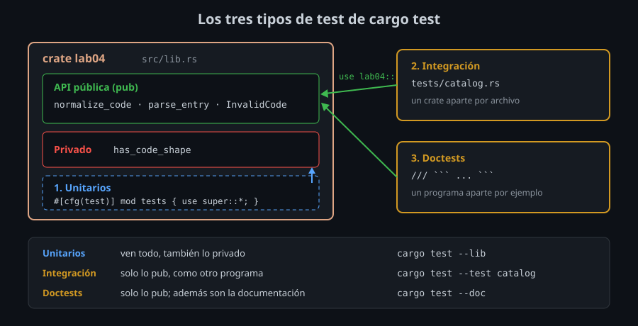

# 03 - Unitarios, integración y doctests

> Lenguaje: **Rust**

`cargo test` ejecuta tres tipos de test, cada uno en su sitio y con una vista distinta del código: los unitarios en `src/`, los de integración en `tests/` y los doctests en la documentación. Esta teoría explica qué ve cada uno y cuándo usarlo.

---

## 🎯 Objetivos

- Distinguir los tres tipos de test de Rust por dónde viven y qué pueden usar.
- Escribir tests de integración en `tests/` que usan solo la API pública.
- Escribir doctests, también con `?` y líneas ocultas.
- Decidir cuándo probar una función privada.
- Ejecutar cada tipo por separado con `--lib`, `--test` y `--doc`.

---

## Tres tipos de test



```text
lab-04/
├── Cargo.toml
├── src/
│   └── lib.rs          # el código, su documentación con ejemplos y mod tests
└── tests/
    └── catalog.rs      # un crate aparte que usa lab04
```

| | Unitarios | Integración | Doctests |
|---|---|---|---|
| Dónde | `#[cfg(test)] mod tests` en `src/` | Un archivo por binario en `tests/` | Bloques ` ``` ` en los comentarios `///` |
| Cómo se compilan | Dentro del crate | Cada archivo, como un crate aparte | Cada ejemplo, como un programa aparte |
| Qué ven | Todo, también lo privado | Solo lo `pub` | Solo lo `pub` |
| Cómo importan | `use super::*;` | `use lab04::...;` | `use lab04::...;` |
| En la salida | `Running unittests src/lib.rs` | `Running tests/catalog.rs` | `Doc-tests lab04` |
| Solo ese tipo | `cargo test --lib` | `cargo test --test catalog` | `cargo test --doc` |

`cargo test` sin opciones los ejecuta en ese orden y se para en el primer binario que falla.

| | Go | Rust |
|---|---|---|
| Caja blanca | `package museum` en `*_test.go` | `mod tests` en el mismo archivo |
| Caja negra | `package museum_test` en `*_test.go` | Un archivo en `tests/` |
| Documentación que se ejecuta | `ExampleXxx` con `// Output:` | Doctests con `assert_eq!` |

---

## Tests de integración en `tests/`

```rust
// tests/catalog.rs
use lab04::{InvalidCode, normalize_code, parse_entry};

#[test]
fn normalizes_spaces_and_case() {
    assert_eq!(normalize_code("  mus-001 "), Some("MUS-001".to_string()));
}
```

**Qué:** cada archivo de `tests/` es un crate que depende de tu librería, como cualquier programa que la use.
**Para qué:** probar la API pública tal como la verá otro programa: si un test de `tests/` necesita algo, ese algo tiene que ser `pub`.
**Impacto:** cada archivo es un binario que se compila y enlaza por separado. Muchos archivos pequeños hacen la suite más lenta de compilar; agrúpalos por funcionalidad.

`tests/` no lleva `#[cfg(test)]`: Cargo solo compila esa carpeta para los tests. Y solo funciona con una librería: si el paquete solo tiene `src/main.rs`, `tests/` no puede importarlo. La solución habitual es dejar en `main.rs` lo mínimo y poner la lógica en `src/lib.rs`.

Llamar a una función privada desde `tests/` no es un fallo del test: el archivo no compila.

```text
error[E0603]: function `has_code_shape` is private
  --> tests/catalog.rs:18:20
```

En Rust, "integración" significa "desde fuera del crate", no "con una base de datos": lo que arranca un contenedor llega en la [semana 39](../../../docs/plan-estudios.md).

---

## Doctests

Los comentarios `///` son la documentación de lo que viene debajo, y `cargo doc` la convierte en HTML. Cada bloque de código entre ` ``` ` es además un test:

````rust
/// Normaliza un código de pieza: quita los espacios de los extremos y pasa a
/// mayúsculas. Devuelve `None` si el resultado no tiene la forma `AAA-000`.
///
/// ```
/// use lab04::normalize_code;
///
/// assert_eq!(normalize_code(" mus-001 "), Some("MUS-001".to_string()));
/// assert_eq!(normalize_code("MUS-1"), None);
/// ```
pub fn normalize_code(raw: &str) -> Option<String> {
````

```bash
cargo test --doc
#    Doc-tests lab04
#
# running 1 test
# test src/lib.rs - normalize_code (line 10) ... ok
```

**Qué:** `cargo test` compila cada ejemplo como un programa aparte que usa tu crate desde fuera, y lo ejecuta.
**Para qué:** que el ejemplo que lee quien usa tu librería compile y diga la verdad.
**Impacto:** si cambias el comportamiento y el ejemplo queda desfasado, la suite falla. En el [lab 04](../2-practicas/lab-04-integracion-y-doctests/README.md#experimento-2-la-documentación-desfasada), un doctest encuentra un cambio que no detectaba ninguno de los otros tres tests.

### `?` y líneas ocultas

````rust
/// ```
/// use lab04::{parse_entry, InvalidCode};
///
/// let (code, name) = parse_entry("mus-001; Vasija ceremonial")?;
/// assert_eq!(code, "MUS-001");
/// assert_eq!(name, "Vasija ceremonial");
/// # Ok::<(), InvalidCode>(())
/// ```
````

| Pieza | Qué hace |
|---|---|
| `# ` al principio de una línea | La línea se compila pero no aparece en la documentación |
| `Ok::<(), InvalidCode>(())` | El valor final del ejemplo. Con él, el programa que genera `cargo test` devuelve un `Result` y el `?` compila |

Sin la línea oculta, el ejemplo no compila: ``the `?` operator can only be used in a function that returns `Result` or `Option` ``.

| Bloque | Qué hace `cargo test` |
|---|---|
| ` ``` ` | Compila y ejecuta |
| ` ```no_run ` | Compila pero no ejecuta: para ejemplos que abren una conexión o escriben archivos |
| ` ```should_panic ` | Compila, ejecuta y espera un pánico |
| ` ```ignore ` | No compila ni ejecuta. Evítalo: es documentación que nadie comprueba |
| ` ```text ` | No es código Rust: no hace nada |

Un pánico dentro de un doctest señala un archivo temporal (`/tmp/rustdoctest.../doctest_bundle_2024.rs:21:1`), no tu `src/lib.rs`. Para encontrar el ejemplo, usa el nombre del doctest: `src/lib.rs - parse_entry (line 25)`.

Los doctests solo ven la API pública, como `tests/`: documentan cómo se usa el crate desde fuera. Úsalos para uno o dos ejemplos por función pública; los casos frontera y los errores van en los unitarios.

---

## Funciones privadas

En Java, una clase de test solo ve lo `private` con reflexión; en Go, el test de caja blanca está en el mismo paquete. En Rust, un módulo hijo ve todo lo de sus padres, y `mod tests` es hijo del módulo que prueba:

```rust
fn has_code_shape(code: &str) -> bool { /* ... */ }   // privada

#[cfg(test)]
mod tests {
    use super::*;

    #[test]
    fn shape_is_three_letters_dash_three_digits() {
        assert!(has_code_shape("MUS-001"));
        assert!(!has_code_shape("MU-0001"), "two letters");
    }
}
```

**Qué:** la regla de visibilidad de Rust permite probar una función privada sin hacerla `pub`.
**Para qué:** cubrir directamente una pieza con casos propios que la API pública alcanza con dificultad.
**Impacto:** el test queda atado a cómo está hecho el código. Si renombras o fusionas la función privada, el test se rompe aunque el comportamiento público sea el mismo.

Empieza por la API pública. Prueba lo privado solo cuando tenga reglas propias que merezcan su tabla de casos, como la forma de un código, y nunca lo hagas `pub` solo para probarlo.

---

## ✅ Resumen

- Unitarios en `mod tests` (ven todo), integración en `tests/` (solo lo `pub`) y doctests en la documentación (solo lo `pub`).
- `cargo test --lib`, `--test nombre` y `--doc` ejecutan un solo tipo; sin opciones, los tres en ese orden.
- Cada archivo de `tests/` es un crate aparte y necesita una librería en `src/lib.rs`.
- Un doctest con `?` necesita la línea oculta `# Ok::<(), E>(())`.
- Probar una función privada es posible; hazlo solo cuando tenga reglas propias.

<!-- nav -->
---

## 🔗 Navegación

| Anterior | Siguiente |
|---|---|
| ← [Teoría — 02 - Pánicos, Result y control de la ejecución](02-panics-result-y-asserts.md) | [Índice de labs](../2-practicas/README.md) → |

[↑ Semana 37](../README.md)
