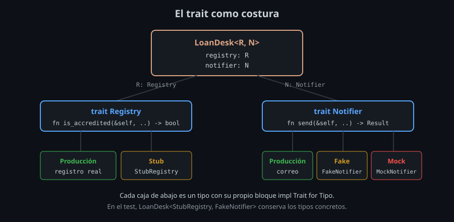

# 01 - Traits y fakes a mano

> Lenguaje: **Rust**

En la [semana 33](../../week-33-interfaces_y_dobles_de_prueba_en_go/1-teoria/01-interfaces-y-dobles-a-mano.md) aislaste las dependencias del servicio de Go con interfaces pequeñas y dobles escritos a mano. En Rust, la pieza equivalente es el **trait**. La idea es la misma; cambian tres cosas: el tipo declara qué trait implementa, el servicio elige entre genéricos y `dyn`, y un doble que guarda lo que recibe choca con el borrow checker.

---

## 🎯 Objetivos

- Declarar un trait con los métodos que el servicio usa e implementarlo con `impl Trait for Tipo`.
- Elegir entre un servicio genérico (`LoanDesk<R, N>`, `impl Trait`) y uno con `dyn Trait`.
- Escribir stubs y fakes a mano, con `RefCell` cuando el método recibe `&self`.

---

## El trait como costura

Una **costura** (*seam*) es el punto del código donde puedes cambiar una dependencia sin tocar el código que la usa. En Rust la costura es un trait: el servicio no conoce el almacén ni el correo, solo los métodos que necesita.



```rust
/// Dice si una institución está acreditada para recibir préstamos.
pub trait Registry {
    fn is_accredited(&self, institution: &str) -> bool;
}

/// Envía el aviso a la institución.
pub trait Notifier {
    fn send(&self, notice: &Notice) -> Result<(), String>;
}
```

Como en Go, el trait lo declara quien lo usa y lleva solo los métodos que usa. La diferencia está en quien lo implementa:

| | Go | Rust |
|---|---|---|
| Cómo cumple un tipo la interfaz | Sin decirlo: basta con tener los métodos | Con un bloque explícito: `impl Registry for StubRegistry { ... }` |
| Si falta un método | Error al pasar el tipo donde se espera la interfaz | Error en el propio `impl`: `E0046 not all trait items implemented` |
| Dónde puede ir la implementación | En el paquete del tipo | En el crate del trait o en el del tipo; en los tests, en `mod tests` o en `tests/` |

**Qué:** `impl Trait for Tipo` dice en voz alta qué trait cumple un tipo. **Para qué:** el compilador comprueba la firma de cada método en ese bloque. **Impacto:** cuando cambias un trait, el compilador te lleva a cada doble que hay que actualizar, también a los de los tests.

---

## Genéricos o `dyn`

El servicio puede recibir sus dependencias de dos formas:

```rust
// 1. Genérico: un parámetro de tipo por dependencia.
pub struct LoanDesk<R: Registry, N: Notifier> {
    pub registry: R,
    pub notifier: N,
}

// 2. Objeto de trait: un puntero a "algo que implementa Notifier".
pub fn broadcast(channels: &[Box<dyn Notifier>], notice: &Notice) -> usize {
    channels.iter().filter(|c| c.send(notice).is_ok()).count()
}
```

| | Genérico (`T: Trait`, `impl Trait`) | `dyn Trait` (`Box<dyn Trait>`, `&dyn Trait`) |
|---|---|---|
| Cuándo se decide el tipo | Al compilar: el compilador genera una versión de `LoanDesk` para cada combinación de tipos que usas (monomorfización) | Al ejecutar: cada llamada busca el método en una tabla (*vtable*) |
| Mezclar tipos distintos | No: un `Vec<T>` guarda un solo tipo | Sí: un `Vec<Box<dyn Notifier>>` guarda canales de tipos distintos |
| Qué ve el test después | El tipo concreto: `desk.notifier.sent` es el campo del fake | Solo el trait: el campo del fake ya no es accesible |
| Coste | Ninguno al ejecutar; más código compilado | Una indirección por llamada; despreciable fuera de bucles muy calientes |

Para el servicio principal, **genérico**: el test construye el servicio con sus fakes y, al terminar, lee el estado de cada fake por su tipo. `dyn` queda para cuando de verdad hay tipos distintos en tiempo de ejecución, como una lista de canales de aviso. Si intentas guardar dos tipos en un `vec!` sin `dyn`, el compilador lo rechaza ([lab 01](../2-practicas/lab-01-traits-y-fakes-a-mano/README.md#experimento-2-dos-tipos-en-un-vec)):

```text
error[E0308]: mismatched types
    let channels = vec![SilentNotifier, FailingNotifier];
                                        ^^^^^^^^^^^^^^^ expected `SilentNotifier`, found `FailingNotifier`
```

`impl Trait` en un argumento es la forma corta de un genérico: `fn check(registry: &impl Registry)` equivale a `fn check<R: Registry>(registry: &R)`. Para una función suelta basta; un `struct` necesita los parámetros con nombre (`<R, N>`).

---

## Stubs y fakes a mano

Los dobles son los de la [semana 33](../../week-33-interfaces_y_dobles_de_prueba_en_go/1-teoria/01-interfaces-y-dobles-a-mano.md#los-dobles-escritos-a-mano): stub, spy, fake y mock. En Rust se escriben igual de cortos:

```rust
// Stub: una respuesta fija.
struct StubRegistry {
    accredited: bool,
}

impl Registry for StubRegistry {
    fn is_accredited(&self, _institution: &str) -> bool {
        self.accredited
    }
}
```

El `_` delante de `_institution` le dice al compilador que el parámetro no se usa a propósito, y evita el warning.

### Guardar lo recibido desde `&self`

Un spy o un fake guarda lo que recibe. En Go, el método tiene un receptor puntero y modifica el slice. En Rust, el trait dice `send(&self, ...)`: una referencia compartida, que no deja modificar nada. Si el fake intenta `self.sent.push(...)`, no compila:

```text
error[E0596]: cannot borrow `self.sent` as mutable, as it is behind a `&` reference
```

Hay dos salidas:

| Salida | Qué cambia | Cuándo |
|---|---|---|
| Cambiar el trait a `&mut self` | El servicio necesita `&mut self` para llamar, y no puede usar el notificador desde dos sitios a la vez | Casi nunca: el trait se diseña para producción, no para el doble. Un cliente de correo real envía con `&self` |
| **Mutabilidad interior** con `RefCell` | El fake guarda la lista dentro de un `RefCell` y la modifica con `borrow_mut()` | Lo normal en un doble que guarda estado |

```rust
use std::cell::RefCell;

#[derive(Default)]
struct FakeNotifier {
    sent: RefCell<Vec<Notice>>,
}

impl Notifier for FakeNotifier {
    fn send(&self, notice: &Notice) -> Result<(), String> {
        self.sent.borrow_mut().push(notice.clone());
        Ok(())
    }
}
```

**Qué:** `RefCell<T>` mueve la comprobación del préstamo de la compilación a la ejecución. **Para qué:** modificar el contenido a través de `&self`. **Impacto:** si el código pide `borrow_mut()` mientras otro `borrow()` sigue vivo, el programa entra en pánico con `already borrowed`. En un fake que solo hace `push`, no pasa. El test lee la lista con `desk.notifier.sent.borrow()`.

`RefCell` no se puede compartir entre hilos. Si el servicio usa el doble desde varios hilos, como el servidor async de la semana 39, el equivalente es `Mutex<Vec<Notice>>` con `lock().unwrap()`.

### Un doble que falla

El mismo trait sirve para un stub que siempre falla. Es la forma de probar el camino de error sin un servidor de correo caído de verdad:

```rust
struct FailingNotifier;

impl Notifier for FailingNotifier {
    fn send(&self, _notice: &Notice) -> Result<(), String> {
        Err("smtp down".to_string())
    }
}
```

Un `struct` sin campos, como `FailingNotifier` o `SilentNotifier`, no ocupa memoria y se crea solo con su nombre.

---

## Cuándo basta escribirlo a mano

Igual que en Go: con un trait de uno o dos métodos y un test que comprueba el **estado** al final (qué se guardó, qué se envió), el fake a mano es corto y claro. Cuando el test comprueba la **interacción** (una llamada con estos argumentos, tantas veces, o ninguna), un mock generado con mockall ahorra el código de comprobar a mano ([teoría 02](02-mocks-con-mockall.md)).

---

## ✅ Resumen

- El trait es la costura: lo declara quien lo usa, con los métodos que usa, y cada doble lo implementa con `impl Trait for Tipo`.
- Servicio genérico para poder leer el estado de los fakes en el test; `dyn Trait` solo para mezclar tipos en tiempo de ejecución.
- Un fake que guarda datos desde `&self` usa `RefCell` (o `Mutex` entre hilos), no un trait con `&mut self`.
- Fake para comprobar estado; mock para comprobar interacción.

<!-- nav -->
---

## 🔗 Navegación

| Anterior | Siguiente |
|---|---|
| ← [Semana 38 - Traits, Dobles y Parametrización en Rust](../README.md) | [Teoría — 02 - Mocks con mockall](02-mocks-con-mockall.md) → |

[↑ Semana 38](../README.md)
