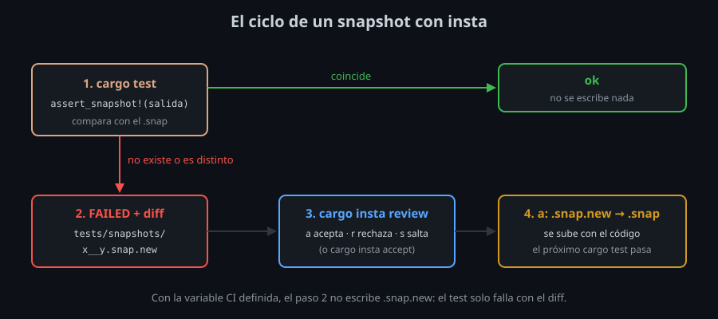

# 03 - rstest, insta y `tests/common`

> Lenguaje: **Rust**

`cargo test` no trae tests parametrizados ni fixtures: en la [semana 37](../../week-37-fundamentos_de_testing_en_rust/3-proyecto/README.md#paso-3-la-validación) un bucle sobre un array se paraba en el primer caso que fallaba. **rstest** añade las dos cosas con atributos. **insta** añade snapshots, el golden file de la [semana 33](../../week-33-interfaces_y_dobles_de_prueba_en_go/1-teoria/03-go-cmp-y-golden-files.md) con una herramienta para revisarlos. Al final, cómo compartir dobles y datos entre los archivos de `tests/`.

---

## 🎯 Objetivos

- Parametrizar un test con `#[case]` y combinar valores con `#[values]`.
- Escribir fixtures con `#[fixture]`, con argumentos por defecto y `#[with(...)]`.
- Guardar una salida con `assert_snapshot!` y revisarla con `cargo insta review`.
- Compartir código entre tests de integración con `tests/common/mod.rs`.

---

## Casos con `#[case]`

```rust
use rstest::rstest;

#[rstest]
#[case(0, 0)]
#[case(1, 50)]
#[case(31, 1500)]
#[case(u32::MAX, 1500)]
fn late_fee_by_days(#[case] days: u32, #[case] want: u32) {
    assert_eq!(late_fee(days), want);
}
```

`#[rstest]` sustituye a `#[test]`. Cada `#[case(...)]` da valores a los parámetros marcados con `#[case]`, en orden, y genera un test aparte dentro de un módulo con el nombre de la función:

```text
test tests::late_fee_by_days::case_1 ... ok
test tests::late_fee_by_days::case_2 ... ok
```

Cada caso pasa o falla por su cuenta: si fallan dos, la salida muestra los dos. Con nombre, `#[case::zero_value("MUS-001", "Ánfora", 0, Err(PieceError::ZeroValue))]` genera `validate::case_5_zero_value`, y el nombre dice qué caso falló.

| Lenguaje | Casos parametrizados | Semana |
|---|---|---|
| Python | `@pytest.mark.parametrize` con `ids=` | [S17](../../week-17-parametrizacion_y_marks_con_pytest/README.md) |
| Java | `@ParameterizedTest` con `@CsvSource` | [S25](../../week-25-junit_6_avanzado_y_assertj/1-teoria/01-tests-parametrizados.md) |
| Go | Tabla de structs y `t.Run(tt.name, ...)` | [S32](../../week-32-fundamentos_de_testing_en_go/1-teoria/02-table-driven-y-subtests.md) |
| Rust | `#[rstest]` y `#[case::nombre(...)]` | Esta semana |

Como en Go, puedes ejecutar un solo caso con el filtro: `cargo test validate::case_3`. A diferencia de Go, si un `#[case]` no tiene tantos valores como parámetros, el test no compila:

```text
error: Wrong case signature: should match the given parameters list.
```

---

## Combinaciones con `#[values]`

```rust
#[rstest]
fn total_is_the_sum(
    #[values(0, 1, 30, 31)] days: u32,
    #[values(Condition::Good, Condition::Damaged)] condition: Condition,
) {
    let c = return_charges(5000, days, condition);
    assert_eq!(c.total, c.late_fee + c.damage_fee);
}
```

`#[values]` genera un test por cada combinación: 4 × 2 = 8 tests. Sirve para comprobar una regla que vale para todos los valores, no un resultado concreto. Ojo con el producto: tres parámetros de cinco valores son 125 tests.

---

## Fixtures

Una fixture de rstest es una función marcada con `#[fixture]`. Un test que tiene un parámetro con ese nombre recibe lo que devuelve:

```rust
use rstest::fixture;

#[fixture]
fn name(#[default(MAX_NAME_LENGTH)] len: usize) -> String {
    "á".repeat(len)
}

#[rstest]
fn accepts_name_at_max_length(name: String) {
    assert_eq!(validate_piece("MUS-001", &name, 1), Ok(()));
}

#[rstest]
fn rejects_name_over_max_length(#[with(MAX_NAME_LENGTH + 1)] name: String) {
    assert_eq!(validate_piece("MUS-001", &name, 1), Err(PieceError::NameTooLong));
}
```

| Pieza | Qué / Para qué / Impacto |
|---|---|
| `#[fixture] fn name(...)` | Una fixture que construye un dato. El test la pide por el nombre del parámetro, como en pytest ([S16](../../week-16-fundamentos_con_pytest/README.md)) |
| `#[default(MAX_NAME_LENGTH)]` | El valor del argumento de la fixture si el test no dice otro |
| `#[with(MAX_NAME_LENGTH + 1)]` | Pasa otro valor a la fixture solo en este test |

A diferencia de pytest, no hay `yield` ni teardown: lo que la fixture devuelve se destruye al acabar el test, como cualquier variable de Rust. Para limpiar algo al final, el tipo implementa `Drop`.

---

## Snapshots con insta

Un **snapshot** es la salida aprobada de una función, guardada en un archivo. El test compara la salida actual con ese archivo. Es lo que hacías en Go con un golden file y el flag `-update`, o en Jest con `toMatchSnapshot` ([S13](../../week-13-snapshot_y_property_based_testing/README.md)).



```rust
use insta::assert_snapshot;

#[test]
fn notice_text() {
    assert_snapshot!(render_notice(&common::sample_notice()));
}
```

1. La primera vez no hay snapshot. El test **falla** y guarda la salida en `tests/snapshots/notice__notice_text.snap.new`.
2. Revisas el `.snap.new` con `cargo insta review` (interactivo: `a` acepta, `r` rechaza, `s` lo salta) o lo aceptas todo con `cargo insta accept`. Aceptar renombra el archivo a `.snap`.
3. Desde entonces, el test compara con el `.snap`. Si la salida cambia, falla con un diff y guarda otro `.snap.new` para revisar.

El nombre del archivo es `<archivo de test>__<nombre del test>.snap`, y se sube al repositorio con el código. `cargo insta` es una herramienta aparte:

```bash
cargo install --locked cargo-insta@1.49.0
cargo insta --version
# cargo-insta 1.49.0
```

| Macro | Qué guarda | Cuándo |
|---|---|---|
| `assert_snapshot!(texto)` | Un `String` tal cual | Un texto que genera el programa: un aviso, un informe |
| `assert_debug_snapshot!(valor)` | El valor con `{:#?}`, una línea por campo | Una estructura grande que no quieres escribir a mano en el test |
| `assert_snapshot!(texto, @"...")` | El texto dentro del propio test (*inline*) | Salidas de una o dos líneas; `cargo insta accept` rellena el `@""` en el código |

### En CI

Si la variable de entorno `CI` existe, como en GitHub Actions, insta no escribe `.snap.new`: el test falla con el diff y nada más. Un snapshot nuevo o cambiado se acepta en local, se revisa en el diff del pull request y se sube.

### Cuándo no

Un snapshot aprueba todo lo que hay en la salida, también lo que no importa. Si la salida lleva una fecha, un identificador aleatorio o el orden de un `HashMap`, cambia en cada ejecución. Igual que en la semana 13: snapshot para salidas estables y revisables; `assert_eq!` para el valor que de verdad importa.

---

## Código compartido en `tests/common`

Cada archivo de `tests/` es un crate aparte ([semana 37](../../week-37-fundamentos_de_testing_en_rust/1-teoria/03-unitarios-integracion-y-doctests.md)). Si dos archivos necesitan los mismos dobles o datos, el código común va en un módulo. Si lo pones en `tests/common.rs`, Cargo lo trata como un archivo de tests más:

```text
     Running tests/common.rs (target/debug/build/lab04/8a82d07869209151/out/common-8a82d07869209151)

running 0 tests
```

En `tests/common/mod.rs` no: Cargo solo compila como tests los archivos que están directamente en `tests/`. Cada archivo que lo usa lo declara con `mod common;` y llama a sus funciones con `common::sample_notice()`.

Cada archivo de tests compila `common` por su cuenta. Si un archivo no usa una función de `common`, el compilador avisa:

```text
warning: function `long_loan` is never used
  --> tests/common/mod.rs:16:8
```

El warning es falso: otro archivo sí la usa. Se silencia con `#![allow(dead_code)]` en la primera línea de `tests/common/mod.rs`.

| | Python (pytest) | Rust |
|---|---|---|
| Dónde va lo compartido | `conftest.py`, descubierto solo | `tests/common/mod.rs`, declarado con `mod common;` |
| Qué contiene | Fixtures | Funciones, fakes, `mock!`, fixtures de rstest |

---

## ✅ Resumen

- `#[rstest]` con `#[case::nombre(...)]` da un test por caso, con su nombre; `#[values]` da un test por combinación.
- Las fixtures de rstest se piden por el nombre del parámetro; `#[default]` y `#[with]` les pasan argumentos.
- insta guarda la salida aprobada en `.snap`; la primera vez y cada cambio fallan y dejan un `.snap.new` para `cargo insta review`.
- Lo compartido entre archivos de `tests/` va en `tests/common/mod.rs`, con `#![allow(dead_code)]`.

<!-- nav -->
---

## 🔗 Navegación

| Anterior | Siguiente |
|---|---|
| ← [Teoría — 02 - Mocks con mockall](02-mocks-con-mockall.md) | [Índice de labs](../2-practicas/README.md) → |

[↑ Semana 38](../README.md)
