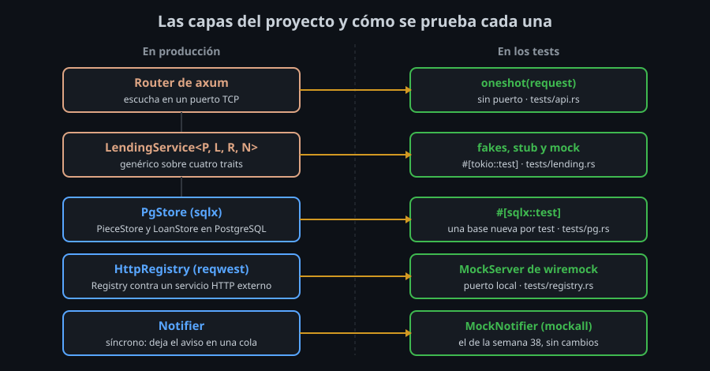

# 02 - APIs con axum y clientes con wiremock

> Lenguaje: **Rust**

Una API tiene dos lados que se prueban por separado, como en Go ([semana 34](../../week-34-http_bd_e_integracion_en_go/1-teoria/01-httptest-handlers-y-clientes.md#dos-lados-dos-herramientas)): las rutas que **sirves** y los servicios externos que **llamas**. En Rust, el router de axum se prueba con `oneshot`, sin abrir un puerto, y un cliente de reqwest se prueba contra un servidor simulado de **wiremock**.



---

## 🎯 Objetivos

- Enviar peticiones a un `Router` de axum con `tower::ServiceExt::oneshot` y leer el estado, las cabeceras y el cuerpo JSON.
- Saber qué peticiones rechaza axum antes de llegar al handler y con qué código.
- Declarar los traits async de un servicio para que axum pueda usarlo.
- Simular un servicio HTTP con wiremock: respuestas, retrasos y expectativas sobre las peticiones.

---

## Las dependencias

```bash
cargo add axum@=0.8.9
cargo add serde@=1.0.229 --features derive
cargo add reqwest@=0.13.5 --no-default-features --features json
cargo add --dev tokio@=1.54.1 --features macros,rt-multi-thread
cargo add --dev tower@=0.5.3 --features util
cargo add --dev http-body-util@=0.1.5 serde_json@=1.0.154 wiremock@=0.6.5
```

| Crate | Para qué |
|---|---|
| `axum` | El router y los extractores (`Path`, `Json`, `State`) |
| `serde` | `Serialize` y `Deserialize` para los tipos que viajan en JSON |
| `reqwest` | El cliente HTTP. `--no-default-features` quita TLS: los tests hablan HTTP con wiremock, y así te ahorras compilar la pila TLS. Si tu cliente llama a HTTPS en producción, añade la feature `rustls` |
| `tower` | `ServiceExt::oneshot`. Con la feature `util` |
| `http-body-util` | `BodyExt::collect`, para leer el cuerpo entero de una respuesta |
| `serde_json` | `json!` y `Value`, para comparar el JSON de la respuesta |
| `wiremock` | El servidor HTTP simulado |

---

## 1. El router con `oneshot`

Un `Router` de axum es un servicio de tower: algo que recibe una petición y devuelve una respuesta. `oneshot` le entrega **una** petición y espera la respuesta, sin servidor ni puerto:

```rust
use tower::ServiceExt;

let req = Request::get("/pieces/MUS-001").body(Body::empty()).unwrap();

let res = app(catalog()).oneshot(req).await.unwrap();

assert_eq!(res.status(), StatusCode::OK);
```

Es el `httptest.NewRecorder` de Go, con dos diferencias:

- `oneshot` pasa por el router entero: rutas, extractores y handler. En Go, el recorder recibía el handler que le dabas, y había que darle el `mux` para probar las rutas.
- `oneshot` es un método del trait `ServiceExt`. Sin `use tower::ServiceExt;`, el método no existe:

  ```text
  error[E0599]: no method named `oneshot` found for struct `Router<S>` in the current scope
  ...
     = help: items from traits can only be used if the trait is in scope
  ```

`oneshot` consume el router (`self`). Para enviar dos peticiones al mismo router, clónalo: `app.clone().oneshot(req)`. El clon comparte el estado, porque el estado va dentro de un `Arc`.

### Leer el cuerpo

El cuerpo de la respuesta llega por partes. `collect` las junta:

```rust
use http_body_util::BodyExt;

let bytes = res.into_body().collect().await.unwrap().to_bytes();
let body: Value = serde_json::from_slice(&bytes).unwrap();

assert_eq!(body, json!({ "code": "MUS-001", "name": "Ánfora romana", "declaredValue": 200000 }));
```

Compara el JSON como `serde_json::Value`, no como tu `struct`. Si un `#[serde(rename_all = "camelCase")]` desaparece, la respuesta cambia de contrato (`declared_value` en lugar de `declaredValue`) y el test lo ve:

```text
  left: Object {"code": String("MUS-001"), "declared_value": Number(200000), "name": String("Ánfora romana")}
 right: Object {"code": String("MUS-001"), "declaredValue": Number(200000), "name": String("Ánfora romana")}
```

Si leyeras la respuesta con el mismo `struct` que la escribe, los dos lados cambiarían juntos y el test seguiría en verde. Es el mismo error que comparar con el `struct` en Go ([semana 34](../../week-34-http_bd_e_integracion_en_go/1-teoria/01-httptest-handlers-y-clientes.md#4-comparar-json)).

---

## 2. Lo que axum responde por ti

Antes de llamar al handler, axum comprueba la ruta, el método y los extractores. Si algo falla, responde él:

| Petición | Respuesta | Quién la da |
|---|---|---|
| Ruta que no existe | `404` | El router |
| Método que la ruta no tiene | `405` con la cabecera `Allow`: `GET,HEAD` para una ruta `get` | El router |
| `Json<T>` sin `Content-Type: application/json` | `415 Unsupported Media Type` | El extractor `Json` |
| JSON mal formado | `400 Bad Request` | El extractor `Json` |
| JSON bien formado al que le falta un campo o con un tipo equivocado | `422 Unprocessable Entity` | El extractor `Json` |

Pruébalas: son parte del contrato de tu API, aunque no las escribas tú. El [lab 02](../2-practicas/lab-02-rutas-axum-con-oneshot/README.md) tiene un test para cada una.

---

## 3. Un servicio con traits async en axum

El servicio de préstamos de la [semana 38](../../week-38-traits_dobles_y_parametrizacion_en_rust/1-teoria/01-traits-y-fakes-a-mano.md) era genérico sobre sus traits. Ahora sus almacenes hablan con PostgreSQL y su registro con un servicio HTTP, así que sus métodos son async. axum ejecuta cada petición en el runtime de varios hilos, y exige que el futuro de cada handler sea `Send`: que se pueda mover de un hilo a otro.

Si declaras el trait con `async fn`, Rust no garantiza que el futuro sea `Send`, y axum no acepta el handler:

```text
error[E0277]: the trait bound `fn(_, Path<String>) -> _ {get_piece::<P, L, R, N>}: Handler<_, _>` is not satisfied
   --> src/api.rs:30:42
    |
 30 |         .route("/api/pieces/{code}", get(get_piece::<P, L, R, N>))
    |                                      --- ^^^^^^^^^^^^^^^^^^^^^^^ the trait `Handler<_, _>` is not implemented for fn item ...
    |
    = note: Consider using `#[axum::debug_handler]` to improve the error message
```

El mensaje no dice nada de `Send`. La solución es declarar el método con lo que devuelve, añadiendo `+ Send`:

```rust
pub trait PieceStore: Send + Sync {
    fn find_by_code(&self, code: &str)
        -> impl Future<Output = Result<Option<Piece>, String>> + Send;
}
```

| Parte | Qué / Para qué / Impacto |
|---|---|
| `impl Future<Output = ...> + Send` | Lo mismo que `async fn`, más la promesa de que el futuro es `Send`. Cada implementación debe cumplirla, y el compilador lo comprueba |
| `: Send + Sync` | Cualquier tipo que implemente el trait se puede compartir entre hilos. axum guarda el servicio en un `Arc` y lo usa desde varias peticiones a la vez |

Las implementaciones siguen escribiéndose con `async fn`:

```rust
impl PieceStore for FakePieces {
    async fn find_by_code(&self, code: &str) -> Result<Option<Piece>, String> {
        Ok(self.0.lock().unwrap().get(code).cloned())
    }
}
```

`Send + Sync` también afecta a los dobles. El fake de la semana 38 usaba `RefCell`, que no es `Sync`. Ahora usa `Mutex`, la versión de `RefCell` para varios hilos, dentro de un `Arc` para que el test se quede un clon y mire dentro después de la petición.

---

## 4. Clientes con wiremock

Para probar un cliente HTTP necesitas algo que le responda. wiremock arranca un servidor HTTP de verdad en un puerto libre, con las respuestas que le programas:

```rust
let server = MockServer::start().await;
Mock::given(method("GET"))
    .and(path("/isbn/9788491050278"))
    .and(header("accept", "application/json"))
    .respond_with(ResponseTemplate::new(200).set_body_json(json!({ "title": "..." })))
    .expect(1)
    .mount(&server)
    .await;

let client = Client::new(&server.uri(), Duration::from_millis(200));
```

| Pieza | Qué hace | Go (S34) |
|---|---|---|
| `MockServer::start()` | Arranca el servidor en `127.0.0.1` y un puerto libre. `server.uri()` da su URL | `httptest.NewServer(handler)` |
| `Mock::given(...).and(...)` | Qué peticiones acepta este mock: método, ruta, cabeceras, cuerpo | El `if` dentro del handler de prueba |
| `respond_with(ResponseTemplate::new(200))` | Qué responde: estado, cuerpo (`set_body_json`, `set_body_string`), cabeceras y retraso (`set_delay`) | `w.WriteHeader` y `w.Write` |
| `expect(1)` | Cuántas peticiones debe recibir. Se comprueba al destruirse el servidor, al final del test | Un contador y un `if` al final |
| `mount(&server)` | Registra el mock en el servidor | — |

wiremock es un servidor genérico: lo programas, no escribes su handler. Por eso cambia una cosa importante respecto a Go. **Una petición que ningún mock acepta recibe un `404`.** Si el cliente olvida una cabecera, wiremock responde `404`, y un test que espera un `404` pasa por la razón equivocada. `expect(1)` lo descubre:

```text
Verifications failed:
- Mock #0.
	Expected range of matching incoming requests: == 1
	Number of matched incoming requests: 0

Received requests:
- Request #1
	GET http://localhost/isbn/9788491050278
accept: */*
host: 127.0.0.1:40395
```

El informe enseña las peticiones que llegaron: aquí, `accept: */*`, el valor por defecto de reqwest, en lugar de `application/json`. Pon `expect` en los mocks de los tests que comprueban qué se envía.

Un servidor que tarda se simula con `set_delay`. El cliente necesita su propio plazo (`reqwest::Client::builder().timeout(...)`): sin él, esperaría lo que el servidor quisiera. Este test sí espera de verdad: el reloj de tokio en pausa no sirve aquí, porque la respuesta llega por un socket real. Usa plazos cortos, de cientos de milisegundos.

---

## ✅ Resumen

- `oneshot` envía una petición al `Router` entero sin abrir un puerto. Necesita `use tower::ServiceExt;` y consume el router.
- Lee el cuerpo con `collect` y compáralo como `serde_json::Value` con `json!`, no con tu `struct`.
- axum responde `404`, `405`, `415`, `400` y `422` antes del handler. Son parte del contrato y se prueban.
- Para usar un servicio genérico en axum, declara los métodos async del trait como `impl Future<Output = ...> + Send` y los dobles con `Mutex`, no `RefCell`.
- wiremock responde `404` a lo que ningún mock acepta. `expect(n)` comprueba lo que se envió y muestra lo que llegó.

<!-- nav -->
---

## 🔗 Navegación

| Anterior | Siguiente |
|---|---|
| ← [Teoría — 01 - `#[tokio::test]` y tiempo controlado](01-tokio-test-y-tiempo-controlado.md) | [Teoría — 03 - PostgreSQL con `#[sqlx::test]` y testcontainers](03-sqlx-test-y-testcontainers.md) → |

[↑ Semana 39](../README.md)
