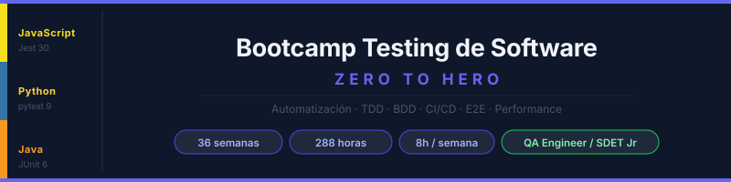

# Semana 39 - Async, APIs y BD en Rust

> **Etapa 5 - Testing con Rust** | Semana 39 de 46



---

## Objetivos de la Semana

Al finalizar esta semana serás capaz de:

1. Probar código async con `#[tokio::test]`, elegir el runtime de un hilo o de varios y controlar el tiempo con `start_paused` y `tokio::time::advance`.
2. Probar un router de axum sin abrir un puerto con `oneshot`, incluidas las respuestas que axum da antes del handler.
3. Declarar los traits async de un servicio para que axum pueda usarlo, y adaptar sus dobles a varios hilos.
4. Probar un cliente HTTP de reqwest contra un servidor simulado con wiremock: respuestas, retrasos y expectativas sobre lo que se envía.
5. Probar un repositorio de sqlx contra PostgreSQL con `#[sqlx::test]` y con testcontainers-rs, y elegir entre los dos.

---

## Requisitos previos

- Semana 38: el servicio del dominio en `rust/`, genérico sobre sus traits, con sus dobles en `tests/common/mod.rs`.
- Semana 34: la API Go del dominio y su migración de PostgreSQL, que portas a Rust.
- Semana 23: el `compose.yaml` con PostgreSQL en la raíz del repositorio.
- Docker en marcha y Rust 1.85 o superior (edición 2024). Los ejemplos usan Rust 1.100.0.

---

## Distribución del Tiempo (10 horas)

| Actividad | Contenido | Tiempo |
|---|---|---|
| Teoría | `#[tokio::test]` y tiempo controlado; axum con `oneshot` y wiremock; `#[sqlx::test]` y testcontainers | 2.5 h |
| Prácticas | 4 labs: tokio, axum, reqwest con wiremock, PostgreSQL | 4 h |
| Proyecto | La API del dominio en Rust, sobre PostgreSQL | 3 h |
| Recursos y cierre | Videos, lecturas y repaso | 0.5 h |

---

## Contenido de la Semana

### Teoría

1. [`#[tokio::test]` y tiempo controlado](./1-teoria/01-tokio-test-y-tiempo-controlado.md)
2. [APIs con axum y clientes con wiremock](./1-teoria/02-axum-oneshot-y-wiremock.md)
3. [PostgreSQL con `#[sqlx::test]` y testcontainers](./1-teoria/03-sqlx-test-y-testcontainers.md)

### Prácticas

- [Índice de labs](./2-practicas/README.md)
- [Lab 01 - Async con `#[tokio::test]`](./2-practicas/lab-01-async-con-tokio-test/README.md)
- [Lab 02 - Rutas de axum con `oneshot`](./2-practicas/lab-02-rutas-axum-con-oneshot/README.md)
- [Lab 03 - Clientes de reqwest con wiremock](./2-practicas/lab-03-clientes-reqwest-con-wiremock/README.md)
- [Lab 04 - PostgreSQL con `#[sqlx::test]` y testcontainers](./2-practicas/lab-04-postgresql-con-sqlx-test-y-testcontainers/README.md)

### Proyecto

- [La API del dominio en Rust, sobre PostgreSQL](./3-proyecto/README.md)

### Recursos

- [Ebooks gratuitos](./4-recursos/ebooks-free/README.md)
- [Videografía](./4-recursos/videografia/README.md)
- [Webgrafía](./4-recursos/webgrafia/README.md)

### Glosario

- [Términos clave de la semana](./5-glosario/README.md)

---

## Entregables

- Proyecto semanal (único entregable obligatorio): rama `week-39` del repositorio `qa-<nombre>-<apellido>` con pull request a `main`. Antes de abrirlo:

  ```bash
  PROYECTO=~/qa-<nombre>-<apellido> ./scripts/verificar-semana.sh 39
  ```

  Las comprobaciones están en [checks.json](./checks.json) y se explican en [autograding](../../docs/autograding.md). La primera arranca el PostgreSQL de tu `compose.yaml`: necesita Docker.

---

## Estructura de Carpetas

```text
week-39-async_apis_y_bd_en_rust/
|-- README.md
|-- rubrica-evaluacion.md
|-- checks.json
|-- 0-assets/
|   |-- 01-capas-y-sus-dobles.svg
|   `-- 02-ciclo-de-sqlx-test.svg
|-- 1-teoria/
|-- 2-practicas/
|   |-- README.md
|   |-- lab-01-async-con-tokio-test/
|   |-- lab-02-rutas-axum-con-oneshot/
|   |-- lab-03-clientes-reqwest-con-wiremock/
|   `-- lab-04-postgresql-con-sqlx-test-y-testcontainers/
|-- 3-proyecto/
|   |-- README.md
|   `-- starter/
|-- 4-recursos/
|   |-- ebooks-free/README.md
|   |-- videografia/README.md
|   `-- webgrafia/README.md
`-- 5-glosario/
    `-- README.md
```

---

## Versiones de la semana

Rust 1.100.0; tokio 1.54.1, axum 0.8.9, serde 1.0.229, reqwest 0.13.5, sqlx 0.9.1, y en `[dev-dependencies]` tower 0.5.3, http-body-util 0.1.5, serde_json 1.0.154, wiremock 0.6.5 y testcontainers-modules 0.15.0 (con testcontainers 0.27.3). PostgreSQL 18.7. Están registradas en [stack-versions](../../docs/stack-versions.md).

---

## Nota Importante

Un test de `oneshot` con fakes y un test de `#[sqlx::test]` no se sustituyen: prueban cosas distintas. Los fakes no tienen `CHECK`, ni claves foráneas, ni calculan fechas; PostgreSQL sí. Y un test contra la base de datos no te dice si la API responde el código correcto. Cada capa tiene su test, y el servicio completo sobre PostgreSQL comprueba que encajan.

---

## Navegación

| ← Semana anterior | Siguiente semana → |
|---|---|
| [Semana 38 - Traits, Dobles y Parametrización en Rust](../week-38-traits_dobles_y_parametrizacion_en_rust/README.md) | [Semana 40 - Calidad Avanzada en Rust](../week-40-calidad_avanzada_en_rust/README.md) |
