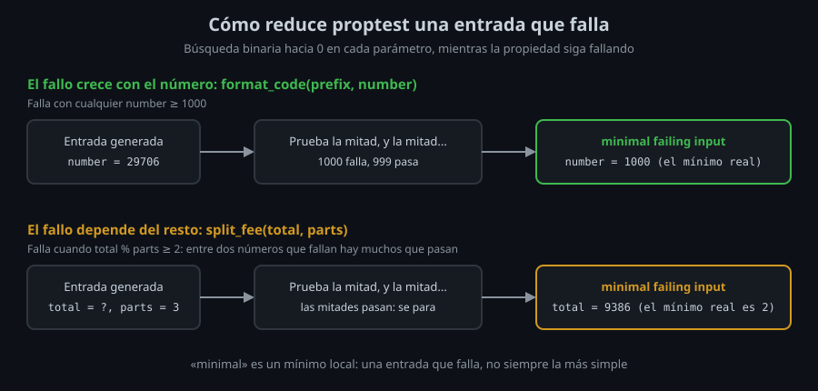

# 01 - Propiedades con proptest

> Lenguaje: **Rust**

Un test de ejemplo comprueba una entrada que eliges tú. Una **propiedad** comprueba algo que se cumple para cualquier entrada, y deja que la herramienta elija cientos de entradas. Es lo que hacía Hypothesis en Python ([semana 20](../../week-20-tdd_con_python/1-teoria/03-property-based-testing-con-hypothesis.md)). En Rust, la herramienta es **proptest**.



---

## 🎯 Objetivos

- Escribir propiedades con la macro `proptest!` y las aserciones `prop_assert!`.
- Elegir estrategias: rangos, `any::<T>()`, expresiones regulares, `prop_oneof!` y `prop_compose!`.
- Leer el resultado de un fallo: el contraejemplo reducido y el archivo de regresiones.
- Saber qué entradas no genera una estrategia y cuándo descartar casos con `prop_assume!`.

---

## Instalar proptest

```bash
cargo add --dev proptest@=1.12.0
```

Va en `[dev-dependencies]`: solo lo usan los tests.

---

## 1. Una propiedad

```rust
use proptest::prelude::*;

proptest! {
    #[test]
    fn late_fee_never_exceeds_the_cap(days in any::<u32>()) {
        prop_assert!(late_fee(days) <= MAX_LATE_FEE);
    }
}
```

| Pieza | Qué hace |
|---|---|
| `proptest! { ... }` | Convierte cada función en un `#[test]` que se ejecuta 256 veces con entradas distintas |
| `days in any::<u32>()` | El parámetro y su **estrategia**: de dónde salen los valores. `any::<u32>()` genera cualquier `u32` |
| `prop_assert!`, `prop_assert_eq!` | Como `assert!` y `assert_eq!`, pero devuelven el fallo a proptest en lugar de entrar en pánico |

`cargo test` ejecuta las propiedades junto a los demás tests. En la salida, cada propiedad es un test más:

```text
test tests::late_fee_never_exceeds_the_cap ... ok
```

| Qué | Python (S20) | Rust |
|---|---|---|
| Declarar la propiedad | `@given(st.integers())` sobre la función | `x in estrategia` en la firma, dentro de `proptest!` |
| Casos por defecto | 100 | 256 |
| Aserción | `assert` | `prop_assert!` (un `assert!` también funciona, pero cada intento de reducción imprime su pánico) |

---

## 2. Estrategias

| Estrategia | Genera |
|---|---|
| `any::<u32>()`, `any::<String>()` | Cualquier valor del tipo |
| `0u32..100_000`, `1u32..` | Un rango |
| `"[A-Z]{3}-[0-9]{3}"` | Textos que encajan con la expresión regular: un `&str` es una estrategia |
| `"\\PC*"` | Cualquier texto de caracteres imprimibles |
| `prop_oneof![Just(A), Just(B)]` | Uno de varios valores o estrategias |
| `prop_compose!` | Una estrategia propia, hecha con otras |

Con `prop_compose!` se construye un valor a partir de otros:

```rust
prop_compose! {
    fn malformed_code()(
        prefix in "[A-Za-z]{1,4}",
        digits in "[0-9]{1,4}",
    ) -> String {
        format!("{prefix}-{digits}")
    }
}
```

`malformed_code()` se usa como cualquier otra estrategia: `code in malformed_code()`.

La estrategia decide qué se prueba. Un rango demasiado estrecho esconde los fallos. Si el código de una pieza tiene tres cifras y pruebas con `number in 0u16..1000`, todo pasa. Con `any::<u16>()`, proptest encuentra `1000` en el primer intento:

```text
minimal failing input: prefix = "AAA", number = 1000
```

`format_code("AAA", 1000)` escribe `AAA-1000`, que `parse_code` no acepta. La estrategia estrecha probaba solo lo que el autor ya sabía que funcionaba.

### Descartar casos: `prop_assume!`

Cuando una entrada generada no tiene sentido para la propiedad, `prop_assume!(condición)` la descarta y proptest genera otra. Úsalo poco: si descartas demasiadas, proptest se rinde con `Too many global rejects` (el límite por defecto es 1024). Si la mayoría de las entradas no sirven, escribe una estrategia que solo genere las que sirven.

---

## 3. Cuando falla: el contraejemplo reducido

Cuando una propiedad falla, proptest no se queda con la entrada que la hizo fallar. La **reduce**: prueba versiones más simples (números más pequeños, textos más cortos) mientras la propiedad siga fallando. Es el *shrinking* de Hypothesis ([semana 20](../../week-20-tdd_con_python/1-teoria/03-property-based-testing-con-hypothesis.md#shrinking-el-contraejemplo-más-simple)).

```text
thread 'tests::split_is_fair' (434841) panicked at src/lib.rs:59:5:
Test failed: shares = [3130, 3128, 3128] at src/lib.rs:72.
minimal failing input: total = 9386, parts = 3
	successes: 2
	local rejects: 0
	global rejects: 0
```

| Línea | Qué dice |
|---|---|
| `Test failed: ...` | El mensaje de la aserción y su línea |
| `minimal failing input` | La entrada reducida |
| `successes: 2` | Cuántos casos pasaron antes del primer fallo |

`minimal` no significa la mínima posible. proptest reduce cada número por búsqueda binaria hacia 0, y eso funciona cuando el fallo crece con el número: `number = 1000` es exacto porque todos los números a partir de 1000 fallan. Aquí falla cuando `total % parts` vale 2 o más, y la búsqueda se para en un mínimo local. En cuatro ejecuciones seguidas del lab salieron `326`, `6972`, `2` y `41589`. Hypothesis reduce más a fondo; con proptest, lee el contraejemplo como «una entrada que falla», no como «la más simple».

### El archivo de regresiones

```text
proptest: Saving this and future failures in .../proptest-regressions/lib.txt
```

proptest guarda la semilla del fallo en `proptest-regressions/`, un archivo por archivo de tests. En la siguiente ejecución prueba primero esas semillas, antes que las entradas nuevas: el fallo se repite aunque las entradas aleatorias cambien.

```text
cc 3597429603607926c1aa9c40d8a4af23c1810c86faa9ccf2b9c3a00f3208643c # shrinks to total = 9386, parts = 3
```

Súbelo al repositorio, como el `testdata/fuzz/` de Go ([semana 35](../../week-35-concurrencia_y_calidad_en_go/1-teoria/02-fuzzing-nativo.md#3-cuando-encuentra-un-fallo)). Una diferencia: en Go cada fallo es un archivo con la entrada; en proptest es una línea con una semilla, que solo sirve mientras la estrategia no cambie.

Para un archivo de `tests/`, proptest busca un `lib.rs` o `main.rs` junto a él, no lo encuentra y avisa:

```text
proptest: FileFailurePersistence::SourceParallel set, but failed to find lib.rs or main.rs
```

El aviso no es un error: guarda las regresiones al lado del archivo, en `tests/pg_properties.proptest-regressions`.

---

## 4. Configuración

```rust
proptest! {
    #![proptest_config(ProptestConfig::with_cases(64))]

    #[test]
    fn postgres_stores_every_valid_piece(...) { ... }
}
```

| Ajuste | Para qué |
|---|---|
| `ProptestConfig::with_cases(n)` | Cambiar los 256 casos. Menos, para propiedades lentas, como las que usan la base de datos; más, para las rápidas que quieres apretar |
| `PROPTEST_CASES=5000 cargo test` | Lo mismo para una ejecución, sin tocar el código |
| `PROPTEST_MAX_SHRINK_ITERS=0` | Sin reducción: ves la entrada original, como `prefix = "BYP", number = 29706` en lugar de `1000` |

---

## ✅ Resumen

- Una propiedad describe lo que se cumple para cualquier entrada. `proptest!` la ejecuta 256 veces.
- La estrategia decide qué se prueba: si es demasiado estrecha, esconde los fallos.
- proptest reduce el contraejemplo, pero puede quedarse en un mínimo local.
- `proptest-regressions/` guarda las semillas de los fallos y se sube al repositorio.
- `prop_assume!` descarta entradas; si descarta muchas, cambia la estrategia.

<!-- nav -->
---

## 🔗 Navegación

| Anterior | Siguiente |
|---|---|
| ← [Semana 40 - Calidad Avanzada en Rust](../README.md) | [Teoría — 02 - Fuzzing con cargo-fuzz](02-fuzzing-con-cargo-fuzz.md) → |

[↑ Semana 40](../README.md)
