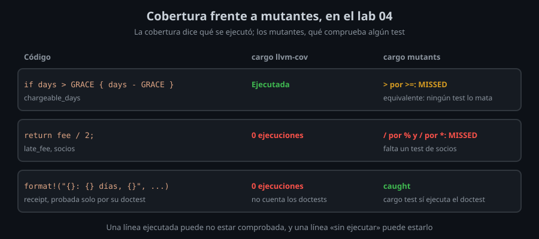

# 04 - Cobertura, nextest, mutantes y clippy

> Lenguaje: **Rust**

Cuatro herramientas que no escriben tests: miden o vigilan los que tienes. **cargo-llvm-cov** dice qué código ejecutan los tests. **cargo-mutants** dice si lo comprueban. **cargo-nextest** los ejecuta con una salida más clara. Y **clippy** revisa el código antes de que llegue a los tests. Son el `go test -cover` y staticcheck de Go ([semana 35](../../week-35-concurrencia_y_calidad_en_go/1-teoria/04-cobertura-y-linters.md)) y el mutmut de Python ([semana 21](../../week-21-coverage_y_calidad_en_python/1-teoria/02-mutation-testing-con-mutmut.md)).



---

## 🎯 Objetivos

- Medir la cobertura de líneas con cargo-llvm-cov, leer el informe y fijar un mínimo.
- Ejecutar la suite con cargo-nextest y saber qué no ejecuta.
- Encontrar con cargo-mutants los tests que ejecutan el código sin comprobarlo, y reconocer un mutante equivalente.
- Usar clippy como red previa a los tests, con `-D warnings`.

---

## Instalar

```bash
rustup component add llvm-tools-preview
cargo install --locked cargo-llvm-cov@0.9.1 cargo-nextest@0.9.152 cargo-mutants@27.1.0
```

| Herramienta | Qué / Para qué |
|---|---|
| `llvm-tools-preview` | Las herramientas de LLVM que leen los datos de cobertura. Es un componente del toolchain, como clippy; si tu proyecto tiene `rust-toolchain.toml`, añádelo a `components` |
| `cargo-llvm-cov` | Compila con instrumentación, ejecuta los tests y escribe el informe |
| `cargo-nextest` | Otro ejecutor de tests: `cargo nextest run` |
| `cargo-mutants` | Mutation testing: `cargo mutants` |

clippy viene con el toolchain (`components = ["rustfmt", "clippy"]` desde la [semana 37](../../week-37-fundamentos_de_testing_en_rust/README.md)).

---

## 1. Cobertura con cargo-llvm-cov

```bash
cargo llvm-cov
```

Ejecuta `cargo test` con instrumentación y termina con una tabla:

```text
Filename          Regions    Missed Regions     Cover   Functions  Missed Functions  Executed       Lines      Missed Lines     Cover    Branches   Missed Branches     Cover
.../src/lib.rs         34                 9    73.53%           5                 1    80.00%          22                 4    81.82%           0                 0         -
```

| Columna | Qué cuenta |
|---|---|
| `Regions` | Trozos de código que se ejecutan juntos: una línea con un `if` tiene varias regiones |
| `Functions` | Funciones ejecutadas al menos una vez |
| `Lines` | Líneas ejecutadas: la cifra habitual |
| `Branches` | Ramas de cada decisión. En estable sale `-`: solo se miden en nightly |

Para ver qué falta:

| Comando | Qué escribe |
|---|---|
| `cargo llvm-cov --text` | El código con cuántas veces se ejecutó cada línea. Un `^0` señala la parte de una línea que no se ejecutó |
| `cargo llvm-cov --html` | El mismo informe en `target/llvm-cov/html/index.html`, con colores |
| `cargo llvm-cov report --show-missing-lines` | Solo las líneas sin ejecutar, por archivo. No vuelve a ejecutar los tests: usa la última medición |
| `cargo llvm-cov --fail-under-lines 85` | Termina con código `1` si la cobertura de líneas no llega al 85 %. **No imprime nada más**: compruébalo con `echo $?` |

```text
   19|      2|pub fn chargeable_days(days: u32) -> u32 {
   20|      2|    if days > GRACE { days - GRACE } else { 0 }
                                                          ^0
   ...
   30|      1|    if category == Category::Member {
   31|      0|        return fee / 2;
```

Dos diferencias con Go:

- Los **doctests no cuentan**. Una función que solo prueba su doctest aparece con `0`. Para incluirlos hace falta nightly: `cargo +nightly llvm-cov --doctests`.
- La cobertura de **ramas** también es de nightly: `cargo +nightly llvm-cov --branch`. Con `rustup component add llvm-tools-preview --toolchain nightly`.

---

## 2. cargo-nextest

```bash
cargo nextest run
```

```text
    Starting 2 tests across 1 binary
        PASS [   0.005s] (1/2) lab04 tests::staff_pays_nothing
        PASS [   0.005s] (2/2) lab04 tests::public_pays_per_chargeable_day
────────────
     Summary [   0.005s] 2 tests run: 2 passed, 0 skipped
```

| Qué cambia respecto a `cargo test` | Para qué / Impacto |
|---|---|
| Un proceso por test | Un test que entra en pánico o deja estado global no afecta a los demás |
| El tiempo de cada test en la salida | Encuentras los tests lentos sin buscar |
| Un resumen al final con todos los fallos | No hay que subir por la salida para encontrarlos |
| **No ejecuta los doctests** | El doctest de `receipt` no aparece. Ejecútalos aparte: `cargo test --doc` |

En suites grandes, nextest es más rápido porque reparte los tests de todos los binarios entre los núcleos a la vez, en lugar de binario por binario.

---

## 3. Mutantes con cargo-mutants

La cobertura dice qué líneas se ejecutaron, no si algún test comprobaría que hacen lo correcto. cargo-mutants lo comprueba: cambia el código (un **mutante**), ejecuta la suite y mira si algún test falla.

```bash
cargo mutants --list
cargo mutants
```

```text
src/lib.rs:20:13: replace > with >= in chargeable_days
src/lib.rs:31:20: replace / with % in late_fee
src/lib.rs:44:5: replace receipt -> String with String::new()
...
Found 15 mutants to test
ok       Unmutated baseline in 0s build + 0s test
MISSED   src/lib.rs:20:13: replace > with >= in chargeable_days in 0s build + 0s test
MISSED   src/lib.rs:31:20: replace / with % in late_fee in 0s build + 0s test
MISSED   src/lib.rs:31:20: replace / with * in late_fee in 0s build + 0s test
15 mutants tested in 4s: 3 missed, 12 caught
```

| Resultado | Qué significa |
|---|---|
| `caught` | Algún test falló con el mutante: los tests lo detectan |
| `MISSED` | Todos los tests pasaron con el código cambiado: nadie comprueba ese comportamiento |
| `unviable` | El mutante no compila, y no cuenta |
| `TIMEOUT` | La suite tardó demasiado con el mutante, por ejemplo por un bucle infinito |

Primero ejecuta la suite sin cambios (`Unmutated baseline`): si falla, no sigue. Los resultados quedan en `mutants.out/`: `missed.txt`, `caught.txt` y un `diff/` con cada cambio. Añade `mutants.out*` a tu `.gitignore`.

| Qué | mutmut (S21) | cargo-mutants |
|---|---|---|
| Qué cambia | Operadores, constantes y valores de retorno, en el código Python | Operadores y el cuerpo entero de cada función (devuelve `0`, `1`, `String::new()`, `Default::default()`...) |
| Dónde | En una copia del proyecto | En una copia del proyecto, en `/tmp`. Tu código no se toca |
| Velocidad | Un proceso por mutante | Una compilación incremental y una suite por mutante. En proyectos grandes, limita con `-f src/archivo.rs` o `--jobs` |

### Mutantes equivalentes

`replace > with >= in chargeable_days` sobrevive aunque la frontera tenga test:

```rust
if days > GRACE { days - GRACE } else { 0 }
```

Con `days == GRACE`, el original devuelve `0` y el mutante devuelve `days - GRACE`, que también es `0`. Los dos programas hacen lo mismo con cualquier entrada: es un **mutante equivalente**, como los de mutmut ([semana 21](../../week-21-coverage_y_calidad_en_python/1-teoria/02-mutation-testing-con-mutmut.md#mutantes-equivalentes)). Ningún test puede matarlo. Analízalo y anótalo, o reescribe el código para que desaparezca: aquí, `days.saturating_sub(GRACE)` hace lo mismo sin la comparación, y clippy lo propone.

---

## 4. clippy: la red previa a los tests

clippy es el linter oficial de Rust: más de 700 comprobaciones de errores probables, código poco idiomático y rendimiento. Va antes que los tests porque es más rápido y encuentra cosas que los tests no ven.

```bash
cargo clippy --all-targets -- -D warnings
```

| Parte | Qué / Para qué |
|---|---|
| `--all-targets` | Revisa también los tests, los benchmarks y los ejemplos, no solo la biblioteca |
| `-- -D warnings` | Convierte cada aviso en error: el comando termina con código `101` si hay alguno. Es la forma de usarlo en la integración continua |

```text
error: manual arithmetic check found
  --> src/lib.rs:20:5
   |
20 |     if days > GRACE { days - GRACE } else { 0 }
   |     ^^^^^^^^^^^^^^^^^^^^^^^^^^^^^^^^^^^^^^^^^^^ help: replace it with: `days.saturating_sub(GRACE)`
   |
   = help: for further information visit https://rust-lang.github.io/rust-clippy/rust-1.100.0/index.html#implicit_saturating_sub
   = note: `-D clippy::implicit-saturating-sub` implied by `-D warnings`
```

Cada aviso tiene un nombre (`implicit_saturating_sub`) y un enlace a su explicación. `cargo clippy --fix` aplica las sugerencias que son seguras; en un repositorio con cambios sin confirmar, añade `--allow-dirty`. Para aceptar un aviso concreto, pon `#[allow(clippy::nombre)]` sobre la función, con un comentario que diga por qué.

| Qué | Go (S35) | Rust |
|---|---|---|
| Comprobaciones básicas | `go vet`, dentro de `go test` | El compilador ya avisa de variables sin usar, código muerto... |
| Linter de la comunidad | staticcheck, aparte | clippy, que viene con el toolchain |

---

## ✅ Resumen

- `cargo llvm-cov` mide líneas, regiones y funciones. Los doctests y las ramas solo cuentan en nightly. `--fail-under-lines` falla sin mensaje.
- `cargo nextest run` ejecuta cada test en su proceso y resume los fallos, pero no ejecuta los doctests: añade `cargo test --doc`.
- `cargo mutants` encuentra código ejecutado que ningún test comprueba. Un `MISSED` se mata con un test o se analiza como equivalente.
- `cargo clippy --all-targets -- -D warnings` va antes que los tests y falla con cualquier aviso.

<!-- nav -->
---

## 🔗 Navegación

| Anterior | Siguiente |
|---|---|
| ← [Teoría — 03 - Benchmarks con criterion](03-benchmarks-con-criterion.md) | [Índice de labs](../2-practicas/README.md) → |

[↑ Semana 40](../README.md)
