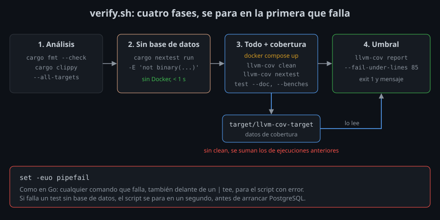

# 01 - La suite Rust completa

> Lenguaje: **Rust**

Esta semana no hay conceptos de testing nuevos. Juntas en una sola suite lo que construiste entre las semanas 37 y 40, la ejecutas con un solo comando, le pones un mínimo de cobertura y escribes el reporte con sus datos. Es la [semana 36](../../week-36-proyecto_integrador_go/1-teoria/01-la-suite-go-completa.md) en Rust: aquí solo se explica lo que cambia.

---

## 🎯 Objetivos

- Ordenar la suite Rust en capas: unitarios en `src/`, tests de integración en `tests/`, doctests y benchmarks.
- Separar los tests que necesitan PostgreSQL con un filtro de cargo-nextest.
- Ejecutar la suite entera con `verify.sh`, que se para en el primer fallo y falla si la cobertura de líneas baja del 85 %.
- Sacar los datos del reporte de testing de las salidas de nextest y cargo-llvm-cov.

---

## De cuatro semanas a una suite

La carpeta `rust/` de tu repositorio ya es un solo paquete: cada semana añadió piezas sobre la anterior.

| Semana | Pieza | Dónde están los tests | ¿PostgreSQL? |
|---|---|---|---|
| [37](../../week-37-fundamentos_de_testing_en_rust/README.md) | `#[cfg(test)] mod tests`, `assert_eq!`, `should_panic`, tests de integración, doctests | `src/`, `tests/`, comentarios `///` | No |
| [38](../../week-38-traits_dobles_y_parametrizacion_en_rust/README.md) | Traits, stubs y fakes, mockall, rstest, insta | `tests/` | No |
| [39](../../week-39-async_apis_y_bd_en_rust/README.md) | `#[tokio::test]`, axum con `oneshot`, wiremock, `#[sqlx::test]` | `tests/` | Solo los de sqlx |
| [40](../../week-40-calidad_avanzada_en_rust/README.md) | proptest, criterion, cargo-llvm-cov, nextest, cargo-mutants, clippy | `tests/`, `benches/` | La propiedad contra PostgreSQL |

### Las capas de un paquete Rust

| Capa | Dónde | Qué ve | Cómo la ejecuta nextest |
|---|---|---|---|
| Unitarios | `#[cfg(test)] mod tests` dentro de `src/` | También lo privado del módulo | Un binario con el nombre del paquete: `museum` |
| Integración | Cada archivo de `tests/` | Solo la API pública, como un usuario del paquete | Un binario por archivo: `museum::api`, `museum::pg` |
| Doctests | Los bloques de código de los comentarios `///` | La API pública | **No los ejecuta**: `cargo test --doc` ([semana 40](../../week-40-calidad_avanzada_en_rust/1-teoria/04-cobertura-nextest-mutantes-y-clippy.md#2-cargo-nextest)) |
| Benchmarks | `benches/` | La API pública | No; `cargo test --benches` ejecuta cada benchmark una vez |

En Rust, «integración» significa «desde fuera del paquete», no «con una base de datos». La mayoría de tus archivos de `tests/` usan fakes, stubs o wiremock y no necesitan Docker.

### Qué tests necesitan PostgreSQL

Go separaba los tests de integración con una build tag ([semana 36](../../week-36-proyecto_integrador_go/1-teoria/01-la-suite-go-completa.md#de-cuatro-semanas-a-una-suite)) y Java con el nombre de la clase. En Rust no hay ni lo uno ni lo otro: un archivo de `tests/` con `#[sqlx::test]` se compila y se ejecuta con todos los demás. Si PostgreSQL no está arrancado, `cargo test` hace esto:

```text
     Running tests/store.rs (target/debug/build/lab01/.../out/store-...)
running 3 tests
test gets_what_was_added ... FAILED
...
failed to connect to setup test database: PoolTimedOut
...
test result: FAILED. 0 passed; 3 failed; 0 ignored; 0 measured; 0 filtered out; finished in 30.00s
error: test failed, to rerun pass `--test store`
```

Dos problemas:

- **30 segundos de espera.** sqlx reintenta la conexión hasta que se agota el tiempo del pool.
- **Lo que viene después no se ejecuta.** `cargo test` ejecuta los binarios uno detrás de otro y se para en el primero que falla: los archivos de `tests/` que van detrás en orden alfabético y los doctests no llegan a ejecutarse. `cargo test --no-fail-fast` sigue hasta el final.

La solución es un criterio por nombre de archivo y un **filtro de nextest** (`-E`, *filterset*):

| Comando | Qué ejecuta |
|---|---|
| `cargo nextest run -E 'not binary(store)'` | Todos los tests menos los del binario `store` (`tests/store.rs`) |
| `cargo nextest run -E 'binary(store)'` | Solo los de `tests/store.rs` |
| `cargo nextest run -E 'not binary(/^pg/)'` | Todos menos los de los binarios cuyo nombre empieza por `pg`: `tests/pg.rs` y `tests/pg_properties.rs`. Entre `/.../`, una expresión regular |
| `cargo nextest run -E 'kind(lib)'` | Solo los unitarios de `src/` |
| `cargo nextest list` | Los tests que ejecutaría, sin ejecutarlos |

**Qué:** un criterio (los tests con PostgreSQL van en archivos que empiezan por `pg`) y un filtro que lo aplica.
**Para qué:** ejecutar primero lo que no necesita Docker y fallar en un segundo si algo está mal.
**Impacto:** si cambias el nombre de un archivo, cambias su fase. Por eso el criterio va escrito en un comentario de `verify.sh`.

---

## Un comando: `verify.sh`

El mismo script de la semana 36, con los comandos de Rust:

```bash
#!/usr/bin/env bash
# La suite Rust completa en un solo comando, como el verify.sh de Go.
# Se para en el primer paso que falla. Necesita Docker para PostgreSQL.
set -euo pipefail
cd "$(dirname "$0")"

echo "== formato y clippy"
cargo fmt --check
cargo clippy --all-targets -- -D warnings

# Los archivos de tests/ que necesitan PostgreSQL empiezan por pg.
echo "== sin base de datos"
cargo nextest run -E 'not binary(/^pg/)'

echo "== PostgreSQL"
docker compose -f ../compose.yaml up -d --wait

echo "== todos los tests, con cobertura"
cargo llvm-cov clean --workspace
cargo llvm-cov nextest --no-report

echo "== doctests"
cargo test --doc

echo "== benchmarks (una iteración)"
cargo test --benches

echo "== umbral de cobertura de líneas (mínimo: 85 %)"
cargo llvm-cov report --summary-only --fail-under-lines 85 || {
    echo "FALLO: la cobertura de líneas no llega al 85 %"
    exit 1
}
```



| Línea | Qué hace |
|---|---|
| `set -euo pipefail` | Para el script en el primer comando que falla, también detrás de un `\| tee` ([semana 36](../../week-36-proyecto_integrador_go/1-teoria/01-la-suite-go-completa.md#set--euo-pipefail)) |
| `cargo fmt --check` | Falla si algún archivo no tiene el formato de rustfmt, sin cambiarlo |
| `clippy --all-targets -- -D warnings` | Revisa también `tests/` y `benches/`, y convierte cada aviso en error ([semana 40](../../week-40-calidad_avanzada_en_rust/1-teoria/04-cobertura-nextest-mutantes-y-clippy.md#4-clippy-la-red-previa-a-los-tests)) |
| `docker compose ... up -d --wait` | Arranca el PostgreSQL de `compose.yaml` y espera a que su `healthcheck` diga que está listo. Si ya estaba arrancado, no hace nada. `-f ../compose.yaml` porque el archivo está en la raíz del repositorio y el script en `rust/` |
| `llvm-cov clean --workspace` | Borra los datos de cobertura de ejecuciones anteriores. Ver más abajo |
| `llvm-cov nextest --no-report` | Ejecuta **todos** los tests con nextest y la instrumentación de cobertura, y guarda los datos sin escribir el informe |
| `cargo test --doc` | Los doctests, que nextest no ejecuta |
| `cargo test --benches` | Cada benchmark de criterion una vez, sin medir. También repite los unitarios de `src/`: la biblioteca es un target con `bench = true` |
| `llvm-cov report ... --fail-under-lines 85` | Imprime la tabla de cobertura y termina con `1` si las líneas no llegan al 85 % |

**Qué:** un script que ejecuta todas las comprobaciones de la suite en orden, de la más barata a la más cara.
**Para qué:** que tú, tu compañero y el pipeline de CI de la semana 45 ejecuten exactamente lo mismo con un solo comando.
**Impacto:** un fallo de formato, de clippy o de un test sin base de datos para el script antes de arrancar Docker y de compilar con instrumentación.

### Tres trampas de cargo-llvm-cov

**1. Los datos de antes.** Con `--no-report`, cargo-llvm-cov **no borra** los datos de las ejecuciones anteriores: los suma, porque `--no-report` sirve para juntar varias ejecuciones en un informe. Si un día la fase de cobertura deja de ejecutar los tests de PostgreSQL, el informe sigue contando lo que cubrieron ayer y el umbral pasa. `cargo llvm-cov clean --workspace` borra esos datos (y los binarios del paquete, no los de las dependencias) antes de cada ejecución. El [lab 01](../2-practicas/lab-01-una-suite-un-comando/README.md#experimento-1-sin-cargo-llvm-cov-clean) lo reproduce.

**2. El umbral callado.** `--fail-under-lines` termina con `1` sin escribir ningún mensaje ([semana 40](../../week-40-calidad_avanzada_en_rust/1-teoria/04-cobertura-nextest-mutantes-y-clippy.md#1-cobertura-con-cargo-llvm-cov)). En un log de CI, la tabla aparece y el script termina sin decir por qué. El `|| { echo ...; exit 1; }` añade el motivo.

**3. Otra compilación.** cargo-llvm-cov compila el paquete con instrumentación en `target/llvm-cov-target`, aparte de `target/debug`. La primera ejecución recompila todas las dependencias: unos 18 s en los labs, 31 s en el museo.

El umbral es **85**, el mismo que en Python, Java y Go, y se mide en **líneas**, como la cifra habitual de las semanas anteriores. No lo bajes para pasar: la cobertura que falta se cubre con tests.

---

## El reporte de testing

`testing-report-rust.md` tiene las mismas cinco secciones que el de Go. Cambia de dónde salen los datos:

| Sección | De dónde salen los datos |
|---|---|
| Suite por capas | `cargo nextest list` (tests por binario), `cargo test --doc` (doctests) y `time` de cada fase |
| Cobertura | `cargo llvm-cov report --summary-only`: ya trae una fila por archivo, sin el `awk` de Go. `--show-missing-lines` dice qué líneas faltan |
| Tests más lentos | Las líneas `PASS [   0.392s]` de nextest ordenadas por tiempo |
| Riesgos y huecos | Tu análisis: qué no prueba la suite |
| Próximos pasos | Los tests que añadirías primero |

Dos detalles al leer los tiempos:

- **Compilar cuesta más que ejecutar.** La suite del museo tarda 9 s con todo compilado y casi 2 minutos desde cero. En el reporte, di siempre cuál de los dos tiempos das.
- **Un `#[sqlx::test]` cuesta lo mismo haga lo que haga.** Cada uno crea una base de datos, aplica las migraciones y la borra al terminar: unos 0.4 s en los labs, aunque el test haga solo dos consultas. nextest los ejecuta en paralelo, así que la fase tarda poco más que el test más lento.

---

## ✅ Resumen

- En Rust, «integración» es «desde `tests/`». Los tests que necesitan PostgreSQL se separan por el nombre de su archivo con `cargo nextest run -E 'binary(...)'`.
- Sin PostgreSQL, `cargo test` espera 30 s por test y se para en el primer binario que falla: lo que va detrás no se ejecuta.
- `verify.sh` encadena fmt y clippy, los tests sin base de datos, PostgreSQL, la cobertura de todos los tests, los doctests, los benchmarks y el umbral.
- `cargo llvm-cov clean --workspace` antes de `--no-report`, y un mensaje propio cuando `--fail-under-lines` falla.
- Los datos del reporte salen de `nextest list`, las líneas `PASS` de nextest y `llvm-cov report`.

<!-- nav -->
---

## 🔗 Navegación

| Anterior | Siguiente |
|---|---|
| ← [Semana 41 - Proyecto Integrador: Etapa 5 (Rust)](../README.md) | [Índice de labs](../2-practicas/README.md) → |

[↑ Semana 41](../README.md)
