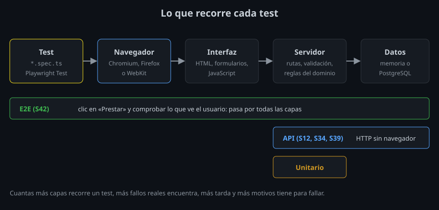

# 01 - E2E y Playwright

> Lenguaje: **TypeScript** (Playwright Test, con pnpm)

Un test **end-to-end (E2E)** usa la aplicación como la usa una persona: abre un navegador, entra en una página, hace clic y lee lo que aparece. Es el nivel 3 de la [pirámide de la semana 1](../../week-01-que_es_testing_calidad_de_software/1-teoria/02-piramide-y-niveles.md#nivel-3--tests-de-sistema--end-to-end-e2e). Hasta ahora has probado funciones, servicios y APIs. Esta semana pruebas lo que ve el usuario, con **Playwright**.



---

## 🎯 Objetivos

- Distinguir qué encuentra un test E2E que no encuentran los de API o los unitarios, y cuánto cuesta.
- Decidir qué flujos merecen un test E2E.
- Instalar Playwright con pnpm, configurarlo para que arranque la aplicación y escribir el primer test.

---

## 1. Qué recorre un test E2E

| Nivel | Qué ejecuta | Ejemplo del curso | Tiempo por test (medido) |
|---|---|---|---|
| Unitario | Una función | `late_fee` en Rust ([S37](../../week-37-fundamentos_de_testing_en_rust/README.md)) | Milisegundos |
| API | El servidor por HTTP, sin navegador | Supertest ([S12](../../week-12-apis_rest_con_supertest/README.md)), `httptest` ([S34](../../week-34-http_bd_e_integracion_en_go/README.md)), axum con `oneshot` ([S39](../../week-39-async_apis_y_bd_en_rust/README.md)) | De milisegundos a 0.9 s con base de datos |
| E2E | Navegador, interfaz, servidor y datos | Esta semana | De 0.1 s a 1.8 s en los labs; 30 s si algo no aparece |

Un test de API comprueba que `POST /items/{isbn}/actions/0` responde bien. No sabe si el botón «Prestar» existe, si está habilitado, si el JavaScript de la página llama a esa ruta o si el estado que ve el usuario cambia. Eso solo lo comprueba un test E2E.

A cambio, cada test E2E:

- **Tarda más.** Arranca un navegador, carga páginas y espera respuestas.
- **Tiene más motivos para fallar.** Cambia el texto de un botón y falla, aunque la aplicación funcione.
- **Comparte datos con los demás.** El navegador de cada test está aislado, pero el servidor es el mismo para todos ([teoría 03](03-page-object-model-y-fixtures.md#3-los-datos-de-cada-test)).

### Qué probar de extremo a extremo

| Sí | No |
|---|---|
| Los flujos principales: dar de alta, buscar, prestar, devolver | Cada combinación de datos inválidos: eso es de los tests unitarios |
| Que la interfaz muestra los errores del servidor | El cálculo de un recargo: un test unitario lo prueba en milisegundos |
| Que una acción no permitida aparece deshabilitada | Lo que ya prueba un test de API, si la interfaz no añade nada |

Si la suite E2E crece más que la unitaria, tienes el [cono de helado](../../week-01-que_es_testing_calidad_de_software/1-teoria/02-piramide-y-niveles.md#el-anti-patrón-el-cono-de-helado) de la semana 1: lenta y frágil.

---

## 2. Playwright

**Playwright** es una biblioteca de Microsoft para controlar navegadores, con su propio ejecutor de tests: **Playwright Test** (`@playwright/test`). Hace lo mismo que Jest ([S07](../../week-07-jest_avanzado_y_organizacion_de_suites/README.md)) para tus tests unitarios: descubre los archivos, ejecuta los tests en paralelo y da un informe. Añade lo que hace falta para la web:

| Pieza | Qué hace |
|---|---|
| Navegadores | Chromium (Chrome, Edge), Firefox y WebKit (el motor de Safari), descargados por Playwright |
| `page` | Un fixture con una pestaña nueva para cada test, en un **contexto** propio: sin cookies ni almacenamiento de otros tests |
| Locators | La forma de encontrar elementos: por rol, por etiqueta, por texto ([teoría 02](02-locators-acciones-y-aserciones.md)) |
| Auto-wait | Cada acción y cada aserción espera a que la página esté lista |
| Evidencias | Capturas, videos y trazas de los tests que fallan ([teoría 04](04-evidencias-reportes-y-navegadores.md)) |

Los tests se escriben en TypeScript (`.spec.ts`). Playwright los transpila al ejecutarlos: no hace falta `tsc` ni `tsconfig.json`. TypeScript solo aporta los tipos; si sabes JavaScript, sabes leerlos.

---

## 3. Instalar

`package.json` con la versión exacta:

```json
{
  "name": "lab01",
  "version": "1.0.0",
  "private": true,
  "packageManager": "pnpm@12.6.0",
  "engines": { "node": ">=22.0.0" },
  "scripts": {
    "start": "node app/server.mjs",
    "test": "playwright test"
  },
  "devDependencies": {
    "@playwright/test": "1.63.0"
  }
}
```

En un proyecto nuevo, `pnpm add -D @playwright/test@1.63.0` escribe esa línea. A diferencia de Jest, Playwright no trae dependencias con build scripts: no hace falta `pnpm-workspace.yaml`.

```bash
pnpm install
pnpm exec playwright install --with-deps chromium
```

| Comando | Qué / Para qué |
|---|---|
| `pnpm install` | Instala `@playwright/test`. No descarga navegadores |
| `pnpm exec playwright install chromium` | Descarga el Chromium que corresponde a esta versión de Playwright en `~/.cache/ms-playwright/`. Una vez por equipo y versión |
| `--with-deps` | En Linux, instala también las bibliotecas del sistema que necesita el navegador, con `sudo apt-get`. En Windows y macOS no hace falta |

`pnpm exec` ejecuta el binario `playwright` de `node_modules/.bin`. Es lo que harías con `npx`, que en este curso no se usa.

---

## 4. La configuración

```ts
// playwright.config.ts
import { defineConfig, devices } from '@playwright/test';

export default defineConfig({
  testDir: './tests',
  use: {
    baseURL: 'http://localhost:3000',
  },
  webServer: {
    command: 'node app/server.mjs',
    url: 'http://localhost:3000',
    reuseExistingServer: !process.env.CI,
  },
  projects: [{ name: 'chromium', use: { ...devices['Desktop Chrome'] } }],
});
```

| Opción | Qué / Para qué / Impacto |
|---|---|
| `testDir` | Dónde están los tests. Playwright ejecuta los `*.spec.ts` y `*.test.ts` de esa carpeta |
| `use.baseURL` | `page.goto('/')` va a `http://localhost:3000/`. Los tests no repiten la dirección y puedes apuntarlos a otro entorno cambiando una línea |
| `webServer.command` | Playwright arranca la aplicación antes de los tests y la para al terminar |
| `webServer.url` | Espera a que esa dirección responda antes de empezar (hasta 60 s) |
| `webServer.reuseExistingServer` | Con `true`, si la aplicación ya está arrancada la usa. Con `!process.env.CI` es `true` en tu equipo y `false` en integración continua, donde un puerto ocupado debe ser un error |
| `projects` | Con qué navegadores se ejecuta cada test. `devices['Desktop Chrome']` fija el tamaño de ventana y el *user agent* |

Si el puerto ya está ocupado y `CI` está definida:

```text
Error: http://localhost:3000 is already used, make sure that nothing is running on the port/url or set reuseExistingServer:true in config.webServer.
```

---

## 5. El primer test

```ts
// tests/catalog.spec.ts
import { test, expect } from '@playwright/test';

test('the catalog lists the seeded books', async ({ page }) => {
  await page.goto('/');

  await expect(page).toHaveTitle('Libros - Biblioteca municipal');
  await expect(page.getByRole('heading', { name: 'Libros' })).toBeVisible();
});
```

| Pieza | Qué es |
|---|---|
| `test` y `expect` | Se importan de `@playwright/test`, no son globales como en Jest |
| `async ({ page }) => ...` | El test pide el fixture `page`: una pestaña nueva, solo para él |
| `await page.goto('/')` | Navega y espera a que la página cargue |
| `await expect(...).toHaveTitle(...)` | Una aserción que **reintenta** hasta 5 s ([teoría 02](02-locators-acciones-y-aserciones.md#3-aserciones-que-reintentan)). Lleva `await` |

```bash
pnpm exec playwright test
# Running 1 test using 1 worker
#
#   ✓  1 [chromium] › tests/catalog.spec.ts:4:5 › the catalog lists the seeded books (132ms)
#
#   1 passed (874ms)
```

El navegador se ejecuta sin ventana (*headless*). Opciones del día a día:

| Comando | Para qué |
|---|---|
| `pnpm exec playwright test tests/catalog.spec.ts` | Solo los tests de ese archivo. Vale también una parte del nombre: `catalog` |
| `pnpm exec playwright test -g "detail"` | Solo los tests cuyo título contiene ese texto |
| `pnpm exec playwright test --list` | Lista los tests sin ejecutarlos |
| `pnpm exec playwright test --last-failed` | Solo los que fallaron en la última ejecución |
| `pnpm exec playwright test --headed` | Con ventana. En WSL necesita WSLg (Windows 11) |
| `pnpm exec playwright test --ui` | Modo UI: lista de tests, ejecución paso a paso y la página en cada momento |
| `pnpm exec playwright codegen localhost:3000` | Abre un navegador y escribe el código de lo que haces con el ratón. Sirve para descubrir locators |

---

## ✅ Resumen

- Un test E2E recorre todas las capas: encuentra fallos que los demás no ven, a cambio de tiempo y fragilidad. Se reserva para los flujos principales.
- `@playwright/test` con versión exacta; los navegadores se descargan aparte con `pnpm exec playwright install`.
- `webServer` arranca la aplicación y `baseURL` evita repetir la dirección. `reuseExistingServer: !process.env.CI` reutiliza el servidor solo en tu equipo.
- `test` recibe `page`, una pestaña aislada; cada `expect` sobre la página lleva `await`.

<!-- nav -->
---

## 🔗 Navegación

| Anterior | Siguiente |
|---|---|
| ← [Semana 42 - Testing End-to-End con Playwright](../README.md) | [Teoría — 02 - Locators, acciones y aserciones](02-locators-acciones-y-aserciones.md) → |

[↑ Semana 42](../README.md)
