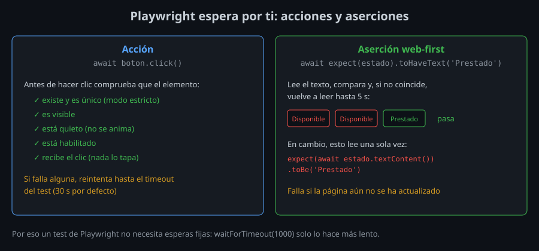

# 02 - Locators, acciones y aserciones

> Lenguaje: **TypeScript** (Playwright Test)

Un test E2E repite tres cosas: **encontrar** un elemento (locator), **hacer** algo con él (acción) y **comprobar** lo que se ve (aserción). Playwright espera por ti en las dos últimas, y esa espera es lo que hace que un test E2E sea estable sin pausas fijas.



---

## 🎯 Objetivos

- Elegir el locator adecuado: por rol, por etiqueta, por texto o por `data-testid`.
- Entender el modo estricto y cómo encadenar locators para quedarte con un solo elemento.
- Usar `click`, `fill`, `selectOption`, `check` y `hover`, y saber qué comprueban antes de actuar.
- Escribir aserciones que reintentan y reconocer las que no.

---

## 1. Locators

Un **locator** describe cómo encontrar un elemento. No lo busca al crearlo: lo busca cada vez que lo usas, así que sirve aunque la página cambie.

| Locator | Encuentra | Ejemplo |
|---|---|---|
| `getByRole(rol, { name })` | Un elemento por su rol de accesibilidad y su nombre visible | `page.getByRole('button', { name: 'Prestar' })` |
| `getByLabel(texto)` | Un campo de formulario por su `<label>` | `page.getByLabel('ISBN')` |
| `getByText(texto)` | Un elemento por el texto que contiene | `page.getByText('Libro prestado')` |
| `getByTestId(id)` | Un elemento con `data-testid="id"` | `page.getByTestId('status')` |
| `locator(css)` | Cualquier selector CSS | `page.locator('td.status')` |

**Prefiere este orden.** `getByRole` y `getByLabel` buscan como busca una persona (o un lector de pantalla): «el botón que dice Prestar». Si cambian las clases CSS o la estructura del HTML, el test sigue pasando. `getByTestId` es para lo que no tiene un rol ni un texto estable. `locator(css)` ata el test a cómo está hecho el HTML: úsalo como último recurso.

Roles frecuentes: `button`, `link`, `heading` (con `level: 1` para un `<h1>`), `textbox`, `searchbox`, `checkbox`, `combobox` (un `<select>`), `row`, `cell`, `alert`, `status`, `tooltip`, `listitem`. Un elemento oculto (`display: none`) no tiene rol: `getByRole` no lo encuentra.

### Coincidencia de texto

Con un texto, `name` de `getByRole`, `getByLabel` y `getByText` buscan **contenido parcial y sin distinguir mayúsculas**. Con `{ exact: true }`, el texto completo; con una expresión regular, lo que coincida con ella:

```ts
page.getByText('Disponible');                   // también «Solo disponibles»
page.getByText('Disponible', { exact: true });  // solo «Disponible»
page.getByRole('row', { name: /Veinte poemas/ });
```

### Modo estricto

Una acción sobre un locator que encuentra varios elementos **falla**. Playwright no elige uno por ti:

```text
Error: locator.hover: Error: strict mode violation: getByText('Disponible') resolved to 4 elements:
    1) <label>…</label> aka getByText('Solo disponibles')
    2) <span>Disponible</span> aka getByText('Disponible').nth(1)
    3) <span>Disponible</span> aka getByText('Disponible').nth(2)
    4) <span>Disponible</span> aka getByText('Disponible').nth(3)
```

El mensaje propone `.nth(1)`, pero «el segundo» deja de ser el mismo libro en cuanto cambia el orden. Mejor, **encadena**: primero la fila del libro y, dentro de ella, el texto:

```ts
page.getByRole('row', { name: /Veinte poemas/ }).getByText('Prestado');
```

Las aserciones sobre varios elementos sí admiten listas: `toHaveCount(n)` o `toHaveText([...])`.

---

## 2. Acciones

| Acción | Qué hace |
|---|---|
| `click()` | Hace clic. Si el clic provoca una navegación (un enlace, un formulario), espera a que termine |
| `fill(texto)` | Vacía el campo y escribe el texto |
| `selectOption(valor)` | Elige una opción de un `<select>` por su valor o su texto |
| `check()` / `uncheck()` / `setChecked(bool)` | Marca o desmarca una casilla |
| `hover()` | Pone el ratón encima; activa los estilos `:hover` |
| `press('Enter')` | Pulsa una tecla |

Antes de actuar, cada acción comprueba que el elemento es único, visible, está quieto, está habilitado y nada lo tapa. Si no, **espera y reintenta** hasta el timeout del test, 30 s por defecto. Cuando el botón está deshabilitado, el log del fallo lo dice:

```text
Test timeout of 30000ms exceeded.

Error: locator.click: Test timeout of 30000ms exceeded.
Call log:
  - waiting for getByRole('button', { name: 'Prestar' })
    - locator resolved to <button disabled>Prestar</button>
  - attempting click action
    2 × waiting for element to be visible, enabled and stable
      - element is not enabled
    ...
    58 × waiting for element to be visible, enabled and stable
       - element is not enabled
```

Treinta segundos esperando a un botón que nunca se habilita: un test que tarda 30 s en fallar casi siempre es un locator que no encuentra nada o un elemento en un estado inesperado.

---

## 3. Aserciones que reintentan

Las aserciones de Playwright sobre la página son **web-first**: leen, comparan y, si no coincide, vuelven a leer hasta 5 s.

| Aserción | Comprueba |
|---|---|
| `toBeVisible()` / `toBeHidden()` | Que el elemento se ve o no |
| `toHaveText(texto)` | El texto completo; con una lista, el de cada elemento en orden |
| `toContainText(texto)` | Que el texto contiene ese fragmento |
| `toHaveCount(n)` | Cuántos elementos encuentra el locator. `0` comprueba que no hay ninguno |
| `toHaveValue(valor)` | El valor de un campo |
| `toBeChecked()` / `toBeDisabled()` / `toBeEnabled()` | El estado de una casilla o un botón |
| `toHaveURL(url)` / `toHaveTitle(texto)` | La dirección y el título de la página. La URL puede ser relativa a `baseURL` |
| `toBeOK()` | Que una respuesta de `request` tiene un código 2xx |

Cuando falla, el mensaje dice cuántas veces leyó:

```text
Error: expect(page).toHaveTitle(expected) failed

Expected: "Biblioteca municipal"
Received: "Libros - Biblioteca municipal"
Timeout:  5000ms

Call log:
  - Expect "toHaveTitle" with timeout 5000ms
    14 × locator resolved to <html lang="es">…</html>
       - unexpected value "Libros - Biblioteca municipal"
```

### Las aserciones que no esperan

`expect` con un valor ya leído es el `expect` de siempre, como en Jest: compara una vez.

```ts
await page.getByRole('button', { name: 'Prestar' }).click();

// ❌ Lee el estado justo después del clic
expect(await page.getByTestId('status').textContent()).toBe('Prestado');

// ✅ Lee hasta que coincide
await expect(page.getByTestId('status')).toHaveText('Prestado');
```

En el lab 02, el botón «Prestar» envía la petición con `fetch` y el servidor tarda 400 ms. La primera forma falla en 158 ms:

```text
Error: expect(received).toBe(expected) // Object.is equality

Expected: "Prestado"
Received: "Disponible"
```

La regla: **el `await` va delante de `expect`, no dentro.** `isVisible()`, `textContent()` o `inputValue()` devuelven el valor de ese instante; úsalos solo para decidir algo, nunca para comprobarlo.

Por la misma razón, `page.waitForTimeout(1000)` no hace falta: una pausa fija es demasiado corta en una máquina lenta y demasiado larga en una rápida. En [Jest](../../week-09-testing_asincrono_con_jest/README.md) esperabas tú las promesas; aquí espera Playwright, mientras pongas `await`.

---

## ✅ Resumen

- Locators por rol y por etiqueta primero; `getByTestId` para lo que no tiene texto estable; CSS como último recurso.
- El modo estricto hace fallar una acción que encuentra varios elementos. Se arregla encadenando locators, no con `.nth()`.
- Cada acción espera a que el elemento sea accionable, hasta el timeout del test (30 s).
- `await expect(locator).toHaveText(...)` reintenta 5 s; `expect(await locator.textContent())` no.

<!-- nav -->
---

## 🔗 Navegación

| Anterior | Siguiente |
|---|---|
| ← [Teoría — 01 - E2E y Playwright](01-e2e-y-playwright.md) | [Teoría — 03 - Page Object Model y fixtures](03-page-object-model-y-fixtures.md) → |

[↑ Semana 42](../README.md)
