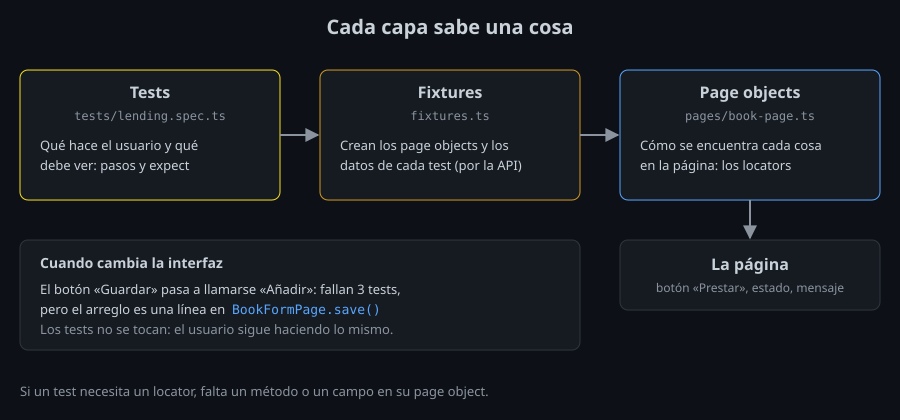

# 03 - Page Object Model y fixtures

> Lenguaje: **TypeScript** (Playwright Test)

Con diez tests, el locator del botón «Guardar» aparece en diez sitios. Cuando el botón cambia de nombre, fallan los diez y hay que arreglar los diez. El **Page Object Model (POM)** reúne en una clase todo lo que un test necesita saber de una página. Los **fixtures** de Playwright crean esas clases y los datos de cada test, para que el test solo cuente lo que hace el usuario.



---

## 🎯 Objetivos

- Escribir un page object con locators como campos y métodos que son acciones del usuario.
- Crear fixtures con `test.extend` que entreguen page objects y datos.
- Preparar los datos de cada test por la API, sin compartirlos con otros tests.

---

## 1. Un page object

```ts
// pages/book-page.ts
import type { Locator, Page } from '@playwright/test';

export class BookPage {
  readonly page: Page;
  readonly status: Locator;
  readonly lendButton: Locator;

  constructor(page: Page) {
    this.page = page;
    this.status = page.getByTestId('status');
    this.lendButton = page.getByRole('button', { name: 'Prestar' });
  }

  async goto(isbn: string) {
    await this.page.goto(`/items/${isbn}`);
  }

  async lend() {
    await this.lendButton.click();
  }
}
```

| Decisión | Qué / Para qué |
|---|---|
| Una clase por página (o por parte grande de una página) | `CatalogPage`, `BookFormPage`, `BookPage`. Cada locator vive en un solo sitio |
| Locators como campos `readonly` | El test los usa en sus aserciones: `expect(bookPage.status).toHaveText(...)`. Como el locator busca al usarse, crearlo en el constructor no busca nada todavía |
| Métodos con nombre de acción del usuario | `lend()`, `search(text)`, `fill(book)`; no `clickButton2()`. El test se lee como el flujo |
| Las aserciones, en el test | El page object dice **cómo** encontrar las cosas; el test decide **qué** debe pasar. Un mismo método sirve para el caso que funciona y para el que falla |
| `import type` | `Locator` y `Page` son solo tipos: no se importan en tiempo de ejecución |

El test queda así:

```ts
test('a book can be lent and returned', async ({ page }) => {
  const bookPage = new BookPage(page);
  await bookPage.goto('9788420412146');

  await bookPage.lend();

  await expect(bookPage.status).toHaveText('Prestado');
});
```

Si el botón «Guardar» pasa a llamarse «Añadir», fallan los tres tests que guardan un libro, todos en la misma línea del page object:

```text
Error: locator.click: Test timeout of 30000ms exceeded.
Call log:
  - waiting for getByRole('button', { name: 'Guardar' })


   at ../pages/book-form-page.ts:34

  32 |
  33 |   async save() {
> 34 |     await this.page.getByRole('button', { name: 'Guardar' }).click();
```

Se arregla una línea y los tres vuelven a pasar.

---

## 2. Fixtures con `test.extend`

`page` y `request` son fixtures que trae Playwright. `test.extend` crea un `test` nuevo con tus propios fixtures:

```ts
// fixtures.ts
import { test as base, expect } from '@playwright/test';
import { BookPage } from './pages/book-page';

type Fixtures = {
  bookPage: BookPage;
};

export const test = base.extend<Fixtures>({
  bookPage: async ({ page }, use) => {
    await use(new BookPage(page));
  },
});

export { expect };
```

| Pieza | Qué hace |
|---|---|
| `base.extend<Fixtures>({...})` | Devuelve un `test` que, además de `page` y `request`, entiende `bookPage` |
| `async ({ page }, use) => {...}` | Un fixture puede pedir otros fixtures, como un test |
| `await use(valor)` | Entrega el valor al test. Lo que va antes de `use` es la preparación; lo que va después, la limpieza, que se ejecuta aunque el test falle |

Los tests importan `test` y `expect` de `fixtures.ts`, no de `@playwright/test`, y piden lo que necesitan:

```ts
import { test, expect } from '../fixtures';

test('a reference book cannot be lent', async ({ bookPage }) => {
  await bookPage.goto('9788491050957');

  await expect(bookPage.lendButton).toBeDisabled();
});
```

Un fixture solo se crea si algún test lo pide. Es el mismo modelo que los fixtures de pytest con `yield` ([semana 16](../../week-16-fundamentos_con_pytest/1-teoria/02-fixtures-yield-scopes-y-composicion.md)): `use(valor)` hace el papel de `yield valor`, y el test declara lo que necesita en sus parámetros.

---

## 3. Los datos de cada test

Cada test tiene su propio navegador, pero **el servidor es el mismo para todos**: los tests que se ejecutan en paralelo, y las ejecuciones seguidas con `reuseExistingServer`, ven los datos que dejaron los demás. Un test que presta un libro de los datos iniciales pasa la primera vez y falla la segunda:

```text
  ✘  1 [chromium] › tests/seed.spec.ts:3:5 › lending a seeded book (30.0s)

    Error: locator.click: Test timeout of 30000ms exceeded.
    Call log:
      - waiting for getByRole('button', { name: 'Prestar' })
        - locator resolved to <button disabled>Prestar</button>
```

Tres reglas:

1. **Los datos iniciales, solo para leer.** Buscar «Rayuela» o comprobar que el diccionario no se presta está bien; prestar «Rayuela», no.
2. **Lo que un test cambia, lo crea él**, con una clave distinta en cada ejecución (un ISBN aleatorio).
3. **Lo que no es el objeto del test, se crea por la API**, no por la interfaz. Rellenar el formulario solo tiene sentido en el test del formulario; para probar el préstamo basta con que el libro exista.

El fixture `request` hace peticiones HTTP con el `baseURL` de la configuración. Con él, un fixture que crea un libro nuevo para cada test que lo pida:

```ts
newBook: async ({ request }, use) => {
  const book = { isbn: newIsbn(), title: 'Libro de prueba', genre: 'Novela' };
  const response = await request.post('/api/items', { data: book });
  await expect(response).toBeOK();
  await use(book);
},
```

```ts
test('a book can be lent and returned', async ({ bookPage, newBook }) => {
  await bookPage.goto(newBook.isbn);
  await bookPage.lend();
  await expect(bookPage.status).toHaveText('Prestado');
});
```

La API JSON de la aplicación de los labs existe para esto. Con una aplicación real, se usa su API pública o un endpoint de pruebas que solo existe en el entorno de test.

---

## ✅ Resumen

- Un page object reúne los locators y las acciones de una página. Las aserciones se quedan en el test.
- `test.extend` crea fixtures: lo de antes de `use` prepara, lo de después limpia. Los tests importan `test` desde `fixtures.ts`.
- El servidor es compartido: los datos iniciales solo se leen, y lo que un test cambia lo crea él, por la API y con clave única.

<!-- nav -->
---

## 🔗 Navegación

| Anterior | Siguiente |
|---|---|
| ← [Teoría — 02 - Locators, acciones y aserciones](02-locators-acciones-y-aserciones.md) | [Teoría — 04 - Evidencias, reportes y navegadores](04-evidencias-reportes-y-navegadores.md) → |

[↑ Semana 42](../README.md)
