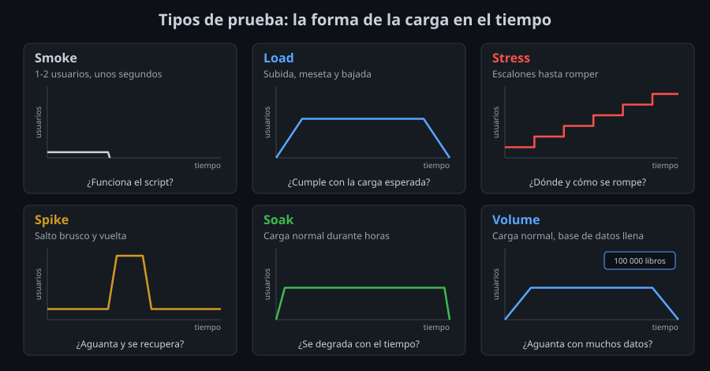
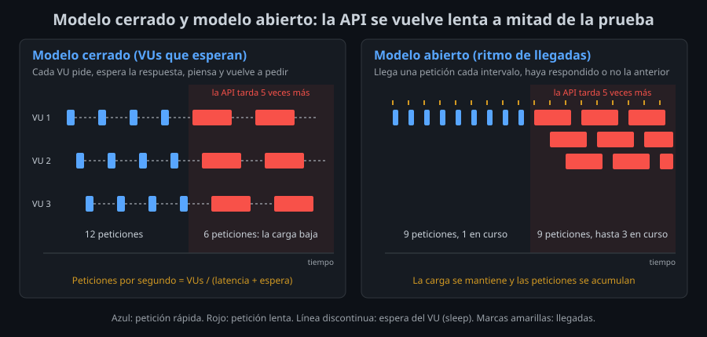

# 01 - Qué es performance testing

> Herramientas: **k6** (scripts en JavaScript) y **Locust** (Python, con uv)

Todas las suites del curso responden a la misma pregunta: ¿el sistema hace lo que debe? Una prueba de rendimiento (*performance testing*) responde a otras tres: ¿lo sigue haciendo cuando lo usan muchas personas a la vez?, ¿con qué rapidez?, ¿hasta cuántas? Para eso no basta con llamar a la API una vez: hay que generar carga, medir cada respuesta y resumir miles de mediciones en unos pocos números.

---

## 🎯 Objetivos

- Distinguir una prueba de carga de un microbenchmark, y saber qué responde cada una.
- Elegir el tipo de prueba (smoke, load, stress, spike, soak, volume) según la pregunta.
- Leer las métricas de una prueba de carga: peticiones por segundo, percentiles de latencia y tasa de errores.
- Usar la ley de Little para comprobar si unos resultados son coherentes y para estimar la capacidad.
- Distinguir el modelo cerrado (usuarios que esperan) del abierto (llegadas a ritmo fijo).

---

## 1. Qué responde una prueba de rendimiento

En las semanas [35](../../week-35-concurrencia_y_calidad_en_go/1-teoria/03-benchmarks-y-benchstat.md) y [40](../../week-40-calidad_avanzada_en_rust/1-teoria/03-benchmarks-con-criterion.md) mediste funciones con `b.Loop()` y criterion. Eso es un **microbenchmark**. Esta semana mides el sistema entero con carga.

| | Microbenchmark | Prueba de carga |
|---|---|---|
| Qué ejecuta | Una función, millones de veces, en un solo proceso | El sistema desplegado: HTTP, servidor, pool de conexiones, base de datos |
| Pregunta | ¿Este código es más rápido que el anterior? | ¿Cuántos usuarios aguanta el sistema, y con qué latencia? |
| Unidad | Nanosegundos por operación | Peticiones por segundo, milisegundos por petición y errores |
| Ejemplo del curso | `isCode` sin expresión regular: −77 % por llamada ([S35](../../week-35-concurrencia_y_calidad_en_go/README.md)) | La búsqueda de la biblioteca: 85 peticiones por segundo como máximo (lab 04) |
| Herramienta | `go test -bench`, criterion | k6, Locust, JMeter |

Una mejora de un microbenchmark puede no notarse con carga. Validar el código de una pieza en 9 ns en lugar de 40 ns no cambia una petición que pasa 36 ms esperando a PostgreSQL. Al revés también ocurre: ningún microbenchmark de la búsqueda de la biblioteca encuentra que la consulta recorre 100 000 filas, porque usaría un almacén falso en memoria. Los dos se complementan. El microbenchmark sirve para optimizar un trozo de código que ya sabes que importa, y la prueba de carga sirve para averiguar qué trozo importa.

---

## 2. Tipos de prueba



| Tipo | Pregunta | Forma de la carga | En la biblioteca |
|---|---|---|---|
| **Smoke** | ¿El script y el sistema funcionan? | 1 o 2 usuarios, unos segundos | Antes de cada prueba larga, para no esperar 10 min y descubrir un error en el script |
| **Load** (carga) | ¿Cumple los objetivos con la carga esperada? | Subida, meseta en la carga esperada, bajada | 30 lectores a la vez durante 30 s: ¿p95 por debajo de 300 ms? (lab 02) |
| **Stress** (estrés) | ¿Dónde se rompe, y cómo? | Escalones que suben hasta pasar el límite | De 50 en 50 usuarios hasta 300: a partir de 150 la latencia se dispara (lab 04) |
| **Spike** (pico) | ¿Aguanta un salto brusco y se recupera? | De poco a mucho en segundos, y vuelta | Abre el plazo de reservas y entran 200 usuarios a la vez |
| **Soak** (resistencia) | ¿Se degrada con el tiempo? | Carga normal durante horas | Fugas de memoria, conexiones que no se devuelven, tablas que crecen |
| **Volume** (volumen) | ¿Aguanta con muchos datos? | Carga normal, con la base de datos llena | La búsqueda con 100 000 libros no tarda lo mismo que con 100 |

Las herramientas son las mismas para todos: lo que cambia es la forma de la carga y lo que se mira. Un *load test* termina con un sí o un no frente a unos criterios. Un *stress test* termina con un número (el punto donde se rompe) y una descripción de cómo se rompe: si devuelve errores claros, si se recupera al bajar la carga o si se queda colgado.

---

## 3. Métricas

| Métrica | Qué mide | En k6 | En Locust |
|---|---|---|---|
| **Throughput** (peticiones por segundo, RPS) | Cuánto trabajo completa el sistema | `http_reqs` (total y por segundo) | `req/s` |
| **Latencia** | Cuánto espera cada petición su respuesta | `http_req_duration` | `Avg`, `Med` y percentiles |
| **Tasa de errores** | Qué parte de las respuestas son errores | `http_req_failed` | `# fails` y `failures/s` |
| **Concurrencia** | Cuántos usuarios hay activos | `vus` | `User Count` |

### Percentiles, no medias

El percentil 95 (**p95**) es el valor por debajo del cual queda el 95 % de las mediciones: si el p95 es 120 ms, 95 de cada 100 peticiones tardaron 120 ms o menos y 5 tardaron más. El **p50** es la mediana: la petición típica. El **p99**, la que le toca a 1 de cada 100 peticiones, que en una página que hace 20 peticiones es casi cada visita.

La media no describe ninguna petición real. En el [lab 01](../2-practicas/lab-01-primer-test-de-carga-con-k6/README.md#paso-5-una-búsqueda-paso-3), la consulta por ISBN tardaba unos 2 ms y la búsqueda unos 110 ms; la media de las dos salió 55 ms, un tiempo que no tardó casi ninguna. Y el máximo es una sola muestra: depende de una pausa del recolector de basura, de una conexión nueva o del reloj del equipo ([teoría 04](04-linea-base-criterios-y-cuellos-de-botella.md#4-el-entorno-también-se-mide)). Los criterios se escriben sobre p95 o p99.

### Latencia y errores van juntos

Un error suele ser rápido: la API rechaza la petición sin llegar a la base de datos. En el lab 01, una URL mal escrita bajó la latencia media de 55 ms a 1.4 ms con la mitad de las peticiones fallando. Una latencia sin su tasa de errores al lado no dice nada.

---

## 4. La ley de Little

En un sistema estable, el número de peticiones en curso es igual al ritmo al que llegan por el tiempo que pasa cada una dentro:

```text
peticiones en curso = peticiones por segundo × latencia (en segundos)
```

Sirve para dos cosas.

**Comprobar resultados.** Con 50 VUs que buscan sin espera durante 10 s, k6 midió 84.9 peticiones por segundo y una latencia media de 0.574 s: 84.9 × 0.574 = 48.7, casi los 50 VUs, porque cada VU siempre tiene una petición en curso. Si la cuenta no sale, algo está mal medido. Por ejemplo, el generador de carga no da abasto (teoría 04).

**Estimar la capacidad.** La API de la biblioteca tiene 4 conexiones a PostgreSQL, y cada búsqueda ocupa una durante unos 45 ms. Como mucho, hay 4 búsquedas en curso a la vez: 4 / 0.045 s = 89 búsquedas por segundo. El stress test del lab 04 se estanca en 85–100. Cuando la estimación y la medición coinciden, has encontrado el recurso que limita.

---

## 5. Modelo cerrado y modelo abierto



| | Modelo cerrado | Modelo abierto |
|---|---|---|
| Qué fijas | Cuántos usuarios hay | Cuántas peticiones llegan por segundo |
| Cómo funciona | Cada usuario hace una petición, espera la respuesta, piensa y hace la siguiente | Llega una petición nueva cada 1/ritmo segundos, haya respondido o no la anterior |
| Si la API se vuelve lenta | Los usuarios también van más despacio: llegan menos peticiones | Las peticiones siguen llegando y se acumulan |
| En k6 | `vus` + `duration`, `stages` (*executor* `ramping-vus`) | *Executors* `constant-arrival-rate` y `ramping-arrival-rate` |
| En Locust | Siempre: usuarios con `wait_time` | No lo tiene: se aproxima con `constant_throughput` |
| Se parece a | Un sistema interno con 30 empleados | Una web pública: los visitantes no esperan a que termine el anterior |

En el modelo cerrado las peticiones por segundo son una consecuencia: VUs / (latencia + espera). Con 10 VUs y `sleep(1)` salen 10 por segundo, pero si la API pasa a tardar 1 s, salen 5. La carga baja justo cuando el sistema sufre, y la prueba lo esconde. Este efecto se llama **omisión coordinada** (*coordinated omission*): el generador deja de enviar las peticiones que habrían encontrado el sistema saturado.

El modelo abierto mantiene el ritmo. Si la API no puede con él, k6 necesita más VUs para seguir enviando peticiones; si llega al máximo (`maxVUs`), cuenta las que no pudo enviar en `dropped_iterations`. Para comparar una línea base antes y después de un cambio, el modelo abierto es más honesto: la carga es la misma en las dos ejecuciones ([lab 04](../2-practicas/lab-04-cuello-de-botella/README.md)).

---

## ✅ Resumen

- Un microbenchmark mide una función; una prueba de carga mide el sistema desplegado. Responden preguntas distintas y se complementan.
- Smoke, load, stress, spike, soak y volume usan las mismas herramientas con distinta forma de carga y distinta pregunta.
- Se mide el throughput, los percentiles de latencia (p95, p99) y la tasa de errores, siempre juntos. Ni la media ni el máximo sirven como criterio.
- Ley de Little: peticiones en curso = peticiones por segundo × latencia. Sirve para comprobar resultados y para estimar la capacidad.
- En el modelo cerrado (VUs que esperan), la carga baja cuando el sistema se vuelve lento. En el modelo abierto (ritmo de llegadas), la carga se mantiene.

<!-- nav -->
---

## 🔗 Navegación

| Anterior | Siguiente |
|---|---|
| ← [Semana 43 - Testing de Performance con k6 y Locust](../README.md) | [Teoría — 02 - k6](02-k6.md) → |

[↑ Semana 43](../README.md)
