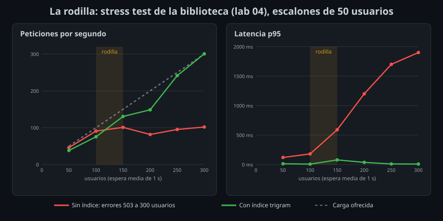

# 04 - Línea base, criterios y cuellos de botella

> Herramientas: **k6**, **Locust**, `psql` y `docker stats`

Una prueba de carga no termina cuando k6 imprime el resumen. Hay que decidir si los números son buenos (contra unos **criterios** escritos antes de medir), si mejoran o empeoran (contra una **línea base**) y, si no llegan, qué los limita (el **cuello de botella**). Esta teoría recorre las tres cosas con la búsqueda de la biblioteca, desde que se estanca en 85 peticiones por segundo hasta que el índice la deja en 4 ms.

---

## 🎯 Objetivos

- Escribir criterios de aceptación medibles antes de ejecutar la prueba.
- Registrar una línea base y comparar contra ella con la misma carga.
- Leer la curva de un stress test y encontrar la rodilla.
- Comprobar que el entorno y el generador no son el límite.
- Encontrar el recurso que limita y comprobar que el arreglo lo resuelve.

---

## 1. Criterios de aceptación

Un criterio de aceptación de rendimiento tiene cuatro partes: **qué** petición, **qué** métrica, **qué** límite y **con qué** carga.

| Mal escrito | Bien escrito |
|---|---|
| «La búsqueda tiene que ser rápida» | «Con 40 búsquedas por segundo, p95 de `GET /api/books?q=` por debajo de 100 ms» |
| «Sin errores» | «Menos del 1 % de respuestas 5xx o sin respuesta durante la prueba de carga» |
| «Aguanta mucha gente» | «Con 30 lectores (1–2 s entre acciones), todas las peticiones con p95 por debajo de 300 ms» |

De dónde salen los números:

- **Del producto:** lo que el usuario tolera. Una búsqueda que tarda más de 1 s se percibe como lenta.
- **De producción**, si existe: la carga de la hora punta, y algo más de margen.
- **De la línea base**, si no hay nada más: «no peor que ahora». Es el mínimo.

Se escriben **antes** de medir. Escritos después, se ajustan a lo que salió.

En k6, cada criterio es un umbral ([teoría 02](02-k6.md#5-umbrales-los-criterios-de-aceptación)); en Locust, una condición en `events.quitting` ([teoría 03](03-locust.md#6-criterios-de-aceptación-y-código-de-salida)). Los dos devuelven un código de salida distinto de cero si no se cumple: el pipeline falla.

---

## 2. La línea base

La **línea base** (*baseline*) es una medición de referencia: el sistema de hoy, con una carga fija, guardada para comparar. Sin ella, «p95 de 63 ms» no dice si has mejorado o empeorado.

Para que dos mediciones se puedan comparar:

| Condición | Por qué |
|---|---|
| La misma carga, en modelo abierto | Con VUs, si el sistema se vuelve más lento, la carga baja sola y la comparación engaña ([teoría 01](01-performance-testing.md#5-modelo-cerrado-y-modelo-abierto)). Con `constant-arrival-rate`, las dos reciben las mismas peticiones por segundo |
| El mismo equipo y los mismos datos | Otro equipo, otra base de datos u otro volumen de datos es otro experimento |
| Guardada en un archivo | `--summary-export results/before.json`. En el repositorio, junto al informe |
| Varias ejecuciones si la diferencia es pequeña | Una diferencia del 5 % entre dos ejecuciones sueltas puede ser ruido. Una del 1200 % no |

En el [lab 04](../2-practicas/lab-04-cuello-de-botella/README.md), la línea base de la búsqueda (40 por segundo durante 30 s) y la misma prueba después del índice:

```bash
jq -c '.metrics.http_req_duration | {med, "p(95)"}' results/before.json results/after.json
# {"med":47.8341245,"p(95)":63.56950285}
# {"med":3.742102,"p(95)":5.226119}
```

---

## 3. Leer la curva: la rodilla

Un stress test sube la carga por escalones hasta pasar el límite. Cada escalón da un punto: peticiones por segundo y latencia.



| Zona | Peticiones por segundo | Latencia | Qué pasa dentro |
|---|---|---|---|
| Antes de la rodilla | Suben con los usuarios | Estable | Hay recursos libres: cada petición se atiende al llegar |
| La **rodilla** | Dejan de subir | Empieza a crecer | Un recurso se ha llenado: las peticiones nuevas hacen cola |
| Después | Planas: es la **capacidad** | Crece con cada usuario | Cuanto más larga la cola, más espera cada uno (ley de Little) |
| Rotura | Planas o bajan | Llega al límite de espera | Aparecen los errores: en la biblioteca, 503 cuando una consulta pasa de 2 s |

En la biblioteca, sin índice, la rodilla está entre 100 y 150 usuarios. Las peticiones por segundo se quedan en 82–102 mientras la carga ofrecida llega a 300, y el p95 pasa de 180 ms a 1.9 s. Con el índice, las peticiones por segundo siguen a la carga ofrecida hasta el final y el p95 no pasa de 78 ms: la rodilla ya no está en este rango.

La capacidad no es el punto de rotura. Mucho antes de los errores, la latencia ya incumple los criterios. Lo que se informa es la **carga máxima que cumple los criterios**: sin índice, unos 100 usuarios con p95 por debajo de 300 ms.

---

## 4. El entorno también se mide

Una prueba de carga mide la API, el equipo, la red y el propio generador. Antes de creer un número:

| Comprobación | Cómo | Ejemplo de esta semana |
|---|---|---|
| ¿El generador da abasto? | Su CPU (`top`), y si su latencia cambia con otro generador | Locust con `HttpUser` sumaba 18 ms de mediana a cada petición frente a k6 ([teoría 03](03-locust.md#7-k6-locust-o-jmeter)) |
| ¿Compiten por la CPU? | Generador, API y base de datos en el mismo equipo se roban CPU entre sí | Normal en tu portátil; en un informe se dice |
| ¿Los datos son realistas? | El mismo volumen que producción | Con 100 libros, la búsqueda sin índice no tiene problema |
| ¿Hay calentamiento? | Las primeras peticiones abren conexiones y llenan cachés | Los primeros segundos de cada escalón no se cuentan (`resumen.py` los salta) |
| ¿El reloj es fiable? | Compara el máximo de `http_req_duration` con `iteration_duration` | Ver debajo |

En WSL2, el reloj de Linux se resincroniza con el de Windows y salta unos 3 s de vez en cuando:

```bash
python3 -c "
import time
base = time.time() - time.monotonic(); end = time.monotonic() + 40
while time.monotonic() < end:
    d = time.time() - time.monotonic() - base
    if abs(d) > 0.2: print('salto de', round(d, 2), 's'); base += d
    time.sleep(0.05)"
# salto de 3.02 s
```

k6 toma algunas marcas de tiempo de ese reloj. En el lab 04, la línea base dio `http_req_duration max=2.91s` con `iteration_duration max=94.98ms`: una petición no puede tardar más que la iteración que la contiene. Ese máximo es el salto del reloj, no la API. Los percentiles no se ven afectados (es una muestra entre 1200), y es otra razón para no poner criterios sobre el máximo.

---

## 5. Encontrar el cuello de botella

El **cuello de botella** es el recurso que se llena primero. Para encontrarlo, mira cada recurso mientras la prueba está en la rodilla:

| Síntoma | Recurso | Cómo comprobarlo |
|---|---|---|
| CPU de la base de datos alta, consultas lentas con un solo usuario | Una consulta cara | `EXPLAIN ANALYZE`: `Seq Scan` sobre una tabla grande |
| Exactamente N consultas activas, siempre N | El pool de conexiones | `pg_stat_activity` cuenta las consultas activas |
| Una petición barata se vuelve lenta junto a otra cara | Un recurso compartido entre las dos | Un umbral por petición ([lab 02](../2-practicas/lab-02-umbrales-etapas-y-etiquetas/README.md)): la consulta por ISBN pasa de 7 ms a 109 ms de p95 esperando conexión |
| CPU de la API al 100 % | Código de la aplicación | El perfil de CPU; ahí sí sirve un microbenchmark ([teoría 01](01-performance-testing.md#1-qué-responde-una-prueba-de-rendimiento)) |
| CPU del generador al 100 %, latencias que cambian con otro generador | El generador | `top`; más procesos (`--processes`) o k6 |
| Bloqueos (`wait_event_type = Lock`) | Filas o tablas que se bloquean entre transacciones | `pg_stat_activity` |

En la biblioteca, durante el stress test sin índice ([lab 04](../2-practicas/lab-04-cuello-de-botella/README.md#paso-3-el-diagnóstico)):

| Medición | Resultado |
|---|---|
| `pg_stat_activity` | 4 consultas activas: el pool entero |
| `docker stats` | PostgreSQL al 424 % de CPU: algo más de 4 núcleos |
| `EXPLAIN ANALYZE` de la búsqueda | `Seq Scan on books`, 99 465 filas descartadas, 50 ms |

Las tres cosas encajan: 4 conexiones ocupadas unos 45 ms cada una dan 4 / 0.045 = 89 búsquedas por segundo, la capacidad que se midió. Dos arreglos posibles, medidos:

| Arreglo | Peticiones por segundo (300 usuarios) | p95 (300 usuarios) | CPU de PostgreSQL | Qué pasó |
|---|---|---|---|---|
| Ninguno (pool de 4) | 102 | 1900 ms y errores 503 | 424 % | — |
| Pool de 16 conexiones | 108 | 1200 ms, sin errores | 669 % | El límite pasa a la CPU de PostgreSQL. Más conexiones ejecutando la misma consulta cara |
| Índice trigram (pool de 4) | 301 | 8 ms | — | La consulta pasa de 50 ms a 4 ms: cada conexión atiende 12 veces más búsquedas |

Agrandar el pool movió el cuello de botella. El índice quitó la causa. Un arreglo se da por bueno cuando la misma prueba lo demuestra: la línea base repetida (de 63.6 ms a 5.2 ms de p95) y el stress test sin rodilla.

---

## ✅ Resumen

- Un criterio de aceptación dice qué petición, qué métrica, qué límite y con qué carga, y se escribe antes de medir.
- La línea base se mide con carga fija (modelo abierto), en el mismo entorno, y se guarda en un archivo para comparar.
- La rodilla es donde las peticiones por segundo dejan de subir y la latencia empieza a crecer. La capacidad que se informa es la carga máxima que cumple los criterios.
- El entorno también se mide: el generador, la CPU compartida, los datos y hasta el reloj.
- El cuello de botella se confirma con datos (`EXPLAIN ANALYZE`, `pg_stat_activity`, `docker stats`) y la ley de Little. Un arreglo vale si la misma prueba lo demuestra.

<!-- nav -->
---

## 🔗 Navegación

| Anterior | Siguiente |
|---|---|
| ← [Teoría — 03 - Locust](03-locust.md) | [Índice de labs](../2-practicas/README.md) → |

[↑ Semana 43](../README.md)
